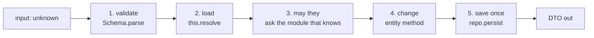
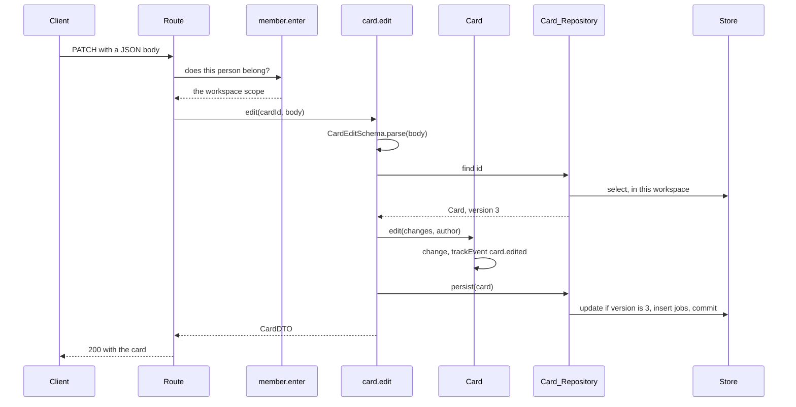
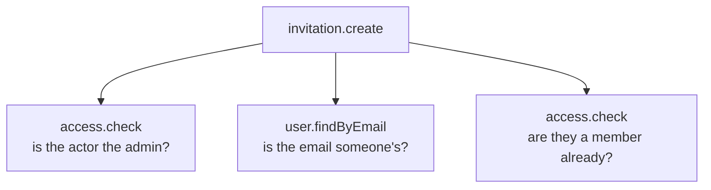

# Use cases

<p class="chapter-lead">A backend's behaviour is the sum of the things you can ask it to do. When those things have no fixed shape, each one checks input, permissions and rules its own way, and some forget. This chapter shows newt's use case: one method, five steps, the same every time. After it you can read every use case of cooper and write your own.</p>

## The problem

Think of three ways to revoke an invitation in a typical backend. The route handler checks
the body, loads the row, checks that the caller is the workspace's admin, sets the status and
saves. The admin script loads the row and sets the status, skipping the admin check because
"it is an admin script". The new MCP tool copies the route, but returns a 403 when the caller
is not a member, telling a stranger that the workspace exists.

Three entry points, three slightly different behaviours. One leaks, one skips a rule, and
none of them is wrong on its own terms. What is missing is one place that *is* "revoke an
invitation", which every entry point calls.

## The idea

::: info Concept: Use case
One thing you can ask a module to do, written as a method of the module marked
`@UseCase()`. It takes what a client sent as `unknown`, validates it, loads what it needs,
checks the person acting may do it, lets the entity change itself, saves once, and
returns plain data. Routes, workers, scripts, tests and MCP tools all call the same use
case.
:::

Every use case is named after its module and its method: `revoke` of the module
`invitation` is `invitation.revoke`. That name is how it appears in traces, metrics, the
monitor and the application's description.

Most use cases that change something follow the same five steps:



Here they are in one of cooper's simplest, `card.edit`:

```ts
// cooper/backend/contexts/boards/modules/card/card.module.ts
@UseCase()
async edit(id: string, input: unknown): Promise<CardDTO> {
  const changes = CardEditSchema.parse(input)   // 1. validate (400)
  const card = await this.load(id)              // 2. load (404)
  card.edit(changes, actingAuthor())            // 4. the entity changes itself
  await this.repo.persist(card)                 // 5. one save
  return card.toDTO()                           //    DTO out
}

private load(id: string): Promise<Card> {
  return this.resolve(() => this.repo.find({ id }), () => new CardNotFound(id))
}
```

Where is step 3? In boards it happens before the use case runs, as you will see below. Let's
go through each step.

## Step 1: validate what came in

What a client sends comes in as `unknown`, and the use case parses it with the module's input
schema:

```ts
const changes = CardEditSchema.parse(input)
```

The route passes the body as it came, `await request.json()`, without a cast. The lint
(`newt/route-body`) refuses `await request.json() as CardEditDTO` in a routes file: a cast
would tell the compiler the body was checked when it was not.

When the parse fails, zod throws a `ZodError`, and newt's HTTP layer answers a 400 with
`code: 'validation'` and zod's issues, so a form can show each field's problem. You write no
code for it.

Arguments a route reads from the path, like `id`, are strings and do not need a schema: an id
that matches nothing is found nowhere, a 404 in the next step.

::: warning Watch out
Use cases called only by other modules or workers (never by a client) may take typed input,
as `card.createFirst(boardId, input: CardCreateDTO)` does. Anything a client can reach takes
`unknown`. When in doubt, take `unknown`: the parse is cheap.
:::

## Step 2: load with `resolve`

`resolve` is a protected helper of `Module`. It runs a finder, returns the first result, or
throws the error you give it:

```ts
protected async resolve<T>(find: () => Promise<T[]>, onMissing: () => DomainError): Promise<T>
```

You give the error because you decide the status. When the id is the resource itself
(`PATCH /cards/:cardId`), a missing card is a 404, `CardNotFound`. When the id is a reference
inside a body, it is a mistake of the request, a 400. cooper puts the call in a private
`load(id)`, used by every use case of the module.

### References: `resolveRefs`

When the input names other modules' things by id, `resolveRefs` checks they exist in one call:

```ts
// cooper/backend/contexts/auth/modules/access/access.module.ts
@UseCase()
async grant(input: AccessGrantDTO): Promise<AccessDTO> {
  const { userId, productId, tenantId } = AccessGrantSchema.parse(input)
  await this.resolveRefs({ productId }, { productId: this.deps.product })
  await this.assertManages(productId, tenantId)
  return this.give({ userId, productId, tenantId, role: 'member' })
}
```

It takes a map of ids and a map of finders, any module with a
`find(criteria: { id: string[] })` use case (a `RefFinder`), and gives back `{ id, name }`
references. An id that points nowhere throws `ReferenceNotFound`, a 400 with
`code: 'reference_not_found'`. `null` stays `null` ("no product"), and a key left out stays
out, so a partial update that never mentioned a reference leaves it as it was.

## Step 3: may they?

::: info Concept: Actor
Who is doing the work in progress: the person signed in, read with `currentActor()` from
`newt/core`. It is set once where the work comes in (a route's session, an MCP tool's token,
a script's `runAsActor`) and travels down to every use case called, without being passed by
hand.
:::

A use case never takes "who is asking" as an argument. It reads it:

```ts
const { userId } = currentActor()
```

The router sets it for every request with a session; outside one, `currentActor()` throws
`NoActor`, a 401 with `code: 'not_signed_in'`. An application may add to what an actor
carries by augmenting newt's `Actor` interface. cooper adds how the person came in:

```ts
// cooper/backend/shared/actor.ts
declare module 'newt/core' {
  interface Actor {
    via: ActorVia   // 'web' | 'mcp'
  }
}
```

Whether they may do it is a different question, and the answer is never stored in the actor.
The use case **asks the module that knows, every time**. In auth, the invitation module asks
the access module whether the person is the workspace's admin:

```ts
// cooper/backend/contexts/auth/modules/invitation/invitation.module.ts
/** Its workspace's admin takes it back: its link opens nothing from then on. */
@UseCase()
async revoke(invitationId: string): Promise<void> {
  const invitation = await this.resolve(() => this.repo.find({ id: invitationId }), () => new InvitationNotFound())
  await this.assertAdmin(invitation.tenantId)
  if (invitation.status !== 'pending') throw new InvitationNotOpen()
  invitation.revoke()
  await this.repo.persist(invitation)
}

/** The signed-in person is the workspace's admin. Who is not even a member is told it does not exist. */
private async assertAdmin(tenantId: string): Promise<void> {
  const access = await this.deps.access.check(currentActor().userId, this.options.productId, tenantId)
  if (!access) throw new TenantNotFound(tenantId)
  if (access.role !== 'admin') throw new NotTenantAdmin()
}
```

Look at the two errors. A **member** who is not the admin gets `NotTenantAdmin`, a 403: they
know the workspace exists, and may not do this. A **stranger** gets `TenantNotFound`, a 404,
exactly as if the workspace did not exist. A 403 to a stranger would confirm that the id is
real.

::: danger Never
Never answer a stranger with a 403. Someone who may not even see a thing is told it does not
exist (404); a 403 is for someone who can see it and may not do this to it. And never take
the user's id as an argument from a client, nor keep a permission in the actor: ask the
module that knows, so an access taken away counts at once.
:::

### Asked once for a whole group of routes

In boards, every use case works inside one workspace, and the question "does this person
belong to it?" is the same for all of them. So it is asked once, by the routes, before any use
case runs:

```ts
// cooper/backend/contexts/boards/workspace-routes.ts
export function workspaceRoutes(base: BoardsBase, members: Member_Module) {
  return base.http.group('/workspaces/:workspaceId', async (request, next) =>
    workspaceScope.run(await members.enter(request.params.workspaceId), next))
}
```

`member.enter` asks auth and throws `WorkspaceNotFound`, a 404, to anyone who does not
belong. Then the request runs inside the workspace's **scope**, and every repository of boards
sees only that workspace's rows. A card of another workspace is simply not found by
`card.edit`'s `load`: a 404 again. That is why `card.edit` has no step 3 of its own. The check
is still made every time; it is made once per request, in the one place no route can skip.
[Tenants and scopes](./22-tenants) covers scopes.

## Step 4: the entity changes itself

```ts
invitation.revoke()
```

The use case decides *whether*; the entity decides *how*. `revoke` sets the status and notes
`invitation.revoked`. The use case never sets a field. Some checks belong here, between
loading and changing, because they depend on more than the entity: `invitation.revoke` checks
the status is `pending` and throws `InvitationNotOpen`, a 409, otherwise.

## Step 5: one save

```ts
await this.repo.persist(invitation)
```

A use case saves once. That save is one transaction: the entity's row, checked against the
version it was read with, and the jobs of the events it noted, in the outbox. If the use case
changes several entities of its module (a card moved and the cards around it repositioned),
they go in the same call, `this.repo.persist(a, b, c)` or a repository method of its own like
`persistOrder`, still one transaction.

::: danger Never
A transaction is one save, never a whole use case. A use case never opens a transaction
(the lint refuses `transaction` in a module), and never saves into another module from a
request: that is a worker's job, after this save commits. A use case that does gets
`[write rule] … writes to … outside a worker`. The rare exception says so in its decorator,
`@UseCase({ writesTo: ['access'] })`, with the reason in a comment, as auth's
`invitation.accept` does.
:::

## DTOs out

```ts
return invitation.toDTO()
```

A use case returns plain data, never an entity: the caller cannot change what it got back,
and what it got back is exactly the module's contract. A use case that changes and returns
nothing, like `invitation.revoke`, returns `Promise<void>`, and its route answers 204.

## The run of a use case

Here is the whole thing, from a request to an answer, for `PATCH /api/workspaces/:id/cards/:cardId`:



## When someone else saved first

Ana and Bob both open card #12. Ana renames it, Bob moves it. Both use cases read version 3.
Ana's saves first: version 4. Bob's save finds version 4 where it expected 3 and throws
`ConcurrencyConflict`.

newt catches that and **runs Bob's use case again from the start**: it reads the card again,
version 4 with Ana's title, moves it, and saves version 5. Neither change is lost, and Bob
never sees an error. It does this up to three more times; a `DuplicateValue` from a unique
index, once.

That is safe only because of the rules above: the use case read, decided and saved once, and
did nothing irreversible before the save. An email sent before the save would be sent again on
every run, which is why emails leave from workers.

A use case that must not run again, because it did something before its save that cannot
happen twice, says `@UseCase({ retryOnConflict: false })` with the reason beside it.
[Versions, conflicts and guards](./20-concurrency) goes deeper.

## Lists come by pages

No list is returned whole unless the domain bounds it. Every other list is a `Page`, from
`newt/core`:

```ts
type PageRequest = { size: number, cursor?: string }
type Page<T> = { items: T[], hasMore: boolean, total: number, nextCursor?: string }
```

A use case takes a `PageRequest` and returns a page of DTOs, with `mapPage`:

```ts
// cooper/backend/contexts/boards/modules/board/board.module.ts
@UseCase()
async list(page: PageRequest): Promise<Page<BoardDTO>> {
  return mapPage(await this.repo.page({}, page, { newestFirst: true }), board => board.toDTO())
}
```

The repository's `page(criteria, page, options)` reads one page after the cursor, the id of
the last item of the previous page; ids are UUIDv7, so they sort by time and the cursor stays
stable while items are added. The route builds the `PageRequest` from the query string with
`pageRequestFrom(request)`, from `newt/http`.

`mapPage` keeps `hasMore` and `total` and works out the next cursor. An item the function
turns into `undefined` is left out: a card found by the search but deleted since.

::: tip In cooper
`card.listInBoard` returns a board's cards whole, as an array, because the domain bounds it:
a board holds at most `MAX_CARDS` (500) cards, and a board is read as one screen. The card
search, which has no such bound, returns a `Page`.
:::

## Errors are part of the contract

A use case fails by throwing a **domain error**: a class with a stable `code` and a base class
that decides the HTTP status.

```ts
// cooper/backend/contexts/boards/modules/card/errors/card-not-found.ts
import { NotFoundError } from 'newt/core'

export class CardNotFound extends NotFoundError {
  readonly code = 'card.not_found'
  constructor(id: string) {
    super(`There is no card ${id}`)
  }
}
```

Each error is one class in one file of the module's `errors/` folder. Its code is the module's
name and a snake-case reason (`card.not_found`, `invitation.already_invited`,
`tenant.not_admin`); clients and tests check codes, never messages, so messages may change.

The base classes, all from `newt/core`:

| Base | Status | For | In cooper |
|---|---|---|---|
| `ValidationError` | 400 | The request is wrong | `InvalidBoardName` |
| `ReferenceNotFound` | 400 | An id in the body points nowhere (thrown by `resolveRefs`) | |
| `UnauthorizedError` | 401 | Not signed in, or wrong credentials | `NoActor` |
| `ForbiddenError` | 403 | Signed in, and may not do this | `NotTenantAdmin`, `InvitationForAnotherEmail` |
| `NotFoundError` | 404 | It does not exist, or not for you | `CardNotFound`, `TenantNotFound` |
| `ConflictError` | 409 | The state does not allow it now | `InvitationNotOpen`, `TooManyCards`, `AlreadyInvited` |
| `TooManyRequests` | 429 | A rate limit was crossed, with `Retry-After` | `invitation.create`'s 50 an hour |

All of them extend `DomainError`. A route never catches one: newt's router turns any domain
error into `{ error, code }` with its status, and anything else into a 500 that says nothing
about the inside.

```json
{ "error": "There is no card 0192…", "code": "card.not_found" }
```

::: warning Watch out
Check first in the use case, for the clear answer, even when the store has the last word. A
board name taken is `BoardNameTaken`, a 409 with its own code, because `board.create` counts
boards of that name before saving; the unique index behind it would only say `duplicate_value`.
:::

## Running as someone

Who acts is set where the work comes in, and three places set it:

- the **router**, from the request's session cookie or bearer token;
- an **MCP tool**, from the assistant's access token;
- a **script** or a **test**, with `runAsActor`:

```ts
// cooper/scripts/seed.ts
const asAna = <T>(fn: () => Promise<T>) => runAsActor({ userId: ana.id, via: 'web' }, fn)
await asAna(() => tenant.create({ name: 'Acme' }))
```

A **worker** runs with no actor and no scope. It reads who from the event's payload and, if
the use case it calls needs an actor, enters one with `runAsActor` itself. Use cases a worker
calls usually do not ask for one: cooper's `card.notifyAssignee` takes `by` as an argument,
from the event, because a worker has nobody behind it.
[Workers and the outbox](./10-workers) covers them.

`findCurrentActor()` is the variant that returns `undefined` instead of throwing, for code
that works both with and without someone signed in.

## Every use case is a span

`@UseCase()` does more than mark a method. Every call goes through the context's
**invocations**, which:

- open a **span** named after the use case (`card.edit`), with its context and module as
  attributes, inside the span of whoever called it;
- run it again on a conflict, each run an `attempt` inside the span;
- time it and count its outcome for the monitor;
- check the write rule against the chain of use cases in progress.

So a request is a trace: the route's use case, the use cases it called in its module, in
other modules, even in other contexts, each one a span inside its caller's, with how long it
took and whether it failed.



That is the trace of `invitation.create`
(`cooper/backend/contexts/auth/modules/invitation/invitation.module.ts`): each call it makes
to another module's use case is a span inside its own.

Run cooper with `COOPER_TRACE=1` and every trace is written to the console as it ends
(`cooper/backend/shared/observability/console-tracer.ts`). With a monitor connected, you see
the same in newt-monitor:

<figure class="screenshot">
  
  
  <figcaption>One request's trace: each use case a span inside the one that called it, with its time.</figcaption>
</figure>

::: details Under the hood: what the decorator does
`@UseCase()` wraps the method so that each call is `this.invocations.run('card.edit', …)`, and
registers the use case in the context's registry when the module is built (that is why it
needs `super(name, base.invocations, deps)` to have run). The registry is what
`describeApplication` and the monitor list as the module's use cases, with their `writesTo`
and `retryOnConflict`. The lint (`newt/use-case`) makes every public method of a `Module` a
`@UseCase`, so nothing public escapes the invocations.
:::

## Recap

- A use case is a public method of a module marked `@UseCase()`, named `<module>.<method>`;
  every other method is `private`.
- The five steps: validate the `unknown` input with the input schema; load with `resolve`
  (and `resolveRefs` for references); check *may they* by asking the module that knows; let
  the entity change itself; save once. Then return a DTO.
- Who acts is `currentActor()`, set by the router, an MCP tool or `runAsActor`; a stranger
  gets a 404, a member who may not, a 403.
- On `ConcurrencyConflict` a use case runs again from the start, so nothing irreversible
  happens before the save.
- Unbounded lists take a `PageRequest` and return a `Page`, built with `mapPage`.
- Errors are domain errors, one class per file, with a stable code and a base class that
  decides the status; routes never catch.
- Every use case is a span of its trace, timed and counted.

## Going further

- [Repositories and stores](./07-repositories): what `this.repo.find`, `page` and `persist`
  do.
- [Routes and the router](./08-http): how a route calls a use case and answers.
- [Versions, conflicts and guards](./20-concurrency): conflicts, retries and the guards of a
  save.
- [Tenants and scopes](./22-tenants): the workspace scope, in depth.
- [Traces and metrics](./32-observability): spans, tracers and what the monitor counts.
