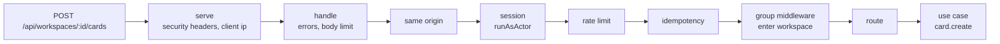
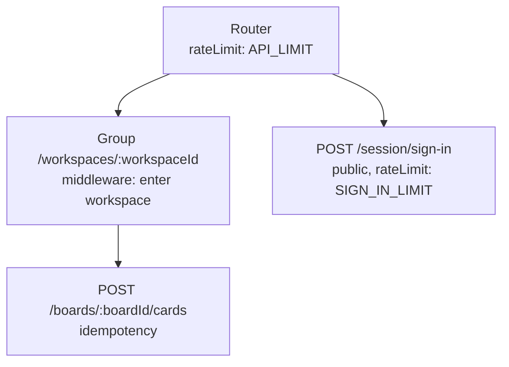

# Routes and the router

<p class="chapter-lead">A backend is reached over HTTP, and HTTP is where business logic loves to
leak. This chapter shows how newt keeps routes thin: what a route does, what the router does for
it (sessions, scopes, errors, limits), and how a context is served. Afterwards you can expose any
use case safely.</p>

## The problem

Here is a route you have probably written, or reviewed:

```ts
app.post('/boards/:boardId/cards', async (req, res) => {
  const body = req.body as CreateCard
  if (!body.title) return res.status(400).json({ message: 'title required' })
  const member = await db.query('SELECT 1 FROM access WHERE …', [req.user.id, req.params.workspaceId])
  if (!member) return res.status(403).end()
  try {
    const card = await cards.create(req.params.boardId, body)
    await mailer.send(/* … */)
    res.status(201).json(card)
  } catch (e) {
    res.status(500).json({ message: e.message })
  }
})
```

It validates (in its own way), checks membership (in its own way), sends an email before
anything is sure to be saved, and turns errors into whatever it felt like that day. The next
route does all of it slightly differently. An MCP tool that creates cards has to copy it. A test
of the rule "only members create cards" has to go through HTTP.

## The idea

**A route does not think.** It reads the request, calls one use case, and answers. Validation,
permission and the business rule belong to the use case, where every entry point (HTTP, MCP, a
worker, a script) gets them for free.

What every route needs besides that (who is signed in, which workspace it is about, what an error
looks like, how often someone may call it) belongs to the **router**, said once.

::: info Concept: Router
A context's HTTP entry: an `HttpRouter`, from `newt/http`. Each module registers its routes on
it, in `<m>.routes.ts`, and the server takes the whole table. The router wraps every route in the
same layers: the session, rate limits, idempotency, the error format, CORS, tracing.
:::

Here is what a request goes through on its way to a use case:



Everything left of the route is the router's. The route is one line.

## In cooper: the board routes

From `cooper/backend/contexts/boards/modules/board/board.routes.ts`:

```ts
import { pageRequestFrom } from 'newt/http'
import type { BoardsBase } from '../../boards-base'
import { workspaceRoutes } from '../../workspace-routes'
import type { Board_Deps } from './board.deps'
import type { Board_Module } from './board.module'

export function registerBoardRoutes(base: BoardsBase, boards: Board_Module, deps: Board_Deps): void {
  const workspace = workspaceRoutes(base, deps.member)

  workspace.get('/boards', async request => Response.json(await boards.list(pageRequestFrom(request))))

  workspace.post('/boards', async request => Response.json(await boards.create(await request.json()), { status: 201 }))

  workspace.get('/boards/:boardId', async request => Response.json(await boards.get(request.params.boardId)))

  workspace.patch('/boards/:boardId', async request => Response.json(await boards.update(request.params.boardId, await request.json())))

  workspace.post('/boards/:boardId/archive', async request => {
    await boards.archive(request.params.boardId)
    return new Response(null, { status: 204 })
  })
}
```

Each route reads what it needs (a param, the body, the page) and calls one use case. No `try`, no
`if`, no check of who is asking. The module calls `registerBoardRoutes` from its `initialize`, so
registering the module registers its routes.

A route is a function from a `BunRequest` to a `Response`. `request.params` is typed from the
path: `'/boards/:boardId'` gives `request.params.boardId`.

## The router

A context's base usually carries its router. cooper's does, in
`cooper/backend/shared/cooper-base.ts`:

```ts
export class CooperBase extends Base<CooperStore> {
  readonly rateLimitStore: RateLimitStore
  readonly http: HttpRouter

  constructor(options: BaseOptions<CooperStore>) {
    const rateLimits = options.rateLimits ?? new TableRateLimitStore(options.store.table<RateLimitRow>('rate_limit'))
    super({ ...options, rateLimits })
    this.rateLimitStore = rateLimits
    this.http = new HttpRouter({ rateLimits, clock: options.clock, rateLimit: API_LIMIT })
  }
}
```

`HttpRouter` mounts its routes under `/api` unless told otherwise. It has `get`, `post`, `put`,
`patch` and `delete`, each taking a path, a route and options. Anything under `/api` that no
route takes is a 404 in JSON, never the frontend's page. A method the path does not have is a
405 that lists the ones it has in `Allow`. Every answer gets `Cache-Control: no-store` unless the
route says otherwise: what an API answers is someone's, as it is now.

A context may have a second router, at the root, for addresses whose shape a standard decides.
auth serves OAuth's endpoints that way, in `cooper/backend/contexts/auth/auth-base.ts`:

```ts
readonly oauth = new HttpRouter({ prefix: '', public: true, rateLimits: this.rateLimitStore, rateLimit: OAUTH_LIMIT })
```

With `prefix: ''`, the router takes only its own paths (`/oauth/token`, `/.well-known/…`) and
leaves every other address to the frontend.

## Pass the body as it came

The body is the one place a route is tempted to think. Resist it:

```ts
// Yes: the use case parses `unknown` with its input schema.
workspace.post('/boards', async request => Response.json(await boards.create(await request.json()), { status: 201 }))
```

The use case takes `input: unknown` and parses it with zod; a body that does not fit is a 400
with code `validation` and zod's issues. A body that is not JSON at all is a 400 `malformed_body`;
one sent without `Content-Type: application/json` is a 415. None of it is the route's business.

::: danger Never
Never cast the body: `await request.json() as BoardCreateDTO` lies to the compiler about what a
stranger sent. The lint refuses it (`newt/route-body`). If a route really must look at the body
(OAuth's registration reads RFC 7591's snake_case fields), it parses it with zod, as
`oauth-client.routes.ts` does.
:::

## Who is asking: sessions

**Every route needs a session unless it says `{ public: true }`.** A request without one is a
401 with code `not_signed_in`, before the route runs.

Who is signed in is told by an **authenticator**: a function from the request to an `Actor`, or
`null`. The module that knows sessions sets it on the router. In auth, the session module does,
in its `initialize`:

```ts
base.http.authenticateWith(request => module.authenticate(request.cookies.get(SessionCookie) ?? undefined))
```

A signed-in request runs as its actor (`runAsActor`), so every use case it calls reads
`currentActor()` and never takes a user id from the request. The sign-up and sign-in routes are
public, of course; from `cooper/backend/contexts/auth/modules/session/session.routes.ts`:

```ts
base.http.post('/session/sign-in', async request => {
  const { user, token } = await sessions.signIn(await request.json())
  keep(request, token)
  return Response.json(user)
}, { public: true, rateLimit: SIGN_IN_LIMIT })

base.http.get('/session', async () => Response.json(await sessions.me()))
```

`keep` calls `setSessionCookie` from `newt/http`, which sets the cookie as it must be set
(`HttpOnly`, `SameSite`, `Secure` when asked). The MCP server, which has no cookies, authenticates
with `bearerAuthenticator` instead. Both are in [Authentication](./29-auth).

## Where it is: groups and scopes

Most of boards' routes are about one workspace. Each must check the person belongs to it, and
then every repository must see only its rows. Rather than repeat that, cooper registers them on a
**group**, in `cooper/backend/contexts/boards/workspace-routes.ts`:

```ts
export function workspaceRoutes(base: BoardsBase, members: Member_Module) {
  return base.http.group('/workspaces/:workspaceId', async (request, next) =>
    workspaceScope.run(await members.enter(request.params.workspaceId), next))
}
```

A group is routes under one prefix that go through a **middleware** first, after the session is
checked. This one asks the member module whether the signed-in person belongs to the workspace
(`members.enter` throws a 404 `workspace.not_found` if not), then runs the route inside the
workspace scope. Every repository below sees that workspace only.

::: tip In cooper
Every module of boards registers its routes on `workspaceRoutes(base, deps.member)`, so no use
case has to check membership, nor can forget to. The backoffice does the same with `staffRoutes`,
a group at `''` whose middleware calls `staff.enter()`: a 403 for anyone not of the staff.
:::

A middleware may also answer instead of calling `next` (a redirect, an error). It is the one place
in HTTP where a little thinking is allowed: resolving what the prefix names, once.

## Errors

**Never catch in a route.** Whatever a route throws becomes an answer:

- A domain error becomes `{ error, code }` with the status its base class decides:
  `NotFoundError` 404, `ValidationError` 400, `UnauthorizedError` 401, `ForbiddenError` 403,
  `ConflictError` 409.
- A `ZodError` is a 400 `{ error, code: 'validation', issues }`.
- Anything else is a 500 `{ error, code: 'internal' }` that says nothing about the inside, and is
  logged on the server.

```json
{ "error": "There is a board called Roadmap in this workspace already", "code": "board.name_taken" }
```

The `code` is the contract: stable, namespaced by module, what a client switches on. The `error`
is for people.

A route with a wire format of its own says `onError`. OAuth's endpoints must answer
`{ error, error_description }` (RFC 6749), so auth's client registration says, in
`oauth-client.routes.ts`:

```ts
base.oauth.post('/oauth/register', async request => { /* … */ }, {
  cors: OPEN_TO_BROWSERS,
  rateLimit: REGISTER_LIMIT,
  maxBodyBytes: REGISTRATION_MAX_BYTES,
  onError: error => toOauthErrorResponse(error, 'invalid_client_metadata'),
})
```

`toOauthErrorResponse(error, fallback, codes?)` maps domain error codes to OAuth's, and anything
else that is the request's fault to `fallback`.

## Lists: `pageRequestFrom`

No list is returned whole unless the domain bounds it. A route that lists reads the page the
client asks for with `pageRequestFrom(request)`: `?size=20&cursor=<id>`, the size kept between 1
and 100, 20 by default. The use case takes the `PageRequest` and returns a `Page`
(`{ items, hasMore, total }`).

```ts
workspace.get('/boards', async request => Response.json(await boards.list(pageRequestFrom(request))))
```

## Options, and how they cascade

A route's options say what is different about it. The same options can be given to the router
(every route of it) and to a group (every route of the group). A route's own come first.

| Option | Says |
|---|---|
| `public` | Reachable without signing in. |
| `rateLimit` | How often each caller may call it. These **add up**: router, group and route each count. `false` leaves out those above. |
| `maxBodyBytes` | The longest body it reads: 413 past it. A megabyte by default. |
| `crossOrigin` | A write that pages of other origins may send (a payment's callback). Off: they get a 403 `cross_origin_refused`. |
| `cors` | Pages of other origins may call it and read its answer. Never with cookies. |
| `idempotency` | For a POST that creates: a retry with the same `Idempotency-Key` gets the first answer. |
| `onError` | Its errors' format. `toErrorResponse` by default. |



Sign-in counts against both `API_LIMIT` and `SIGN_IN_LIMIT`, each a count of its own; it is public
because its own option says so. cooper's limits are named constants in
`cooper/backend/shared/rate-limits.ts`:

```ts
export const API_LIMIT: HttpRateLimit = { name: 'api', limit: 600, windowMs: MINUTE }
export const SIGN_IN_LIMIT: HttpRateLimit = { name: 'session.signIn', limit: 30, windowMs: 15 * MINUTE, by: 'ip' }
```

Past a limit the answer is a 429 `too_many_requests` with `Retry-After`. How limits count, by
actor or by address, and where, is [Rate limits](./28-rate-limits).

### Idempotent POSTs

A phone on a train sends "create card", the answer gets lost, and the app sends it again. Without
care that is two cards. cooper's create route asks for idempotency, in `card.routes.ts`:

```ts
workspace.post('/boards/:boardId/cards',
  async request => Response.json(await cards.create(request.params.boardId, await request.json()), { status: 201 }),
  { idempotency: { table: base.store.table<KeptAnswer>('idempotency_key') } })
```

A client that sends an `Idempotency-Key` header gets, the second time, the answer it got the first
time, kept in the store for a day. The same key while the first is still running is a 409
`idempotency_key_in_use`; with another body, a 422 `idempotency_key_reused`. The whole story is
[Idempotency](./24-idempotency).

### Other origins

By default a route that writes (`POST`, `PUT`, `PATCH`, `DELETE`) refuses what a page of another
site sends it: a 403 `cross_origin_refused`. That is what stops a forged form on someone else's
site from acting with your users' cookies. A route meant to be called from other origins says
`cors` (which origins, which headers); cooper's MCP server and OAuth endpoints use
`OPEN_TO_BROWSERS`, with `origin: '*'` and no cookies: who calls is in the bearer token.

::: info Security by default
Every answer carries `X-Content-Type-Options: nosniff`, a referrer policy and a refusal to be
framed. A built frontend's pages get a Content-Security-Policy, their inline scripts allowed by
hash. Bodies are capped. Writes from other origins are refused. You opt out, never in. See
[Security](./27-security).
:::

## Serving a context

`serve` from `newt/http` turns a router into a running server, on `Bun.serve`:

```ts
import { serve } from 'newt/http'

const server = serve({
  port: 3002,
  router: base.http,
  frontend: 'dist/cooper/boards',   // the built frontend, for every address no route takes
  health: true,                     // GET /api/health, public: 200, or 503 once stopping
  drainMs: 2000,                    // on stop: health says 503 for 2 s, then it closes
})
```

cooper wraps this in `ServedContext.serving()`, in `cooper/backend/shared/served-context.ts`,
which adds the context's extra routes (OAuth's, MCP's) and turns on HSTS when the public address
is HTTPS:

```ts
serving(): ServeOptions {
  const hsts = new URL(this.served.publicUrl).protocol === 'https:'
  return { port: this.served.port, router: this.base.http, routes: this.routes(), frontend: this.served.frontendFolder, health: true, hsts }
}
```

Other options matter in production (`trustProxy`, `csp`, `securityHeaders`); they are in
[Running it in production](./13-production).

::: details Under the hood: the order of the layers
For each route, the router builds, from the inside out: the route, then idempotency (POST only),
then the rate limits (counted as whoever is signed in), then the session check (which runs the
rest as the actor), then the same-origin check for writes. `handle` wraps all of it: it turns
whatever is thrown into `onError`'s answer, caps the body, and makes a bad body a 400 instead of a
500. Around that come CORS headers, a trace span named `POST /api/workspaces/:workspaceId/boards`,
and `no-store`. A group's middleware runs inside, just around the route. `serve` adds the client's
address and the security headers to every answer. Read `packages/newt/http/http-router.ts`.
:::

## Recap

- A route reads the request, calls one use case, answers. It never validates, checks or catches.
- Routes live in `<m>.routes.ts`, on the context's `HttpRouter` (`/api` by default, `''` at the
  root).
- Pass the body as it came: `await request.json()`, never `as X`.
- Every route needs a session unless `{ public: true }`; the authenticator says who, and the
  request runs as that actor.
- A group's middleware enters a scope once for all its routes.
- Errors become `{ error, code }` with their class's status; `onError` for another format.
- Options cascade router, group, route; rate limits add up.

## Going further

- [Idempotency](./24-idempotency): keys, kept answers, and handlers that run twice.
- [Security](./27-security): headers, CSP, body limits, same origin, cookies, proxies.
- [Rate limits](./28-rate-limits): `RateLimits`, `HttpRateLimit`, where counts live.
- [Authentication](./29-auth): sessions, OAuth, bearer tokens.
- [Frontends](./30-frontends): serving a frontend from its sources or built.
