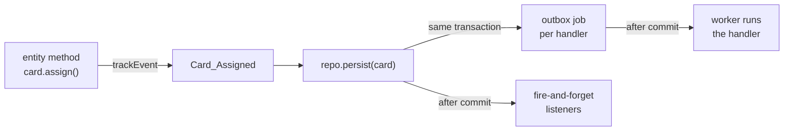
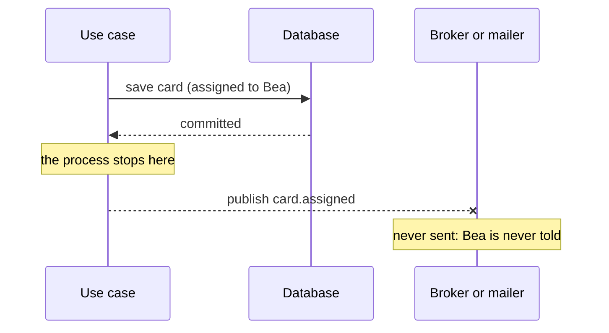
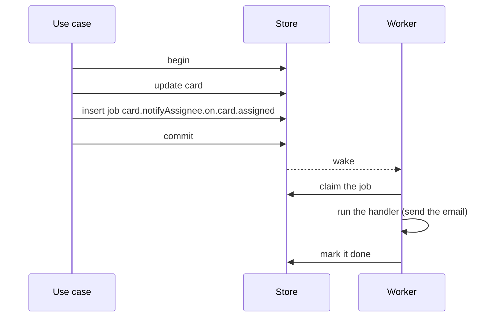

# Domain events

<p class="chapter-lead">When something happens in one module, others often need to know: a card
assigned should send an email, a card moved should be logged. This chapter shows how a module tells
what happened without knowing who listens, and why newt delivers those events through a
transactional outbox. Afterwards you can define events, offer them, and choose how to hear them.</p>

## The problem

When someone assigns a card to Bea in cooper, three more things should happen. Bea gets an email.
The card's activity log gets a line. The search index learns the card's new assignee.

The obvious way is to do them all in `assign`:

```ts
card.assign(assigneeId, author)
await this.repo.persist(card)
await this.mailer.send(/* … */)        // Bea hears of it
await this.activity.record(/* … */)    // the log
await this.search.index(card)          // the search
```

Now the card module knows about email, activity and search. Each new reaction is another line in
`assign`, and another module it depends on. And it is fragile in a way that is hard to see: if the
process stops after `persist` and before `send`, Bea never hears of it. If `send` succeeds and
`activity.record` throws, the use case fails, the client retries, and Bea gets two emails.

## The idea

The card module should say one thing: **a card was assigned**. Whoever cares reacts to that, on
their own, after the fact.

::: info Concept: Domain event
A fact, in the past tense, about something that changed in a module: `card.assigned`,
`tenant.deleted`. It carries a payload (what the module knew when it happened) and is told only
once the change that caused it is saved. The module that tells it does not know who listens.
:::

In newt an event is born in the **entity**, in the method that makes the change. The repository
publishes it with the save. Others subscribe through the module's `events`.



## In cooper: the board's events

An event is a class, one per file, in the module's `events/` folder. From
`cooper/backend/contexts/boards/modules/board/events/board-created.ts`:

```ts
import { now, type DomainEvent } from 'newt/core'
import type { BoardDTO } from '../board.schema'

export class Board_Created implements DomainEvent<BoardDTO> {
  static readonly eventName = 'board.created'
  readonly name = Board_Created.eventName
  readonly occurredAt = now().toISOString()
  constructor(readonly payload: BoardDTO) {}
}
```

The names follow one pattern:

| | Pattern | Example |
|---|---|---|
| Class | `<M>_<Verb>` | `Board_Created`, `OauthGrant_Replayed` |
| File | `events/<m>-<verb>.ts` | `events/board-created.ts` |
| Event name | `<module>.<verb>` | `board.created`, `oauthGrant.replayed` |

`occurredAt` comes from `now()`, never `new Date()`, so a test that moves the clock gets the time
it set.

### The payload is JSON, and only grows

A payload is a `Json` type: plain objects, arrays, strings, numbers, booleans and `null`. It is
stored in the outbox as it was told, and read by a worker that may run hours later, after a
deploy. So:

- Use `type`, not `interface`, for payloads: an `interface` is not assignable to `Json`, a `type` of the same shape is.
- A payload **only grows**. Add fields; never rename or remove one. A job written yesterday still
  has the old shape, and today's handler will read it.
- Never put a secret in a payload. It is stored as is.

Most events carry the entity's DTO: whoever hears it knows what the entity looks like now, without
asking. An event about a change carries more: what changed and what it was. cooper's
`board.updated`, from `events/board-updated.ts`:

```ts
/** The whole board as it is now, the fields that changed (`changes`) and what they were (`previous`). */
type BoardChange = { dto: BoardDTO, changes: Partial<BoardDTO>, previous: Partial<BoardDTO> }

export class Board_Updated implements DomainEvent<BoardChange> {
  static readonly eventName = 'board.updated'
  readonly name = Board_Updated.eventName
  readonly occurredAt = now().toISOString()
  constructor(readonly payload: BoardChange) {}
}
```

`{ dto, changes, previous }` is the convention for every `updated`, `moved` or `edited` event. A
handler can then ask `changes.columnId !== undefined` without comparing anything itself.

### Born in the entity

The entity tracks the event in the method that changes it. From `board.ts`:

```ts
static create(input: { workspaceId: string, name: string, description: string }): Board {
  const board = new Board({ ...input, name: BoardName.from(input.name) }, true)
  board.trackEvent(new Board_Created(board.toDTO()))
  return board
}

update(changes: { name?: string, description?: string }): void {
  this.change({ /* … */ })
  const diff = this.getChanges()
  if (diff) this.trackEvent(new Board_Updated({ dto: this.toDTO(), changes: diff, previous: this.getPrevious()! }))
}

archive(): void {
  this.markAsDeleted()
  this.trackEvent(new Board_Archived(this.toDTO()))
}
```

The method that changes the entity is the one that knows what happened, so it is the one that
says so. A use case never builds an event; it calls the method and persists.

Notice `if (diff)` in `update`. A rename to the same name changes nothing, so it tells nothing.

::: danger Never
An event always comes with a change. An entity that tracks an event but has nothing to save is
refused before anything is written: `EventWithoutChange`. If an event tells that something
happened, change what says it happened with it (a status, a date). And an entity tells at most
one event of each name per save: tracking a second `card.moved` before the save replaces the
first.
:::

Some events carry who did it. A listener runs later, with no actor, so `currentActor()` would
throw there; if it needs to know who acted, the event must say. cooper's card events add
`CardAuthor` (`{ by, via }`), from `card.schema.ts`, to their payload.

### Offered by the module: `eventsOf`

The module turns its event classes into **emitters** others subscribe to. From
`board.module.ts`:

```ts
readonly events

private constructor(base: BoardsBase, private readonly repo: Board_Repository, deps: Board_Deps) {
  super('board', base.invocations, deps)
  this.events = eventsOf(base.bus, { created: Board_Created, updated: Board_Updated, archived: Board_Archived })
}
```

Elsewhere, `boards.events.created` is a `DomainEventEmitter<BoardDTO>`, typed with its payload.
That is the whole public face of an event: the module's `events`, and the class's file for its
type.

## Who hears a card's events

Go back to the problem: an assignment should reach Bea, the activity log and the search. Here is who
subscribes to `card.created` in cooper, each in its own module's `<m>.workers.ts`:

| Queue | Module | Does |
|---|---|---|
| `card.notifyAssignee.on.card.created` | card | Emails the assignee, if any. |
| `card.indexCard.on.card.created` | card | Indexes the card for the search. |
| `card.leaveRemovedColumn.on.card.created` | card | Moves it out of a column removed meanwhile. |
| `card.unassignMember.on.card.created` | card | Unassigns someone who left meanwhile. |
| `activity.recordCreated.on.card.created` | activity | Appends a line to the board's log. |
| `metric.recordCard.on.card.created` | metric (backoffice) | Counts it, in another context. |

The card module's `create` knows none of them. It calls `Card.create`, which tracks `Card_Created`,
and persists. Adding a seventh reaction is a new subscription in the module that reacts, and no
change to `create` at all. That is the decoupling events buy: the module that changes something
says what happened, once; the modules that care decide what to do about it.

## Told after the commit

When does a listener hear an event? **Only after the save that made it commits.** If the save
rolls back (a conflict, a rule broken in `after`), nothing is told. A listener never reacts to a
change that did not happen.

That one sentence hides the most important design decision of newt. To see why, look at what
goes wrong without it.

### The dual-write problem

Most systems save to a database and then publish to a message broker, or call a service. That is
two writes to two systems, and nothing makes them happen together.



Swap the order, and it fails the other way: the email leaves, then the save fails on a conflict,
and Bea is told about a card that is not hers. There is no order of two independent writes that
is safe. Retrying does not help either: you cannot tell whether the first attempt reached the
broker.

### The transactional outbox

newt's answer is to make the second write part of the first. The event is not sent anywhere when
it is told. Instead, for each durable listener, a **job** is written to a table in the same store,
in the same transaction as the change: the **outbox**. Either the card and its jobs are saved, or
neither is.



If the process stops after the commit, the job is still there, and the worker runs it when it
comes back. If the transaction rolls back, the job never existed. The price: a job may run more
than once (the process can stop after the email and before "done"), so a handler must be safe to
run again. That is the next chapter's subject.

::: info Concept: Outbox
A table of jobs in the context's own store, written in the transaction of the change that caused
them. A **worker** claims and runs them after the commit, retrying on failure. It turns "save, then
tell" into one atomic write plus at-least-once delivery.
:::

## The event's id

Every event told gets an id, a UUIDv7, when it is published. The class leaves `id` out; the
publisher fills it in. The id is the same for every listener of that event and for every run of
its job. That makes it the natural key for "once per event": an email's idempotency key, an
activity row's id.

A listener receives it as the second argument, an `EventMeta`: `{ id, name, occurredAt }`. From
`cooper/backend/contexts/boards/modules/card/card.workers.ts`:

```ts
cards.events.assigned.subscribe(({ dto, by }, { id }) => cards.notifyAssignee(dto, by, id), {
  strategy: 'handler',
  queue: 'card.notifyAssignee.on.card.assigned',
})
```

## Two ways to hear an event

`subscribe` always says how, with a `strategy`. There is no default, on purpose.

| | `'handler'` | `'fire-and-forget'` |
|---|---|---|
| Where | A job in the outbox, written with the change. | In memory, after the commit. |
| Survives a crash | Yes: it runs after a restart. | No: lost. |
| On failure | Retried with backoff, 5 attempts by default, then dead. | Logged, and lost. |
| Needs | A `queue` name; an idempotent handler. | Nothing. |
| For | Anything that must happen: emails, other modules' writes, counts. | What may be lost: a log line, a cache, a metric. |

A `handler` subscription, from `cooper/backend/contexts/backoffice/modules/metric/metric.workers.ts`:

```ts
deps.boards.card.events.created.subscribe(card => metrics.recordCard(card), {
  strategy: 'handler',
  queue: 'metric.recordCard.on.card.created',
})
```

Its comment says why it is not fire-and-forget: a number lost when the server stops would be wrong
for good.

A `fire-and-forget` one, from `activity.workers.ts`:

```ts
// A line in the server's log as each card moves, to watch a board live while tracing.
// If it fails, or the server stops before it runs, the line is lost, and nothing is wrong.
events.moved.subscribe(({ dto, previous, by, via }) => {
  options.log(`[boards] #${dto.number} "${dto.title}" moved from column ${previous.columnId} to ${dto.columnId} by ${by ?? 'cooper'}${via ? ` (${via})` : ''}`)
}, { strategy: 'fire-and-forget' })
```

When in doubt, use `handler`. A lost reaction is a bug nobody sees; a job that ran twice is a bug
your tests can catch.

### Filtering with `when`

A subscription may take only some events, with `when`, which looks at the payload. An event `when`
refuses writes no job at all. From `card.workers.ts`:

```ts
cards.events.created.subscribe(({ by, ...card }, { id }) => cards.notifyAssignee(card, by, id), {
  strategy: 'handler',
  queue: 'card.notifyAssignee.on.card.created',
  when: card => card.assigneeId !== null,
})
```

A card created with nobody assigned leaves no job. `when` runs inside the save's transaction, so it
must look only at the payload: no reads, no calls. A type guard narrows what the handler gets; more
of that in [Workers and the outbox](./10-workers).

::: details Under the hood: what publishing does
`Repository.save` publishes each changed entity's events inside the transaction, after its hooks.
`Base.publisher.publish` gives the event its id, asks the `JobQueue` to write one job per
`handler` subscription whose `when` takes it, and registers an `afterCommit` that counts the event
for metrics, runs the in-memory (`fire-and-forget`) listeners, and wakes the worker. Read
`packages/newt/runtime/base.ts` and `packages/newt/repository/repository.ts`.
:::

## Recap

- An event is a fact in the past tense, one class per file: `<M>_<Verb>`, named `<module>.<verb>`.
- Its payload is JSON (`type`, not `interface`), only grows, and carries no secret; changes carry
  `{ dto, changes, previous }`.
- The entity tracks it in the method that changes it; no change, no event (`EventWithoutChange`).
- The module offers its events with `eventsOf(base.bus, { … })`.
- An event is told only after its save commits. Durable listeners get a job in the outbox, written
  in the same transaction: no dual write.
- `handler` is durable and retried; `fire-and-forget` is in memory and may be lost. Key what must
  happen once by `event.id`.

## Going further

- [Workers and the outbox](./10-workers): queues, retries, dead jobs, schedules.
- [Contexts working together](./11-between-contexts): hearing another context's events.
- [Aggregates](./21-aggregates): what one entity's events cover, and what they do not.
- [Event metrics](./43-metrics): watching events in newt-monitor.
