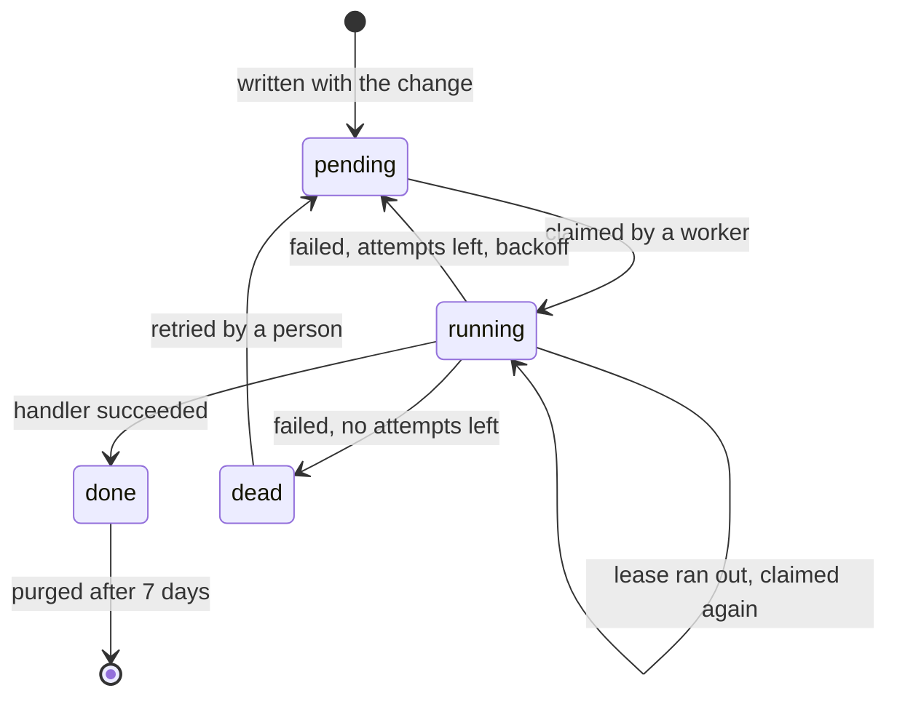

# Workers and the outbox

<p class="chapter-lead">An event's durable listeners become jobs in the outbox. This chapter is
about what runs them: workers, their queues, retries and dead jobs, and the schedules that start
work on their own. Afterwards you can write a handler that is safe to run twice, and know what
happens when it fails.</p>

## The problem

In the last chapter, assigning a card wrote a job beside the card: "tell the assignee". Someone has
to run it. And that someone has hard questions to answer.

What if sending the email fails because the mail provider is down for a minute? Try again, but not
in a tight loop. What if it fails forever, because the address is broken? Stop at some point, and
keep the job for a person to look at. What if the server is deployed in the middle of a run? Run it
again later, which means the email may leave twice. What if three instances of cooper run at once?
Each job must be taken by one of them, not three.

And some work starts with no request at all: every night, the expired sessions should go.

## The idea

A context's **worker** claims jobs from its outbox, runs each one's handler, and closes it: done,
to retry later, or dead. It runs beside the server, in the same process, and starts with the
context.

::: info Concept: Worker and handler
A **handler** is a subscription with `strategy: 'handler'`: a function that reacts to an event by
calling one use case of its own module. Each handler is a **queue**, named after who reacts with
what to which event. The **worker** is the loop that takes that queue's jobs and runs them, at
least once each, until they succeed or run out of attempts.
:::

A job goes through a few states:



## In cooper: the invitation's email

An invitation to a workspace is an email, and an email cannot be taken back. So it never leaves
from the use case that creates the invitation: it leaves from a worker, once the invitation is
saved. From `cooper/backend/contexts/auth/modules/invitation/invitation.workers.ts`:

```ts
/**
 * An invitation's email leaves once it is saved, from a job: an email cannot be taken
 * back, so it never leaves for an invitation that rolled back. And a deleted
 * workspace's invitations stop opening it.
 */
export function registerInvitationWorkers(invitations: Invitation_Module, deps: Invitation_Deps): void {
  invitations.events.created.subscribe(invitation => invitations.send(invitation.id), {
    strategy: 'handler',
    queue: 'invitation.send.on.invitation.created',
  })
  deps.tenant.events.deleted.subscribe(tenant => invitations.revokeForTenant(tenant.id), {
    strategy: 'handler',
    queue: 'invitation.revokeForTenant.on.tenant.deleted',
  })
}
```

A module's handlers live in `<m>.workers.ts`, in one function its `initialize` calls. Each handler
does one thing: call **one use case of its own module**, with what it reads from the payload. All
the thinking is in the use case, where a test can call it directly.

Here is that use case, from `invitation.module.ts`:

```ts
/**
 * Sends its email, with a new token for its link: what its worker calls once it is
 * saved, since an email cannot be taken back. The token is made here, not when it
 * was created, so it is never kept in a job: the store only ever has its hash. Run
 * again, it sends a new link, and the one before stops working.
 */
@UseCase()
async send(invitationId: string): Promise<void> {
  const invitation = await this.repo.first({ id: invitationId })
  if (!invitation?.isOpen()) return
  const [tenant] = await this.deps.tenant.getMany([invitation.tenantId])
  if (!tenant) return
  const inviter = await this.deps.user.get(invitation.invitedBy)

  const token = invitation.issueToken()
  await this.repo.persist(invitation)
  await this.options.mailer.send({ to: invitation.email, subject: `${inviter.name} invited you to ${tenant.name} on Cooper`, text: /* … */ })
}
```

Three habits are worth copying:

1. **It reads again what it is about.** The handler passes only the id. The use case loads the
   invitation as it is now: a job may run late, and the invitation may have been revoked since.
2. **It does nothing when there is nothing to do.** An invitation no longer open, a workspace
   gone: return. A second run finds nothing to do.
3. **What cannot be undone comes last**, after the save. If the save fails on a conflict, no email
   left.

::: danger Never
What cannot be undone (an email, a payment, a call to another service) never leaves from the use
case that makes the change. It leaves from a worker reacting to the change's event, once it is
saved. That is golden rule 7.
:::

## Naming a queue

A queue is named `<module>.<useCase>.on.<module>.<event>`:

```text
invitation.send.on.invitation.created
└───┬────┘ └┬─┘    └────────┬───────┘
 module   use case     the event it hears
 that reacts  it calls
```

The name is what finds a job's handler again after a restart, so it must be stable and unique.
newt refuses at startup a queue whose event part is not the event subscribed to. The lint goes
further (`newt/queue-name`): the callback must call that very use case, of that module.

::: warning Watch out
Renaming a queue leaves its pending jobs behind, under the old name, with no handler. The worker
warns about them (`… job(s) of '…' wait, and no worker serves that queue`), and newt-monitor shows
the queue as an orphan, but nobody runs them until someone does. Rename a queue only when it is
empty, or move its jobs.
:::

## No actor, no scope

A job runs **detached**: no actor, no scope, nothing of the request that caused it. That is on
purpose. The request is long gone; acting as its person, hours later, would be a lie.

So a handler reads who and where from the payload, and enters what it needs itself. cooper's
`notifyAssignee` enters the card's workspace before reading it, from `card.module.ts`:

```ts
async notifyAssignee(card: CardDTO, by: string | null, eventId: string): Promise<void> {
  if (card.assigneeId === null || card.assigneeId === by) return
  const current = await runInWorkspace(card.workspaceId, () => this.repo.first({ id: card.id }))
  if (current?.assigneeId !== card.assigneeId) return
  // … find the member, send the email
}
```

`runInWorkspace` is cooper's helper over `workspaceScope.run({ workspaceId }, fn)`. A use case
that needs an actor wraps its work in `runAsActor(actor, fn)`. Calling `currentActor()` in a job
without one throws `NoActor`.

## Which events get a job: `when`

Most handlers care about every event they subscribe to. Some care about a few, and `when` says
which, from the payload alone. An event `when` refuses writes no job: nothing to claim, nothing to
run, nothing to look at in the monitor. From `card.workers.ts`:

```ts
cards.events.moved.subscribe(({ dto }) => cards.leaveRemovedColumn({ id: dto.columnId, boardId: dto.boardId, workspaceId: dto.workspaceId }), {
  strategy: 'handler',
  queue: 'card.leaveRemovedColumn.on.card.moved',
  when: ({ changes }) => changes.columnId !== undefined,
})
```

A move within the same column changes only `position`, so it leaves no job. This is where the
`{ dto, changes, previous }` payload of the last chapter earns its keep.

`when` may be a type guard, which narrows what the handler receives:

```ts
/** A new card, given to someone: what `when` lets through to check they still belong. */
type CreatedFor = CardDTO & CardAuthor & { assigneeId: string }

cards.events.created.subscribe(card => cards.unassignMember(card.workspaceId, card.assigneeId), {
  strategy: 'handler',
  queue: 'card.unassignMember.on.card.created',
  when: (card: CardDTO & CardAuthor): card is CreatedFor => card.assigneeId !== null,
})
```

In the handler, `card.assigneeId` is a `string`, so `unassignMember` needs no check for `null`.

::: warning Watch out
`when` runs inside the transaction of the save that tells the event, before the job is written. It
must look only at the payload: never read the store, never call a use case. Anything that needs the
world as it is belongs in the handler's use case, which runs later.
:::

## When a job fails

A handler that throws does not lose its job. The worker closes it as pending, to run again after a
**backoff** that doubles each time: 10 seconds, 20, 40, 80, up to 15 minutes at most. After its
last attempt (5 by default) the job is **dead**: it stays in the outbox, with its last error, until
a person looks at it.

A subscription may ask for more attempts. boards' purge of a deleted workspace must not give up
soon, from `workspace.workers.ts`:

```ts
deps.auth.tenant.events.deleted.subscribe(tenant => workspace.purge(tenant.id), {
  strategy: 'handler',
  queue: 'workspace.purge.on.tenant.deleted',
  // The workspace is gone in auth already: a purge that keeps failing must not die soon.
  attempts: 10,
})
```

A dead job is put back with `store.outbox.retry(id)`, as new: no attempts, due now. cooper wraps
that in a small `Outbox_Module` per context, in `cooper/backend/shared/outbox/outbox.module.ts`,
so the staff's backoffice lists each context's dead jobs and retries them through use cases.
Looking after dead jobs in newt-monitor is [Queues and dead jobs](./45-queues).

<figure class="screenshot">
  
  
  <figcaption>A queue with a dead job in newt-monitor: its event, how many times it ran, and its last error.</figcaption>
</figure>

## A job may run twice

The outbox promises **at least once**. Between a handler finishing its work and the worker marking
the job done there is always a moment, and the process may stop in it. Then the job runs again. A
worker that froze past its lease loses the job to another, and may still finish its own run.

So every handler must give the same result run twice as run once: golden rule 8, **a second run
finds nothing to do**. There are a few ways to get there:

- **Look before you act.** `invitation.send` returns when the invitation is not open;
  `tenant.ensureAdmin` returns when the admin already has access.
- **Key what must happen once by the event's id.** It is the same on every run. cooper's activity
  log stores each entry with the event's id as its row id, and checks for it first:
  `if (await this.repo.first({ id: event.id })) return`. The assignee's email carries
  ``key: `card.notifyAssignee:${eventId}` ``, which the mailer sends once.
- **Converge.** A purge removes what is left; run again, there is nothing left.

The detailed patterns, and how to test them, are in [Idempotency](./24-idempotency).

## The write rule: writes into another module come from a worker

A request should change one module. If creating a workspace also wrote the workspace's welcome
board, its columns and its card, one request would hold four modules' saves, any of which could
fail after the others.

So newt enforces golden rule 6: **a use case writes into another module only from a worker.**
Called from a request, a use case that saves in another module throws:

```text
[write rule] workspace.prepare writes to boards.board outside a worker: write it from a
worker reacting to an event, or list it in its writesTo
```

From a job it is allowed: the job runs until it completes, so the steps converge. That is how
cooper's `workspace.prepare` writes a board, columns and a card in reaction to `tenant.created`
(more in [Contexts working together](./11-between-contexts)).

A few use cases must write into another module from the request, and say why. auth's
`tenant.create` gives its creator admin access at once, so they can enter the workspace the moment
it answers. From `tenant.module.ts`:

```ts
/**
 * … It writes to `access` without being a worker, on purpose: whoever makes a
 * workspace enters it the moment it answers. … should that second save fail, the
 * worker of `tenant.created` (`ensureAdmin`) gives it.
 */
@UseCase({ writesTo: ['access'], retryOnConflict: false })
async create(input: unknown): Promise<TenantDTO> {
  // …
}
```

`writesTo` lists the exception, its comment gives the reason, and a worker repairs the case where
the second save fails.

## Schedules: work that starts on its own

Some work has no event behind it: every night, sessions past their days go. newt turns time into
events too. A module defines a **schedule**, a cron expression in UTC, and gets back an emitter,
subscribed like any other. From `cooper/backend/contexts/auth/modules/session/session.module.ts`:

```ts
/** At three every night (UTC): a schedule, told as an event its workers subscribe to. */
readonly nightly
// … in the constructor:
this.nightly = base.schedules.define('session.nightly', '0 3 * * *')
```

And in `session.workers.ts`:

```ts
sessions.nightly.subscribe(() => sessions.purgeExpired(), {
  strategy: 'handler',
  queue: 'session.purgeExpired.on.session.nightly',
})
```

A schedule's name is an event's, `<module>.<name>`. Its payload is a `ScheduleTick`, which says
when it was due. Each tick is told once, however many processes run the context: the first to
record it in the store's `schedule_tick` table, with its jobs, in one transaction, tells it. Ticks
missed while nothing ran are not told one by one, only the last of them. The first time a schedule
runs, it waits for its next tick.

cooper purges expired sessions, tokens and OAuth requests this way. Each purge is a `handler`, so a
night whose purge fails retries it. Time, clocks and schedules in tests are in
[Time](./23-time).

## Starting and stopping

A context's `start()` starts its worker and its schedules; `stopWorker()` stops claiming and waits
for the jobs in progress. `runContexts` does both for you (see
[Running it in production](./13-production)). A script that wants its jobs run starts the worker
and waits for `base.jobs.idle()`.

The worker looks for jobs every 5 seconds, and at once whenever a commit wakes it, so a job usually
runs a moment after its save. It runs up to 10 jobs side by side.

::: tip In cooper
A handler subscribed to **another context's** event gets its jobs in that context's outbox, run by
that context's worker. boards' `workspace.prepare.on.tenant.created` is a job of auth's outbox. So
cooper stops every context's worker before it closes any store. See
[Contexts working together](./11-between-contexts).
:::

::: details Under the hood: how the outbox claims jobs
The worker (`JobQueue`, in `packages/newt/runtime/jobs/job-queue.ts`) only knows the `Outbox` port
(`packages/newt/port-outbox/outbox.ts`). Each store implements it in its own tables.

- **Claiming** takes up to as many jobs as the worker has room for, of the queues it serves: those
  pending and due, or running with their lease run out. One claim is one statement: SQLite runs
  `UPDATE job SET status = 'running' … WHERE id IN (SELECT … LIMIT ?) RETURNING …`; Postgres and
  MySQL select with `FOR UPDATE SKIP LOCKED`, so two workers never take the same job and never
  wait for each other.
- **Each claim counts an attempt** and is locked as `<worker>/<claim number>`, a name no claim used
  before. Renewing and closing a job only work while it is still that claim (`attempts` and
  `lockedBy` fence it), so a worker that lost its lease cannot close a job another worker now
  holds.
- **The lease** is a minute, renewed every third of it while the handler runs. A worker that dies
  stops renewing; a minute later another worker claims the job again.
- **Nothing holds the database while a handler runs.** Claiming, renewing and closing are each a
  short transaction of their own; the handler runs between them, outside any.
- A job whose worker stopped mid-run on every attempt it had is closed dead without running again.
- Done jobs are history: purged after 7 days. Dead ones stay.

The defaults (`concurrency`, `pollMs`, `leaseMs`, `backoffMs`, `maxBackoffMs`, `keepDoneMs`) are
`JobQueueOptions`, given to a `Base` as `jobs`.
:::

## Recap

- Handlers live in `<m>.workers.ts`; each calls one use case of its own module.
- A queue is `<module>.<useCase>.on.<module>.<event>`; the lint checks it, and renaming one strands
  its jobs.
- A job runs with no actor and no scope: read who and where from the payload, enter them yourself.
- Failures are retried with a doubling backoff, 5 attempts by default; then the job is dead until
  retried.
- A job may run twice: look first, key by `event.id`, or converge.
- Writes into another module, and anything irreversible, happen in workers. `writesTo` is the
  exception, with a reason.
- Schedules are events: `base.schedules.define(name, cron)`, subscribed like any other.

## Going further

- [Idempotency](./24-idempotency): handlers that run twice, kept answers, mail keys.
- [Time](./23-time): clocks, schedules, and moving time in tests.
- [Contexts working together](./11-between-contexts): whose worker runs which job; sagas.
- [Queues and dead jobs](./45-queues): watching the outbox in newt-monitor.
