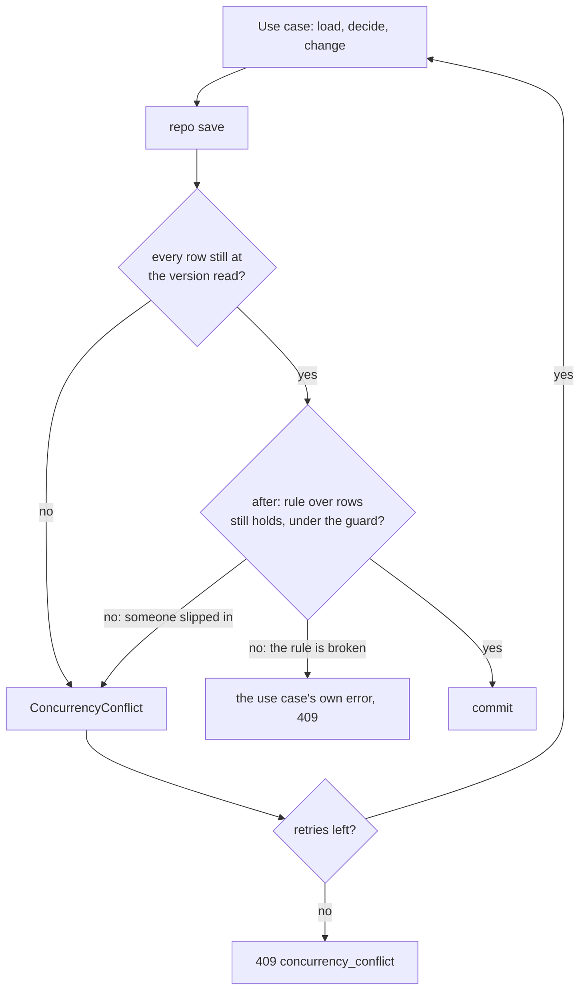
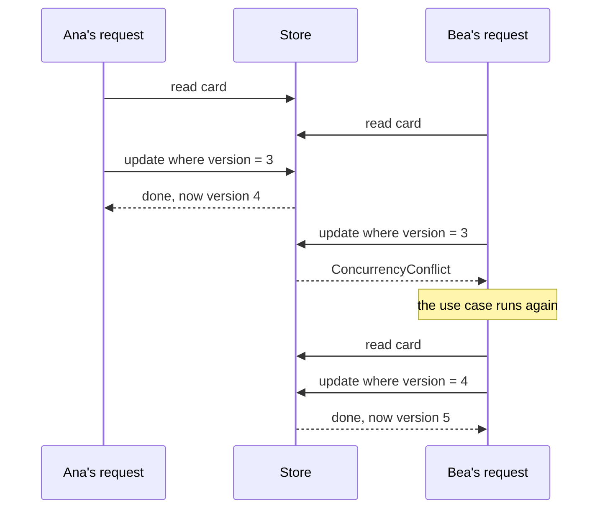
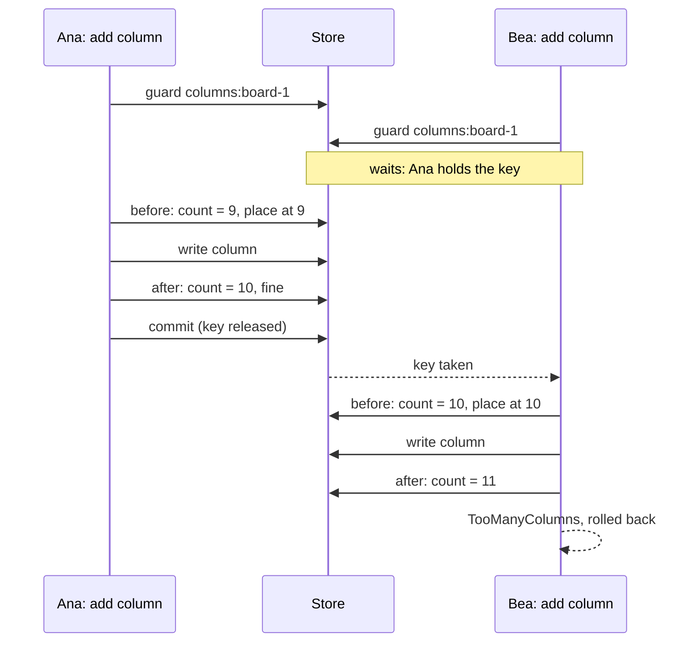
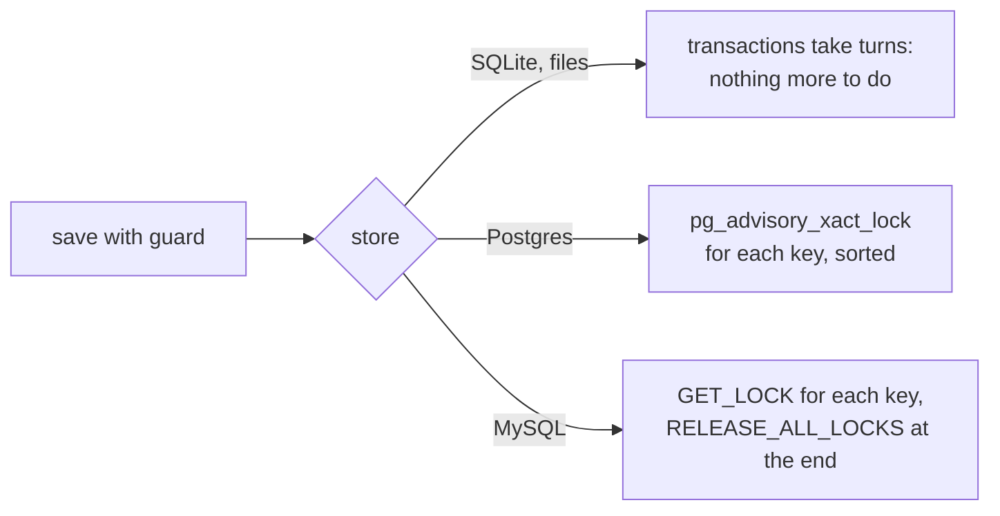
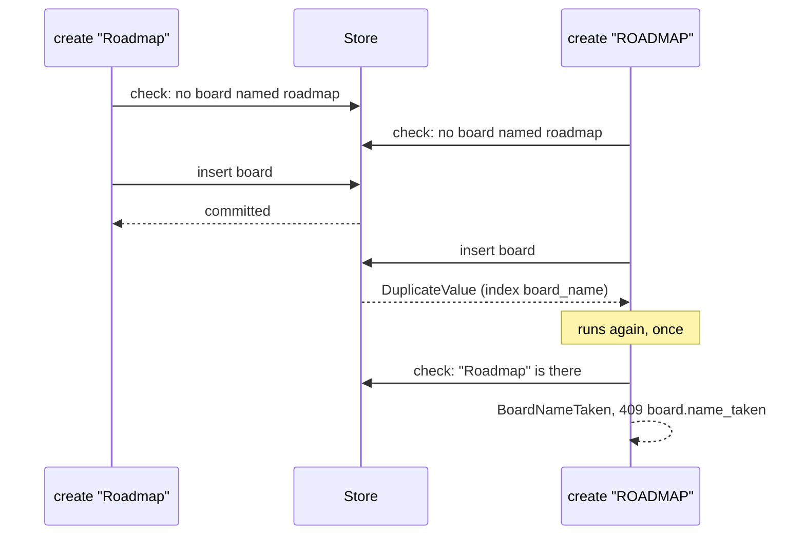
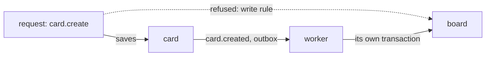

# Versions, conflicts and guards

<p class="chapter-lead">Two people change the same thing at the same moment, and one of them
silently loses. Or ten requests each check a limit, each find room, and all ten get in. This
chapter shows how newt notices both, what it does on its own, and what you say so that a rule
over several rows holds on every store, SQLite and Postgres alike.</p>

## The problem

Ana and Bea have the same board open. Ana drags card #1 to *Doing*; at the same instant Bea
drags it to *Done*. Both requests read the card, both decide where it goes, both save.

Without protection the second save writes over the first with what it read before. Ana's move
vanishes and nobody knows. Worse, a move rewrites the positions of the cards around it, so the
column can end with two cards in one place and a gap in another.

There is a second kind of race, harder to see. A board has at most ten columns. Two requests
add one to a board of nine:

```text
Ana   counts the columns: 9     → room for one
Bea   counts the columns: 9     → room for one
Ana   saves her column          → 10
Bea   saves her column          → 11
```

Nobody overwrote anybody. Both columns are new rows; neither save touched what the other wrote.
And still the rule is broken.

These are the two problems of concurrency in a backend: **lost updates** to one row, and
**rules over several rows** checked on a picture that changed before the save. newt answers the
first without you writing anything, and the second with a few words in the save.

## The idea

newt uses **optimistic concurrency**. Nobody locks a row while they look at it. Every save
checks, at the moment it writes, that what it read is still what is stored. If not, the use case
runs again from the start, on what is stored now.

For one row that check is its **version**. For a rule over several rows, no single version
covers what was read, so the save names what the rule protects, its **guard**, and checks the
rule again inside its own transaction, where no other save of that guard can get in.



::: info Concept: Optimistic concurrency
Each change is made on the assumption that nobody else changes the same thing at once, and
checked when it is saved. A clash is rare, so it is cheaper to detect it and try again than to
lock everything everyone reads. The cost is that the work must be safe to repeat.
:::

## The version

Every row a store writes has a `version`, a number that goes up by one on each save that writes
it. It is in every row type of cooper:

```ts
// cooper/backend/contexts/boards/modules/card/card.repository.ts
export type CardRow = CardDTO & { version: number }
```

An entity remembers the version it was read at. When the repository writes it, the `Table`
changes the row only where it is still at that version:

```ts
// packages/newt/port-store/table.ts
/** Changes a row still at `version`, one version on; `ConcurrencyConflict` otherwise. */
update(id: string, version: number, changes: Partial<NewRow<Row>>): Promise<void>
/** Removes a row still at `version`; `ConcurrencyConflict` otherwise. */
delete(id: string, version: number): Promise<void>
```

You never call these yourself for an entity: `TableRepository.write` does, with the entity's
version. Here is the race on card #1, as the store sees it:



Nothing is lost in silence. Bea's request did not overwrite Ana's move: it failed, read the card
again (now in *Doing*), moved it to *Done* from there, and saved. Both moves happened, one after
the other, which is what two people dragging the same card mean.

A save writes all its entities in one transaction. If any one of them is stale, nothing is
written. A row that did not change is not written, and its version is not checked: a column whose
position stayed the same in a reorder neither costs a write nor causes a conflict.

::: details Under the hood: what the version protects, and what it does not
The version protects a row against someone who **changed that row**. It cannot protect a row that
did not exist when you read: a card created while you renumber a column has no version in your
save. That is the second problem of this chapter, and the guards below are its answer.
:::

## Trying again, on its own

Getting a 409 would be correct for Bea, but rarely useful. The sensible thing is what a person
would do: look again and redo it. Every use case does that without being asked. On a
`ConcurrencyConflict` it runs again **from the start**, up to three more times, after a short
random wait. Only when every attempt collides does the client get the error:

```json
{ "error": "Someone changed it in the meantime. Try again.", "code": "concurrency_conflict" }
```

with status 409. In a trace, each retry is an `attempt` span inside the use case's span, and the
use case's span carries a `conflict.retry` event saying which attempt it was, so you see in
newt-monitor which use cases collide and how often ([Traces](./44-traces)).

```ts
// packages/newt/core/use-case/invocations.ts
/** How many more times the first use case of a chain runs after a conflict (unless one in it says `retryOnConflict: false`). */
const RETRIES = 3
```

### Only the first of a chain runs again

A use case may call another: `card.removeColumn` calls `column.remove`. When the inner one hits a
conflict it does not try again itself; it lets the conflict through to its caller, and the whole
chain runs again from the top. If both retried, the inner one would repeat what its caller then
repeats anyway, up to sixteen runs for one request.

A use case called **from another context** is that context's API: it is the root of what it does
there. But a conflict still travels up to the first use case of the whole chain, whatever context
it belongs to.

### Nothing irreversible before the save

Running again is only safe if the first attempt left nothing behind. So a use case has a fixed
shape: **load, decide, change, save**, with the save last and nothing before it that cannot be
undone.

```ts
// cooper/backend/contexts/boards/modules/card/card.module.ts
@UseCase()
async move(id: string, input: unknown): Promise<CardDTO> {
  const { columnId, position } = CardMoveSchema.parse(input)
  const card = await this.load(id)
  const from = card.columnId
  if (columnId !== from) await this.assertColumnOf(card.boardId, columnId)
  const left = (await this.repo.inColumn(from)).filter(each => each.id !== id)
  const target = columnId === from ? left : await this.repo.inColumn(columnId)
  const at = Math.min(position ?? target.length, target.length)
  target.splice(at, 0, card)
  if (target !== left) left.forEach((each, index) => each.reposition(index))
  target.forEach((each, index) => each === card ? card.moveTo(columnId, index, actingAuthor()) : each.reposition(index))
  await this.repo.persistOrder(target === left ? target : [...left, ...target], [from, columnId])
  // …
  return card.toDTO()
}
```

Everything before `persistOrder` only reads and changes entities in memory. Run it three times
and the world sees one move. An email to the new assignee, a call to a payment provider, a
message to another system: those leave from a worker, after the save commits
([Workers](./10-workers)). A use case that sent an email and then hit a conflict would send it
again on every attempt.

::: warning Watch out
"Nothing irreversible" includes a save of your own. A use case that saves twice (`writesTo`, below)
and fails on the second save will, on a retry, find the first one done. Either make the first
step safe to find done, or turn retries off.
:::

### `retryOnConflict: false`

Some use cases cannot be made to save once, at the end. cooper's web session completes a sign-in
by trading a one-time code with auth over HTTP, before it saves the session. Run again, it would
trade a code already spent:

```ts
// cooper/backend/shared/web-session/web-session.module.ts
/**
 * auth sent the browser back: the code is traded for who signed in, and the
 * context's own session is opened. It calls auth over HTTP before saving, so it
 * never runs again on a conflict: the code is spent.
 */
@UseCase({ retryOnConflict: false })
async complete(input: { /* … */ }): Promise<{ token: SecretToken, returnTo: string }> {
```

auth's `tenant.create` says the same for another reason: it saves the workspace, then its admin's
access. Run again, it would make a second workspace.

```ts
// cooper/backend/contexts/auth/modules/tenant/tenant.module.ts
@UseCase({ writesTo: ['access'], retryOnConflict: false })
async create(input: unknown): Promise<TenantDTO> {
```

The flag holds for the **whole chain**: if a use case deep down says it must not run twice, none
of the ones that called it runs again either, not even in another context. A conflict then
reaches the client as a 409.

::: tip In cooper
Every use case of `boards` loads, decides and saves once: none needs the flag. The four that have
it are in `auth` (`tenant.create`, `tenant.delete`, `token.exchange`) and in
`cooper/backend/shared/web-session/web-session.module.ts`, each with its reason in the comment
above it. Before you write it, check whether the use case can be reordered to save once, at the
end. The flag is for what cannot.
:::

### `SaveRolledBack`

When a save's transaction rolls back, every entity in it is put back as it was before the save,
and marked: it is never saved again. Saving it a second time throws `SaveRolledBack`:

```text
Card 0196… was in a save that rolled back: read it again, and save that one
```

The reason is that the entity in memory no longer says what is stored. Its version, its changes
and its events describe a write that never happened. This matters only for code that catches an
error from a save and tries to go on with the same entity. The retry of a use case never meets
it: each attempt loads its entities afresh. Do the same by hand: read it again, and change that
one.

## Rules over several rows

Back to the eleventh column. The version cannot help: the two columns are new rows, and neither
save touches the other's. The rule "at most ten" reads a **set** of rows, and the set changed
between the count and the save.

The fix has two parts. First, check the rule again **inside the save's transaction, after the
writes**: then the count includes the row you just wrote. Second, make sure no other save that
could break the same rule runs in between: name what the rule protects, and let saves that name
the same thing take turns.

That is what a save's hooks and its `guard` are:

```ts
// cooper/backend/contexts/boards/modules/column/column.repository.ts
/**
 * Saves a new column at the end of its board, only if the board is left with no more
 * than `MAX_COLUMNS`: a rule over several rows, which no version covers. The
 * save guards its board's columns: its place is read before writing it, and the
 * columns counted after, with no other column of the board added, moved or removed
 * in between, in any store. Ten added at once to a board of five: five get in.
 */
async persistAdded(column: Column): Promise<void> {
  const { boardId } = column
  await this.save([column], each => this.write(each), {
    guard: [`columns:${boardId}`],
    before: async () => column.place(await this.count({ boardId })),
    after: async () => {
      if (await this.count({ boardId }) > MAX_COLUMNS) throw new TooManyColumns(boardId)
    },
  })
}
```

`save` is the protected method every repository has (`persist` is `save` with no hooks). Its three
hooks run in the save's transaction, in this order:

| Hook | Runs | Use it for |
|---|---|---|
| `guard` | first, before anything is read | the keys of the rules this save protects |
| `before` | before the entities are written | what must go first: a place, a number, rows they replace |
| `after` | once they are written, before the events | checking a rule over several rows; writing what follows |

Either hook throws to roll everything back. The entity's events are published only after `after`
succeeds, so a save that breaks a rule tells nothing.



The use case still checks first, before it saves, for a clear answer in the usual case (one person
adding a column to a full board). The save checks again where nothing can slip in. A rule over
several rows is written twice, on purpose.

::: info Concept: Guard
A name for what a rule over several rows protects, such as `columns:<board id>`. While one
transaction holds a guard key, any other transaction that asks for the same key waits until the
first commits or rolls back. Saves with different keys never wait for each other.
:::

### `this.conflict()`: someone slipped in

Sometimes what `after` finds is not a broken rule but a sign that the picture changed. Moving a
column rewrites the positions of every column of its board. Each was read at a version, so a
column someone else moved meanwhile is a conflict already. But a column **added** meanwhile has no
version in this save, and could end at a position another column already has.

So `persistOrder` checks the order whole after writing, and if it is not 0, 1, 2… without gaps,
it says so with `this.conflict()`:

```ts
// cooper/backend/contexts/boards/modules/column/column.repository.ts
async persistOrder(columns: Column[], boardId: string): Promise<void> {
  await this.save(columns, each => this.write(each), {
    guard: [`columns:${boardId}`],
    after: async () => {
      const positions = (await this.ofBoard(boardId)).map(each => each.position)
      if (positions.length === 0) throw new LastColumn(boardId)
      if (positions.some((position, index) => position !== index)) this.conflict()
    },
  })
}
```

`this.conflict()` throws the same `ConcurrencyConflict` a stale version does. The transaction rolls
back and the use case runs again, now seeing the new column.

Look at the two outcomes side by side. A gap means "someone changed what I decided on": run again
and decide on what is there now, so `this.conflict()`. No column left means "the rule is broken":
run again, the use case would find one column and refuse all the same, so the save throws the
answer itself, `LastColumn`. Choose by asking: would a second run decide differently?

### Narrow guards

A guard is as narrow as the rule. Saves that share a key take turns; the rest run side by side.
A key too wide makes saves wait for nothing; a key too narrow lets the rule break.

cooper's board names show both edges. A board's name is its workspace's once, whatever its case:

```ts
// cooper/backend/contexts/boards/modules/board/board.repository.ts
async persistWithNameFree(board: Board): Promise<void> {
  const { workspaceId, name } = board
  await this.save([board], each => this.write(each), {
    guard: [`boardName:${workspaceId}:${name.replace(/[A-Z]/g, letter => letter.toLowerCase())}`],
    after: async () => {
      if (await this.count({ name: { ieq: name } }) > 1) throw new BoardNameTaken(name)
    },
  })
}
```

The key holds the workspace and the name, so two saves of `Roadmap` and `ROADMAP` in Acme take
turns, and nothing else waits for them. `board:<workspace>` would also be correct, but every board
save in the workspace would queue behind every other.

Now look at how the name is folded: only A to Z, not `toLowerCase()`. **The key must fold exactly
as the rule compares.** `ieq` and the unique index fold A to Z only, so for the rule `Ärger` and
`ärger` are two names. Folding more than the comparison is safe, only slower: different names would
wait for each other. Folding **less** is the bug: `Roadmap` and `ROADMAP` would take two keys, run
side by side, and both pass the count.

::: warning Watch out
A guard is a string. Nothing ties `columns:<board>` to the column module except the convention.
Two repositories using the same key would wait on each other; two saves of one rule using
different keys would not wait at all. Name a key after the rule, prefix it with what it protects,
and use the same helper or template everywhere that rule is saved.
:::

### Counters under a guard

A card's number is the clearest case of what a guard buys. Each board keeps the last number it
gave in a row of its own, `card_counter`, and every new card of the board takes it one up:

```ts
// cooper/backend/contexts/boards/modules/card/card.repository.ts
async persistNew(card: Card, options: { first?: boolean } = {}): Promise<void> {
  const { boardId, columnId } = card
  await this.save([card], each => this.write(each), {
    guard: [`boardCards:${boardId}`, `cards:${columnId}`],
    before: async () => card.place(await this.takeNumber(card), await this.count({ columnId })),
    after: async () => {
      const count = await this.count({ boardId })
      if (count > MAX_CARDS) throw new TooManyCards(boardId)
      // Its board's first, and another one got in first: the use case runs again, and finds it.
      if (options.first && count > 1) this.conflict()
    },
  })
}

/** The board's next number, taken: its counter one up, in the save of the card that gets it. */
private async takeNumber(card: Card): Promise<number> {
  const [counter] = await this.counters.find({ id: card.boardId })
  if (!counter) {
    await this.counters.insert({ id: card.boardId, workspaceId: card.workspaceId, lastNumber: 1 })
    return 1
  }
  const number = counter.lastNumber + 1
  await this.counters.update(counter.id, counter.version, { lastNumber: number })
  return number
}
```

The counter is a value everyone changes at once. Without the guard, twenty cards created together
would all read `lastNumber: 6`, nineteen of them would hit a stale version, and the retries would
pile up until some ran out. Under `boardCards:<board>` they take turns instead: each reads the
number the one before it wrote, and none is refused. cooper's tests create twenty at once and
expect numbers 1 to 20, with no conflicts.

Two keys in one guard are fine: the card goes into a column, so it also takes that column's
`cards:<column>`, the key a card move takes. A new card and a move in the same column never
interleave. Keys are taken in sorted order, so two saves asking for the same pair cannot deadlock.

A guard waits; a version fails. For a hot key (a counter) waiting is better than conflicts and
retries. For a save that holds its key a long time, everything behind it waits, up to the store's
wait limit (30 seconds by default), and then fails saying which key it waited for.

### `guard: []`, and saves that need no guard

A save with an `after` must name its `guard`, or it does not compile:

```ts
// packages/newt/repository/save-hooks.ts
export type SaveHooks = {
  before?: () => void | Promise<void>
} & (
  | { after?: undefined, guard?: string[] }
  | { after: () => void | Promise<void>, guard: string[] }
)
```

When an `after` checks no rule over rows (it writes something that follows, say), write
`guard: []`. A reader then sees that no guard is needed, rather than wondering whether one was
forgotten.

## Why say it, if SQLite takes turns anyway

On SQLite every transaction runs one at a time. The eleventh column cannot happen there, with or
without a guard. So why write one?

Because the modules do not know which store they run on, and not every store takes turns. Each
store keeps the same promise, "transactions that guard the same key never interleave", in its
own way:

| Store | How transactions run | How a guard is kept |
|---|---|---|
| SQLite | One writer at a time: `BEGIN IMMEDIATE`, queued in the process; other processes wait on the database's lock | Being in a transaction is enough |
| Files | One at a time, behind a lock file shared by every process on the host | Being in a transaction is enough |
| Postgres | Side by side, one pooled connection each | `pg_advisory_xact_lock` per key, released with the transaction |
| MySQL | Side by side, `READ COMMITTED` | `GET_LOCK` per key (a hash of the database and the key), released when the transaction ends |



On Postgres and MySQL the transactions run at `READ COMMITTED`. That matters: the count in `after`
runs after the lock is taken, so it sees what the key's previous holder committed. Under MySQL's
default `REPEATABLE READ`, a read before the guard would fix the snapshot, and the count would miss
it. The waiting is bounded on both: a guard that waits longer than `waitTimeoutMs` (30 s) fails
with `Waited … ms for the guard '<key>', which another transaction holds`.

A transaction the database gives up on (a deadlock, a serialization failure) becomes a
`ConcurrencyConflict` too, so the use case runs again.

::: details Under the hood: one TransactionScope for every store
`packages/newt/port-store/transaction-scope.ts` is the machinery every adapter builds on. For a
`serial` store (SQLite, files) it queues transactions in the process, and `guard` only checks that
it is called inside one. For a store that runs them side by side (`serial: false`, the SQL
servers), `guard` refuses to answer on its own: `SqlStore.guard` takes the locks on the
transaction's reserved connection, through the dialect's `lock`.
:::

### The guard rule

A rule that holds on SQLite only by luck breaks, unseen, the day the context moves to Postgres
([Stores and migrations](./26-stores)). newt makes a missing guard loud on every store, SQLite
included.

Every table tells the save in progress when it reads rows in its transaction. A save that guards
nothing and still read rows (a `find` or `count` in `before`, in `write`, or in `after`) breaks the
**guard rule**. By default the save fails and rolls back:

```text
error: [guard rule] column.add reads column in a save that guards nothing: on Postgres and MySQL another save may change what it read before it commits. Name what its rule protects in the save's guard
```

That includes `guard: []` with an `after` that counts: the empty list says "no rule here", and the
read says otherwise.

What the rule looks at is only the save's own transaction. What a use case reads before saving (the
entity it loaded, its own check) is not its business; nor is a query you write yourself outside a
save. And it cannot catch a guard that names the wrong thing: a key too narrow is yours to see.

::: danger Never
Never silence the guard rule to make a test pass. `guardRule` on the `Base` takes `'error'` (the
default), `'warn'` (a warning once per use case and table, while an application adds its guards)
or `'off'`. cooper keeps the default.
:::

## Unique values: check first, the index has the last word

Some rules are about values no two rows share: a board's name in its workspace, a card's number on
its board, one access per person and workspace. Three things keep them, each with its own job:

- **The use case's check**, before the save: the clear answer in the usual case.
- **The save's `after`, under its guard**: the rule, kept the same way on every store.
- **A unique index**: the database's last word. Whatever writes the table, even a script or a bug,
  two rows with that value never both get in.

cooper's board name has all three. The index is in the context's migrations:

```sql
-- cooper/backend/contexts/boards/migrations/sqlite/00001_board_up.sql
-- A name is a workspace's once, whatever its case (A to Z, as `lower` and `ieq` compare).
CREATE UNIQUE INDEX board_name ON board (workspace_id, lower(name)) WHERE deleted_at IS NULL;
```

It is a **partial** unique index: `WHERE deleted_at IS NULL` leaves archived boards out, so
archiving a board frees its name. Unique among live rows is always a partial index.

The table repeats the rule for stores that have no indexes, in the same words for every store:

```ts
// cooper/backend/contexts/boards/modules/board/board.repository.ts
super(base, base.store.table<BoardRow>('board', { unique: [['workspaceId', 'name']] }), {
  softDelete: true,
  scope: { field: 'workspaceId', current: currentWorkspaceId },
})
```

The `unique` option is kept by the files store, which has no indexes; a softly deleted row shares
nothing. SQL stores ignore it, because their indexes say it.

### `DuplicateValue`

A row that takes a unique value another row has is refused as it is written, with
`DuplicateValue` (409, `duplicate_value`). Its `fields` name the columns that collided when the
store can tell.

`DuplicateValue` is a kind of `ConcurrencyConflict`, so the use case runs again, but **only once**.
A value taken stays taken; the point of the second run is that the use case's own check now finds
it, and answers with its own error:



So on SQLite, in a race, the index usually answers first: the second insert is refused before its
`after` runs. The client gets `board.name_taken` either way.

Sometimes a value taken by someone else is not an error at all. auth gives a person access to a
workspace once; if two saves give the same access at the same instant, the second finds it given,
and that is the answer:

```ts
// cooper/backend/contexts/auth/modules/access/access.module.ts
const access = Access.grant(input)
try {
  await this.repo.persistKeepingOneAdmin(access)
} catch (error) {
  // Given by another save at the same time (a tenant's admin, by the request that
  // made it and by its worker): given once, and this one gives what is there. Run
  // again, it would find it; but `tenant.create`, which calls it, never runs again.
  const given = error instanceof DuplicateValue ? await this.repo.first({ userId, productId, tenantId }) : undefined
  if (!given) throw error
  return given.toDTO()
}
```

It catches only `DuplicateValue`, and rethrows anything else. Routes never catch; a use case may,
when the error is part of its domain.

::: warning Watch out
A plain unique index treats two nulls as different. auth's `access_once` index is on
`ifnull(tenant_id, '')` so the staff's accesses, whose tenant is null, are kept once too.
:::

## The write rule

A save is one module's. A repository saves only its own entities, so one save never spans two
modules. That leaves the use case: it could call two modules that each save, and fail between them,
leaving half a change. newt's **write rule** makes that a choice you write down, not an accident.

1. **A use case writes into another module only from a worker.** A worker reacting to an event runs
   until it completes: if it fails halfway, its job runs again, and each step finds what the earlier
   run did. A request has no such second chance.
2. **One module per transaction, always.** Even in a worker, a second module's save inside a
   transaction that already saved another is refused.

Breaking the first:

```text
[write rule] workspace.prepare writes to boards.board outside a worker: write it from a worker reacting to an event, or list it in its writesTo
```

`workspace.prepare` builds a new workspace's welcome board, writing to `board`, `column` and `card`.
It is meant to run from the worker of auth's `tenant.created`, and cooper's test shows the rule
refusing it from anywhere else (`cooper/backend/contexts/boards/modules/workspace/workspace.test.ts`).

Breaking the second, by calling another module from a save hook, or wrapping two saves in one
transaction:

```text
[write rule] card.create saves boards.board in the transaction that saved boards.card: one module per transaction; save it after that one commits, from a worker reacting to an event, or list it in its writesTo
```



### `writesTo`: the exception, in writing

Sometimes a request must write into another module at once. `card.removeColumn` asks the cards
whether a column is empty, since only they know, and then has the column module remove it:

```ts
// cooper/backend/contexts/boards/modules/card/card.module.ts
/**
 * Removes a column of a board, only if no card is in it. […] So this use
 * case asks, and has the column module remove it: a write to another module outside
 * a worker, said where it is seen. It is the only write it makes, so a failure leaves
 * nothing halfway; […]
 */
@UseCase({ writesTo: ['column'] })
async removeColumn(columnId: string): Promise<void> {
  const column = await this.deps.column.get(columnId)
  const cards = await this.repo.count({ columnId })
  if (cards > 0) throw new ColumnNotEmpty(columnId, cards)
  await this.deps.column.remove(column.id)
}
```

`writesTo` names the modules of its context a use case, or any it calls, may write to although it
is not a worker's. It counts for everything below it, however deep. It always comes with its reason
beside it. And it does not make two saves one transaction: each is still its own.

::: tip In cooper
Six use cases say `writesTo`, each with its reason: `card.removeColumn`, and in auth
`tenant.create` and `tenant.delete` (a workspace and its admin's access), `invitation.accept`
(whoever accepts enters at once), `session.signUp` (an account and its session in one answer)
and `token.exchange` (a code spent and its tokens). Two signs a boundary is wrong: the same two
modules keep needing `writesTo` (they change together, so they may be one), or two modules' saves
guard the same key (the rule spans both, so one of them owns it).
:::

### `writeRule` and `guardRule`

Both rules are options of a context's `Base`, `'error'` by default:

```ts
// packages/newt/runtime/base-options.ts
writeRule?: WriteRule   // 'off' | 'warn' | 'error'
guardRule?: GuardRule   // 'off' | 'warn' | 'error'
```

`'warn'` prints a warning once for each use case and module (or table), for an application moving
to the rules; `'off'` checks nothing. New code keeps `'error'`.

## Testing races

A race is tested by running the use cases at once, with `Promise.all` or `Promise.allSettled`, on a
real store:

```ts
// cooper/backend/contexts/boards/modules/card/card.test.ts
test('gives each of two moves of the same card at once its turn, and leaves no gap', async () => {
  const [plan] = [await create('Plan'), await create('Design'), await create('Build')]

  const moved = await Promise.all([
    inAcme(() => t.modules.card.move(plan.id, { columnId: doing })),
    inAcme(() => t.modules.card.move(plan.id, { columnId: done })),
  ])

  expect(moved.map(card => card.columnId).sort()).toEqual([doing, done].sort())
  const after = await columns()
  expect(after.todo).toEqual(['#2@0', '#3@1'])
  expect([...after.doing, ...after.done]).toEqual(['#1@0'])
})
```

Both moves succeed (one after the other, thanks to the retry), and *To do* is left with no gap. The
column tests add eight columns at once to a board of five and expect five to get in; the board tests
create `Roadmap`, `ROADMAP`, `roadmap` and `RoadMap` at once and expect one. cooper also runs its
suites on Postgres (`cooper/backend/postgres.test.ts`), where the guards, not the serial store, are
what keeps them.

## Recap

- Every row has a version; a save writes only where it is still the one read, else
  `ConcurrencyConflict`, and the first use case of the chain runs again, up to three more times.
- So a use case loads, decides, changes and saves last, with nothing irreversible before.
  `retryOnConflict: false`, with its reason, for the few that cannot.
- A rule over several rows is checked in the save's `after`, under a `guard` as narrow as the rule
  and folded as the rule compares; `this.conflict()` when someone slipped in, your own error when the
  rule is broken.
- The guard rule refuses, on every store, a save that reads rows and guards nothing; `guard: []`
  says none is needed.
- Unique values: check in the use case, guard in the save, and keep a (partial) unique index for the
  last word; `DuplicateValue` runs the use case again once.
- One module per transaction; writes into another module from a worker, or with `writesTo` and its
  reason.

## Going further

- [Aggregates](./21-aggregates): why a save is a module's, and where a rule over rows belongs.
- [Doing things once](./24-idempotency): the other half of "safe to run again", for jobs and POSTs.
- [Stores and migrations](./26-stores): the stores side by side, and adding a unique index in a new
  migration.
- [The rules](./a-rules) and [Common problems](./e-problems): every message of this chapter, and what
  to do.
