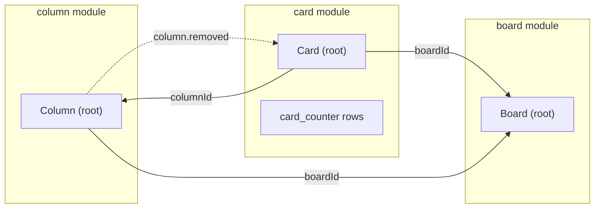
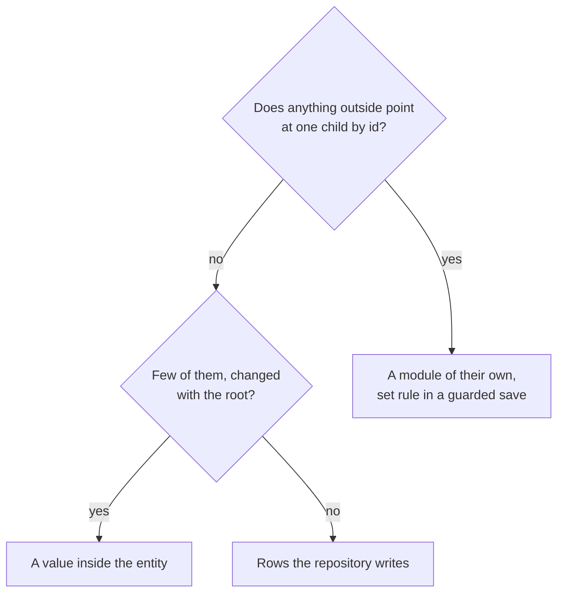
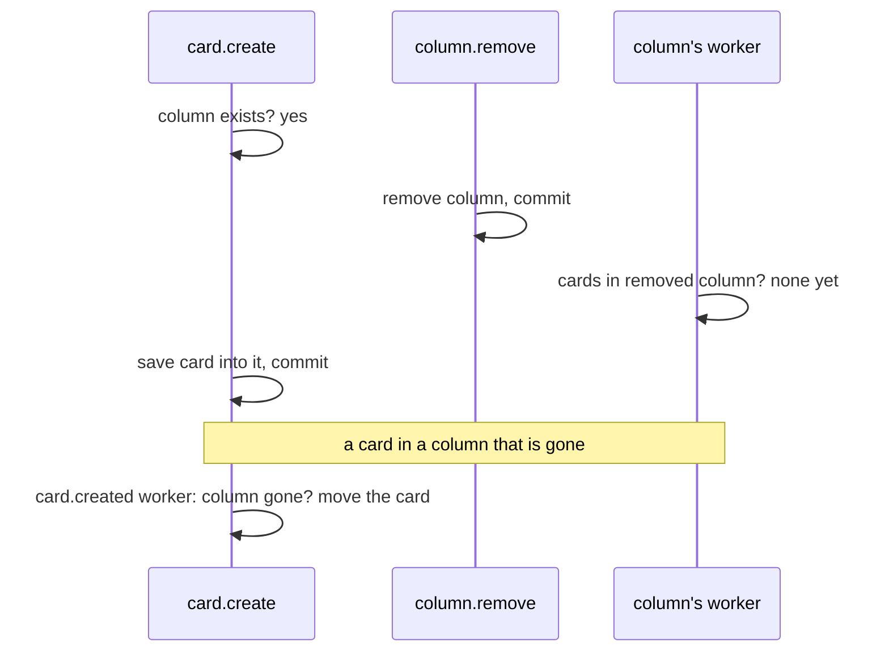

# Aggregates

<p class="chapter-lead">A board has columns, a column has cards, an OAuth client has its redirect
addresses. Some of these belong inside their owner; others need a life of their own. This chapter
gives you the idea that decides which (the aggregate), shows how newt maps it onto modules,
entities and saves, and walks through the three shapes cooper uses for "an entity with children".</p>

## The problem

You are modelling cooper's boards. A board has columns, and a board never has more than ten. The
textbook answer is to make the board own them: `board.addColumn(name)` checks the count, and
saving the board saves its columns. One object, one rule, one place to look.

Then the cards arrive. A card sits in a column, so it points at it. A card moves between columns.
Columns get their own events (renamed, moved, removed) that cards react to. Should the board own
the cards too? Then every card move is a change to the board, every two people moving two
different cards collide on the board's version, and loading a board to rename it loads a thousand
cards.

The opposite mistake is just as easy. An OAuth client has a list of redirect addresses. Make each
address a row of its own module, and you now need a module, a repository, events and a guard to
keep "at most ten addresses", for a list nobody outside the client ever points at.

Both are the same question asked badly: **what must change together, under rules that hold after
every save?** That set is an aggregate, and drawing it well is most of the design of a module.

## The idea

::: info Concept: Aggregate
A cluster of data that changes together, under rules (invariants) that must be true after every
transaction, not eventually. One entity is its **root**: the only one outsiders talk to, and the
only way to change the rest. The idea comes from Eric Evans' *Domain-Driven Design*; Vaughn
Vernon's *Effective Aggregate Design* turned it into four rules.
:::

Vernon's rules, briefly:

1. **Model true invariants in consistency boundaries.** Draw the aggregate around the data a rule
   needs, and nothing more.
2. **Design small aggregates.** A large one loads more than a use case needs, and every change to
   any part of it collides with every other.
3. **Reference other aggregates by identity.** Hold another's id, never the object.
4. **Use eventual consistency outside the boundary.** A change in one aggregate reaches another
   through a domain event, in that other's own transaction.

Behind them sits a rule of thumb: modify one aggregate per transaction.

newt is built on these rules. You have met every piece in Part I; here they are side by side:

| Vernon | newt |
|---|---|
| An aggregate, with its root | A module, with its entity |
| Only the root changes its parts | Only the entity changes itself (`change()` is protected); only the repository touches the store |
| One version per aggregate | One `version` per entity's row, checked on every save |
| One aggregate per transaction | A save is one module's; the write rule refuses two modules in one transaction |
| Reference by identity | References are ids, checked by asking the other module |
| Eventual consistency outside | Domain events through the outbox, `handler` workers |



Each box is a boundary. Arrows are ids, never objects. The dotted arrow is an event: when a column
goes, its cards follow a moment later, in their own transaction.

## Three shapes for children

When an entity seems to own children, newt gives you three ways to keep them. Which one fits
depends on two questions: **does anything outside point at a child by its id?** and **is a child
changed by many people at once, or on its own?**



### 1. A value inside the entity

When the children are few, nobody points at them one by one, and they change with the root, keep
them **in** the entity, as a field. auth's OAuth client keeps its redirect addresses this way:

```ts
// cooper/backend/contexts/auth/modules/oauth-client/oauth-client.schema.ts
export const OauthClientSchema = z.object({
  id: z.uuidv7(),
  clientId: z.string().min(1),
  name: z.string().min(1).max(80),
  redirectUris: z.array(OauthClientRedirectUriSchema).min(1).max(10),
  productId: z.string().nullable(),
  createdAt: z.string().default(''),
  updatedAt: z.string().default(''),
})
```

The list is part of the client's row. The repository tells the store it is JSON, so stores without
a JSON type (SQLite keeps it as text) know how to read it back:

```ts
// cooper/backend/contexts/auth/modules/oauth-client/oauth-client.repository.ts
super(base, base.store.table<OauthClientRow>('oauth_client', { types: { redirectUris: 'json' }, unique: [['clientId']] }), { scope: 'none' })
```

Look at what this buys. The rule "one to ten addresses" is **in the schema**, so it holds every
time the entity changes: `change()` parses the whole entity, and an entity method that breaks its
own schema throws `InvalidEntity` before anything is saved. The root's version covers the whole
list: two requests changing the addresses at once collide on the client's row, and the second runs
again. No guard, no second module, no events between them. The entity changes the list whole:

```ts
// cooper/backend/contexts/auth/modules/oauth-client/oauth-client.ts
/** A product's own client follows the product: its name, where it gets its codes, its secret. */
reconfigure(input: { name: string, redirectUri: string, secret: ClientSecret }): void {
  const secretHash = /* … */
  this.change({ name: input.name, redirectUris: [input.redirectUri], secretHash })
}
```

`change` compares the new list with the old one deeply, so setting the same list is no change, and
a save with nothing changed writes nothing and tells nothing.

::: tip In cooper
newt-monitor keeps several values this way too: a structure version's whole description
(`structure_version`, `types: { description: 'json' }`) and a connection's identity and last
failure (`connection`, `types: { identity: 'json', failure: 'json' }`), in
`packages/newt-monitor/backend/contexts/monitor/modules/`.
:::

This is Vernon's root-owns-children, and it is the right shape more often than people think. Its
limits are its size (every change rewrites and re-reads the whole value) and its reach (nobody can
point at "the third address" from elsewhere, nor query across many clients' addresses with an
index).

### 2. A module of their own

When something outside points at a child by id, the child is an aggregate of its own: a module.
Cards point at columns, so `column` is a module, and the rule that used to be the board's ("at most
ten columns") moves into the column's save, under a guard named after the set it protects:

```ts
// cooper/backend/contexts/boards/modules/column/column.repository.ts
async persistAdded(column: Column): Promise<void> {
  const { boardId } = column
  await this.save([column], each => this.write(each), {
    guard: [`columns:${boardId}`],
    before: async () => column.place(await this.count({ boardId })),
    after: async () => {
      if (await this.count({ boardId }) > MAX_COLUMNS) throw new TooManyColumns(boardId)
    },
  })
}
```

Read the guard key as the name of a consistency boundary. `columns:<board>` is exactly the
aggregate Vernon would draw, "a board's columns", without a class for it. Saves of that set take
turns; every other save runs side by side ([Versions, conflicts and guards](./20-concurrency)).

The same shape answers rules Vernon's design struggles with:

- **A name free in its workspace.** `persistWithNameFree` guards
  `boardName:<workspace>:<name folded>` and counts in `after`. Vernon calls this set validation, and
  it has no good home in one aggregate: a workspace that owned every board would be the large
  aggregate rule 2 warns about. The guard is as narrow as the rule.
- **An order.** `persistOrder` saves every column (or card) whose position changes, each at its
  version, in one save, and checks in `after` that the positions run 0, 1, 2… without gaps.

That last one is newt's one deliberate departure from Vernon. His rule of thumb is about
**instances**: one aggregate per transaction. newt's is about **modules**: a save writes entities of
one module, as many as it is given, all or none. Moving a column rewrites the positions of its
board's other columns, several rows each with its own version, in one save. The question the save
answers is the one rule 1 asks: which rows must be consistent together for this change? Here, the
columns of one board.

::: warning Watch out
The invariant now lives in the repository, not the entity. `Board` knows nothing of "at most ten
columns"; `Column_Repository.persistAdded` does. When you look for a module's rules, read its
entity, its use cases and its repository's save hooks.
:::

### 3. Rows the repository writes

Some children are no entity's: nobody loads them on their own, they have no events, and the module
that owns them is the only one that reads them. cooper's card counter is one. Each board's last card
number is a row of `card_counter`, which the card's save takes one up, in `before`, under the
board's guard:

```ts
// cooper/backend/contexts/boards/modules/card/card.repository.ts
/** The last number a board gave a card: its id is the board's. A card deleted does not give it back. */
export type CardCounterRow = { id: string, workspaceId: string, lastNumber: number, version: number }

export class Card_Repository extends TableRepository<Card, CardRow, BoardsBase> {
  private readonly counters

  constructor(base: BoardsBase) {
    super(base, base.store.table<CardRow>('card', { unique: [['boardId', 'number']] }), {
      scope: { field: 'workspaceId', current: currentWorkspaceId },
    })
    this.counters = base.store.table<CardCounterRow>('card_counter')
  }
  // …
}
```

The counter is part of the card module's aggregate, kept in a second table of the same repository.
Vernon would keep it on the board, and then every new card would collide with every rename of the
board on the board's version. As a row of its own, changed only by new cards and only under
`boardCards:<board>`, new cards take turns and nothing else waits.

A repository writes rows of no entity in two places: inside an entity's save (in `before` or
`after`, as the counter), or on their own with `saveRows`, which runs them in one transaction under
the same rules:

```ts
// cooper/backend/contexts/boards/modules/card/card.repository.ts
async purgeWorkspace(workspaceId: string): Promise<void> {
  await this.saveRows(async () => {
    await this.purge({ workspaceId })
    await this.counters.deleteMany({ workspaceId })
  })
}
```

When an entity's children are stored in a way a single table cannot say (an order's lines in a
table of their own, read back with the order), extend `Repository` instead of `TableRepository`:
its `save` takes your own `write` for each entity, and you decide how rows become an entity.

::: details Under the hood: the base `Repository`
`packages/newt/repository/repository.ts` holds `save`, `saveRows` and `conflict`. `TableRepository`
adds finding, paging, scopes and soft deletes on one `Table`, and a `write` that inserts, updates at
the version, or deletes. Extending `Repository` keeps the transaction, the write rule, the guard
rule, the events and the versions; you keep the shape of the rows.
:::

## Outside the boundary: events, followed from both sides

Between aggregates, consistency is eventual. A card checks its column exists before it saves, by
asking the column module, outside the column's transaction. So the column may be removed a moment
later. cooper's card module follows the column's event, and moves any card left in a removed column
to the board's first one:

```ts
// cooper/backend/contexts/boards/modules/card/card.workers.ts
deps.column.events.removed.subscribe(column => cards.leaveRemovedColumn(column), {
  strategy: 'handler',
  queue: 'card.leaveRemovedColumn.on.column.removed',
})
cards.events.created.subscribe(card => cards.leaveRemovedColumn({ id: card.columnId, boardId: card.boardId, workspaceId: card.workspaceId }), {
  strategy: 'handler',
  queue: 'card.leaveRemovedColumn.on.card.created',
})
```

Why the second subscription? Following only the column's event leaves a gap:



The column's worker ran before the card committed, and found nothing. So the card follows its own
event too. Each follower runs after its own commit and checks the **other side's state**, not what
the event said; whichever runs last sees both commits, so the two converge in any order. And each
is safe to run twice: the second time, there is nothing in the removed column
([Doing things once](./24-idempotency)).

A piece of work across several aggregates is a sequence of saves from a worker, each its own
transaction, each step finding what an earlier run did. boards' welcome board is one: on auth's
`tenant.created`, `workspace.prepare` writes a board, three columns and a card, in three modules,
which only a worker may do ([Between contexts](./11-between-contexts)).

## Finding a boundary

Ask these, in order:

1. **What rule must hold after every save?** Draw the boundary around the data it reads. "At most
   ten columns" reads a board's columns: that set is the boundary, and `columns:<board>` its name.
2. **Can it be true a moment later instead?** Then it is not one boundary; the second part follows
   by an event. A card in a removed column moves a moment later.
3. **Does something else point at it by id?** Then it is a module of its own. Cards point at
   columns, so columns are not a field of the board.
4. **Is it changed by many people at once?** Keep it apart from what changes rarely. The card
   counter is a row of its own, not a field of the board.
5. **Does describing it need an "and"?** Then it is two modules.

Two signs that a boundary is wrong: a use case keeps needing `writesTo` for the same two modules
(they change together, so they may be one), or two modules' saves guard the same key (the rule spans
both, so one of them owns it).

## How other approaches compare

The same problem has other answers. A short map, so you know what newt chose:

| Approach | Where rules live | Concurrency | Across aggregates |
|---|---|---|---|
| newt | Entity methods and schema; set rules in guarded saves | Version per row, named guards, retry | Events, outbox, workers |
| ORM object graphs (JPA, EF Core) | The root's methods over loaded children | Version on the root | Often one shared transaction |
| Transaction scripts | The service and the database | Row locks, `SELECT … FOR UPDATE` | One transaction for everything |
| Event sourcing | Command handlers on a stream | Expected stream version | Events, process managers |
| Actors (Orleans, Akka) | The actor's handler | One writer by construction | Messages |
| The database only | Constraints, triggers, `SERIALIZABLE` | The database | One transaction, or none |

newt uses the database for the last word only: a unique index under a rule the code already checks.

## What it costs

Be clear about the trade:

- **A set rule is written twice**: in the use case, for the clear answer, and in the save, where it
  holds.
- **You test it against a store**, with saves at once (`Promise.allSettled`), not as a unit test of
  one class.
- **A guard waits; a version fails.** Good for a hot counter, bad for a save that holds its key long.
- **Guard keys are strings**, tied to their rule only by convention.
- **A follower watches both sides.** Eventual consistency is only as good as the reactions that
  close it.
- **It is still one store.** A guard works because the rows are in one database. A rule over two
  contexts' data is eventual, by events.

What it buys: small aggregates by construction, rules over sets without a class that holds the set,
hot counters without collisions, and the same code on every store.

## Common mistakes

**Two modules in one use case.** `card.create` that also updates a board's count of cards. The write
rule refuses it outside a worker. Do the second part from a worker on `card.created`, or, if the two
always change together, make them one module.

**Reading, then writing, without a guard.**

```ts
if (await this.repo.count({ boardId }) >= MAX_COLUMNS) throw new TooManyColumns(boardId)
await this.repo.persist(column)
```

Right in every SQLite test; on Postgres two requests count nine and both save. Repeat the count in
`after`, under a guard. The check before is only for the clear answer.

**Calling another module from a save hook.** A hook runs inside the transaction; a save of another
module there is refused by the write rule. A hook reads and writes only its own module's rows.

**An aggregate that grows.** A board that starts holding its columns, then its cards, then each
card's activity. Split by questions 3 and 4: what others point at, and what many change at once, go
apart.

**A worker that trusts the event.** A job runs later, maybe after other changes, maybe twice. It
reads again what it is about before acting, as `leaveRemovedColumn` lists the board's columns again.

## Recap

- An aggregate is what must change together under rules that hold after every save; in newt it is a
  module, and its entity is the root.
- Children nobody points at, few and changed with the root: a field of the entity (`types: 'json'`),
  with the rule in the schema and the root's version covering them.
- Children others point at: a module of their own, with the set rule in a save guarded by the set's
  name.
- Rows of no entity (a counter, a link table): rows the repository writes, in an entity's save or in
  `saveRows`.
- A save's boundary is a module, not an instance: several rows of one module, all or none.
- Outside the boundary, events through the outbox, followed from both sides, safe to run twice.

## Going further

- [Versions, conflicts and guards](./20-concurrency): guards, `this.conflict()` and the write rule in
  depth.
- [Between contexts](./11-between-contexts): following another context's events.
- [Doing things once](./24-idempotency): why every follower may run twice.
- [The rules](./a-rules): "a value many change at once", and the rest of the saving rules.
