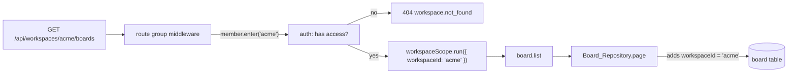
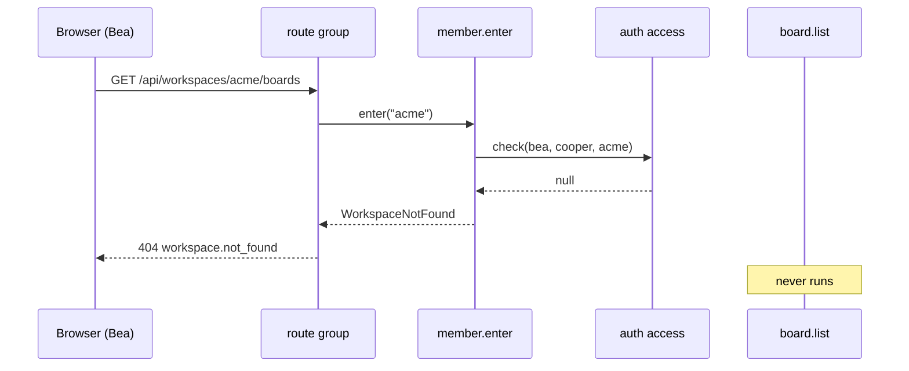
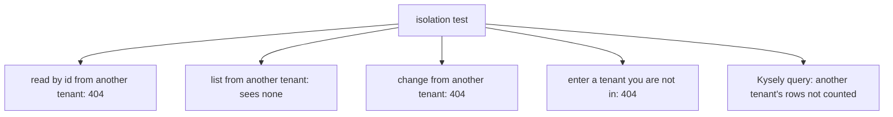

# Tenants and scopes

<p class="chapter-lead">A SaaS keeps many customers' data in one database, and one forgotten
<code>where</code> shows Acme's boards to Globex. This chapter shows how newt makes "whose rows are
these" something you say once, where the work comes in, so that no repository can forget it, and
how to enter, leave and test a tenant's scope on purpose.</p>

## The problem

cooper keeps every workspace's boards, columns and cards in the same tables. Each row has a
`workspaceId`. Every query of every repository must say `where workspace_id = ?`, and every save
must check that the row it changes belongs to the workspace the request is about.

That is dozens of places, and each is one line easy to forget. Forget it in a list and a stranger
sees someone else's data. Forget it in a save and someone can move a card into another workspace by
sending its id. Pass the workspace id down by hand as an argument, and every use case, every
repository method and every helper grows a parameter that someone, some day, fills with the wrong
value.

And the question "may this person see this workspace?" is not the repository's to answer. It is
auth's: it knows who has access to what. boards should ask, once, before any of its code runs.

## The idea

newt splits the problem in two:

- **Where the work comes in**, decide which tenant it is about, after checking that whoever acts
  belongs to it, and **enter that tenant's scope**.
- **Every repository of tenant rows** says which field holds the tenant, and reads it from the
  scope. Inside, it filters every read and checks every save by itself.



::: info Concept: Scope
A value that travels with the work in progress, as the actor does: set once where the work comes in
(a route group, a worker, a script, an MCP tool) and read anywhere below without being passed by
hand. It follows the code across `await`s, and ends when the function you gave it returns.
:::

::: info Concept: Tenant
A customer whose data is kept apart from every other's in shared tables: in cooper, a workspace.
auth calls them tenants, because it serves several products; boards calls them workspaces.
:::

## Defining a scope

A scope is defined once, for the context, with `defineScope`:

```ts
// cooper/backend/contexts/boards/workspace-scope.ts
import { defineScope } from 'newt/core'

/** The workspace the work in progress is about: an auth tenant, by its id. */
export type WorkspaceScope = {
  workspaceId: string
}

export const workspaceScope = defineScope<WorkspaceScope>('workspace', {
  missing: () => new Error('No workspace here: a route under /workspaces/:workspaceId, inWorkspace or runInWorkspace enters one'),
})

/** The id of the workspace the work in progress is about; throws outside one. */
export function currentWorkspaceId(): string {
  return workspaceScope.current().workspaceId
}
```

A `Scope<T>` has three methods:

| Method | Does |
|---|---|
| `run(value, fn)` | Runs `fn` inside the scope, with `value`; returns what `fn` returns |
| `current()` | The value, or throws `missing()` outside the scope |
| `find()` | The value, or `undefined` outside it |

`missing` is the error `current()` throws when nobody entered the scope. Make it say how to enter
one: it is the message a developer reads the first time a worker forgets.

The scope's name (`'workspace'`) is also how the application's metrics say which value of it an
event was told in, so newt-monitor can count events per workspace. A scope of your own that should
not be counted says `counted: false`.

::: details Under the hood: AsyncLocalStorage
`defineScope` is a thin layer over Node's `AsyncLocalStorage` (`packages/newt/core/scope/define-scope.ts`).
That is why the value follows every `await` inside `run`, and why it is lost by code that leaves
the async chain (an `EventEmitter` callback, a timer set up elsewhere). newt's own pieces of
"current" state (the actor, the transaction, the invocation chain) are scopes of the same kind.
:::

## A scoped repository

Every repository says what its rows belong to. It is required, so a scope is never dropped by
leaving it out:

```ts
// cooper/backend/contexts/boards/modules/board/board.repository.ts
export class Board_Repository extends TableRepository<Board, BoardRow, BoardsBase> {

  constructor(base: BoardsBase) {
    super(base, base.store.table<BoardRow>('board', { unique: [['workspaceId', 'name']] }), {
      softDelete: true,
      // Every find, count and page sees the current workspace's boards only.
      scope: { field: 'workspaceId', current: currentWorkspaceId },
    })
  }
  // …
}
```

`scope: { field, current }` says the rows of this table belong to a tenant, which `field` names, and
`current` gives the one of the work in progress. From then on the repository does three things by
itself:

1. **`find`, `first`, `count` and `page` add `workspaceId = current()`** to whatever criteria they
   are given, alongside `deletedAt: null` for a soft-deleting one. A use case asks
   `this.repo.find({ id })` and gets the board only if it is the current workspace's.
2. **Saving refuses an entity of another scope.** `write` checks the entity's field, and for a stored
   one the value it was read with too, against `current()`. An entity whose `workspaceId` was changed
   to move it, or one read in another scope, is refused:

   ```text
   Board 0196… belongs to workspaceId 'globex', not to the current one: a repository saves only its scope's
   ```

3. **Outside a scope, `current` throws.** A worker that forgets to enter the workspace fails at its
   first read with the scope's `missing` message, instead of reading every workspace's rows.

The use cases above the repository never mention the workspace. Here is the whole of `board.get`:

```ts
// cooper/backend/contexts/boards/modules/board/board.module.ts
@UseCase()
async get(id: string): Promise<BoardDTO> {
  return (await this.load(id)).toDTO()
}

private load(id: string): Promise<Board> {
  return this.resolve(() => this.repo.find({ id }), () => new BoardNotFound(id))
}
```

A board of another workspace is simply not found: a 404, `board.not_found`, the same answer as an id
that never existed.

A new entity takes its tenant from the scope when it is created, never from the client:

```ts
// cooper/backend/contexts/boards/modules/board/board.module.ts
const board = Board.create({ workspaceId: currentWorkspaceId(), name, description })
```

::: danger Never
Never drop a scope to make something work. A repository that needs to read across tenants keeps its
scope and has a method named for it (below). `scope: 'none'` is for tables whose rows belong to no
tenant, with a comment saying why.
:::

### What a repository writes itself

The scope covers what `TableRepository` does for you. What a subclass does on its own must add the
`where` itself:

- **A Kysely query** in the repository says `.where('workspaceId', '=', currentWorkspaceId())`:

  ```ts
  // cooper/backend/contexts/boards/modules/card/card.repository.ts
  /** How many cards each board of the current workspace has: boards without any are not there. */
  async countByBoard(): Promise<CardCountByBoard[]> {
    const rows = await this.base.db
      .selectFrom('card')
      .select(eb => ['boardId', eb.fn.countAll<number>().as('cards')])
      .where('workspaceId', '=', currentWorkspaceId())
      .groupBy('boardId')
      .orderBy('boardId')
      .execute()
    return rows.map(row => ({ boardId: row.boardId, cards: Number(row.cards) }))
  }
  ```

- **`this.table`** used directly (the raw `Table`, below the repository) sees every row.
- **A second table** of the repository, like the card counter, is read by its id, which is the
  board's: a board already checked to be the current workspace's.

The `after` hook of a save is usually fine: `this.count(...)` there is the repository's own, scoped.

::: warning Watch out
Kysely queries are the one place a tenant filter is easy to forget, and nothing checks it. Keep them
few, in the repository, and give each a test with a second tenant ([Queries, analytics and
ports](./25-queries)).
:::

## Entering the scope

### In a route group, after checking membership

boards serves everything about a workspace under `/api/workspaces/:workspaceId`. One route group
enters the scope for all of them, once auth says the signed-in person belongs:

```ts
// cooper/backend/contexts/boards/workspace-routes.ts
/**
 * The routes about one workspace, under `/api/workspaces/:workspaceId`: each one runs
 * in that workspace once `member.enter` has checked the signed-in person belongs to it
 * (404 for anyone else), so no use case below has to, nor can forget to. Every module
 * of `boards` registers its routes on it.
 */
export function workspaceRoutes(base: BoardsBase, members: Member_Module) {
  return base.http.group('/workspaces/:workspaceId', async (request, next) =>
    workspaceScope.run(await members.enter(request.params.workspaceId), next))
}
```

The group's middleware calls a use case, `member.enter`, which asks auth and answers the scope's
value, or throws:

```ts
// cooper/backend/contexts/boards/modules/member/member.module.ts
/**
 * The workspace scope for the signed-in person, if they belong to it: what a route
 * under `/workspaces/:workspaceId` runs in. To anyone else it does not exist (404,
 * not 403: a private thing does not own up to existing).
 */
@UseCase()
async enter(workspaceId: string): Promise<WorkspaceScope> {
  if (!await this.belongs(workspaceId, currentActor().userId)) throw new WorkspaceNotFound(workspaceId)
  return { workspaceId }
}
```

`belongs` asks auth's `access` module, and checks the workspace is still there, **every time**. Who
belongs is never copied into the session or the actor: someone removed from a workspace is out on
their next request.



### A stranger gets a 404

Bea is in Globex. When she asks for Acme's boards she gets `404 workspace.not_found`, never
`403 forbidden`. A 403 would confirm that Acme exists and that she guessed a real id. To someone who
does not belong, a private workspace and a workspace that never existed are the same thing, and the
error says so in its comment:

```ts
// cooper/backend/contexts/boards/modules/member/errors/workspace-not-found.ts
/** A workspace the person does not belong to, or that does not exist: to them, the same thing. */
export class WorkspaceNotFound extends NotFoundError {
  readonly code = 'workspace.not_found'
  constructor(id: string) {
    super(`There is no workspace ${id}`)
  }
}
```

The same holds one level down: a board id of another workspace, sent inside Acme's routes, is
`board.not_found`, because the scoped repository never finds it.

### In workers and scripts

A worker runs on its own, outside any request: it has **no actor and no scope**. It never inherits
the scope of the request whose save made its job. It reads the tenant from the event's payload and
enters it:

```ts
// cooper/backend/contexts/boards/workspace-scope.ts
/** Runs in a workspace without checking who may: for workers and scripts, which already know. */
export function runInWorkspace<T>(workspaceId: string, fn: () => T): T {
  return workspaceScope.run({ workspaceId }, fn)
}
```

```ts
// cooper/backend/contexts/boards/modules/card/card.module.ts
@UseCase()
async leaveRemovedColumn(column: Pick<ColumnDTO, 'id' | 'boardId' | 'workspaceId'>): Promise<void> {
  await runInWorkspace(column.workspaceId, async () => {
    const left = await this.repo.inColumn(column.id)
    if (left.length === 0) return
    // …
  })
}
```

It checks nobody, on purpose: the event came from a save already made in that workspace. That is why
every event payload of a tenant's entity carries its `workspaceId`, and why `runInWorkspace` is not
for anything a person calls directly.

A script entering a workspace by hand does the same, and if it saves into several modules it runs as
a worker would (`base.jobs.runAsWorker(fn)`), so the write rule treats it as one.

### In MCP tools

An MCP tool is a request like a route, from an assistant acting for a signed-in person. It enters the
workspace the same way a route group does, after checking:

```ts
// cooper/backend/contexts/boards/workspace-scope.ts
/** Runs in a workspace once the person signed in is checked to belong to it (404 otherwise): for the MCP tools. */
export async function inWorkspace<T>(members: Member_Module, workspaceId: string, fn: () => Promise<T>): Promise<T> {
  return workspaceScope.run(await members.enter(workspaceId), fn)
}
```

```ts
// cooper/backend/contexts/boards/mcp/mcp-tools.ts
const within = <T>(id: string, fn: () => Promise<T>) => inWorkspace(member, id, fn)

server.registerTool('list_boards', {
  title: 'List boards',
  description: 'The boards of a workspace, the newest first.',
  inputSchema: { workspaceId, ...pageArgs },
  annotations: READ_ONLY,
}, async args => within(args.workspaceId, async () =>
  answer(paged(await board.list(pageOf(args)), ({ id, name, description }) => ({ id, name, description })))))
```

| Where the work comes in | How it enters | Checks who? |
|---|---|---|
| A route under `/workspaces/:workspaceId` | the group's middleware, `member.enter` | yes, every request |
| An MCP tool | `inWorkspace(member, id, fn)` | yes, every call |
| A worker | `runInWorkspace(payload.workspaceId, fn)` | no: the event says |
| A script | `runInWorkspace(id, fn)` | no: whoever runs it is trusted |

## Reading across tenants, on purpose

Some work looks at every workspace by design: the staff's backoffice shows the boards created last,
whatever their workspace; a search index is rebuilt for every card. A scoped repository keeps its
scope and offers a method **named** for crossing it, built on the protected `findInEveryScope`:

```ts
// cooper/backend/contexts/boards/modules/board/board.repository.ts
/**
 * The boards created last, in every workspace: for the staff, who look across them
 * on purpose. Archived ones stay out.
 */
recentInEveryScope(limit: number): Promise<Board[]> {
  return this.findInEveryScope({}, { limit, orderBy: [{ field: 'id', direction: 'desc' }] })
}
```

`findInEveryScope` is the repository's `find` without the tenant filter (soft-deleted rows still stay
out). Because it is protected, a use case cannot call it; because the repository method says
`InEveryScope`, a review sees it. The use case above it says who may reach it, and no route of
boards calls it:

```ts
// cooper/backend/contexts/boards/modules/board/board.module.ts
/**
 * For the staff's backoffice: the boards created last, whatever their workspace. It
 * reads every workspace on purpose, so it does not run in one: no person of a
 * workspace reaches it (no route of boards calls it), and its repository says so by
 * name (`findInEveryScope`), where a review sees it.
 */
@UseCase()
async recentInEveryWorkspace(limit: number): Promise<BoardDTO[]> {
  const boards = await this.repo.recentInEveryScope(Math.min(Math.max(limit, 1), 50))
  return boards.map(board => board.toDTO())
}
```

When another context wants one workspace's rows (the backoffice listing Acme's boards), the module
enters that workspace for it, rather than reading across:

```ts
// cooper/backend/contexts/boards/modules/board/board.module.ts
/** For other contexts (the backoffice): a page of a workspace's boards, the newest first. */
@UseCase()
async listOf(workspaceId: string, page: PageRequest): Promise<Page<BoardDTO>> {
  return runInWorkspace(workspaceId, () => this.list(page))
}
```

And when a tenant is gone for good, its rows are removed with `purge(criteria)`, which, like
`deleteMany`, works in every scope: the criteria alone say which. The workspace is named, not the
current one, since auth deleted it and nobody is in it:

```ts
// cooper/backend/contexts/boards/modules/board/board.repository.ts
async purgeWorkspace(workspaceId: string): Promise<void> {
  await this.purge({ workspaceId })
}
```

## `scope: 'none'`, and why auth uses it

Not every table belongs to a tenant. Every repository of auth says `scope: 'none'`, each with its
reason:

```ts
// cooper/backend/contexts/auth/modules/user/user.repository.ts
// No scope: people belong to no tenant; they are in many.
super(base, base.store.table<UserRow>('user'), { scope: 'none' })
```

```ts
// cooper/backend/contexts/auth/modules/access/access.repository.ts
// No scope: a person's accesses span tenants (and the staff's belong to none); the use cases ask who may see them.
super(base, base.store.table<AccessRow>('access'), { scope: 'none' })
```

```ts
// cooper/backend/contexts/auth/modules/invitation/invitation.repository.ts
// No scope: an invitation is found by its token before anyone is in its tenant; the use cases ask who is its admin.
super(base, base.store.table<InvitationRow>('invitation'), { scope: 'none' })
```

auth is the context that **decides** who is in which tenant, so it cannot itself run inside one. A
person is in many workspaces; an access is the link between a person and a tenant; an invitation is
opened before its reader belongs to anything; the tenants are the tenants. Sessions, tokens, OAuth
clients and grants are a person's or the product's. So every use case of auth asks, itself, who may
see what (is this person the tenant's admin? is this their own session?).

`'none'` is written, never left out: the option is required, and the type refuses a repository
without it. Dropping a scope is writing `'none'`, where a reviewer reads it.

::: tip In cooper
boards and the backoffice are opposite cases. Every repository of boards is scoped by
`workspaceId`. The backoffice has no repository of its own: it asks boards and auth through their
modules, which enter scopes or read across them by name. The web sessions every context keeps
(`cooper/backend/shared/web-session/web-session.repository.ts`) say `scope: 'none'`: a session is a
person's, found by its token, in no workspace.
:::

## Testing isolation

Every repository of tenant rows has a test where a second tenant cannot read, change or list the
first's rows. cooper's test helper runs a use case as a person, in a workspace they belong to, the
way a route does:

```ts
// cooper/backend/contexts/boards/testing/open-test-boards.ts
/** Runs as someone, in a workspace they belong to: what a route under `/workspaces/:workspaceId` (or an MCP tool) does. */
as<T>(userId: string, workspaceId: string, fn: () => Promise<T>, via: ActorVia = 'web'): Promise<T> {
  return runAsActor({ userId, via }, () => inWorkspace(boards.modules.member, workspaceId, fn))
},
```

and the board tests use it with Ana in Acme and Bea in Globex:

```ts
// cooper/backend/contexts/boards/modules/board/board.test.ts
test('shows a workspace\'s boards to its members only, and nobody else\'s', async () => {
  const roadmap = await create('Roadmap')

  await expect(t.as('bea', 'globex', () => t.modules.board.get(roadmap.id))).rejects.toMatchObject({ code: 'board.not_found' })
  await expect(t.as('bea', 'acme', () => t.modules.board.list({ size: 10 }))).rejects.toMatchObject({ code: 'workspace.not_found' })
  expect((await t.modules.board.listOf('acme', { size: 10 })).items.map(board => board.id)).toEqual([roadmap.id])
})
```

Three cases in three lines: Bea in her own workspace cannot see Acme's board by id; Bea cannot enter
Acme at all; and the backoffice's `listOf` sees it. Over HTTP, `boards.context.test.ts` checks the
same through the route group: no session is a 401, a stranger is a 404 `workspace.not_found`, and
another workspace's board id is a 404.



::: warning Watch out
A test that only uses one tenant proves nothing about isolation: every repository looks right when
there is one workspace. Always open a second one, with something in it.
:::

## Recap

- A scope (`defineScope`) carries the tenant of the work in progress; `run` enters it, `current()`
  reads it, and throws `missing()` outside it.
- Every repository says `scope: { field, current }` for tenant rows, or `scope: 'none'` with a
  reason; a scoped one filters every find, count and page, and refuses to save another scope's
  entity.
- A route group enters the scope after asking the module that knows whether the person belongs,
  every request; MCP tools do the same; workers and scripts enter it from the payload.
- A stranger gets a 404, never a 403: a private thing does not own up to existing.
- Kysely queries and raw table reads add the tenant's `where` themselves.
- Reading across tenants is a named method over `findInEveryScope`; purging names the tenant.
- Every scoped module has a test with a second tenant that reads, lists and changes nothing.

## Going further

- [Authentication and access](./29-auth): how auth decides who may enter which tenant.
- [Queries, analytics and ports](./25-queries): Kysely in a scoped repository.
- [Doing things once](./24-idempotency): workers that enter a scope from their event.
- [HTTP security](./27-security): what else stands between a request and someone else's data.
