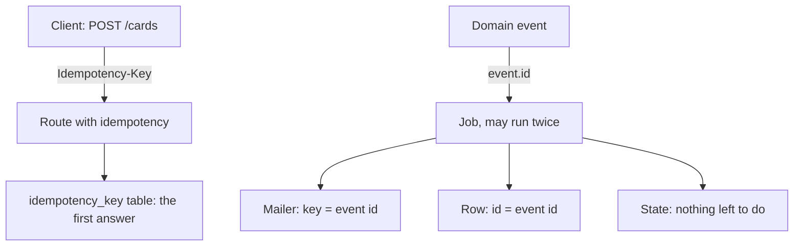
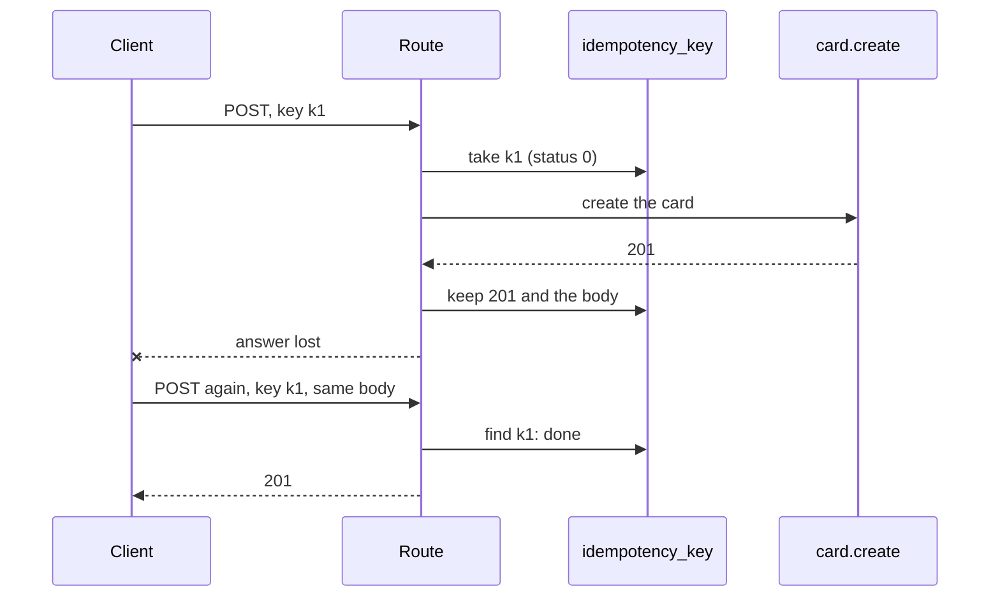
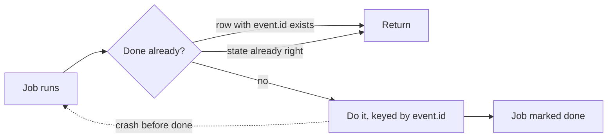

# Doing things once

<p class="chapter-lead">Networks drop answers, browsers resubmit, workers crash halfway, and a job
may run twice. This chapter shows how newt makes a repeated request or a repeated job do its
work once: an <code>Idempotency-Key</code> for a POST that creates, and jobs keyed by their
event's id, written so that a second run finds nothing to do.</p>

## The problem

Ana adds a card, *Plan*, on a train. She presses Enter. The request reaches cooper, the
card is created as #7, and the answer is lost in a tunnel. Her screen shows an error.
She presses Enter again. Now the board has #7 *Plan* and #8 *Plan*.

The same thing happens behind the server's back. Bob assigns #7 to Ana, and a worker
sends her an email. The mail provider accepts it, then the worker's process is killed
before it marks the job done. A minute later, another worker claims the job and sends
the email again.

Both are the same failure: **something was done, and the proof that it was done got
lost**. The sender can only try again. So the receiver has to recognise the retry.

## The idea

::: info Concept: Idempotent
An operation is idempotent when doing it twice leaves things as doing it once. Renaming a
card to *Plan* is: the second rename changes nothing. Creating a card is not: each
call makes a new one. Sending an email is not, unless the provider is told "this is the
same email".
:::

Most of what a backend does is idempotent already, or can be made so by writing it as
"make it so" rather than "do it again". What is left needs a **key**: a name for the
operation that is the same on every try, so the receiver can say "I did this one".

newt gives each side its key:



- A **request** carries a key the client chose, in the `Idempotency-Key` header.
- A **job** carries the id of the event it reacts to, `event.id`, the same on every run.

## Which requests need a key

Go through cooper's routes and ask, for each: what happens if it arrives twice?

- `PATCH /cards/:cardId` renaming a card to *Plan*: the card is called *Plan*. Safe.
- `POST /cards/:cardId/assign` to Ana, twice: the card is Ana's. Safe (the second
  tells no event: nothing changed).
- `DELETE /cards/:cardId`, twice: the second finds nothing, a 404. Safe.
- `POST /cards/:cardId/move` to *Doing*, twice: the card is in *Doing*. Safe.
- `POST /boards` with a name, twice: the second is `board.name_taken`. The rule makes it
  safe, though the client sees an error.
- `POST /boards/:boardId/cards`, twice: **two cards**. A card has nothing unique to
  collide on.

So in cooper exactly one route takes the option. That is the usual outcome: a POST that
**creates** something with no natural unique value.

## An idempotent POST

The route says where to keep the first answers:

```ts
// cooper/backend/contexts/boards/modules/card/card.routes.ts
  // A client may send it again with the same `Idempotency-Key` (its answer lost on the
  // way): it gets the card made the first time, kept in the store, not a second one.
  workspace.post('/boards/:boardId/cards', async request => Response.json(await cards.create(request.params.boardId, await request.json()), { status: 201 }), { idempotency: { table: base.store.table<KeptAnswer>('idempotency_key') } })
```

`idempotency` is a route option (a group's or a router's too) of type `Idempotency`
(`packages/newt/http/idempotency.ts`):

| Field | Means |
|---|---|
| `table` | Where first answers are kept: `store.table<KeptAnswer>('idempotency_key')`. |
| `ttlMs` | How long a key is remembered: a day by default. |
| `clock` | What tells the time; `now` unless told. |

It applies to POST only: on any other method the router ignores it.

The table is the context's own, made by a migration like any other:

```sql
-- cooper/backend/contexts/boards/migrations/sqlite/00004_idempotency_key_up.sql
CREATE TABLE idempotency_key (
  id TEXT PRIMARY KEY,
  version INTEGER NOT NULL,
  body_hash TEXT NOT NULL,
  status INTEGER NOT NULL,
  headers TEXT NOT NULL,
  body TEXT NOT NULL,
  expires_at TEXT NOT NULL
);
CREATE INDEX idempotency_key_expires_at ON idempotency_key (expires_at);
```

Because the answers live in the context's store, every server of a deployment sees them:
a retry that lands on another instance still gets the first answer.

### What it does

A request without the header runs as usual. One with it goes through `idempotent`
(`packages/newt/http/idempotent.ts`):

1. The key's row id is a hash of **who** sends it (the current actor), **where** (the
   URL's path) and the key. Two people, or two paths, never share a key.
2. It hashes the body.
3. It looks for the row. If one is there and not expired:
   - another body: **422 `idempotency_key_reused`**;
   - still in progress (status 0): **409 `idempotency_key_in_use`**;
   - done: the kept answer, status, headers and body, plus `idempotent-replayed: true`.
4. Otherwise it **takes** the key: inserts the row (or updates an expired one at its
   version) with status 0. Two requests that race to take it cannot both win: the loser
   gets a `ConcurrencyConflict`, answered as 409 `idempotency_key_in_use`.
5. It runs the route, and keeps its answer for `ttlMs`.



Two choices in it are worth knowing:

- **Failures are not kept.** If the route throws, or answers a 5xx, the row is removed:
  the same key may try again, and should. A 4xx (a validation error, a full board) is an
  answer, and is kept.
- **A key in progress is held a minute at most** (or `ttlMs`, if shorter). If the
  process dies midway, the key is not locked for a day: after a minute another request
  may take it. Expired keys are removed as new ones come, at most once a minute, by the
  `expires_at` index.

::: warning Watch out
`idempotency_key_reused` is a client bug: the same key with a different body. A key names
**one** submit, not one form. When the user edits the form after a failure, the client
must send a new key.
:::

### The client's half

The key only works if the client keeps it across retries of the same submit, and
changes it for anything else. cooper's form for a new card does both:

```ts
// cooper/frontend/boards/modules/boards/board/board-card-new/board-card-new.service.ts
  /**
   * One `Idempotency-Key` per card being made: a submit again after a failure (its
   * answer lost on the way) sends the same one, and gets the card the first one made.
   */
  private key = crypto.randomUUID()
  /** What the key was last sent with: the backend refuses it with another body. */
  private sent: string | null = null
  // …
  submit(): Promise<boolean> {
    return this.form.submit(async input => {
      const card = { ...input, columnId: this.columnId }
      const body = JSON.stringify(card)
      if (this.sent !== null && this.sent !== body) this.newKey()
      this.sent = body
      await this.board.createCard(card, this.key)
      this.newKey()
    })
  }
```

A new key per card; the same key on a retry with the same body; a new key once the body
changed, or once the card was made.

### Testing it

```ts
// cooper/backend/contexts/boards/boards.context.test.ts
    const first = await submit('submit-1')
    const again = await submit('submit-1')
    expect([first.status, again.status, again.headers.get('idempotent-replayed')]).toEqual([201, 201, 'true'])
    expect(await again.json()).toEqual(await first.json())
    expect((await call<unknown[]>('GET', `/acme/boards/${id}/cards`)).body).toHaveLength(1)

    expect((await submit('submit-2')).status).toBe(201)
    expect((await call<unknown[]>('GET', `/acme/boards/${id}/cards`)).body).toHaveLength(2)
```

## Jobs run at least once

On the server side there is no client to pick a key. There is no need: a job already
carries one.

::: info Concept: At least once
A `handler` subscription writes a job in the save's transaction, and a worker runs it
until it succeeds ([Workers](./10-workers)). "Until it succeeds" means it may run more
than once: a run that did its work and then failed to say so (a crash, a lost lease, a
timeout after the effect) is run again. newt promises a job runs **at least once**,
never "exactly once". Making it count once is your handler's job.
:::

Every published event gets an id, a UUIDv7 (`withId`, `packages/newt/runtime/events`),
and the job keeps the event as it was published, id included. A handler receives it as
its second argument, an `EventMeta` (`{ id, name, occurredAt }`). **On every run of the
job, `event.id` is the same.** That is the key.

There are three ways to use it, from most to least explicit.

### 1. Hand the key to whoever does the effect

An email cannot be taken back. cooper's `Mailer` port takes an optional key:

```ts
// cooper/backend/shared/mail/mailer.ts
  /**
   * The same email sent again has the same key, and is sent once: what a worker gives
   * when its job may run twice (the id of the event it tells of). A mailer of a real
   * provider must honour it, passing it as the provider's idempotency key (most take
   * one, as a header). None: each send is a new email.
   */
  key?: string
```

The worker passes the event's id through to the use case:

```ts
// cooper/backend/contexts/boards/modules/card/card.workers.ts
  cards.events.assigned.subscribe(({ dto, by }, { id }) => cards.notifyAssignee(dto, by, id), {
    strategy: 'handler',
    queue: 'card.notifyAssignee.on.card.assigned',
  })
```

and the use case builds the mail's key from it:

```ts
// cooper/backend/contexts/boards/modules/card/card.module.ts
  @UseCase()
  async notifyAssignee(card: CardDTO, by: string | null, eventId: string): Promise<void> {
    if (card.assigneeId === null || card.assigneeId === by) return
    const current = await runInWorkspace(card.workspaceId, () => this.repo.first({ id: card.id }))
    if (current?.assigneeId !== card.assigneeId) return
    // …
    await this.options.mailer.send({
      to: member.email,
      subject: `#${card.number} ${card.title} is yours`,
      text: /* … */,
      key: `card.notifyAssignee:${eventId}`,
    })
  }
```

The key names the reaction *and* the event: `card.notifyAssignee:<event id>`. Another
reaction to the same event (if one ever sent an email too) gets a key of its own.

Notice the lines before the send: the worker **reads the card again**. A job may run
late, after other changes. If the card is gone or has another assignee by then, there is
nothing to tell; that other assignment tells its own.

::: tip In cooper
`RecordingMailer` (`cooper/backend/shared/mail/recording-mailer.ts`), the tests' mailer,
honours the key as a provider would: a mail with a key already kept is not kept again.
So a test that runs a job twice can prove one email left.
:::

### 2. Use the key as a row's id

The activity log records one entry per event of a card. Its entry's id **is** the
event's id:

```ts
// cooper/backend/contexts/boards/modules/activity/activity.module.ts
  private async append(card: CardDTO, { by, via }: CardAuthor, event: EventMeta, kind: ActivityKind, detail: ActivityDTO['detail']): Promise<void> {
    if (!await this.deps.member.exists(card.workspaceId)) return
    await runInWorkspace(card.workspaceId, async () => {
      if (await this.repo.first({ id: event.id })) return
      await this.repo.persist(Activity.record({
        id: event.id,
        workspaceId: card.workspaceId,
        // …
      }))
    })
  }
```

The second run finds the entry and returns. If two runs ever raced past that check, the
second insert would collide on the primary key and fail (a `DuplicateValue`), and its
retry would find the row. The database has the last word.

::: details Under the hood: an id from outside
"Never take an id in a create input" is about what a *client* sends. Here the id comes
from newt's own event, which is why `Activity.record` takes one
(`cooper/backend/contexts/boards/modules/activity/activity.ts`). It is still a UUIDv7,
so pages of entries stay in the order they happened.
:::

### 3. Make the state the key

The cleanest handlers need no key at all: they read the world and make it right.

```ts
// cooper/backend/contexts/boards/modules/card/card.module.ts
  @UseCase()
  async unassignMember(workspaceId: string, userId: string): Promise<void> {
    if (!await this.deps.member.exists(workspaceId)) return
    if (await this.deps.member.find(workspaceId, userId)) return
    await runInWorkspace(workspaceId, async () => {
      const cards = await this.repo.find({ assigneeId: userId })
      for (const card of cards) card.unassign(BOARDS)
      await this.repo.persist(...cards)
    })
  }
```

The second run finds no card assigned to that person, and saves nothing. The nightly
purges of [Time and schedules](./23-time) are the same shape: "remove what is expired by
now" removes nothing the second time. `indexCard` reads the card again and indexes what
is there, or removes it if it is gone, so any number of runs in any order leave the
search right.



::: danger Never
An effect that cannot be undone, in a use case a request calls, before or after its save.
If the save then fails, or the use case runs again on a conflict
([Versions, conflicts and guards](./20-concurrency)), the effect happens anyway, or twice.
Send it from a worker, keyed by the event's id (golden rules 7 and 8).
:::

### When a second run makes something new

Not every effect can be deduplicated. auth's invitation email contains a fresh token,
made when it is sent so that the store only ever keeps its hash:

```ts
// cooper/backend/contexts/auth/modules/invitation/invitation.module.ts
  /**
   * Sends its email, with a new token for its link: what its worker calls once it is
   * saved, since an email cannot be taken back. The token is made here, not when it
   * was created, so it is never kept in a job: the store only ever has its hash. Run
   * again, it sends a new link, and the one before stops working.
   */
  @UseCase()
  async send(invitationId: string): Promise<void> {
    const invitation = await this.repo.first({ id: invitationId })
    if (!invitation?.isOpen()) return
    // …
    const token = invitation.issueToken()
    await this.repo.persist(invitation)
    await this.options.mailer.send({ /* … */ })
  }
```

Run twice, Bob gets two emails, and only the second link works. That is a choice made in
the open: the worst case is one spare email with a dead link, never a token stored in
plain text. When you cannot make the second run harmless, make it *safe*, and say so in
the doc comment.

## Queue names are part of the key

A job is stored under its subscription's **queue** name
(`card.notifyAssignee.on.card.assigned`). The worker finds jobs by queue. So renaming a
queue (renaming the handler's use case, its module, or the event) leaves every job still
pending under the old name with nobody to run it.

newt does not let that pass in silence. Each worker records the queues it serves, and
warns once about a queue with jobs waiting that no worker has been seen serving for five
times `seenEveryMs` (a minute by default):

```text
[JobQueue] 3 job(s) of 'card.notifyAssignee.on.card.assigned' wait, and no worker serves that queue: was its handler renamed or removed?
```

<figure class="screenshot">
  
  
  <figcaption>newt-monitor lists each context's queues and how full they are: a queue nobody serves stands out.</figcaption>
</figure>

::: warning Watch out
Rename a queue only when it is empty: deploy with the old handler still subscribed, wait
until its queue drains, then rename. Or move its pending jobs in a migration. The lint
(`newt/queue-name`) keeps the name in step with the code, which is exactly why a rename
of the use case renames the queue too.
:::

## Recap

- A request or a job may arrive twice; the receiver recognises the retry by a key that is
  the same on every try.
- Only POSTs that create something with no natural unique value need `idempotency`;
  in cooper, that is creating a card.
- `{ idempotency: { table: base.store.table<KeptAnswer>('idempotency_key') } }` keeps the
  first answer per actor, path and `Idempotency-Key`; a key in progress is a 409
  `idempotency_key_in_use`, the same key with another body a 422 `idempotency_key_reused`;
  failures are not kept.
- A job runs at least once. Its `event.id` is the same on every run: hand it to the
  provider (a mail key), use it as a row's id, or write the handler so its second run
  finds nothing to do.
- A worker reads again what it is about; it may run late.
- Renaming a queue strands its pending jobs; newt warns about a queue nobody serves.

## Going further

- [Workers](./10-workers): attempts, backoff, leases and dead jobs.
- [Versions, conflicts and guards](./20-concurrency): why a use case may run again, and
  must do nothing irreversible before its save.
- [Time and schedules](./23-time): scheduled work written from the state.
- [Queues in newt-monitor](./45-queues): watching queues and retrying dead jobs.
