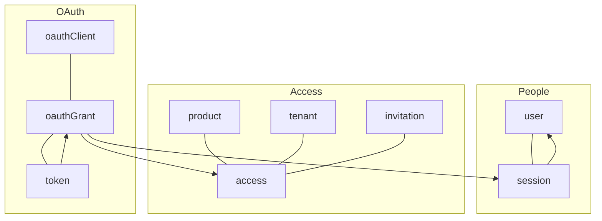
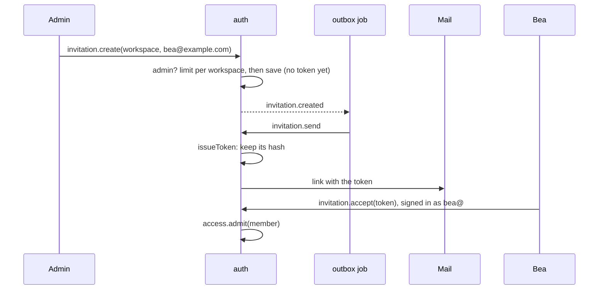
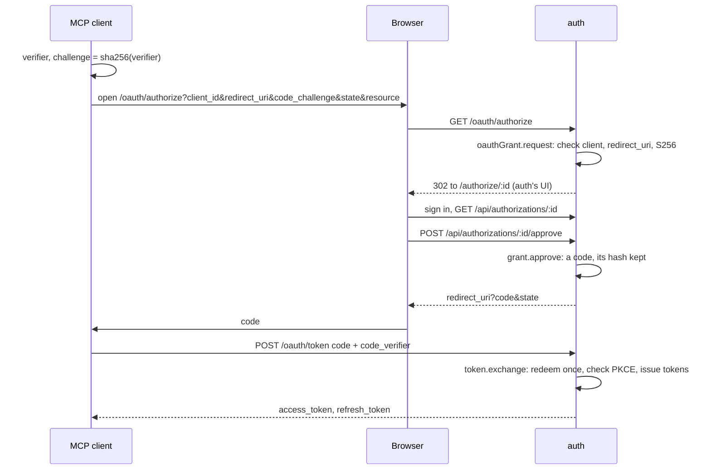
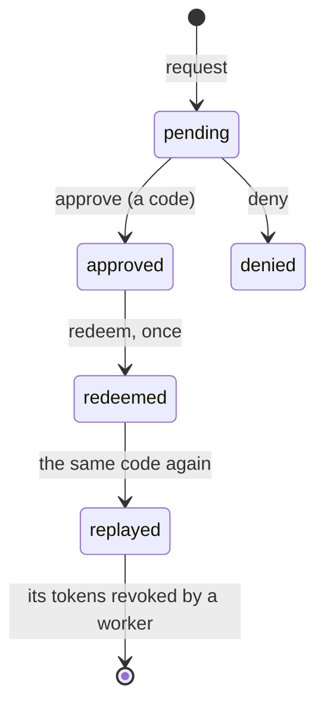
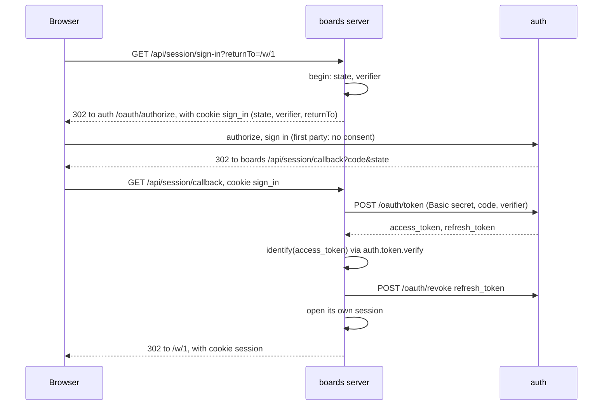

# Auth, OAuth and web sessions

<p class="chapter-lead">Every real application ends up needing accounts, sessions, tenants, invitations
and, sooner or later, a way for another program to act for someone. This chapter reads cooper's
`auth` context as a worked example: how it keeps people and who may enter what, how it runs a
small OAuth 2.1 server, and how cooper's other apps sign people in through it without ever holding
a token in the browser.</p>

## The problem

cooper is three apps: the boards, where workspaces keep their cards; the staff's backoffice; and,
behind both, the place where people sign in. An AI assistant, connected through MCP, also wants to
read Ana's boards for her. Each of them asks the same questions:

- Who is this? (An account, a password, a session.)
- May they enter? (This workspace of the boards; the backoffice at all.)
- How does a new person get in? (Signing up, or being invited by a workspace's admin.)
- How does a program that is not cooper act for a person, without learning their password?

You could answer them in every app. Then each app has its own passwords, its own session table,
its own idea of who belongs to which workspace, and the AI assistant has nowhere to go. Or you
answer them once, in a context of their own, and let every app ask it.

::: info Concept: Identity as a bounded context
Who someone is, and what they may enter, serves every part of an application and belongs to none
of them. Kept as its own bounded context with its own store, it uses no other context; the others
use it, through its modules (`deps.auth.access.check(...)`), and through OAuth for anything that
runs outside the process.
:::

## The idea

cooper's `auth` context (`cooper/backend/contexts/auth/`) has nine modules. They fall into three
groups:



- **People**: `user` keeps accounts (an email, a name, an argon2id password hash via
  `Bun.password`); `session` signs them in to auth itself, with a cookie.
- **Access**: `product` lists cooper's apps, declared in code; `tenant` keeps the workspaces;
  `access` says who may enter which product, for which tenant; `invitation` lets a workspace's
  admin bring someone in.
- **OAuth**: `oauthClient` keeps who may ask; `oauthGrant` keeps each request and the person's
  answer; `token` keeps what the client got.

The other apps never read auth's tables. Inside the process they call its modules as deps. From
outside (a browser, an MCP client) they speak OAuth to it over HTTP. The rest of this chapter takes
the groups one by one.

## People: accounts and sessions

A person signs up or signs in at auth's own pages, served by its frontend. The routes are three
public `POST`s and a `GET`:

```ts
// cooper/backend/contexts/auth/modules/session/session.routes.ts (trimmed)
base.http.post('/session/sign-up', async request => {
  const { user, token } = await sessions.signUp(await request.json())
  keep(request, token)
  return Response.json(user, { status: 201 })
}, { public: true, rateLimit: SIGN_UP_LIMIT })

base.http.post('/session/sign-in', async request => {
  const { user, token } = await sessions.signIn(await request.json())
  keep(request, token)
  return Response.json(user)
}, { public: true, rateLimit: SIGN_IN_LIMIT })

base.http.post('/session/sign-out', /* … */, { public: true })
base.http.get('/session', async () => Response.json(await sessions.me()))
```

`keep` is `setSessionCookie(request, SessionCookie, token, { secure, maxAgeSeconds })`: an
`HttpOnly`, `SameSite=Lax` cookie, `Secure` when auth's public address is HTTPS (chapter
[HTTP security](./27-security)). Sign-out is public on purpose: signing out with a session already
gone still clears the cookie.

The session entity keeps only the hash of its token:

```ts
// cooper/backend/contexts/auth/modules/session/session.ts
static open(userId: string, days: number): { session: Session, token: SecretToken } {
  const token = SecretToken.generate()
  // …
  return { session: new Session({ userId, tokenHash: SecretToken.hash(token), expiresAt }, true), token }
}
```

The module installs itself as the router's authenticator, so every other route of auth runs as
whoever the cookie says:

```ts
// cooper/backend/contexts/auth/modules/session/session.module.ts
base.http.authenticateWith(request => module.authenticate(request.cookies.get(SessionCookie) ?? undefined))
```

Sign-in is guarded twice: 30 tries per address every quarter hour at the route, and 10 wrong
passwords per email at the use case, forgotten when one works. Chapter
[Rate limits](./28-rate-limits) walks through both. A schedule, `session.nightly`, removes expired
sessions every night.

::: tip In cooper
`session.signUp` is `@UseCase({ writesTo: ['user'] })`: it writes an account and a session in one
answer, because the person waits for both. The doc comment says so, and says what happens if the
second save fails: the account stays, and the person signs in. That is the shape of every
`writesTo` exception: a reason in a comment, and a failure that leaves nothing wrong.
:::

## Access: products, tenants, who may enter

### Products are code

cooper's apps are not data anyone edits; a new one is new code. So `product` is a module with no
entity and no table: it is handed its products as an option and keeps them in memory.

```ts
// cooper/backend/contexts/auth/initialize-modules.ts (trimmed)
{
  id: WORKSPACES_PRODUCT,                       // 'cooper': the boards
  name: 'Cooper',
  publicUrl: config.boardsPublicUrl,
  signUp: true,                                 // anyone may make an account on the way to it
  access: 'anyone',
  mcpResource: `${config.boardsPublicUrl}/mcp`, // its MCP server, for OAuth's resource (RFC 8707)
  redirectUri: `${config.boardsPublicUrl}${WEB_SESSION_CALLBACK}`,
},
{
  id: PRODUCTS.backoffice,
  name: 'Cooper Backoffice',
  signUp: false,
  access: 'granted',                            // only whom it was told
  mcpResource: null,
  // …
},
```

`access: 'anyone'` lets anyone with an account sign in to the boards; what they then see depends on
the workspaces they belong to. `access: 'granted'` lets in only those with an access row for the
whole product: the staff.

### An access is a row

`access` keeps one row per person, product and tenant:

```ts
// cooper/backend/contexts/auth/modules/access/access.schema.ts (trimmed)
export const AccessSchema = z.object({
  id: z.uuidv7(),
  userId: z.uuidv7(),
  productId: z.string().min(1),
  /** The tenant it is for; null when it is for the whole product. */
  tenantId: z.string().nullable(),
  role: AccessRoleSchema,   // 'admin' | 'member'
  // …
})
```

A member of a workspace has a row with its `tenantId`; one of the staff has a row with
`tenantId: null` for `backoffice`. `access.check(userId, productId, tenantId)` is the question every
context asks before letting someone in:

```ts
// cooper/backend/contexts/boards/modules/member/member.module.ts
@UseCase()
async enter(workspaceId: string): Promise<WorkspaceScope> {
  if (!await this.belongs(workspaceId, currentActor().userId)) throw new WorkspaceNotFound(workspaceId)
  return { workspaceId }
}
```

boards' workspace group calls `member.enter` in its middleware, which asks auth's
`access.check` (through `deps.auth.access`), and enters the workspace scope only then. A stranger
gets a 404, not a 403: a private workspace does not own up to existing (golden rule 12; chapter
[Tenants](./22-tenants)).

Two rules over rows hold the model together, both checked in a repository's `after`, under a guard:
a tenant has exactly one admin, its creator, who is never revoked while it exists; and the staff
never loses its last member. An access given twice at once is given once: a unique index has the
last word, and `admit` answers with the row that won (`DuplicateValue`, chapter
[Concurrency](./20-concurrency)).

### Tenants

`tenant` keeps the workspaces' names, and only that. Creating one makes its creator its admin:
`@UseCase({ writesTo: ['access'], retryOnConflict: false })`. It writes to `access` from a request
because whoever makes a workspace enters it the moment it answers; should that second save fail, a
worker of `tenant.created` (`ensureAdmin`) gives the admin access instead, and whichever gives it
second finds it given. It never runs again on a conflict, because it would make a second workspace.
Deleting one tells `tenant.deleted`, whose
workers revoke every access and every open invitation of it.

### Invitations

A workspace's admin invites an email. The invitation is saved; its email leaves from a worker on
`invitation.created`, because an email cannot be taken back (golden rule 7).



Notice where the token is made: in `send`, not in `create`. So it never sits in a job's payload in
the outbox: the store only ever has its hash. Run again, `send` makes a new token and the old link
stops working, which is the right answer to "the job ran twice". The workspace may send 50 an hour
(`invitation.create`, chapter [Rate limits](./28-rate-limits)).

## OAuth: letting other programs in

So far, everything happens inside auth's own pages. Now the boards, on another domain, need to know
who is signed in. And an MCP client, a program cooper has never met, wants to act for Ana. Both are
what OAuth is for.

::: info Concept: OAuth 2.1 authorization code with PKCE
A **client** sends the person's browser to the **authorization server** with a request. The person
signs in there, and says yes. The browser goes back to the client's **redirect URI** with a
one-time **code**. The client trades the code, at the token endpoint, for an **access token** (to
act) and a **refresh token** (to get new ones). **PKCE** ties the trade to whoever started the
request: the client sends the hash of a secret `code_verifier` first, and the verifier itself
when it trades.
:::

auth is a small OAuth 2.1 server. Its addresses are not its API's: they sit at the root, are public
(the client proves itself on its own), and speak OAuth's wire format, a form in and
`{ error, error_description }` out. So auth has a second router:

```ts
// cooper/backend/contexts/auth/auth-base.ts
export class AuthBase extends CooperBase {
  readonly oauth = new HttpRouter({ prefix: '', public: true, rateLimits: this.rateLimitStore, rateLimit: OAUTH_LIMIT })
}
```

`prefix: ''` mounts it at the root, beside the frontend. The context serves both routers'
routes (`routes()` in `cooper/backend/contexts/auth/auth.context.ts`). Each OAuth route's
`onError` is `toOauthErrorResponse(error, fallback, codes)` from `newt/http`, which maps domain
error codes to OAuth's (`'oauthGrant.invalid_grant': 'invalid_grant'`).

### Two kinds of client

`oauthClient` keeps two kinds:

| | A product's own client | A registered client |
|---|---|---|
| Who | `cooper`, `backoffice` | an MCP client |
| Made by | `declareProducts()`, on every start, from code and config | `POST /oauth/register` (RFC 7591) |
| Proves itself with | its secret (`client_secret_basic` or `_post`) and PKCE | PKCE only (a public client) |
| Consent | none: the person only signs in | the person is asked |
| Its tokens are for | knowing who signed in | the product's MCP server (`resource`) |

The product's client id is the product's id, and its secret comes from configuration; only the
secret's hash is kept (`ClientSecret`, a value object of the module). A product's client is kept in
step with code and config on every start, so changing a redirect address is a deploy, not a
migration.

### Where everything is: metadata

A client that knows only auth's address learns the rest from its metadata (RFC 8414):

```ts
// cooper/backend/contexts/auth/oauth-server-metadata.ts (trimmed)
const metadata = {
  issuer: publicUrl,
  authorization_endpoint: `${publicUrl}/oauth/authorize`,
  token_endpoint: `${publicUrl}/oauth/token`,
  registration_endpoint: `${publicUrl}/oauth/register`,
  revocation_endpoint: `${publicUrl}/oauth/revoke`,
  response_types_supported: ['code'],
  grant_types_supported: ['authorization_code', 'refresh_token'],
  code_challenge_methods_supported: ['S256'],
  token_endpoint_auth_methods_supported: ['client_secret_basic', 'client_secret_post', 'none'],
  // …
}
oauth.get('/.well-known/oauth-authorization-server', () => Response.json(metadata), { cors: OPEN_TO_BROWSERS })
```

`cors: OPEN_TO_BROWSERS` (any origin, never cookies) lets a client running in a browser, such as
the MCP inspector, read it. The same goes for registering, the token endpoint and revocation. The
authorization endpoint has no `cors`: a browser goes there, nobody fetches it.

## The authorization code flow, step by step

Here is the whole flow for an MCP client. A product's own client is the same, minus the consent.



### The request

`GET /oauth/authorize` reads the query and calls `oauthGrant.request`. Every check that could send
the browser somewhere it should not go happens first:

```ts
// cooper/backend/contexts/auth/modules/oauth-grant/oauth-grant.module.ts (trimmed)
const client = await this.clientOf(request.clientId)
if (!client.redirectUris.includes(request.redirectUri)) throw new InvalidAuthorizationRequest('The address to go back to is not one of this application')
if (request.responseType !== 'code') throw new InvalidAuthorizationRequest('The application asks for a kind of access cooper does not give')
if (request.codeChallengeMethod !== 'S256' || !S256_CHALLENGE.test(request.codeChallenge)) {
  throw new InvalidAuthorizationRequest('The application does not protect its request with PKCE (S256)')
}
```

- **The redirect URI must match exactly** one the client registered: no prefix matching, no
  wildcard. A registered redirect is `https`, or `http` only on a loopback address (a native app on
  the person's own computer), never with a fragment, at most 2000 characters
  (`OauthClientRedirectUriSchema`).
- **PKCE is required, and only S256.** OAuth 2.1 drops the `plain` method.
- **Until the client and its redirect address are known to go together, nothing is sent back.** A
  request auth cannot answer is shown on auth's own error page, never redirected to an address
  nobody vouched for. That is what the route's `onError` does: a `DomainError` becomes a redirect
  to `/error?message=…` on auth itself.

A valid request is kept as an `OauthGrant` in state `pending`, for ten minutes, and the browser goes
to auth's UI at `/authorize/:id`.

### Which server the token is for: `resource`

A registered client asks for access to a product's MCP server by naming it in `resource` (RFC
8707). `product.forResource(resource)` finds the product whose `mcpResource` it is, or the request
is refused. A client that names no resource gets the one product with an MCP server, as long as
there is only one; with two, it must say which. The grant keeps the resource, and so will the token: an access token for boards' MCP
server opens boards' MCP server, and nothing else. A product's own client names no resource; its
product is the client's.

### Consent

auth's UI asks `GET /api/authorizations/:id` what is being asked. The route is public, but
`review` knows who is signed in when someone is (`findCurrentActor()`), and says upfront when the
product would refuse them, rather than letting them click "Allow" into an error.

For a registered client, the page shows the client's name, the product, and the host the browser
will go back to. The client's name is whatever it registered with, so the page says so plainly:

```tsx
// cooper/frontend/auth/pages/authorize/authorize.tsx
<Alert tone="warn" title="Its name is not checked">{`Authorize it only if you are connecting it yourself right now, and ${review.redirectHost} is the application you expect.`}</Alert>
```

This page is the reason auth's frontend may never be framed (chapter
[HTTP security](./27-security)): a frame could hide it and steal the click on "Allow". And the
approve and deny routes are `POST`s, so another site's page cannot send them (`sameOrigin`).

For a product's own client (`firstParty`), there is nothing to consent to: the person is signing
in to cooper, through cooper. The UI approves for them as soon as they are signed in.

### The code

`approve` checks once more that the grant is pending and in time, and that the product lets this
person in (`mayEnter`: `access: 'granted'` needs an access row). Then the entity changes itself:

```ts
// cooper/backend/contexts/auth/modules/oauth-grant/oauth-grant.ts
approve(userId: string): string {
  const code = SecretToken.generate()
  this.change({ status: 'approved', userId, codeHash: SecretToken.hash(code), expiresAt: minutesFromNow(CODE_MINUTES) })
  return `${CODE_PREFIX}${code}`
}
```

The code is `cooper_ac_` and a `SecretToken`; the prefix lets people and secret scanners recognize
one in a log. Only its hash is kept. It lasts five minutes: a client trades it at once. The
browser goes back to the redirect URI with `code` and the `state` the client sent.

### Trading the code, once

`POST /oauth/token` with `grant_type=authorization_code` calls `token.exchange`, which
authenticates the client, then asks `oauthGrant.redeem` to spend the code:

```ts
// cooper/backend/contexts/auth/modules/oauth-grant/oauth-grant.module.ts
if (grant.status === 'redeemed') {
  grant.replay()
  await this.repo.persist(grant)
  throw new InvalidGrant()
}
if (!grant.is('approved') || grant.clientId !== clientId || grant.redirectUri !== redirectUri || !grant.isVerifiedBy(codeVerifier)) throw new InvalidGrant()

grant.redeem()
await this.repo.persist(grant)
```

Four things must hold: the grant is approved and in time, the client is the one that asked, the
redirect URI is the same one, and `sha256(code_verifier)` is the challenge it sent
(`isVerifiedBy`). Every failure is the same `invalid_grant`: a client learns nothing about which
check failed.

A grant moves through these states:



### A code brought twice: replay revokes

If a code arrives after it was traded, someone copied it: from a log, a referrer, a browser
extension. OAuth's answer (RFC 6749 §4.1.2) is to revoke whatever it was traded for. `replay()`
marks the grant and tracks `oauthGrant.replayed`; a worker of `token` revokes the grant's tokens:

```ts
// cooper/backend/contexts/auth/modules/token/token.workers.ts
deps.oauthGrant.events.replayed.subscribe(grant => tokens.revokeGrant(grant.id), {
  strategy: 'handler',
  queue: 'token.revokeGrant.on.oauthGrant.replayed',
})
```

The race is subtle, and `exchange` handles both orders:

- **The copy comes after the tokens were saved.** The worker finds them and revokes them.
- **The copy comes before the tokens were saved**, in the moment between redeeming and issuing.
  The worker finds nothing. So `exchange`, after saving its tokens, asks
  `oauthGrant.isReplayed(grantId)`; if so, it revokes them itself and answers `invalid_grant`.
- **Two copies at once.** Both read the grant as approved; one saves first, the other meets
  `ConcurrencyConflict`. `exchange` reads again, now finds it redeemed, and marks it replayed.

That is why `exchange` is `@UseCase({ writesTo: ['oauthGrant'], retryOnConflict: false })`. It
writes to another module from a request, because the client waits for its tokens in this answer.
And it must not run again on a conflict, because the code it spent would look copied.

### Tokens: opaque, hashed, rotated

```ts
// cooper/backend/contexts/auth/modules/token/token.ts (trimmed)
const PREFIX = { access: 'cooper_at_', refresh: 'cooper_rt_' } as const

rotate(lifetime: TokenLifetime): TokenPairDTO {
  const { pair, hashes, expiry } = fresh(lifetime)
  this.change({ ...hashes, ...expiry, previousRefreshTokenHash: this.data.refreshTokenHash })
  return pair
}
```

Tokens are opaque: random `SecretToken`s with a prefix, not JWTs. Any context that receives one
asks `token.verify(accessToken)`, which answers whose it is, for which client, product and
resource, or `null`. Opaque tokens cost a lookup, and buy instant revocation: a token revoked is
gone from the table, and the next `verify` says so.

Every refresh replaces both tokens (OAuth 2.1 §4.3.1), so a refresh token works once. And every
spent refresh token's hash is kept. If one of them comes back, however long ago it was replaced,
it was copied:

```ts
// cooper/backend/contexts/auth/modules/token/token.module.ts (trimmed)
const token = await this.repo.first({ refreshTokenHash: hash })
if (!token) {
  const grantId = await this.repo.grantThatSpent(hash)
  const copied = grantId ? await this.repo.first({ grantId }) : undefined
  if (copied) {
    copied.revoke()
    await this.repo.persist(copied)
  }
  throw new InvalidRefreshToken()
}
```

This is **refresh token reuse detection**. Whoever stole the token and whoever owns it both had a
copy; one of them refreshed first. When the other tries, auth cannot tell which is the thief, so it
revokes the grant's current tokens, and both sign in again. The thief cannot.

`POST /oauth/revoke` (RFC 7009) gives a token back; either the access or the refresh token revokes
both, and the answer is a 200 whether the token was one or not. Nightly schedules remove expired
grants and tokens: anyone may start a request, so their rows would only pile up.

::: details Dynamic client registration, and what limits it
`POST /oauth/register` (RFC 7591) is open to anyone, because an MCP client meets cooper for the
first time when someone connects it. A registered client opens nothing until a person says yes to
it. Still, an open endpoint that writes rows is limited: 10 registrations per address per hour
(`REGISTER_LIMIT`), at most 16 KiB of body (`REGISTRATION_MAX_BYTES`), a name of at most 80
characters, at most 10 redirect addresses. A client registers as public
(`token_endpoint_auth_method: 'none'`): asking for anything else is `invalid_client_metadata`.
Authorization requests are limited too, 120 per address per hour (`AUTHORIZE_LIMIT`), since each one
is a row.
:::

## Web sessions: boards and backoffice as OAuth clients

Now the boards. They are on another domain, with their own cookies. When Ana opens them, they must
learn who she is from auth. The standard way for a single-page app is to do OAuth in the browser
and keep the tokens in JavaScript. cooper does not.

::: info Concept: Backend for frontend
The app's own server is the OAuth client. It does the protocol with auth server to server, with
its secret, learns who signed in, and opens a session of its own. The browser only ever holds that
session's cookie, `HttpOnly`, never a token. A script injected into the page has nothing to steal
that works outside it.
:::

That server-side client is `WebSession_Module`, in `cooper/backend/shared/web-session/`: shared
code that each context initializes with its own options and its own `session` table.

```ts
// cooper/backend/contexts/boards/initialize-modules.ts (trimmed)
const session = WebSession_Module.initialize(base, {
  context: 'boards',
  clientId: WORKSPACES_PRODUCT,
  clientSecret: config.clientSecret,
  publicUrl: config.publicUrl,
  authUrl: config.authPublicUrl,
  days: config.sessionDays,
  identify: accessToken => deps.auth.token.verify(accessToken),
  profile: async userId => { /* only what boards' UI shows of them */ },
})
```

The module sets its context's authenticator, so every route of boards runs as the person its
session cookie names. Its cookies are named after the context, `cooper_boards_session` and
`cooper_boards_sign_in`: on one host in development, every context's cookies meet.

### The sign-in



Walk through what each step protects:

- **`begin`** makes a `state` and a PKCE `verifier`, both `SecretToken`s, and keeps them, with
  where to return, in a short cookie: `HttpOnly`, sent only to `/api/session`, for ten minutes.
  Nothing about the sign-in is kept server-side until it completes.
- **The callback** clears that cookie first, whatever happens next. `complete` refuses a `state`
  that is not the cookie's (`SignInExpired`): a callback the browser was tricked into opening,
  with someone else's code, finds no matching state.
- **The trade** goes from boards' server to auth's token endpoint, with
  `client_secret_basic`. The code is useless without the secret and the verifier, neither of which
  ever reached the browser.
- **`identify`** asks auth's `token.verify`, in the same process, who the token is for, and checks
  it is for this product. Then boards revokes the tokens: it keeps none, because who signed in is
  all it needed.
- **`returnTo`** is passed through `ownPath`, which keeps only a path of this same origin. A
  `returnTo=//evil.example`, or one with a backslash or a control character a browser would read
  differently, becomes `/`. No open redirect.

`complete` is `@UseCase({ retryOnConflict: false })`: it calls auth over HTTP before saving, and the
code is spent. A sign-in that fails goes to the frontend's start with `?signInError=<code>`, which
says why.

### Signing out

```ts
// cooper/backend/shared/web-session/web-session.routes.ts (trimmed)
base.http.post('/session/sign-out', async request => {
  await sessions.signOut(request.cookies.get(cookies.session) ?? undefined)
  clearSessionCookie(request, cookies.session, { secure })
  // …
  const next = `${options.authUrl}/oauth/logout?${new URLSearchParams({ redirect: back })}`
  return Response.json({ next } satisfies WebSessionSignOutDTO)
}, { public: true })
```

boards ends its session, then sends the browser on to auth's `/oauth/logout`, which ends auth's
session too and sends it back. Otherwise, signing in again would silently sign in the same person,
with no way to switch accounts. auth goes back only to an address of one of cooper's products
(`session.returnAddress`); any other goes to auth's own start.

::: warning Watch out
Each context's session is its own row in its own store. Signing out of boards does not sign anyone
out of the backoffice, and revoking a person's access in auth does not end their boards session:
boards asks `access.check` on every workspace request, so they are refused at the door of each
workspace, but their session itself lives on until it expires or they sign out.
:::

## Tests that sign in for real

A sign-in is a dance between two servers and a browser, so cooper tests it as one. `newt/testing`
has `browser(baseUrl)`, a `fetch` that keeps cookies and never follows redirects, so a test can
walk each 302 by hand and see every cookie. `cooper/backend/contexts/auth/oauth.test.ts` runs the
flow and its attacks: a code traded twice, a refresh token replayed, a redirect URI that does not
match, a request without PKCE, a client that is not the one that asked.

## Recap

- auth is a bounded context of its own: accounts, sessions, products, tenants, accesses and
  invitations, used by every other context, using none.
- An access is a row: a person, a product, a tenant or none. Every context asks `access.check`; a
  stranger gets a 404.
- Secrets are kept as hashes: session tokens, invitation tokens, codes, access and refresh tokens,
  client secrets. Invitation tokens are made when the email leaves, never in a job.
- auth's OAuth 2.1 server: exact redirect URIs, PKCE S256 only, single-use codes whose replay
  revokes the tokens, refresh rotation with reuse detection, `resource` (RFC 8707) binding tokens
  to one server, open registration (RFC 7591) behind rate limits, metadata (RFC 8414).
- boards and backoffice are confidential OAuth clients whose servers do the protocol; the browser
  holds only their own `HttpOnly` session cookie, never a token.
- `writesTo` and `retryOnConflict: false` mark the places where a person waits for two writes, or
  where running again would look like an attack.

## Going further

- [HTTP security](./27-security): cookies, the origin check, the never-framed consent page.
- [Rate limits](./28-rate-limits): the limits on sign-in, registration and authorization.
- [An MCP server](./31-mcp): the other side of `resource`, a server that accepts these tokens.
- [Tenants](./22-tenants): scopes, and why a stranger gets a 404.
- [Concurrency](./20-concurrency): `ConcurrencyConflict`, guards, and `DuplicateValue`.
- [Frontends](./30-frontends): auth's pages, and the boards' sign-in from the browser's side.
