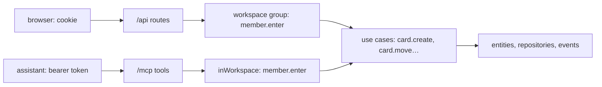
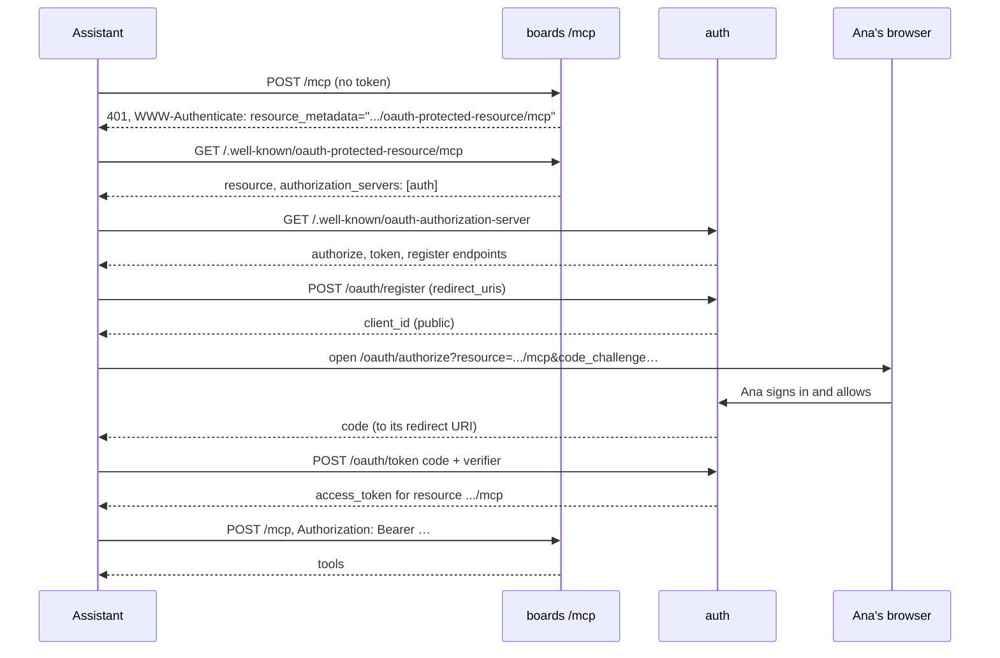
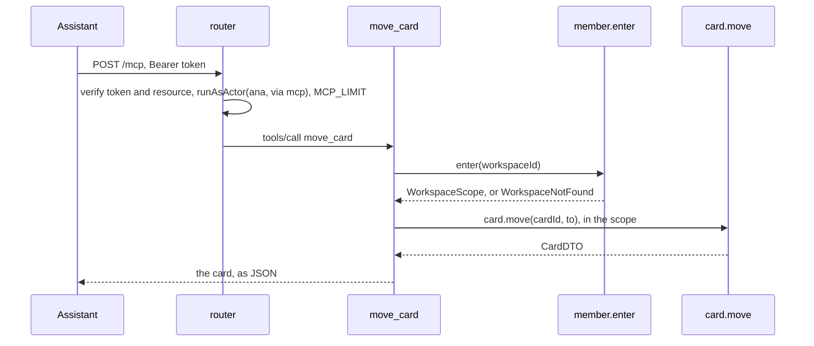

# An MCP server

<p class="chapter-lead">People increasingly ask an AI assistant to do their work in the apps they
use. This chapter shows how cooper's boards context offers its use cases to assistants as MCP
tools: how an assistant that knows only one address finds out how to sign in, how its token is
checked, and why the tools add no rules of their own.</p>

## The problem

Ana keeps her team's work in cooper. She also talks to Claude all day. She would like to say "put a
card in Launch for the press kit and give it to Bob" and have it done, in her name, by the same
rules as when she clicks.

The assistant speaks **MCP**, the Model Context Protocol: it discovers the *tools* a server offers
and calls them over HTTP. Building an MCP server is easy. Building one that is safe raises three
questions:

- **Who is calling?** Not a browser with a cookie. A program on someone's laptop, or in someone's
  cloud, that must act for Ana without ever learning her password.
- **How does it learn where to sign in?** The assistant is given one address,
  `https://boards.cooper.example/mcp`, and nothing else.
- **What may it do?** Exactly what Ana may, and nothing more. Not "everything the API key allows",
  not a second set of permissions that drifts from the first.

::: info Concept: MCP server
A server that offers **tools** (named operations with a JSON schema of their arguments) to an AI
assistant, over the Model Context Protocol. In newt, an MCP server is another door into a context,
like its routes: each tool parses its arguments and calls use cases, as the token's person, and
answers what they return.
:::

## The idea: another door, the same rooms



boards already has a door, its HTTP routes. The MCP server is a second one, beside it, with a
different lock: a bearer token instead of a cookie. Behind both doors are the same rooms: the
workspace check, the use cases, the entities and their rules. A tool cannot do what a route
cannot, because it calls the same code.

The protocol itself comes from `@modelcontextprotocol/sdk`. What newt gives is the rest: a router
at the root, an authenticator for bearer tokens, a route's own `onError`, a rate limit, and the
scope a tool enters.

## Where the server lives

The MCP server is not part of boards' API: its address is `/mcp`, at the root, and it speaks MCP's
wire format, not `{ error, code }`. So it gets a router of its own, with `prefix: ''`:

```ts
// cooper/backend/contexts/boards/mcp/mcp.ts (trimmed)
export function mcpRoutes(modules: Boards_Modules, auth: Pick<Boards_Auth, 'token'>, options: McpOptions): Bun.Serve.Routes<undefined, string> {
  const resource = `${options.publicUrl}/mcp`
  const router = new HttpRouter({ prefix: '', cors: OPEN_TO_BROWSERS, rateLimits: options.rateLimits, rateLimit: MCP_LIMIT })
  // …
  return router.routes()
}
```

Three options on that one line:

- **`prefix: ''`** mounts it at the root, beside the frontend; it takes only its own paths.
- **`cors: OPEN_TO_BROWSERS`** lets a page of any origin call it. Some MCP clients, such as the MCP
  inspector, run in a browser. Any origin may, because who calls is in the token, never in a
  cookie (chapter [HTTP security](./27-security)). The same `cors` lets their writes pass the
  origin check.
- **`rateLimit: MCP_LIMIT`**, 120 requests per minute per person, shared with the context's other
  limits in its `rate_limit` table (chapter [Rate limits](./28-rate-limits)):

```ts
// cooper/backend/shared/rate-limits.ts
/** What one person's AI assistant may ask of the MCP server: a conversation calls tools in bursts. */
export const MCP_LIMIT: HttpRateLimit = { name: 'mcp', limit: 120, windowMs: MINUTE }
```

boards serves the router's routes beside its API by overriding `routes()`:

```ts
// cooper/backend/contexts/boards/boards.context.ts
protected override routes(): Bun.Serve.Routes<undefined, string> {
  return { ...super.routes(), ...mcpRoutes(this.modules, this.auth, { publicUrl: this.config.publicUrl, authPublicUrl: this.config.authPublicUrl, rateLimits: this.base.rateLimitStore }) }
}
```

## Who is calling: bearer tokens

The router's authenticator reads the token and asks auth whose it is:

```ts
// cooper/backend/contexts/boards/mcp/mcp.ts
// A token of auth's for this server only: not one for another server, nor a web app's.
router.authenticateWith(bearerAuthenticator(async accessToken => {
  const identity = await auth.token.verify(accessToken)
  return identity?.resource === resource ? { userId: identity.userId, via: 'mcp' } : null
}))
```

`bearerAuthenticator(verify)` from `newt/http` reads `Authorization: Bearer <token>` (RFC 6750)
and hands the token to `verify`; a request without one is nobody's. What a token means is yours to
say. cooper says two things:

1. **Ask auth, every time.** `auth.token.verify` is a use case of auth's `token` module, called in
   the same process through boards' deps. Tokens are opaque and hashed (chapter
   [Auth](./29-auth)), so a revoked token stops working on the next call: there is no signature
   that stays valid until it expires.
2. **Only a token for this server.** auth binds each token to a `resource` (RFC 8707): the
   address of the server it was given for. A token auth gave the backoffice, or another product's
   MCP server, has another resource and opens nothing here.

The actor gets `via: 'mcp'`. cooper extends newt's `Actor` once, in
`cooper/backend/shared/actor.ts`:

```ts
// cooper/backend/shared/actor.ts
export type ActorVia = 'web' | 'mcp'

declare module 'newt/core' {
  interface Actor {
    via: ActorVia
  }
}
```

`via` says **how** someone came in, never what they may do. It goes into the record: boards'
activity log tells Ana's clicks from her assistant's. It never goes into a rule.

::: danger Never
Never give the MCP server permissions of its own: an "MCP scope", a service account, a token that
reads every workspace. The assistant acts as its person, through the same use cases, and is
refused what they would be refused. A rule that differs by `via` is a second permission system,
and it will drift.
:::

## How an assistant finds out how to sign in

An assistant given only `/mcp` calls it, and is refused. The 401 tells it where to look:

```ts
// cooper/backend/contexts/boards/mcp/mcp.ts (trimmed)
router.post('/mcp', /* … */, {
  // Without a token, or with one that is not valid: where to get one.
  onError: (error, request) => error instanceof NotSignedIn
    ? Response.json(
      { error: 'An access token for this MCP server is needed: connect through OAuth' },
      { status: 401, headers: { 'www-authenticate': `Bearer resource_metadata="${resourceMetadataUrl(options.publicUrl)}"${request.headers.has('authorization') ? ', error="invalid_token"' : ''}` } },
    )
    : toErrorResponse(error),
})
```

A route's `onError` decides what every error of it becomes, the missing session's `NotSignedIn`
too. Here it is a 401 whose `WWW-Authenticate` names the **protected resource metadata** (RFC
9728), with `error="invalid_token"` when a token was sent but did not open anything.

The metadata is a small JSON document that names auth:

```ts
// cooper/backend/contexts/boards/mcp/protected-resource.ts
const metadata = {
  resource,
  authorization_servers: [authPublicUrl],
  bearer_methods_supported: ['header'],
  resource_name: 'Cooper',
}
// At the root and at the path of the resource: clients look in either (RFC 9728 §3.1).
router.get('/.well-known/oauth-protected-resource', answer, { public: true })
router.get('/.well-known/oauth-protected-resource/mcp', answer, { public: true })
```

From there, the assistant follows auth's own metadata (RFC 8414), registers itself (RFC 7591),
and runs the authorization code flow with PKCE, naming this server as its `resource`. The whole
discovery is a chain of documents, each pointing at the next:



Chapter [Auth](./29-auth) walks through each step on auth's side: the exact redirect URI, the
consent page that says the client's name is not checked, the single-use code, the refresh
rotation. From boards' side, all of it reduces to one line: `auth.token.verify(accessToken)`.

::: tip In cooper
auth knows which product a `resource` belongs to because each product declares its `mcpResource`:
the boards' is `${boardsPublicUrl}/mcp`, the backoffice's is `null` (it has no MCP server). An
authorization request naming a resource cooper does not have is refused before the person is
asked anything (`cooper/backend/contexts/auth/initialize-modules.ts`).
:::

## One server per request

The MCP SDK can keep sessions and stream server-initiated messages. cooper needs neither: nothing
it does sends a client anything it did not ask for. So each `POST /mcp` builds a fresh server,
answers in JSON, and closes it:

```ts
// cooper/backend/contexts/boards/mcp/mcp.ts
router.post('/mcp', async request => {
  const server = new McpServer({ name: 'cooper', version: '1.0.0' }, { instructions: INSTRUCTIONS })
  registerMcpTools(server, modules)
  const transport = new WebStandardStreamableHTTPServerTransport({ sessionIdGenerator: undefined, enableJsonResponse: true })
  await server.connect(transport)
  try {
    return await transport.handleRequest(request)
  } finally {
    await server.close()
  }
}, { /* onError, above */ })
```

Stateless is simpler and scales out freely: any instance answers any request, and there is no
stream to keep open. `GET /mcp`, which would open a stream, and `DELETE /mcp`, which would end a
session, are not registered, so the router answers them with a 405 that lists `POST` in `Allow`.

Because the route runs inside the router, the request is already signed in as Ana: `runAsActor`
wraps it, and every use case a tool calls finds `currentActor()`. It is also a trace, a span
`POST /mcp` with every use case inside it (chapter [Traces and metrics](./32-observability)).

`INSTRUCTIONS` tells the assistant how the tools fit together: start with `list_workspaces`,
because every other tool takes a workspace id.

## Tools are use cases

A tool is registered with a name, a description for the model, a zod schema of its arguments, and
annotations; its handler calls use cases and answers JSON:

```ts
// cooper/backend/contexts/boards/mcp/mcp-tools.ts (trimmed)
export function registerMcpTools(server: McpServer, modules: Boards_Modules): void {
  const { workspace, board, card, member } = modules
  const within = <T>(id: string, fn: () => Promise<T>) => inWorkspace(member, id, fn)

  server.registerTool('list_boards', {
    title: 'List boards',
    description: 'The boards of a workspace, the newest first.',
    inputSchema: { workspaceId, ...pageArgs },
    annotations: READ_ONLY,
  }, async args => within(args.workspaceId, async () =>
    answer(paged(await board.list(pageOf(args)), ({ id, name, description }) => ({ id, name, description })))))

  server.registerTool('move_card', {
    title: 'Move a card',
    description: 'Moves a card to a column of its board (its status), at a position from 0 at the top; at the bottom when none is given.',
    inputSchema: { workspaceId, cardId: z.string(), columnId: z.string(), position: z.number().int().min(0).optional() },
    annotations: WRITE,
  }, async ({ workspaceId: id, cardId, ...to }) => within(id, async () =>
    answer(cardOf(await card.move(cardId, to), await workspace.members()))))
  // …
}
```

Look at what a tool does, and what it does not:

- It **enters the workspace** with `inWorkspace`, the same check as the route group.
- It **calls a use case**: `board.list`, `card.move`. The use case parses its input as it always
  does: a tool's zod schema describes the arguments to the model, but the use case is still the one
  that validates.
- It **shapes the answer** for a model to read: a card with its assignee by name, a page with its
  `nextCursor`.
- It **does not** check permissions, change entities, or touch a repository. It is a route in
  another wire format.

cooper offers eight tools: `list_workspaces`, `list_boards`, `get_board`, `list_members`,
`search_cards` (read only), and `create_card`, `move_card`, `assign_card` (they create and change,
never delete). The annotations say so to the assistant: `READ_ONLY` is `{ readOnlyHint: true,
openWorldHint: false }`, `WRITE` adds `destructiveHint: false`. No tool deletes anything; that is a
choice about what Ana would want an assistant to do unasked, not a limit of newt.

::: tip In cooper
Lists follow golden rule 11 at this door too: `list_boards` and `search_cards` take a `cursor` and
a `size` of at most 100 and answer a page, never a whole list. A model that wants more asks for the
next page.
:::

## Entering the scope

Every boards repository is scoped to the current workspace: it sees only that workspace's rows
(chapter [Tenants](./22-tenants)). A route enters the scope in its group's middleware; an MCP tool,
which is no route under `/workspaces/:workspaceId`, enters it itself:

```ts
// cooper/backend/contexts/boards/workspace-scope.ts
/** Runs in a workspace once the person signed in is checked to belong to it (404 otherwise): for the MCP tools. */
export async function inWorkspace<T>(members: Member_Module, workspaceId: string, fn: () => Promise<T>): Promise<T> {
  return workspaceScope.run(await members.enter(workspaceId), fn)
}
```

`member.enter` is the very use case the route group calls: it asks auth whether the signed-in
person belongs to the workspace, and throws `WorkspaceNotFound` otherwise. So a tool asked about a
workspace Ana does not belong to gets the same answer a route gets: there is no such workspace. The
SDK turns the thrown error into a tool result with `isError: true` and the error's message, and the
assistant reads "no workspace" like any other answer.



There are three ways into a workspace in boards, and `workspace-scope.ts` names all of them:
`workspaceRoutes` for routes, `inWorkspace` for tools (both check membership), and
`runInWorkspace` for workers and scripts, which already know their workspace and check nothing.

## Testing it as an assistant would

cooper's end-to-end test, `cooper/backend/cooper.test.ts`, connects the SDK's own `Client` the way
Claude would. It starts knowing only `/mcp`, follows the 401 to the metadata, registers at auth,
signs Ana in with PKCE for this resource, trades the code, and connects with the token. Then it calls
every tool and checks the activity log says the assistant did it, as Ana, `via: 'mcp'`. A second
test tries the door: no token, a forged token, and a preflight from another origin. And a tool
asked about a workspace Ana is not in answers `isError: true`.

## Connecting a real client

With cooper running locally, boards' public URL is `http://localhost:3002`, and the MCP server
is at `http://localhost:3002/mcp`. In Claude Code:

```sh
claude mcp add --transport http cooper http://localhost:3002/mcp
```

Then `/mcp` inside Claude Code authenticates: your browser opens auth's sign-in page, you sign in
and allow access, and the assistant has its token. The MCP inspector
(`bunx @modelcontextprotocol/inspector`) does the same from its own page, on another origin, which
is why the routes are open to any.

## Recap

- An MCP server is another door into a context: a router at the root (`prefix: ''`), its tools
  calling the same use cases as the routes, adding no rules of their own.
- `bearerAuthenticator` reads the token; cooper verifies it in-process with auth's `token.verify`
  and accepts it only for this server's `resource`. The actor says `via: 'mcp'`, for the record.
- A 401 names the protected resource metadata (RFC 9728), which names auth; the assistant
  discovers, registers and signs in from there.
- One server per request, JSON answers, no session: any instance answers any call.
- A tool enters the workspace with `inWorkspace`, the same `member.enter` as the route group: a
  stranger's workspace does not exist.
- `cors: OPEN_TO_BROWSERS`, because the token is the credential; `MCP_LIMIT` per person.

## Going further

- [Auth, OAuth and web sessions](./29-auth): the authorization server behind the tokens.
- [HTTP security](./27-security): CORS without cookies, and the origin check.
- [Rate limits](./28-rate-limits): `MCP_LIMIT` and the other limits that share its store.
- [Tenants](./22-tenants): scopes, and why a stranger gets a 404.
- [Asking Claude about production](./46-asking-claude): newt-monitor's own MCP server, which lets
  an assistant read your application's metrics and traces.
