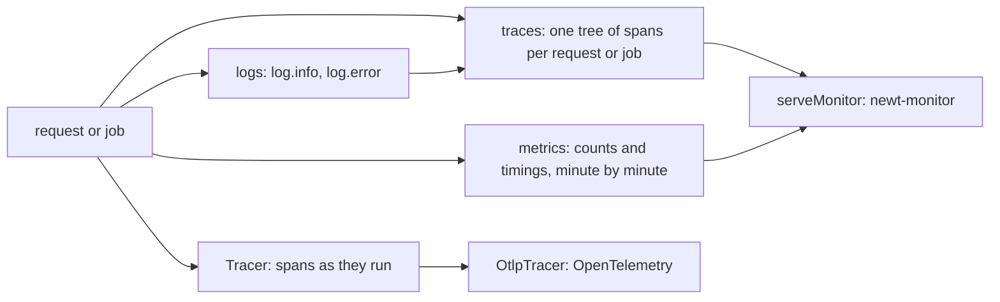
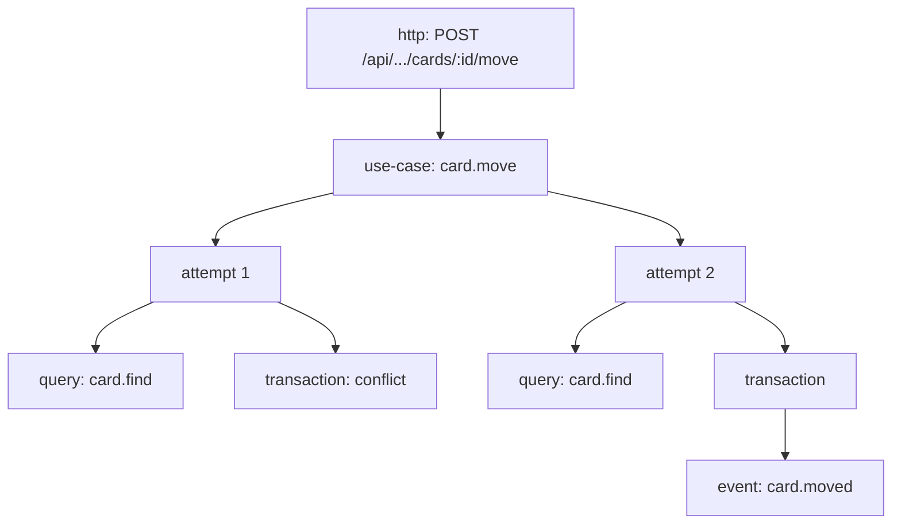
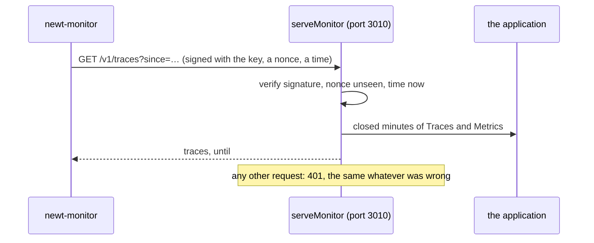

# Traces and metrics

<p class="chapter-lead">In production, the question is never "does it work" but "what did it do":
which use cases a slow request called, why a job was retried, how often a card is moved, whether a
queue is falling behind. This chapter shows what newt records about itself without a line of
yours, how it decides what to keep, and the two ways it leaves the process: to OpenTelemetry, and
to newt-monitor.</p>

## The problem

A person writes: "moving a card took ten seconds this morning". You open the logs. There are
thousands of lines, none of which says which request was theirs, which use cases it called, which
queries those ran, or that one of them met a `ConcurrencyConflict` and ran three times. You add a
log line, deploy, and wait for it to happen again.

The usual fix is an APM agent that patches every library and records everything. It knows a lot
about HTTP and SQL and nothing about your domain: it cannot tell you that `card.move` ran twice, or
that `card.moved` caused a job in `activity.record.on.card.moved` that failed.

newt knows its own structure: every use case, every event, every queue, every table read. So it
can record a trace in your domain's words, and count what matters, from the inside, with nothing
for you to add.

## The idea: three streams



- **Traces** say what one request or one job did, as a tree: the request, the use cases it called,
  each run of them, each query, each transaction, each event told, each rate limit taken.
- **Metrics** say how often and how long, minute by minute: events told, use case calls and their
  outcomes, jobs published, delivered, redelivered and dead.
- **Logs** are lines you write with `log`; each is also written into the trace in progress, at the
  step that wrote it.

Traces and metrics are collected by **newt-monitor** through `serveMonitor`, an endpoint of your
application. Separately, the **`Tracer`** interface hands every span, as it runs, to whoever you
like: `OtlpTracer` sends them to an OpenTelemetry collector.

## Traces

### What a trace is

A `Trace` (`packages/newt/core/traces/trace.ts`) is a request or a job and everything it did, as a
tree of `TraceSpan`s. Each span has a `kind`:

| `SpanKind` | What | Name |
|---|---|---|
| `http` | a request, the root | `POST /api/workspaces/:workspaceId/cards` |
| `job` | a job's run, the root | `activity.record.on.card.moved` |
| `use-case` | a use case's call | `card.move` |
| `attempt` | one run of it, when it ran more than once | `attempt 2` |
| `query` | a read or write of a table | `card.find` |
| `transaction` | a transaction, with its `commitMs` | `transaction` |
| `event` | an event told, an instant | `card.moved` |
| `rate-limit` | a take from a rate limit | `session.signIn` |



A trace also carries who acted (`actor`), the scopes it ran in (`scopes`, a workspace), the use
cases it called, the events it told, its log lines, and its `outcome`: the worst of its spans.

A span says what it is, never what it was given. A query span has the query's **shape**
(`{ id: ?, workspaceId: ? }`) and how many rows it read, never a value. A failure keeps its message
and the top of its stack; an error (a `NotFoundError`, a validation) keeps only its code, because it
says it may happen. A validation span says which fields were wrong, not what was in them. A rate
limit's span leaves its key out, because it may be an email. A trace can be shown to anyone who may
see the system, without leaking anyone's data.

::: info Concept: Outcome
How a call ended, as metrics and traces count it: `null` when it went well; an **error**, with its
code, when it threw a domain error under 500 (it says it may happen: a 404, a validation, a 429);
a **failure** when it threw anything else or answered 500 or more (a bug, a dependency down).
:::

### Where spans come from

You write none of them. newt records them where it already stands:

- `HttpRouter` makes each request the root of a trace, named by its route (`traced` in
  `packages/newt/http/http-router.ts`), a 5xx a failure and a 4xx an error.
- The job queue makes each job's run the root of its own trace, named by its queue, with the job's
  id, run number, event and `eventId`.
- `Invocations` wraps every use case call in a `use-case` span, and each run after a conflict in an
  `attempt` span.
- `Base` wraps its store (`tracedStore`), so every table call is a `query` span and every
  transaction a `transaction` span.
- Publishing an event notes it as an `event` span, and in the trace's `told`.
- `RateLimit.take` and the router's rate limits are `rate-limit` spans.

Two internal functions do the recording, `traceRoot` and `traceSpan`, in
`packages/newt/core/traces/trace-recorder.ts`. They are not exported to applications: you never
need to open a span yourself, because every step worth seeing is one of newt's.

### A job's trace finds the request that caused it

A request that tells `card.moved` and the job that reacts to it run apart: one now, the other a
moment later, maybe on another instance. Their traces are separate, but linked: the request's
trace keeps the event's id in `told`, and the job's trace has it as `job.eventId`. newt-monitor
follows the link, so you see the request and every job it caused, one under the other.

### Which traces are kept

Recording a trace costs little; keeping every one costs a lot. newt keeps **every trace that
matters, and a share of the rest**:

```ts
// packages/newt/core/traces/trace-sampling.ts
export function keeps(trace: Trace, sampling: TraceSampling, random = Math.random): boolean {
  if (trace.forced || trace.outcome || trace.retried || trace.spans.some(span => span.outcome)) return true
  return random() < rateOf(trace, sampling)
}
```

A trace is always kept when it was **forced**, when anything in it **went wrong** (an error or a
failure), or when it **ran again** (a conflict, a job's run after the first). The rest, the ones
that went well and ran once, are kept at a sample rate: 1% unless told.

The rate can be one number or rules, from the most concrete:

```ts
setTraces(new RedisTraces({ url, prefix: 'shop:traces' }), {
  sampleRate: { default: 0.01, useCases: { 'payment.charge': 1 }, routes: { 'GET /api/health': 0 } },
})
```

A trace matches its use cases first (the highest of theirs), then its route or queue, then its
contexts, then the default. `NEWT_TRACE_SAMPLE_RATE`, when set, replaces the default without
changing the code.

### Forcing a trace

Three things force a trace to be kept whatever its share, and record why in `forced`:

- **`keepTrace(reason)`**, from `newt/core`, in your code: a request worth seeing whole.
  ```ts
  if (order.total > 10_000) keepTrace('a large order')
  ```
- **An error log.** `log.error(...)` inside a trace keeps it (`'error log'`).
- **A signed `x-newt-trace` header.** `TRACE_HEADER` is `x-newt-trace`. A request that carries one
  signed with the monitor's key has its trace kept (`'x-newt-trace header'`). newt-monitor hands
  you such a header, made with `signTraceHeader(key, expiresAt)`: an expiry and its HMAC-SHA256,
  good for at most a day (`TRACE_HEADER_MAX_MS`). Whoever does not have the key cannot make one, so
  nobody can fill your trace store from outside.

That last one is how you debug one person's problem in production: get a header from the monitor,
send the request with it, and its trace is there, whole, with every job it caused.

::: details Under the hood: what a trace keeps at most
At most 500 spans per trace: a loop of queries past it is counted in `dropped`, not kept. At most
200 log lines (`setTraces`'s `maxLogs`), the rest counted in `droppedLogs`. A use case that ran
once keeps no `attempt` span for its one run, which would say nothing; one that ran more keeps
each. And with traces off, `traceRoot` is the call as it was, "not even a turn of the event loop
more".
:::

### Where traces are kept

`setTraces(traces, options)` from `newt/runtime` says where, once, where the application starts:

- **`MemoryTraces`**, in the process: one instance. The default once the monitor serves.
- **`RedisTraces`**, in Redis: several instances, collected from one place.

Traces are kept by the minute they ended; the monitor collects whole minutes once they are closed
(`Traces.closed`). Nothing is traced before `serveMonitor` turns traces on (`enableTraces`): an
application nobody monitors pays nothing.

```ts
// cooper/backend/index.ts
if (config.monitor.redisUrl) {
  setMetrics(new RedisMetrics({ url: config.monitor.redisUrl, prefix: 'cooper:metrics' }))
  setTraces(new RedisTraces({ url: config.monitor.redisUrl, prefix: 'cooper:traces' }), { sampleRate: 1 }) // every trace, for the demo to be full
}
```

## Logs in the trace

`log` from `newt/core` is the application's log: `log.debug`, `log.info`, `log.warn`, `log.error`,
each with a message and fields.

```ts
// cooper/backend/contexts/auth/modules/session/session.module.ts
log.warn('sign in refused', { email })
```

Each line goes to the logger (`setLogger`; `ConsoleLogger` unless set) with the `traceId`,
`spanId` and context it was written in, and into the trace in progress, at the step running. In
the monitor, the line shows inside the span of the use case that wrote it. In your log
aggregator, the `traceId` finds the trace.

## Metrics

A trace is one request. Metrics are all of them, added up. `Metrics`
(`packages/newt/runtime/metrics/metrics.ts`) counts, minute by minute:

| What | Counted when | Holds |
|---|---|---|
| Events told (`count`) | after the save that told it commits | context, event, scopes, actor |
| Use case calls (`time`) | as each call ends | context, use case, ms, retries, outcome, scopes, actor |
| Queue flows (`flow`) | a job published, delivered, redelivered or dead | context, queue, how long it waited |
| Instance samples (`sample`) | every 10 seconds, once the monitor serves | memory, processor time, event loop lag; the server's disks, memory, processors |

All of it is counted by `Base`, from where it stands: `Invocations.onTimed` for use cases (only
your modules', never the framework's own `job.claim` or `schedule.tick`), the publisher's
`afterCommit` for events, the job queue's `onFlow` for jobs. An event that rolled back is never
counted, because it never happened. Counting never writes to the application's store.

Use case timings are histograms, so the monitor can show percentiles (p50, p95, p99) per minute
without keeping every call. `histogramBucketOf`, `histogramPercentile` and their constants are
exported by `newt/runtime` and `newt/contract`, so the monitor's frontend computes them the same
way.

Where metrics are counted:

- **`MemoryMetrics`**, in the process: one instance. Each context's own unless told.
- **`RedisMetrics`**, in Redis: any number of instances, which sum in one place.

`setMetrics(metrics)` makes one `Metrics` the whole application's; a context's own
(`BaseOptions.metrics`) goes before it. Like traces, counting starts only when `serveMonitor`
serves (`enable()`).

## OpenTelemetry: the `Tracer`

Some teams already have a tracing backend: Jaeger, Grafana Tempo, Honeycomb, Datadog. newt hands
its spans to them through one small interface:

```ts
// packages/newt/core/observability/tracer.ts
export interface Tracer {
  startActiveSpan<T>(name: string, attributes: SpanAttributes, fn: (span: Span) => Promise<T>): Promise<T>
  /** Sends the spans it still keeps, for one that sends them in batches: once the application stops. */
  flush?(): Promise<void>
}
```

A `Span` has `setError`, `addEvent` and `end`. Every request (`GET /api/things/:id`, with
`http.method` and `http.route`) and every use case call is a span of the application's tracer, so
a request that crosses contexts is one trace. The application's tracer is set with `setTracer`, or
`runContexts(contexts, { tracer })`, which also flushes it when the application stops. A context's
own `tracer` in `BaseOptions` goes before it. Unset, it is `NoopTracer`.

`newt/otel` ships one, `OtlpTracer`, which sends spans to an OpenTelemetry collector over
OTLP/HTTP in JSON, **without the OpenTelemetry SDK**: no dependency at all.

```ts
// cooper/backend/open-contexts.ts
export function cooperTracer(config: Config): Tracer | undefined {
  const tracer = config.otlpUrl ? new OtlpTracer({ endpoint: config.otlpUrl, service: 'cooper' })
    : config.trace ? new ConsoleTracer() : undefined
  return tracer && filterSpans(tracer, name => !name.startsWith('job.'))
}
```

`OtlpTracerOptions` are `endpoint` (spans go to its `/v1/traces`), `service` (the `service.name`),
`headers` (an API key) and `intervalMs` (5 seconds unless told). An export that fails is lost and
said on the console; the application goes on.

`filterSpans(tracer, keep)` hands the tracer only the spans whose name `keep` says; the rest run
without one. cooper leaves out the worker's own `job.` spans, the polling of the outbox, which
would drown everything else.

::: tip In cooper
`cooper/backend/shared/observability/console-tracer.ts` is a `Tracer` of cooper's own that prints
each request as an indented tree on the console, for development (`COOPER_TRACE=1`). Writing a
`Tracer` is that small: one method.
:::

::: warning Watch out
The `Tracer` and newt's own traces are two streams. The `Tracer` sees every span as it runs, with
no sampling of newt's, and sends them where you say. newt's traces are recorded, sampled and kept
for newt-monitor. You may run both, either, or neither.
:::

## serveMonitor: the bridge to newt-monitor

`serveMonitor` from `newt/monitor` is what turns all of this on, and what lets newt-monitor read it:

```ts
// cooper/backend/index.ts
if (config.monitor.key) {
  const nonces = config.monitor.redisUrl ? new RedisNonces({ url: config.monitor.redisUrl, prefix: 'cooper:monitor:nonce' }) : undefined
  const monitor = serveMonitor(contexts.all, { name: 'cooper', port: config.monitor.port, hostname: config.monitor.hostname, key: config.monitor.key, nonces, disks: config.monitor.disks })
  console.log(`monitor listening on ${monitor.url}`)
}
```

It listens on a port of its own, apart from every context's, on `127.0.0.1` unless told: a port
with no public address in front of it. It answers, read only:

| Path | What |
|---|---|
| `GET /v1/identity` | which application and instance, its newt version and commit |
| `GET /v1/structure` | what it is made of, as `describeApplication` says it |
| `GET /v1/metrics/events?since=` | events told, by minute |
| `GET /v1/metrics/use-cases?since=` | use case timings and outcomes, by minute |
| `GET /v1/metrics/live` | events as they come, server-sent |
| `GET /v1/outbox`, `GET /v1/outbox/dead` | how full each queue is; dead jobs, without their payloads |
| `GET /v1/traces?since=` | the traces kept, whole minutes |
| `GET /v1/instances?since=` | every instance and its server |



Every request must be signed with a key both sides share (`signMonitorRequest`), at least 32
characters, never sent. A request that is not gets a 401 that is the same whatever was wrong, and
learns nothing, not even which paths exist. Each request carries a nonce, which may be used once
(`MemoryNonces`, or `RedisNonces` so that every instance refuses a nonce any of them saw). It never
serves the application's data: counts and shapes, not rows.

Serving it starts every context's metrics, the instance sampler, and the application's traces, and
makes signed `x-newt-trace` headers force traces. Without `serveMonitor`, none of it runs.

<figure class="screenshot">
  
  
  <figcaption>One trace in newt-monitor: the request, its use cases, their queries and the events they told.</figcaption>
</figure>

<figure class="screenshot">
  
  
  <figcaption>One use case's calls, minute by minute: how many, how long, and how they ended.</figcaption>
</figure>

## Recap

- newt records traces in your domain's words, with nothing to add: requests and jobs as roots;
  use cases, attempts, queries, transactions, events and rate limits as spans. Spans say shapes and
  codes, never values.
- A trace is always kept when forced (`keepTrace`, an error log, a signed `x-newt-trace` header),
  when something went wrong, or when something ran again; the rest at a sample rate, 1% unless
  told, by rules per use case, route, queue or context.
- `log` writes each line to the logger and into the trace, at the step running.
- Metrics count events, use case calls with their outcomes and timings, queue flows and instance
  samples, minute by minute, in `MemoryMetrics` or `RedisMetrics`.
- The `Tracer` interface hands spans to anyone; `OtlpTracer` sends them to OpenTelemetry without
  its SDK; `filterSpans` leaves some out.
- `serveMonitor` turns it all on and serves it, signed, on a port of its own, to newt-monitor.

## Going further

- [newt-monitor](./40-monitor): what the monitor does with all of this.
- [Connecting an application](./41-connecting): the key, the port, `serveMonitor` in production.
- [Traces in the monitor](./44-traces) and [Metrics in the monitor](./43-metrics): reading them.
- [Asking Claude about production](./46-asking-claude): the monitor's MCP server.
- [Production](./13-production): Redis for several instances.
