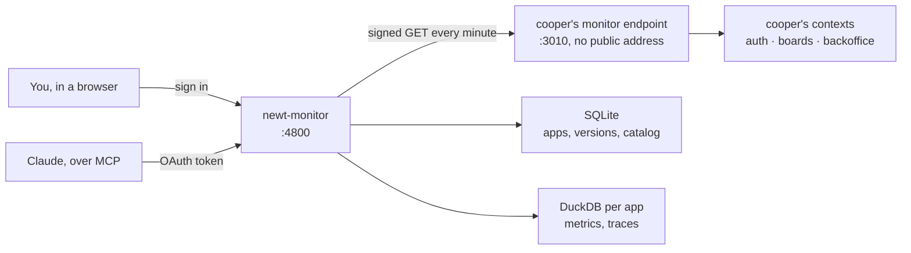
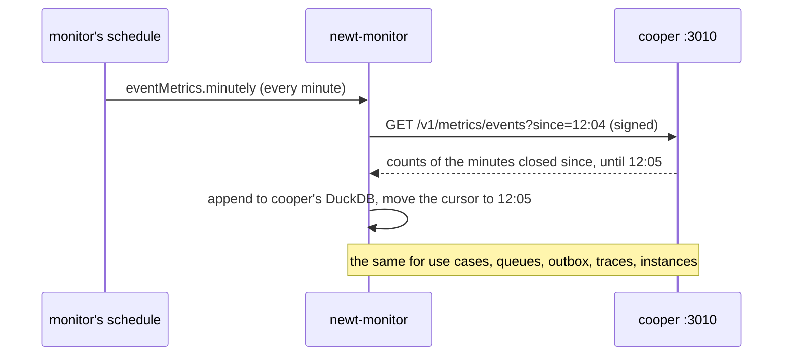
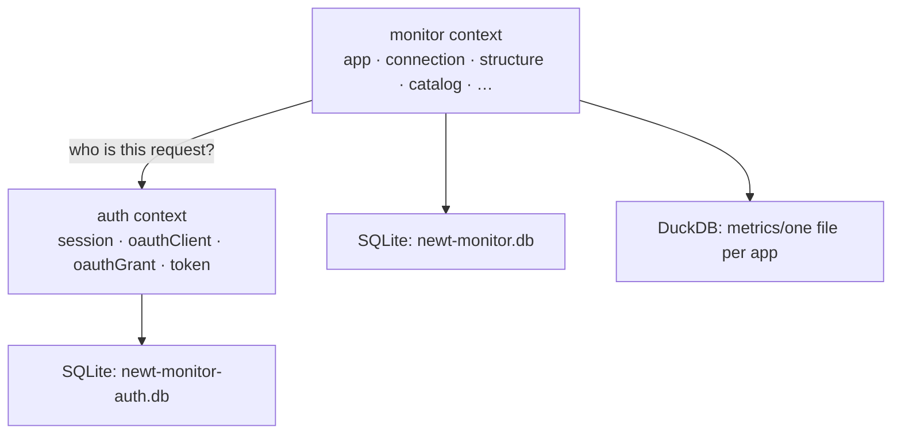

# newt-monitor

Once cooper runs in production, you need to see inside it: which use case got slow, which event stopped being told, which queue is filling up. This chapter shows newt-monitor, the monitor that knows newt's own words because the application tells it what it is made of, and walks through everything it shows.

## The problem

cooper is live. A customer writes: "moving a card has felt slow since yesterday". You open
the logs. There are thousands of lines, `POST /api/workspaces/:workspaceId/cards/:cardId/move 200 412ms`
among them, and nothing else. The logs know HTTP. They do not know that the route calls
`card.move`, that `card.move` tells `card.moved`, that three workers react to it, and that
one of those workers, `card.indexCard.on.card.moved`, has had a queue of four hundred jobs
since the deploy at 18:40.

A generic APM gets you a little further. It draws latency per route, flames per request,
a CPU chart. But it still speaks in routes and SQL. It has no idea what a bounded context
is, which module owns a table, or which jobs one event caused in another process half a
second later. You end up translating its picture back into your design in your head, at
two in the morning.

Here are the questions you actually want answered, in cooper's words:

- Which **use case** got slower since the last deploy, and for which **workspace**?
- How many times was **`card.created`** told this hour, compared with the same hour last week?
- Which **queue** is backing up, and are its jobs **dead** or just slow?
- This request failed: what did it call, in which **context**, and what did the **jobs** its
  events caused do afterwards?
- What does the application look like **now**: which contexts, modules, use cases, events,
  schedules? And what changed in the last version?

A tool can answer those only if it knows the concepts. newt-monitor does.

## The idea

A newt application already knows what it is made of. Every module is registered with its
context, every use case has `@UseCase()`, every event has a name, every subscription has a
queue, every schedule has a cron. Part I of this book built that structure on purpose, and
`describeApplication` can read it back while the application runs.

So the monitor does not guess. The application **tells** it: its structure, how many
times each event was told, how long each use case took, how its queues flowed, the traces it
kept, the machines it runs on. It tells it through a small endpoint of its own, on a port
of its own, and only to requests signed with a key both share.

::: info Concept: The monitor endpoint
A tiny HTTP server the application starts beside its contexts with `serveMonitor`
(`newt/monitor`). It answers only `GET` requests signed with a shared key, on a port no
public address points at, and it serves only what newt already counts: never a row of the
application's data. Anything else gets a bare `401`.
:::

The monitor is the other side: a separate application, `newt-monitor`, that you run once
for all your newt applications. It registers each one by its endpoint's address and key,
asks it every minute what is new, keeps what it hears in its own databases, and draws it.

Three things in that picture matter.

**The monitor pulls.** cooper never sends anything anywhere. It counts in its own memory
(or in a Redis shared by its instances), and the monitor comes to collect, minute by minute.
If the monitor is down for a while, cooper does not notice; when it comes back, it asks
for the minutes it missed.

**Every request is signed.** Each request carries an HMAC-SHA256 signature of its method,
path, time and a fresh nonce, made with the shared key. The key itself never travels. A
request copied on the wire is refused the second time, and a request with the wrong key
learns nothing, not even which paths exist.

**The application never opens its database to the monitor.** The monitor has no
connection string, no read replica, no SQL into cooper. What it knows is what newt counted:
names, times, counts, outcomes, shapes of queries. That is why you can point it at
production without a security review of every table.

## A tour

The rest of Part III goes deep into each page. Here is what you get, one look at a time.

### Your applications

The first page lists every application the monitor watches, with a badge that says
whether it answered the last time it was asked: **Up**, **Down** or **Not checked**. You
register one with a name, the address of its monitor endpoint and its key. The monitor
asks the endpoint who it is *before* it saves anything: an address that does not answer, or
a key the application refuses, is never stored. [Connecting an application](./41-connecting)
covers all of it.

### The overview

Open cooper and you land on its overview: a dashboard of what to look at first.

<figure class="screenshot">
  
  
  <figcaption>cooper's overview: its parts counted, its instances, every use case's calls, errors and failures on one chart, and what failed or ran again most in 24 hours.</figcaption>
</figure>

At the top, the band: cooper's name, its connection badge, and the commit deployed now
(linked to GitHub, with its title, once you tell the monitor where the code is). Two
buttons, **Check connection** and **Refresh structure**, ask cooper right now instead of
waiting for the next round.

Below: how many contexts, modules, use cases and events it has; how many instances are
alive, the disk that fills soonest, memory in use and the worst event loop delay; then one
chart of every use case together (calls, runs again after a conflict, errors, failures and
mean time) over a window you pick, from an hour to a year. Three boxes say where to look
first: the use cases with the most **failures** nobody expected in 24 hours, the ones that
**ran again** most after a conflict, and the queues. At the bottom, a graph of which
context uses which.

Every chart carries **marks**: a line where a commit was deployed, and where an instance
started, stopped or was lost. "Since the deploy" is something you can see, not something
you work out.

### Contexts and modules

The **Contexts** tab is cooper's design, drawn from cooper itself.

<figure class="screenshot">
  
  
  <figcaption>The Contexts tab: a tree of contexts and modules on the left, the module chosen on the right, with its use cases, events, deps and reactions.</figcaption>
</figure>

On the left, a tree like a repository's folders: `auth`, `boards`, `backoffice`, and the
modules of the one you are in. A context's page says which contexts it uses, draws its
modules against the others, and lists who hears its events. A module's page lists its use
cases (with their last 24 hours, what they write to besides their own module, and whether
they are retried on a conflict), the events it tells (schedules with their cron), what it
depends on, and which events it reacts to. A toggle shows the parts that were **removed**
in earlier versions, kept by the catalog. [The structure, drawn](./42-structure) is all
about this tab.

### One use case

Click `card.create` and you get everything newt measured about it.

<figure class="screenshot">
  
  
  <figcaption>One use case: its calls, runs after a conflict, errors and failures; p50, p90 and p99 over time; its errors by code; a trace near each percentile; and who calls it most.</figcaption>
</figure>

Calls, runs again after a conflict, errors (the ones it says may happen, like
`card.not_found`) and failures (the ones nobody expected), mean, p90 and p99, each beside
the window before or the same window a week before. Who calls it most, by actor and by
workspace, one click to filter the whole page by one of them. And, for each percentile, a
real trace of a call that took about that long, so "p99 is 900 ms" becomes "here is one of
those 900 ms calls, and here is the query that took 700 of them". Events get a page of
their own, with a live counter of this minute. [Metrics](./43-metrics) goes through both.

### Traces

The **Traces** tab lists what cooper kept: every request and job that failed, ended in an
error, ran again or was asked for, and a share of the rest.

<figure class="screenshot">
  
  
  <figcaption>Traces, newest first, filtered by how they went: failures, errors, ran again, asked for, warned, or the slowest.</figcaption>
</figure>

Open one and you see its steps on a timeline: the request, the use cases it called, each
run of them, each query with its shape and rows, the transaction and its commit, each
event told, and the jobs those events caused, unfolded in place, with how long they waited
in their queue. A trace in newt follows a flow across processes, not just one request.
Settings gives you a signed header that makes cooper keep the trace of every request
carrying it, for an hour or a day. [Traces](./44-traces) explains it all.

### Queues

The **Queues** tab is the outbox seen from outside.

<figure class="screenshot">
  
  
  <figcaption>Every queue together: waiting, running and dead now, the oldest job waiting, and over time how full they were, what went in and out, and how long jobs waited.</figcaption>
</figure>

How many jobs are ready, waiting to run again, running and dead, right now and over time;
what went in and out; how long jobs waited before a worker took them, p50 to p99. Each
queue by context, with a red **Orphan** badge when jobs wait in a queue no worker serves
any more (a handler renamed in a deploy). A queue's page lists its dead jobs with their
last error, never their payload. [Queues and dead jobs](./45-queues) covers them.

### System

The **System** tab is the machines cooper runs on, and its own processes, whatever they are.

<figure class="screenshot">
  
  
  <figcaption>The system: instances alive, memory and processor added up across them, the worst event loop, the machines' memory, processors and disks, and in how many days a disk fills.</figcaption>
</figure>

Each instance reads itself and its machine every 10 seconds: memory (resident and heap),
processor time, event loop delay; the machine's memory, processors, load and disks. The
monitor adds the instances up, so the line goes on across deployments even though every
deploy brings new processes and new containers. A disk that is filling gets a "full in N
days" from the pace it filled lately.

### Settings

**Settings** holds the application's address, key and GitHub repository, how long its
metrics and traces are kept, its connection in detail, the trace header, its **versions**
(one each time its structure changed, with what each added and removed), and the danger
zone: archive, restore, delete.

### Asking Claude

Last, the monitor is an MCP server. Connect Claude to it once, through OAuth, and ask in
plain words: "which use case of cooper got slower since the last deploy?", "are there dead
jobs in boards?". Claude reads the same data the pages draw, through fifteen read-only
tools. [Asking Claude](./46-asking-claude) shows how.

::: tip In cooper
cooper serves its endpoint in `cooper/backend/index.ts`, only when `COOPER_MONITOR_KEY`
is set, on `COOPER_MONITOR_PORT` (3010). With `COOPER_REDIS_URL`, its instances count
together in Redis, so the monitor sees all of them from whichever one it reaches.
:::

## What it is not

It helps to be precise about the edges.

- **It reads, it never acts.** No page and no tool of the monitor changes an application.
  It cannot retry a dead job, restart an instance or roll back a deploy. Those belong to
  the application (cooper retries dead jobs from its own backoffice) or to your platform.
- **It knows what newt counts.** Your own log lines appear inside the traces that kept them,
  but the monitor is not a log store, and it does not measure code outside newt's use
  cases, routes, jobs and stores.
- **It is one person's tool.** One user and password, from its environment. It has no
  teams, no roles, no alerts that page you at night.
- **It speaks newt only.** The endpoint is `newt/monitor`'s. For a non-newt service, or
  to send traces to a tracing backend you already run, newt has OpenTelemetry
  (`newt/otel`), which [Observability](./32-observability) covers.

::: warning Watch out
The application keeps what the monitor has not collected yet for a while only: a day of
minutes in `MemoryMetrics` and an hour of traces in `MemoryTraces`, by default, and in
memory nothing survives a restart. A monitor that is down for longer leaves a gap; one
that is down for a few minutes catches up on its next round.
:::

## Built with newt

newt-monitor is not a special tool bolted on the side. It is a newt application, in
`packages/newt-monitor`, built with exactly what this book teaches: two bounded contexts,
`auth` (who may enter: the one person, their sessions, the MCP clients they let in) and
`monitor` (the applications and what it learns of each), thirteen modules in `monitor`,
use cases, domain events, workers, schedules, repositories on SQLite, and DuckDB for the
metrics. Each minute's collection is a schedule; each reaction ("an application was
deleted, forget its versions") is a worker on a queue. You could open newt-monitor in
newt-monitor and see its own design drawn.

[Running the monitor](./47-running-the-monitor) ends Part III with how it is configured,
secured and deployed, and a closer look at how it is built.

## Recap

- Logs and generic APMs speak HTTP and SQL; newt-monitor speaks contexts, modules, use
  cases, events, queues, workers and schedules, because the application describes itself.
- The application serves a small signed endpoint (`serveMonitor`) on a private port; the
  monitor pulls from it every minute and never touches the application's database.
- It shows the structure (and how it changed), use case and event metrics, traces that
  follow a flow across processes, queues and dead jobs, and the system the application
  runs on, all marked with deployments.
- It is read-only, for one person, and also an MCP server Claude can ask.
- It is itself a newt application, with two contexts: `auth` and `monitor`.

## Going further

- [Connecting an application](./41-connecting): `serveMonitor`, the key, registering.
- [Observability](./32-observability): what newt measures and traces inside the application.
- [Running the monitor](./47-running-the-monitor): its configuration and security.
