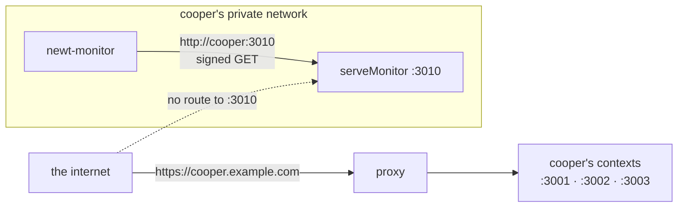
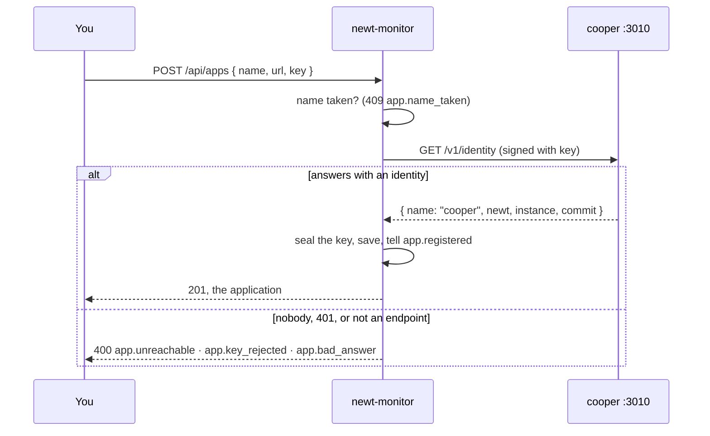
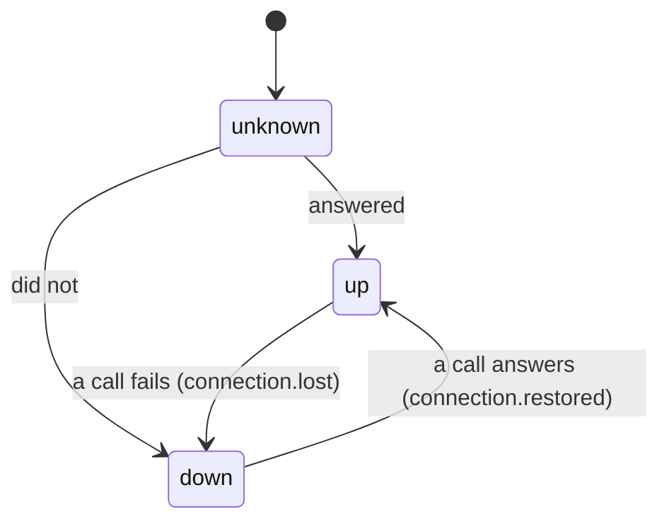
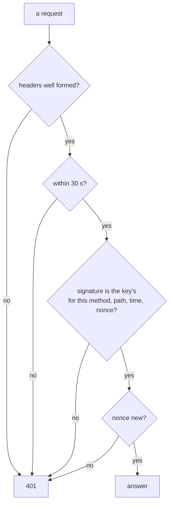

# Connecting an application

<p class="chapter-lead">An application has to tell the monitor what it is made of, and tell nobody else. This chapter shows how cooper opens its monitor endpoint with `serveMonitor`, how you register it in newt-monitor, and how signatures and nonces keep that conversation private.</p>

## The problem

You want cooper to answer questions about itself: its structure, its counts, its traces.
But cooper is on the internet. Anything it answers to the monitor, it must not answer to a
curious stranger, a scanner, or someone who recorded one request on the network and plays
it back an hour later.

And you want this to be boring to set up. No agent to install, no sidecar, no extra
database. One call in cooper's entry file, one form in the monitor.

## The idea

The application serves a **monitor endpoint**: a separate HTTP server, on a port of its
own, that no public address points at. It answers only `GET` requests signed with a key the
application and the monitor share. The monitor, given the endpoint's address and the key,
signs every request it sends.



Two walls protect the endpoint. The first is the network: its port is not published, so
only something on the same network (the monitor's container, say) can reach it. The second
is the signature: even a request that reaches it is refused without the key.

## Serving the endpoint

`serveMonitor` comes from `newt/monitor`. You give it the contexts the application is made
of, and its options:

```ts
import { serveMonitor } from 'newt/monitor'

const monitor = serveMonitor(contexts.all, {
  name: 'cooper',
  port: 3010,
  hostname: '0.0.0.0',
  key: process.env.COOPER_MONITOR_KEY!,
})
```

It returns Bun's `Server`. Here is every option:

| Option | What it is |
|---|---|
| `name` | The application's name, as the monitor shows it: `cooper`. |
| `port` | Its own port, apart from every context's. One with no public address in front of it. |
| `hostname` | Where it listens: `127.0.0.1` unless told. `0.0.0.0` in a container that another container reaches over their network. |
| `key` | The key the monitor signs with: at least 32 characters. Without one, it does not start. |
| `commit` | The commit the application was built from: `SOURCE_COMMIT` unless told (Coolify sets it as it builds); `null` when unknown. The monitor turns it into deployments. |
| `disks` | The paths whose disks it reports, as space left: `['/']` unless told. |
| `nonces` | Where it remembers the nonces it has seen: its own memory unless told; `RedisNonces` with several instances. |
| `clock`, `instances`, `traces` | For tests: a clock of their own, instances and traces served as they are. |

::: danger Never
`serveMonitor` refuses to start without a key of 32 characters or more: it throws
`The monitor's key has at least 32 characters: it does not start without one`. There is no
"open" mode to try it without one.
:::

### What serving it turns on

Serving the endpoint is not only opening a port. It switches on the measurements the
monitor will read, which cost nothing until then:

- **Counting.** Every context's `Base.metrics` is enabled: events told, use case calls and
  their timings, queue flows, minute by minute.
- **Sampling the instance.** An `InstanceSampler` reads the process (memory, heap,
  processor time, event loop delay) and its machine (memory, processors, load, the disks
  in `disks`) every 10 seconds.
- **Tracing.** The application's traces are turned on (`enableTraces`): kept in its memory
  unless `setTraces` said where. And a request carrying an `x-newt-trace` header signed with
  the same key has its trace kept whole ([Traces](./44-traces)).

It also gives the process an **identity**: a fresh instance id each time it starts, its
host, its pid, when it started, the newt version it runs and its commit.

### What it answers

| Path | What it says |
|---|---|
| `GET /v1/identity` | Which application and which process: name, newt version, instance, start time, commit. |
| `GET /v1/structure` | What it is made of, as `describeApplication` says it while it runs. |
| `GET /v1/metrics/events?since=` | How many times each event was told, minute by minute, for the minutes closed since. |
| `GET /v1/metrics/use-cases?since=` | Each use case's calls, retries, total time, a duration histogram, errors and failures by code, per minute. |
| `GET /v1/metrics/queues?since=` | Each queue's jobs published, delivered, redelivered and dead, and how long they waited, per minute. |
| `GET /v1/metrics/live` | Event counts as they come, as server-sent events, with a heartbeat every 8 seconds. |
| `GET /v1/outbox` | Every context's queues now: ready, retrying, running, dead, the oldest due, orphans. |
| `GET /v1/outbox/dead?context=&after=&limit=` | A page of a context's dead jobs, without payloads (at most 100). |
| `GET /v1/traces?since=` | The traces kept, by the minute they ended. |
| `GET /v1/instances?since=` | Every instance now and its closed minutes. |

Anything else gets a `404` (once signed), a method other than `GET` a `405`, and an
unsigned request a `401` before any of that.

::: info Concept: Closed minutes
The metrics paths answer only **closed** minutes, those that ended (with a few seconds to
settle, for what was still committing), and the cursor of the last one, `until`. The
monitor asks `since` the `until` it got last time. So a minute is never read half-full,
and one asked twice is the same minute twice, which the monitor keeps once.
:::

## In cooper

cooper serves the endpoint at the end of `cooper/backend/index.ts`, only when it was given a
key:

```ts
// cooper/backend/index.ts
// Several instances count their events and keep their traces in one Redis; one alone, in its memory.
if (config.monitor.redisUrl) {
  setMetrics(new RedisMetrics({ url: config.monitor.redisUrl, prefix: 'cooper:metrics' }))
  setTraces(new RedisTraces({ url: config.monitor.redisUrl, prefix: 'cooper:traces' }), { sampleRate: 1 }) // every trace, for the demo to be full
}
const contexts = await openContexts(config)
// …

// What cooper is made of, for whoever monitors it: only with a key, on a port no domain points at.
if (config.monitor.key) {
  const nonces = config.monitor.redisUrl ? new RedisNonces({ url: config.monitor.redisUrl, prefix: 'cooper:monitor:nonce' }) : undefined
  const monitor = serveMonitor(contexts.all, { name: 'cooper', port: config.monitor.port, hostname: config.monitor.hostname, key: config.monitor.key, nonces, disks: config.monitor.disks })
  console.log(`monitor listening on ${monitor.url}`)
}
```

The settings come from `cooper/backend/config.ts`:

| Variable | What it is |
|---|---|
| `COOPER_MONITOR_KEY` | The key. Unset, there is no endpoint at all. |
| `COOPER_MONITOR_PORT` | Its port: 3010. |
| `COOPER_MONITOR_HOSTNAME` | `127.0.0.1` unless told; cooper's image sets `0.0.0.0`, for the monitor's container to reach it. |
| `COOPER_DISKS` | The disks reported, by path, comma separated: `/` unless told. |
| `COOPER_REDIS_URL` | The Redis cooper's instances share, for metrics, traces and nonces. |

::: tip In cooper
cooper's `Dockerfile` sets `COOPER_MONITOR_HOSTNAME=0.0.0.0` and does not `EXPOSE` 3010:
"The monitor's port (3010, with COOPER_MONITOR_KEY) is reached over the container's network
only: it is not exposed." The monitor reaches it by the container's name,
`http://cooper:3010`.
:::

### One instance or several

With one instance, everything lives in that process's memory: `MemoryMetrics`,
`MemoryTraces`, `MemoryNonces`. That is the default; you write nothing.

With several instances behind a load balancer, the monitor reaches only one of them per
request. So they must count in one place:

- `setMetrics(new RedisMetrics({ url }))`: each instance counts in memory and adds to Redis
  every few seconds; a minute is closed once every instance has added to it.
- `setTraces(new RedisTraces({ url }))`: traces kept by any instance, collected from any.
- `RedisNonces`: a signed request seen by one instance is refused by all.

Call `setMetrics` and `setTraces` once, where the application starts, before its contexts
open. `cooper/scripts/replicas.ts` (`bun run cooper:replicas`) starts two instances on one
Redis, to try it.

::: warning Watch out
`sampleRate: 1` keeps every trace: cooper does it so its demo is full. In production keep
the default, 0.01, or a rule per use case. Traces that failed or ran again are kept
whatever the share.
:::

## The key

The key is a shared secret, of 32 characters or more (the monitor takes up to 512). Make
one long and random:

```sh
openssl rand -base64 48
```

Give the same value to the application (`COOPER_MONITOR_KEY`) and, below, to the monitor.
The monitor stores it encrypted with its own secret (`KeyCipher`, AES-256-GCM, bound to the
application's id) and never shows it again. It needs the key itself, not a hash, because it
signs with it.

To change it, start the application with the new key and give the monitor the new key in
the application's Settings. The monitor checks it answers before saving it.

## Registering it in the monitor

The first page of the monitor lists your applications.

<figure class="screenshot">
  
  
  <figcaption>The applications the monitor watches: each one's endpoint, when it was added, and whether it answered the last time it was asked.</figcaption>
</figure>

**New application** opens a form with three fields:

- **Name**: how the monitor calls it, `cooper`. Unique among the applications it watches.
- **Endpoint**: its `serveMonitor` address as the monitor reaches it, `http://cooper:3010`.
  `http` or `https`, no query, no fragment; a trailing `/` is dropped.
- **Key**: the key it was started with.

The monitor **asks before it saves**. It signs a `GET /v1/identity` with the key and sends
it to the address. Only if a monitor endpoint answers, with that key, is the application
saved.



The three refusals say exactly what went wrong:

| Code | Why |
|---|---|
| `app.unreachable` | Nobody answered at that address within 5 seconds. Wrong host, wrong port, or the application is not serving its endpoint. |
| `app.key_rejected` | It answered `401`: the key is not the application's. |
| `app.bad_answer` | It answered, but not as a monitor endpoint does: another status, something that is not JSON, or a redirect. |

Saved, the application is `app.registered`, and a worker reads its structure at once, so
its pages fill within seconds instead of at the next hour.

The same works over the API, with the monitor's session cookie:

```sh
curl -s -b cookies.txt localhost:4800/api/apps -H 'content-type: application/json' \
  -d '{"name":"cooper","url":"http://cooper:3010","key":"…"}'
```

### Where its code is

In **Settings**, an application also takes a **Repository**: its code on GitHub,
`https://github.com/<owner>/<repo>`. With it, each commit an instance says it was built
from links to GitHub, and the monitor asks GitHub for the commit's message, so a
deployment shows as `3f2a91c Cards keep their order when moved` instead of a bare hash.
Private repositories need `NEWT_MONITOR_GITHUB_TOKEN` ([Running the monitor](./47-running-the-monitor)).

## Whether it answers

Every time the monitor calls an application (to read its structure, collect a minute,
snapshot its queues), it records how the call went. That record is the application's
**connection**:



The badge on every page is that state: **Up**, **Down**, or **Not checked** before the first
call. **Settings → Connection** tells it in full: who answered last time ("cooper answers,
on newt" and the newt version it runs), its host, its process, when it started, how many
instances are alive, when it was checked, and when it last answered if it does not now, with the reason:

| Reason | Meaning |
|---|---|
| `unreachable` | Nobody answered, or not in time. |
| `key_rejected` | It refused the signature. |
| `bad_answer` | Something answered, but not a monitor endpoint (or one on a newt too old for what was asked). |
| `key_unreadable` | The monitor cannot open the key it kept: it was started with another `NEWT_MONITOR_SECRET`. Give the key again. |

**Check connection**, in the band, asks it now. Going down tells `connection.lost`, coming
back `connection.restored`: domain events of the monitor's `connection` module, there for
whatever reacts to them.

## Changing, archiving, deleting

In **Settings → General** you change the name, the endpoint, the key (empty keeps the one
it has) or the repository. A new address or key is checked like a registration: one that
does not answer leaves the one that did. A new address or key also reads the structure
again at once.

The **danger zone** holds the application's life:

- **Archive**: it stops being watched (no more collections, no badge), and everything known
  of it is kept. Archiving twice is archiving once.
- **Restore**: watched again, and its structure read at once.
- **Delete**: only once archived. Everything the monitor knew goes: its connection, its
  versions, its catalog, its deployments, its retention, and its metrics' DuckDB file. Each
  module forgets its own part, as a worker on `app.deleted`.

## Signatures and nonces

Here is what makes the endpoint safe to leave running.

Each request carries three headers, made by `signMonitorRequest(key, { url })`:

| Header | What it is |
|---|---|
| `x-newt-timestamp` | When the request was made, in milliseconds. |
| `x-newt-nonce` | 16 random bytes, base64url: never used before. |
| `x-newt-signature` | HMAC-SHA256, with the key, of `newt-monitor-v1`, the method, the path with its query, the timestamp and the nonce, one per line, in hex. |

The endpoint checks, in order:

1. The three headers are well formed.
2. The timestamp is within **30 seconds** of its own clock, either way.
3. The signature is the key's for *this* method, path, query, time and nonce (compared in
   constant time).
4. The nonce was **not seen before**. It is kept for 60 seconds, twice the window, so a
   replay inside the window is caught, and one outside it fails step 2.



Every refusal is the same bare `401`, with no body. A stranger learns nothing: not which
check failed, not even which paths exist. The key never travels; a signature seen on the
wire is good for one request, once, for half a minute, and for nothing else, because
changing the path or query changes the signature.

The monitor, on its side, gives an endpoint 5 seconds to answer (its body included), and
**never follows a redirect**: it asks the address you gave and no other, so an endpoint
cannot send it, and its signed headers, somewhere else.

::: warning Watch out
The window is 30 seconds. Keep the clocks of the monitor's machine and the application's in
sync (NTP, which every cloud machine has). A monitor whose clock drifts by a minute sees
`key_rejected` although the key is right.
:::

::: details Under the hood: several instances and replays
With `MemoryNonces`, each instance remembers its own nonces: a request replayed to
*another* instance within the window would be taken there. `RedisNonces` stores each nonce
with `SET … NX PX`, so the first instance to see it says yes and every other says no. The
nonce is kept from the instance's own now, not from the request's timestamp, so an instance
whose clock lags a little still keeps it long enough.
:::

## What the monitor reads, and what it never does

It reads only what the table above lists: names, counts, durations, outcomes by code,
queue depths, a dead job's queue, event, attempts and last error, a trace's spans with the
*shape* of each query (never its values), log lines written during a kept trace, and the
process's and machine's resources.

It never reads a row of the application's data, an event's payload, a job's payload, a
request's body, a header's value. There is no path for it. And every path is a `GET`: the
endpoint has nothing that changes the application.

::: warning Watch out
Log lines kept with a trace carry the fields your code gave them. If your code logs an
email address, the monitor will show it. Log ids, not personal data.
:::

## Recap

- `serveMonitor(contexts, { name, port, key })` opens the endpoint on a port of its own; it
  will not start without a key of 32 characters or more.
- Serving it turns on counting, the instance sampler (every 10 s) and traces.
- Several instances share Redis: `RedisMetrics`, `RedisTraces`, `RedisNonces`.
- Register an application with its name, endpoint and key: the monitor asks it who it is
  first, and saves nothing that does not answer.
- Each request is signed (HMAC-SHA256, 30 s window, nonce seen once); every refusal is the
  same `401`, and the monitor never follows a redirect.
- The connection badge (up, down, not checked) is updated by every call.

## Going further

- [The structure, drawn](./42-structure): what the monitor does with `/v1/structure`.
- [Observability](./32-observability): `setMetrics`, `setTraces` and sampling, from the
  application's side.
- [Running the monitor](./47-running-the-monitor): `NEWT_MONITOR_SECRET`, and how the keys
  are sealed.
