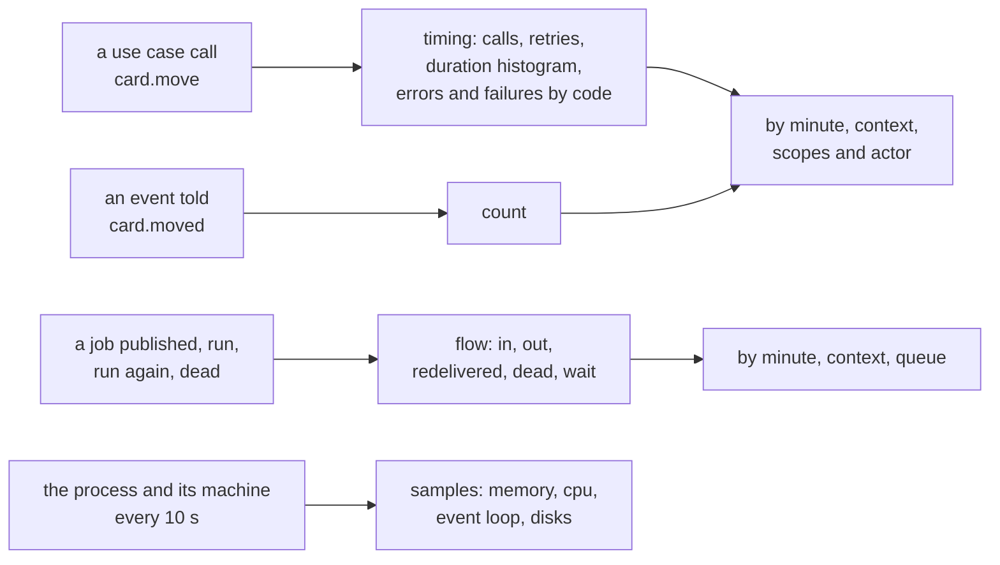
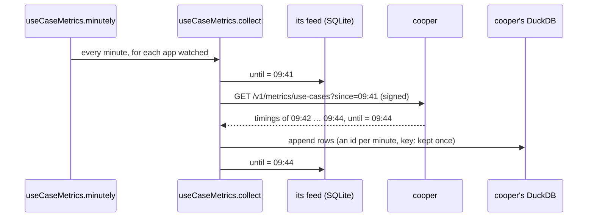
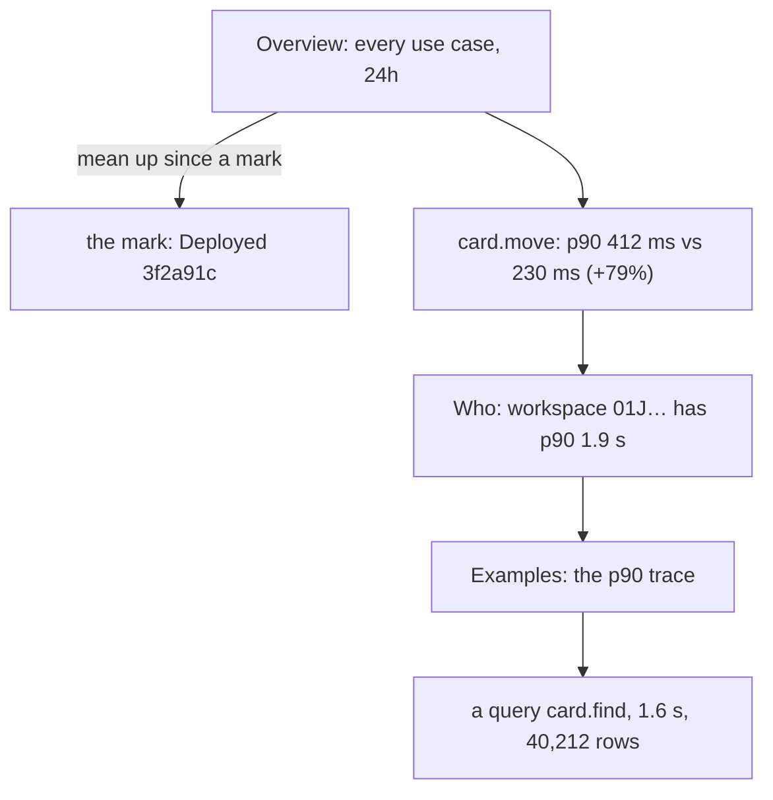

# Metrics

"Is it slower than yesterday?" is the question you ask most, and the one logs answer worst. This chapter shows the numbers newt-monitor keeps for every use case, event, queue and instance, how to read them, and how they get from cooper's memory into the monitor's DuckDB, minute by minute.

## The problem

A Monday morning. Support says cooper "feels slow". You need to know four things fast:

1. Is it slow at all, or is it one person's network?
2. If it is slow, **which use case**: `card.move`, `card.search`, `board.get`?
3. Since **when**: the deploy on Friday, or the traffic this morning?
4. For **whom**: every workspace, or the one with forty thousand cards?

A dashboard of HTTP latency answers the first question, badly the second, and not at all
the fourth. And the counts you would need to answer them, "calls of `card.move` per minute,
per workspace, with their durations", are exactly what nobody thought to add a metric for.

## The idea

newt already wraps every use case call, every event told, and every job a worker runs. So
it measures them all, in the same shape, without you writing a line:

Each measurement is keyed by **minute**, **context**, the **scopes** it ran in (cooper's
`workspace`) and the **actor** who ran it. That is what makes the fourth question cheap:
"for whom" is already a column.

::: info Concept: Error and failure
newt tells apart two ways a call ends badly. An **error** is one the code says may happen:
a `DomainError` under 500 (`card.not_found`, `board.name_taken`) or a validation. A
**failure** is one nobody expected: a 5xx domain error, a `TypeError`, a database gone. The
monitor counts both, by code (a failure's code is its error's class name when it has no
other), and draws them apart, because a rising number of `validation` errors and a rising
number of `TypeError`s are very different mornings.
:::

## How they are collected

The application counts in its memory (or in Redis, with several instances), minute by minute.
The monitor collects. Every minute, a schedule of each of its metrics modules fires, and for
every application watched it asks for the minutes closed since the last one it has:

Each metrics module keeps a **feed**: a row in the monitor's SQLite with the last minute it
collected. If the monitor was down for twenty minutes, the next collection asks for twenty
minutes at once. If a minute is collected twice, its rows have the same ids and are kept once.

The modules that collect each minute are:

| Module | Asks | Keeps |
|---|---|---|
| `eventMetrics` | `/v1/metrics/events` | `event_minute`, `event_day` |
| `useCaseMetrics` | `/v1/metrics/use-cases` | `use_case_minute`, its histogram buckets, and their days |
| `useCaseErrors` | `/v1/metrics/use-cases` | `use_case_error_minute`, `use_case_error_day` |
| `queueMetrics` | `/v1/metrics/queues` | `queue_minute`, its wait buckets, and their days |
| `outbox` | `/v1/outbox` | `queue_depth`, a snapshot a minute |
| `instances` | `/v1/instances` | instances alive, the system, its disks, by minute and by day |
| `traces` | `/v1/traces` | the traces, their calls, events and logs |

All of them write into **one DuckDB file per application**, in the metrics folder beside the
monitor's database (`data/metrics/<appId>.duckdb`). DuckDB is a columnar database built for
exactly this: sums and percentiles over millions of rows, in a single file, with no server.

::: details Under the hood: one application's failure is not every application's
Each collection goes through the applications one after another. One that does not answer is
recorded as `unreachable` in its connection; one whose collection throws (its DuckDB
unreadable, say) is logged and skipped. The others go on. And a collection that overlaps the
application's deletion notices, and keeps nothing: what the monitor knew of it is already
forgotten, and stays so.
:::

### Every night: days, and forgetting

At night, each metrics module **sums whole days** (those at least two days old) into its
`*_day` tables, without the actor, and **forgets** what its application's retention says is
old. The defaults, in **Settings → General → Metrics**:

| Setting | Default | What it keeps |
|---|---|---|
| Minute by minute, with who | 30 days | Every minute, with its actor: what can be filtered by actor and drawn by the minute. At least 3 days. |
| Day by day, without who | for ever | Each day's sums, by scope, without actor: what stays once the minutes are gone. Never shorter than the minutes. |
| Servers and instances, minute by minute | 30 days | Each machine's memory, processors and disks, and how many instances were alive. |
| Traces | 7 days | Each trace kept. |

So a year of `card.create` is a year of daily rows, and the last month is every minute.

## Windows, buckets, comparisons

Every metrics page has the same controls.

**A window**: the last hour, 24 hours, 7, 30, 90 or 365 days. **A bucket**, how long each
point of the chart is, among those the window allows:

| Window | Buckets | By default |
|---|---|---|
| 1h | 1m, 5m | 1m |
| 24h | 1m, 5m, 15m, 1h | 15m |
| 7d | 15m, 1h, 1d | 1h |
| 30d | 1h, 1d | 1d |
| 90d, 365d | 1d | 1d |

**A comparison**: beside the window, the same length just before it ("compared with the
window before"), or **a week before** (so Monday morning is compared with last Monday
morning), or none. Every stat says its value then and the change: `412 ms, 230 ms the window
before (+79%)`.

**Marks** on every chart: each deployment, as a line with its commit and title, and each
instance that started, stopped or was lost.

## Use cases

The overview shows every use case at once: calls, runs again after a conflict, errors,
failures and their mean time, on one chart with each line shown or hidden from the legend.
Beside it, the use cases with the most failures in 24 hours (and how that compares with the
day before) and those that ran again most after a conflict. A module's page shows each of its
use cases' 24 hours in one line. Click one, and you get its page.

<figure class="screenshot">
  
  
  <figcaption>card.create over 24 hours: calls, runs after a conflict, errors, failures; mean, p90 and p99 beside the window before; its latencies, calls, retries and bad endings over time.</figcaption>
</figure>

From top to bottom:

- **Volume**: calls in the window; runs again after a conflict, with how many per 100 calls;
  errors and failures, each per 100 calls.
- **Time**: mean, p90 and p99, each beside the comparison.
- **Charts**: p50, p90, p99 and mean over time; calls; runs after a conflict; errors and
  failures.
- **By code**: each error and failure code, its count, beside the window before.
- **Examples**: for p50, p90 and p99, a real trace of a call that took about that long
  (see [Traces](./44-traces)), and every trace kept of it.
- **Who**: the actors who call it most, and, for each scope it ran in, the scope's ids that
  call it most (for cooper, workspaces), each with their own p50, p90 and p99. Order them by
  calls, runs again, errors or failures.

Click an actor or a workspace and the whole page filters to it: its stats, its charts, its
comparison. `card.move` is slow for workspace `01J…`? You see it, and you see that it is not
for the others.

::: info Concept: Runs again after a conflict
A use case whose save finds a row changed since it read it (optimistic concurrency) runs
again from the start, unless it says `retryOnConflict: false`. The monitor counts those runs.
A use case that runs again often is one whose rows are fought over: two people moving cards
in the same column at once. See [Concurrency](./20-concurrency).
:::

### How percentiles are computed

The application does not keep each duration. Each minute it keeps a **histogram**: buckets
that grow by 10% each, from 0.1 ms. The monitor adds histograms up over the window (or the
bucket, or the filter) and reads the percentile from them. So any percentile, over any span,
of any filter, is within about 5% of the exact one, and costs no more to keep for a minute
with a million calls than for one with ten.

::: warning Watch out
A p99 over five calls is one call. Read percentiles beside the call count: the examples box
says "No trace kept near it" when there is nothing to show.
:::

## Events

An event's page is simpler: how many times it was told.

<figure class="screenshot">
  
  
  <figcaption>card.created: told in the window beside the window before, over time against the comparison, who tells it most, and a live count of this minute.</figcaption>
</figure>

- **Told in the window**, and the change from the comparison.
- **A chart** of every bucket, the comparison drawn behind it: this Monday's cards against
  last Monday's.
- **Who tells it most**: by actor, and by each scope's ids. `No one (a worker, a schedule)`
  for counts with no actor. One click filters the page.
- **Traces that told it**: requests and jobs kept that told this event.
- **Live**, in the corner: a badge that counts this minute as it happens, `Live · 37 this
  minute`.

Events are often the best signal of all. Use cases tell you how the code behaves; events tell
you what your users *did*. A drop in `card.created` after a deploy is a bug report nobody
has written yet.

::: details Under the hood: live counts
The badge opens a server-sent events stream to the monitor (`/api/apps/:id/metrics/live`),
which opens one to the application's `GET /v1/metrics/live`, signed, and passes on what it
sends: counts as they are told, and a heartbeat every 8 seconds that keeps proxies from
closing it. It is not recorded as a check of the connection, and it ends when you leave the
page.
:::

## Queues

Each queue's flow is collected the same way: per minute, jobs **published** (in),
**delivered** (out, done), **redelivered** (run again after a failure), **dead** (out of
attempts), and a histogram of how long jobs **waited** between being due and being taken by a
worker. With the outbox snapshot each minute, that is what [Queues and dead
jobs](./45-queues) draws.

## Instances and the system

Each instance of the application reads itself and its machine every 10 seconds and keeps the
samples by minute. The monitor collects them, and the **System** tab draws them.

<figure class="screenshot">
  
  
  <figcaption>The system now and over 24 hours: instances alive, the application's memory and processor added up, its worst event loop, and its machines at their fullest.</figcaption>
</figure>

**Now**, from the last reading of each instance alive:

- **Instances alive**, and when they were read.
- **Its memory**: resident memory of its instances added up, with the heap.
- **Its processor**: as a share of one core, added up.
- **Worst event loop**: the longest delay of any instance. A long one means some code is
  holding the loop: a big JSON parse, a sync loop.
- **The machines' memory in use**, **processors busy** with load and cores, and the disk that
  fills soonest: **full in N days**, at the pace it filled lately, or how much is free.

**Over a window**, two groups of charts: **the application** (instances alive, fewest and
most; memory and processor, average and most; event loop at its worst) and **the machines**
(memory at its fullest; processors busy and load; each disk's free space at its lowest).

The lines go on across deployments. Every deploy brings new processes, often new containers
on other machines; the monitor adds up whichever instances were alive in each minute, so
"memory of cooper" is one line, not a new one per container.

::: info Concept: An instance's status
An instance is **alive** while it reports; **stopped** when it said it stopped (a clean
shutdown); **lost** when it stopped reporting without saying so (killed, crashed, its machine
gone). Stopped and lost instances stay listed for a day, then are forgotten. Each start, stop
and loss is a mark on every chart.
:::

The connection's page and the overview link here, and Claude reads the same numbers through
`system_and_instances` and `system_series`.

## Putting it together

Back to Monday morning:

The overview's chart rises at a mark: the Friday deploy. `card.move`'s p90 went from 230 to
412 ms. **Who** shows one workspace at 1.9 s and the rest unchanged. Its p90 example trace
shows a query reading forty thousand rows. Four clicks, and the answer is in cooper's own words.

## Recap

- newt measures every use case call (calls, retries, duration histogram, errors and failures
  by code), every event told, every queue's flow and every instance, by minute, context,
  scopes and actor.
- The monitor collects closed minutes every minute, with a feed per module so nothing is lost
  or counted twice, into one DuckDB file per application.
- Nightly, whole days are summed without actor, and what retention says is old is forgotten:
  minutes 30 days, days for ever, traces 7 days by default.
- Every page has windows (1h to 365d), buckets, a comparison (window before, a week before)
  and deployment marks.
- Use cases show volume, percentiles (from histograms, within about 5%), codes, example traces
  and who calls them most; events show counts, who tells them, and a live count.
- The System tab adds up instances across deployments: memory, processor, event loop, machines
  and disks.

## Going further

- [Traces](./44-traces): the examples behind each percentile.
- [Observability](./32-observability): `Base.metrics`, `setMetrics` and `RedisMetrics` from
  the application's side.
- [Concurrency](./20-concurrency): what "runs again after a conflict" counts.
