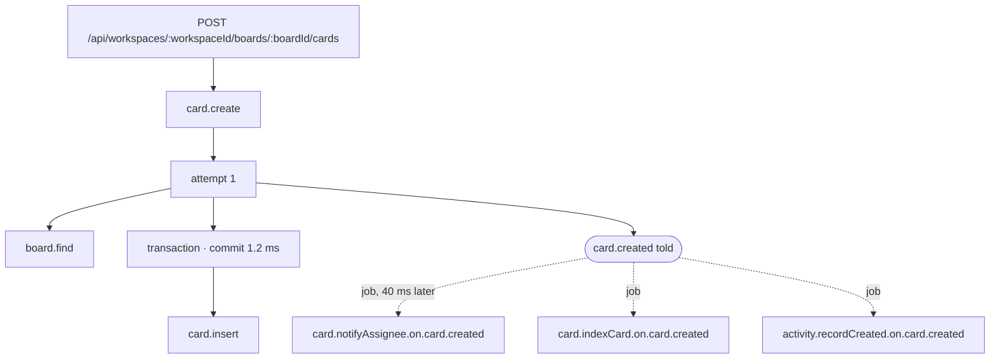
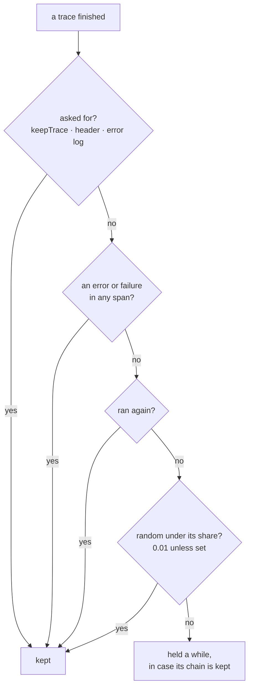
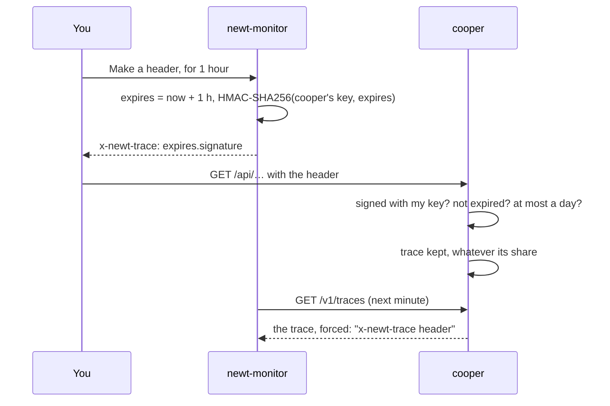
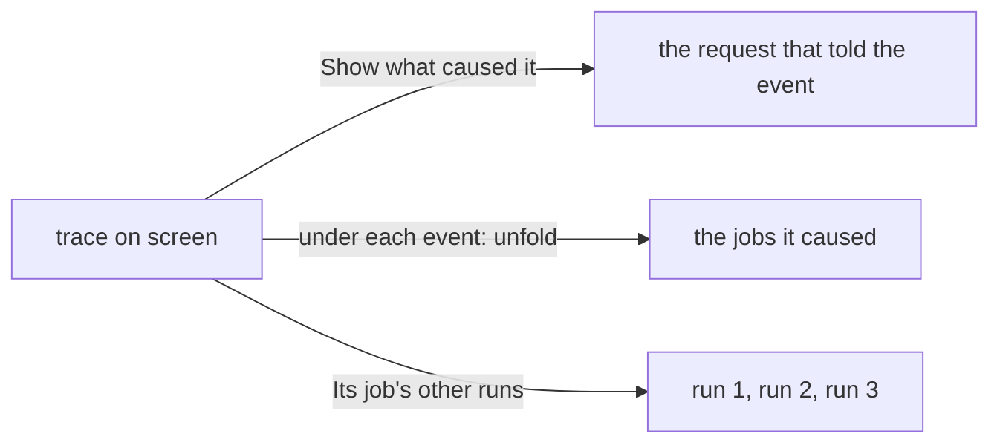

# Traces

<p class="chapter-lead">A metric says something is slow or failing; a trace says why. This chapter shows what a trace is in newt (a request or a job, everything it did, and the jobs its events caused afterwards, across processes), which traces are kept, how to ask for one with a signed header, and how to read one in newt-monitor.</p>

## The problem

A customer creates a card and assigns it to a teammate. The request answers `201` in 80 ms.
The teammate never gets the email.

Where did it go wrong? The request is fine. The email is sent by a worker, from a job the
`card.created` event caused, in its own transaction, perhaps in another process, three
seconds later. Its failure is in a different log, with a different request id, or none.
To connect the two you would need to know which event the job ran for, which request told
that event, and what both did. In most systems, you grep timestamps and guess.

## The idea

In newt the connection is not guessed, because the framework made it. A request calls use
cases; use cases tell events with ids; each subscription writes a job for that event id into
the outbox; a worker runs the job. So a trace can follow the whole flow.

::: info Concept: A trace
A request or a job (its **root**), and everything it did, as a tree of **spans**: the use
cases it called, each **attempt** of them, the **queries** they ran, the **transaction** and
its commit, the **events** they told, and any **rate limit** they took from. A job's trace
knows the event it ran for, so it finds the trace that told it, and the traces of the jobs
that trace's events caused hang beneath it.
:::



The solid part is one trace, the request's. Each dashed job is a trace of its own, kept by
the worker that ran it, maybe on another instance. The monitor puts them back together.

## What a trace holds

Each span has a kind, a name, its context, when it started (from the trace's start), how
long it took, how it ended, and a few attributes about itself. Never a value it was given.

| Kind | Name | What it says |
|---|---|---|
| `http` | `POST /api/workspaces/:workspaceId/cards/:cardId/move` | A request, the root. A 4xx is an error, a 5xx a failure. |
| `job` | `card.indexCard.on.card.created` | A worker's run of a job, the root: which run, of which queue, for which event. |
| `use-case` | `card.move` | A use case's call; `runs` when it ran more than once. |
| `attempt` | `attempt 2` | One run of that use case, after a conflict. |
| `query` | `card.find` | A read or write of a table: its **shape** (`{workspaceId, boardId} order position limit 50`), and the rows it read. |
| `transaction` | `transaction` | The store's transaction, and how long its commit took. |
| `event` | `card.moved` | An event told: an instant, with its id. |
| `rate-limit` | `session.signIn` | A take from a rate limit: its limit, window, what it counts by, and what remains; refused, an error. |

The trace itself also says who ran it (its **actor**), in which **scopes** (the workspace),
the use cases it called, the events it told, its worst **outcome** (a failure over an
error), whether anything **ran again**, and the **log lines** written while it ran, each at
the step that wrote it (up to 200; the rest are counted). A failure keeps its message and its
stack; an error keeps only its code, because it says it may happen.

::: info Concept: A query's shape
Traces record which fields a query filtered by and how, its order and its limit:
`{workspaceId, status in, or(dueAt lt, dueAt null)} order position limit 50`. Not the values.
You can see that `card.search` scans without the workspace in its filter, and nobody can see
what anyone searched for.
:::

## Which traces are kept

Tracing every request in full costs memory and storage, and almost all of them went well.
So newt keeps:

- **Every trace where something went wrong**: an error or a failure anywhere in it.
- **Every trace where something ran again**: a use case after a conflict, a job's run after
  its first.
- **Every trace something asked for**: `keepTrace('a large order')` in your code, an error
  logged with `log.error`, or a request with a signed `x-newt-trace` header.
- **A share of the rest**, at random: 1 in 100 by default.



The share is `setTraces`'s `sampleRate`: a number, or rules by use case, route, queue or
context, the most concrete winning. `NEWT_TRACE_SAMPLE_RATE` replaces the default share
without touching the code.

```ts
setTraces(new RedisTraces({ url }), {
  sampleRate: { default: 0.01, useCases: { 'card.move': 0.2 }, routes: { 'GET /api/health': 0 } },
})
```

### A flow is kept whole

A trace that is *not* kept, but told events or ran a job, is **held** for half an hour. If any
trace of its chain is kept later (the job its event caused failed, three seconds later), the
held ones of that chain are kept with it: the request that told the event, and the other jobs
it caused. So when `card.notifyAssignee` fails, you get the request that created the card
too, even though that request went well and was not in the 1%.

The application keeps its traces until the monitor collects them: in its memory
(`MemoryTraces`, an hour, at most 1,000 a minute) unless `setTraces` gives another place.
Several instances share `RedisTraces`, so a flow that crosses instances is still one. The
monitor collects them every minute and keeps them 7 days by default (**Settings → General →
Metrics**).

::: tip In cooper
`cooper/backend/index.ts` keeps every trace (`sampleRate: 1`) when it runs with Redis, so its
demo is full. A production application keeps the default share, and lets errors, failures
and retries keep themselves.
:::

## Asking for a trace: the signed header

Sometimes you need to see a request that goes *well*: a customer says "saving this board is
slow for me", but nothing fails, and their request is unlikely to land in the 1%. You want
*their* request traced, in production, now, and nobody else's requests to change.

**Settings → Trace a request** makes a header for that. Pick how long it is good for (an
hour, 6 hours or a day) and press **Make a header**:

```text
x-newt-trace: 1793534400000.4f1c…e9a2
```

Every request to the application that carries this header has its trace kept whole,
whatever the share, until the header ends. Send it with curl, a browser extension that adds
headers, or your API client:

```sh
curl -H 'x-newt-trace: 1793534400000.4f1c…e9a2' https://boards.cooper.example.com/api/…
```

Its traces show up in **Traces**, under **Asked for**, marked "kept: x-newt-trace header".
The jobs their events cause are kept with them.



The header is `<when it ends>.<HMAC-SHA256 of it, with the application's monitor key>`. The
application checks it with the key it already has, so only whoever holds that key, the
monitor, can make one. It is refused once it has ended, and refused if it claims to last more
than a day from now. Copied, it is good only until it ends, and only for asking traces to be
kept: it reads nothing, and changes nothing but what is recorded.

::: details Under the hood: the header's API
The page calls `POST /api/apps/:id/traces/header` with `{ "hours": 1 }` (1 to 24, 1 by
default), and gets `{ name, value, expiresAt }` back: a POST, because each answer is a new
header. In the application, `serveMonitor` sets the check (`verifyTraceHeader`, with its key),
and every route of an `HttpRouter` asks it when a request starts. `newt/monitor` also exports
`signTraceHeader(key, expiresAt)`, `TRACE_HEADER` and `TRACE_HEADER_MAX_MS` (24 hours), should
you want to make one in a script of your own.
:::

## Finding a trace

The **Traces** tab lists every trace kept in a window, newest first.

<figure class="screenshot">
  
  
  <figcaption>Every trace kept, newest first: each with how it ended, how long, the use cases it called, who ran it, and why it was kept if it was asked for.</figcaption>
</figure>

Each row shows an icon for how it ended (went well, ran again, an error, a failure), its name,
when, its job's run, its outcome's code, the use cases it called, its actor, and its time.
Filters narrow it:

| Filter | Shows |
|---|---|
| **All** | Every trace kept. |
| **Failures** | Those that ended in a failure. |
| **Errors** | Those that ended in an error. |
| **Ran again** | A conflict, or a job's run after the first. |
| **Asked for** | `keepTrace`, a signed header, an error logged. |
| **Warned** | Those that logged a warning or an error. |
| **Slowest** | All of them, the slowest first. |

The same list appears where it matters: a use case's page lists the traces that called it
(with how long *its* call took, beside the whole), an event's page those that told it, a
queue's page the runs of its jobs. And a use case's **examples** find, for each percentile,
the trace whose call took nearest to it.

## Reading a trace

Open one.

<figure class="screenshot">
  
  
  <figcaption>One trace: its steps on a timeline, the jobs its events caused under the event that caused them, and the step selected, whole.</figcaption>
</figure>

**The header** says where it comes from: "A request, 2 minutes ago, in 84 ms, by
`01J…`, workspace `01J…`", or, for a job, "Run 2 of a worker's job of
`card.notifyAssignee.on.card.created`, for the event `card.created` told by
`POST /api/…/cards`". A badge says how it ended: **Went well**, **Ran again**, **Error:**
`card.not_found`, **Failed:** `TypeError`.

**Steps** is a waterfall. Each span is a row at its time, indented under the one it ran in,
coloured by kind and outcome: queries and transactions muted, use cases and events in the
brand colour, errors amber, failures red. Queries say their shape and rows, transactions their
commit time, use cases how many times they ran, rate limits how much was left. Log lines are
dots on the line of the step that wrote them.

**The flow.** Under each event told, the runs of the jobs it caused appear at their own time,
with a dotted line for how long each **waited** in its queue before a worker took it. Each is
folded: unfold it to see its steps inside this timeline, or open it as a trace of its own. On a
job's trace, **Show what caused it** unfolds, above, the trace that told its event; **Only
this trace** folds it back.



**The step selected**, below, is said whole: what it is ("A query of boards, in
`POST /api/…`, from 12.4 ms for 3.1 ms"), a table of what it says of itself, a failure's
message and stack, and the log lines it wrote with their fields. Its attributes, by name:

| Attribute | On | Means |
|---|---|---|
| Shape | query | Fields filtered by, order, limit. |
| Rows | query | How many it read, counted or removed. |
| Runs | use case | How many times it ran (a conflict made it run again). |
| Commit | transaction | How long the commit took. |
| Fields found wrong | use case | Which fields a validation refused. |
| Limit, Window, Counted by, Remaining | rate limit | The rule, and what was left after this take. |

A use case's step links to **Its metrics**, an event's to **The event**. A job's trace lists
**its job's other runs**, so you can see run 1 fail with a timeout and run 2 succeed.

::: tip In cooper
cooper lets one address try to sign in 30 times in 15 minutes (`SIGN_IN_LIMIT`, in
`cooper/backend/shared/rate-limits.ts`). The 31st try's trace has a `rate-limit` span named
`session.signIn`, refused, with its limit, its window and what it counts by (`ip`), and the
request ends in an error, `http.429`. Every try before it shows the same span with what
remained. See [Rate limits](./28-rate-limits).
:::

## A worked example

The email that never came:

1. **Traces → Failures**: `card.notifyAssignee.on.card.created`, run 5, **Failed:** with the
   class of the error the mailer threw.
2. Open it. The header says "for the event `card.created` told by
   `POST /api/workspaces/:workspaceId/boards/:boardId/cards`".
3. **Show what caused it**. The request appears above, 80 ms, went well, with its
   `card.create`, its insert, its transaction, and `card.created` told.
4. Under the event: three jobs. `card.indexCard` and `activity.recordCreated` went well in a
   few milliseconds. `card.notifyAssignee` waited 40 ms, then ran; its step holds the failure's
   message and stack, and the line where the mailer gave up.
5. **Its job's other runs** shows runs 1 to 4 with the same failure. Five attempts is the default, and they are spent: the job is dead.
   [Queues and dead jobs](./45-queues) takes it from here.

One page, the whole story, without a single grep.

## What a trace never has

The values a request carried, the rows a query read, an event's payload, a job's payload, a
header's value. A trace says *what the code did*, never *what the data was*. The one thing
that can carry data is a log line's fields, because your code writes them: log ids.

## Recap

- A trace is a request or a job and everything it did, as spans: use cases, attempts, queries
  (by shape), transactions, events, rate limits; with actor, scopes, outcome and log lines.
- Jobs know the event they ran for, so the monitor joins a request with the jobs its events
  caused, across instances.
- Every trace with an error, a failure, a retry, or that was asked for is kept; a share of the
  rest (0.01 by default); a flow is kept whole once any trace of it is.
- **Settings → Trace a request** makes a signed `x-newt-trace` header (an hour by default, a
  day at most) that keeps every request carrying it.
- The trace page draws a waterfall with the jobs each event caused, how long they waited,
  what caused the trace, and every step's attributes, failure and logs.

## Going further

- [Observability](./32-observability): `setTraces`, `keepTrace`, sampling rules and
  OpenTelemetry.
- [Domain events](./09-events) and [Workers](./10-workers): the chain a trace follows.
- [Queues and dead jobs](./45-queues): when a job's last run fails.
