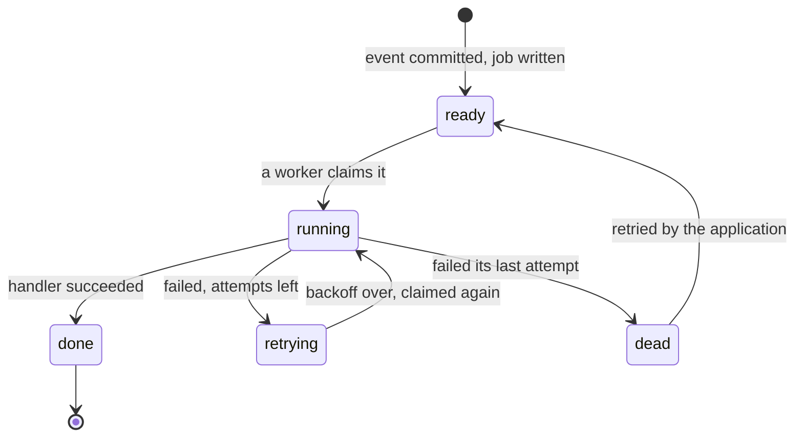
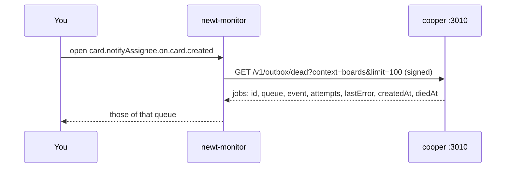
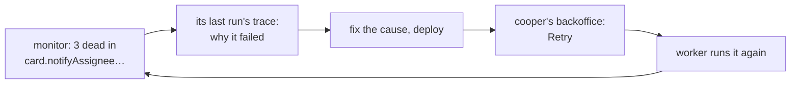

# Queues and dead jobs

<p class="chapter-lead">The outbox makes every reaction reliable, and also invisible: jobs wait in a table nobody looks at. This chapter shows the outbox from the monitor, how full each queue is now and was, how fast jobs flow and wait, which queues no worker serves, and the dead jobs that ran out of attempts, with their last error.</p>

## The problem

[Workers](./10-workers) taught the outbox: a domain event's subscription writes a job in the
same transaction as the change, and a worker runs it later, with retries and backoff. Nothing
is lost when a process restarts. That is the good news.

The bad news is that a reliable queue fails quietly. A mailer that times out does not crash
anything: its job waits, runs again, waits longer, runs again, and after its last attempt it
is **dead**, a row with a `lastError`, waiting for a person who does not know it is there. A
handler renamed in a deploy leaves its old queue's jobs waiting forever, for a worker that no
longer exists. And a queue that is slowly filling up, because its handler got slower than its
traffic, looks like nothing at all until the backlog is hours long.

You need to see the outbox the way a broker's dashboard shows a broker.

## The idea

Every context's worker knows, at any moment, how full each of its queues is. The monitor
endpoint serves that (`GET /v1/outbox`), and the queue flows minute by minute
(`GET /v1/metrics/queues`). The monitor takes a **snapshot** every minute and keeps it, so
"now" is one minute old at most and "over time" is a chart.

::: info Concept: A queue's depth
How many of its jobs are, right now: **ready** (pending, never run), **to run again**
(pending after a failed attempt, waiting for their backoff), **running** (taken by a worker,
not yet closed), and **dead** (out of attempts). And how long the **oldest** job that is due
has waited for a worker.
:::



Each queue is named after what runs it: `<module>.<useCase>.on.<event>`, so
`card.indexCard.on.card.created` is run by the use case `card.indexCard`, on `card.created`.
The monitor reads the handler from the name and links to its use case.

## The Queues tab

<figure class="screenshot">
  
  
  <figcaption>Every queue of cooper as one: waiting, running and dead now, the oldest job waiting, how full they were over time, what went in and out, and how long jobs waited.</figcaption>
</figure>

At the top, every queue of the application added up:

- **Waiting now**: ready plus to run again, with how many of each, in how many queues.
- **Running now**: taken by a worker, not closed.
- **Dead now**: out of attempts.
- **Oldest waiting**: the longest any due job has waited, in any queue.

Then, over a window (an hour to a year), with a bucket and a comparison as on every metrics
page:

- **In** (jobs published), **Out** (delivered, done), **Run again** and **Dead**, as totals
  beside the window before, and as a chart.
- **How full**: the most each kind of job reached in each bucket: ready, to run again,
  running, dead. A rising "ready" line is a handler slower than its traffic.
- **How long jobs waited** between being due and being taken, p50, p90 and p99. The wait
  is the cost of the outbox: a few hundred milliseconds is normal, minutes is a worker that
  cannot keep up.

Below, each context's queues, found by a search ("card index" finds
`card.indexCard.on.card.created` in `boards`). Each row says the handler it runs, its jobs in
and out in 24 hours, its p90 wait, how many are running, how long the oldest has waited, how
many are waiting now, and two red badges when they apply: **N dead**, and **Orphan**.

::: info Concept: An orphan queue
A queue with jobs still to run that **no worker serves**: none in this process registered it,
and none elsewhere said it was alive for five times its `seenEveryMs`. It happens when a
deploy renames or removes a handler: the jobs already written wait under the old name, and
nobody runs them. The worker also logs a warning, once per queue, a few minutes after the
deploy (it waits, because the old process saw the old queue moments ago). Someone has to
rename those jobs, or run them by hand.
:::

### One queue

A queue's page says the same for one queue: its stats now, its charts over the window, its
**dead jobs**, and its **runs**: the traces kept of its jobs, with the usual filters
(failures, ran again, slowest…). "Run by `card.indexCard`" links to the use case's page,
where how long it takes and how it fails are drawn.

## Dead jobs

A job that failed its last attempt is dead. It is not deleted: it keeps its event, its
attempts and its last error, and waits for someone. The queue's page lists them.



Dead jobs are **not stored** by the monitor. They are asked of the application each time you
look: a page of its context's dead jobs at a time (100 at most), of which the queue's page
keeps that queue's. So what you see is the outbox as it is now, and a
job retried a minute ago is gone from the list. Each one shows:

- the **event** it ran for (`card.created`),
- how many **attempts** it made,
- when it **died** and when it was **published**,
- the first line of its **last error**.

Never its payload. The event's data stays in the application.

<figure class="screenshot">
  
  
  <figcaption>A queue with a dead job: how full it got, what went in and out, how long jobs waited, and the dead job with its event, its attempts and its last error.</figcaption>
</figure>

Click one, and the monitor takes you to the trace of its last run, if it was kept, and a job
that failed is always kept.

That page is a trace like any other ([Traces](./44-traces)): its steps, the failure's message
and stack, the log lines its handler wrote, **Show what caused it** to see the request that
told the event, and **its job's other runs**, one per attempt. Five runs, five failures, the
same timeout each time: the mailer was down for longer than the backoff. Or five runs, five
different errors: the handler has a bug.

::: warning Watch out
A job's run is traced only when the application's traces are on, which `serveMonitor` does,
and a run's trace is kept at most as long as the application's trace retention (7 days by
default). A job that died a month ago still lists, with its last error, but "No trace of this
job" is all its page can say.
:::

## Putting a dead job back

The monitor **does not** retry jobs. It is read-only on purpose: it can be pointed at
production by someone who should look but not touch, and Claude can be connected to it
without being able to change anything. Retrying is an action on the application's data, so
the application does it, through its own use case, behind its own permissions.

newt gives every store the operation: `outbox.retry(id)` puts a dead job back to wait, as
new, with no attempts, due now, and returns whether it was dead. A job in any other state is
left as it is.

::: tip In cooper
cooper's staff retry dead jobs from the backoffice. Each context has a use case that does it,
in `cooper/backend/shared/outbox/outbox.module.ts`:

```ts
// cooper/backend/shared/outbox/outbox.module.ts
  /**
   * Puts a dead job back to wait, as new: its worker runs it again at once, with all its
   * attempts. …
   */
  @UseCase()
  async retry(id: string): Promise<void> {
    if (await this.base.store.outbox.retry(id)) return
    const job = await this.base.store.outbox.get(id)
    throw job ? new JobNotDead(id, job.status) : new JobNotFound(id)
  }
```

and the backoffice's `job` module calls it for the context the staff chose, behind
`POST /api/jobs/:context/:jobId/retry` (`cooper/backend/contexts/backoffice/modules/job/`).
:::

<figure class="screenshot">
  
  
  <figcaption>cooper's backoffice, where its staff work. Its Jobs page lists each context's dead jobs: "Fix what killed one, then retry it: its context runs it again."</figcaption>
</figure>

So the loop is: the monitor shows the dead job and why it died; you fix the cause (deploy the
fix, bring the mailer back); you retry it from the application; the next snapshot shows the
dead count fall and the job's new run in the queue's traces.



## Asking Claude about queues

Two of the monitor's MCP tools are about the outbox: `queues` (every queue now, and its flow
over a window) and `dead_jobs` (a page of a context's dead jobs, as the application lists
them, never their payloads). "Are there dead jobs in cooper's boards context, and why did
they die?" is one question away. See [Asking Claude](./46-asking-claude).

## Recap

- The monitor snapshots every queue each minute (ready, to run again, running, dead, oldest
  wait, orphan) and collects their flows (in, out, run again, dead, wait percentiles).
- The Queues tab adds them all up and lists each by context; a queue's page draws it alone,
  with its dead jobs and its runs.
- An **orphan** queue has jobs no worker serves: a handler renamed or removed by a deploy.
- Dead jobs are asked of the application as you look, without payloads; each opens the trace
  of its last run.
- The monitor never retries a job. The application does, with `outbox.retry(id)` behind a use
  case of its own, as cooper's backoffice does.

## Going further

- [Workers](./10-workers): the outbox, attempts and backoff.
- [Idempotency](./24-idempotency): why a handler must be safe to run again.
- [Traces](./44-traces): reading a job's runs.
