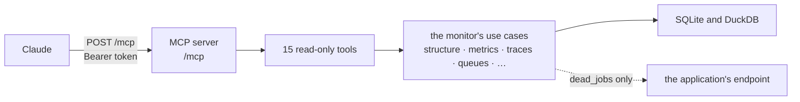
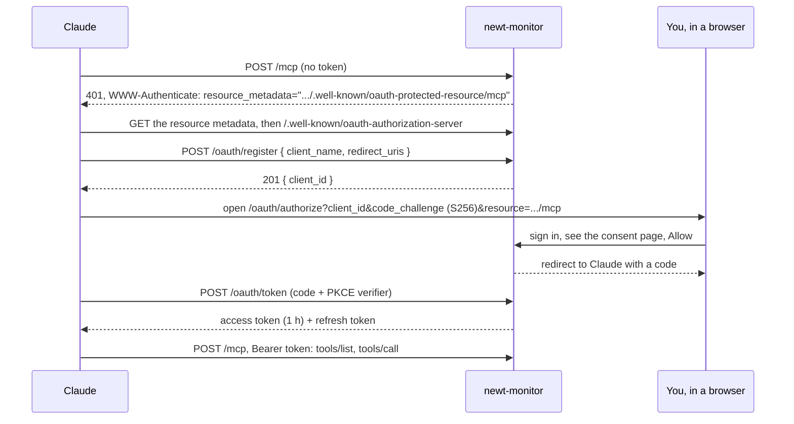

# Asking Claude

Charts answer the questions you knew to ask. This chapter connects Claude to newt-monitor's MCP server, so you can ask in plain words ("which use case got slower since the last deploy?") and get answers from the same data the pages draw: what the server offers, how signing in with OAuth works, and what Claude can and cannot do there.

## The problem

It is late, and something is off in cooper. You could open the monitor, pick the overview,
change the window, open three use cases, compare them with last week, open a trace. Or you
could ask:

> Which of cooper's use cases got slower since the last deploy, and is any of them failing?

and have someone do those clicks for you, read the numbers, and come back with an answer and
the trace that explains it. That someone can be Claude, if Claude can read what the monitor
knows, safely, as you.

## The idea

newt-monitor is an **MCP server**. MCP, the Model Context Protocol, is how AI assistants call
tools in other applications. The monitor offers fifteen tools, each one a thin wrapper over a
use case its pages already call, and every one of them only reads.

Claude signs in as you, through OAuth, the way a third-party app signs in to GitHub: it
registers itself, sends you to the monitor's consent page, you sign in and press **Allow**,
and it gets a token good for the monitor's MCP server and nothing else.

::: info Concept: MCP server
An endpoint that lists tools (a name, a description, an input schema) and runs them when an
assistant asks. The monitor's lives at `/mcp`, speaks Streamable HTTP, answers in JSON, and
keeps no session: each request is answered on its own. See [MCP](./31-mcp) for how cooper
offers one of its own.
:::

## Connecting Claude

You need the monitor on an `https` address (its `NEWT_MONITOR_PUBLIC_URL`), reachable from
wherever Claude runs. Then give Claude the MCP server's address, `<public url>/mcp`:

- **Claude (web, desktop)**: add a custom connector with the URL
  `https://monitor.example.com/mcp`.
- **Claude Code**: `claude mcp add --transport http newt-monitor https://monitor.example.com/mcp`,
  then `/mcp` to sign in.

Claude finds the rest on its own. Here is what happens the first time:

Step by step:

1. **Discovery.** Without a token, `/mcp` answers `401` with a `WWW-Authenticate` header that
   points at its **protected resource metadata** (RFC 9728), which names the monitor as its
   authorization server. Its **authorization server metadata** (RFC 8414, at
   `/.well-known/oauth-authorization-server`) lists the endpoints: `/oauth/authorize`,
   `/oauth/token`, `/oauth/register`, `/oauth/revoke`.
2. **Dynamic client registration** (RFC 7591). Claude registers itself at `/oauth/register`
   with a name and its redirect addresses, and gets a `client_id`. Every client is
   **public**: it has no secret, and proves itself with PKCE.
3. **Authorization.** Claude sends your browser to `/oauth/authorize` with a PKCE challenge
   (S256 only) and, usually, the resource it wants (`<public url>/mcp`, the only one the
   monitor has). The monitor checks the client, its redirect address and the challenge, keeps
   the request, and takes you to its **consent page**.
4. **Consent.** You sign in to the monitor if you are not, and answer.
5. **Tokens.** Claude trades the code, with its PKCE verifier, at `/oauth/token`, for an access
   token and a refresh token, both for the MCP server only.

### The consent page

The consent page says, in so many words:

> **An application calling itself "Claude" asks to read newt-monitor.** It will see
> everything the monitor knows of every application: their structure, metrics, traces,
> queues, servers and instances. It cannot change anything. It will be answered at
> `claude.ai`.
>
> **Its name is not checked.** Allow it only if you are connecting it yourself right now, and
> `claude.ai` is the application you expect.

The warning matters. With dynamic registration anyone may register a client under any name.
What you can trust is the **address** the browser goes back to, which the page shows. If you
did not just ask Claude to connect, press **Deny**.

::: warning Watch out
A request that is wrong (an unknown client, a redirect address that is not the client's, no
PKCE, another resource) is never sent back to the address it gave: the monitor shows its own
error page instead ("The application asked for access the wrong way"), so it cannot be used to
send your browser somewhere with an error in the address.
:::

### Tokens

| | Lasts | Notes |
|---|---|---|
| Authorization request | 10 minutes | Unanswered, it expires; nightly, old ones are removed. |
| Code | 5 minutes | Traded once. Brought a second time, it was copied: every token it gave is revoked. |
| Access token | 1 hour | Good for `<public url>/mcp` only; Claude refreshes it. |
| Refresh token | 30 days unused | Each refresh replaces both tokens, so a refresh token works once. |

The monitor keeps only the tokens' hashes. Starting the monitor with another user or password
revokes every token at once ([Running the monitor](./47-running-the-monitor)).

## The tools

Every tool but `list_apps` takes an application's `appId` (from `list_apps`), and each answers JSON. Windows are
`1h`, `24h` (the default), `7d`, `30d`, `90d` or `365d`.

| Tool | What it answers |
|---|---|
| `list_apps` | The applications the monitor watches, archived ones too: id, name, endpoint, repository, archived, and whether each answers now. Paged. |
| `get_structure` | What one is made of, as its last version says: contexts, the contexts each uses, modules, use cases, events, queues, schedules. |
| `list_versions` | Its structure's versions, newest first: each a deployment that changed what it is made of. Paged. |
| `use_case_totals` | Each use case over a window: calls, p50, p90, p99, errors, failures, runs again after a conflict, beside the window before. |
| `use_case_series` | One use case (or all) bucket by bucket over a window, compared with the window before. |
| `errors_totals` | Each use case that ended in errors or failures over a window, and how many. |
| `error_codes` | One use case's errors and failures by code, with how many and the last one. |
| `event_totals` | Each domain event over a window: how many times it was told. |
| `queues` | Each queue now (ready, running, to run again, dead, oldest waiting) and its flow over a window. |
| `dead_jobs` | A context's dead jobs, as the application lists them now: queue, event, attempts, last error. Never payloads. |
| `list_traces` | Traces kept over a window, newest first, by context, use case or queue, and by what to show: `failures`, `errors`, `retried`, `forced`, `logged`, `slow`. |
| `get_trace` | One trace in full: every use case, job and query, how long each took, and the error it ended in. |
| `system_and_instances` | The system now: instances alive, memory and processor added up, worst event loop, the machines, each disk with in how many days it fills; then each instance. |
| `system_series` | The system bucket by bucket over a window, across deployments. |
| `list_deployments` | Each commit deployed, newest first: when its first instance started, and its title from GitHub. |

Each tool is marked **read-only** (`readOnlyHint: true`) and closed-world, so an assistant
that asks before calling tools that change things will not need to.

The server also gives Claude instructions on how to use them: start with `list_apps`;
`get_structure` says what an application is made of; `use_case_totals`, `errors_totals`,
`queues` and `system_and_instances` say how it is doing; `list_deployments` what it deployed
and when; `list_traces` and `get_trace` show single runs.

## Questions to ask

Some that work well, and the tools Claude reaches for:

- **"Which use case of cooper got slower since the last deploy?"** `list_deployments` for when
  it was, `use_case_totals` over a window around it, `use_case_series` for the ones that moved.
- **"Is anything failing in cooper right now? Show me a trace."** `errors_totals` over `1h`,
  `error_codes` for the worst, `list_traces` with `show: failures`, `get_trace`.
- **"Are there dead jobs in boards? Why did they die?"** `queues`, then `dead_jobs` with
  `context: boards`, and the last errors grouped.
- **"What does cooper's backoffice context depend on?"** `get_structure`, read for `uses` and
  each module's deps.
- **"What changed in cooper's structure this week?"** `list_versions` and `get_structure`.
- **"Is the disk going to fill up?"** `system_and_instances`, its disks' `fullInDays`;
  `system_series` over `30d` for the trend.
- **"How many cards were created yesterday compared with the day before?"** `event_totals`
  over `24h`, which is beside the window before.
- **"Explain the slowest `card.search` call in the last day."** `list_traces` with
  `useCase: card.search`, `show: slow`, then `get_trace`, and Claude reads you the spans.

Claude combines them as it needs: it can read the structure to learn the names, then the
metrics for those names, then a trace, and answer in a paragraph.

::: tip In cooper
Asked "why are cooper's card emails not arriving?", Claude can find
`card.notifyAssignee.on.card.created` with dead jobs in `queues`, read their last error with
`dead_jobs`, find a failed run with `list_traces` (`queue`, `show: failures`), and open it with
`get_trace` to read the failure's message: everything [Queues and dead jobs](./45-queues) does
by hand.
:::

## What it can and cannot do

**It can** read everything the monitor has collected, for every application it watches: the
same structure, metrics, traces, queues, system and deployments its pages show.

**It cannot**:

- change anything: there is no tool to register, archive or delete an application, change a
  retention, retry a job, or make a trace header;
- read an application's data: the monitor itself never has it, so no tool can return a row,
  a payload or a request's body;
- reach an application on its own: every tool reads the monitor's own databases, except
  `dead_jobs`, which asks the application's endpoint for the current page, as the queue's page
  does, signed by the monitor;
- act beyond the one person: the token is the monitor's single user's, for `/mcp` only.

::: warning Watch out
"Everything the monitor knows of every application" includes the fields of log lines kept
with traces, and the last errors of dead jobs. Whatever your code put there, Claude can read.
:::

## Recap

- newt-monitor serves an MCP server at `/mcp`: stateless, JSON, Streamable HTTP.
- Claude signs in through OAuth 2.1: discovery (RFC 9728, RFC 8414), dynamic client
  registration (RFC 7591), authorization code with PKCE S256, a token for `/mcp` only.
- The consent page shows where the answer goes; the client's name is not checked.
- Fifteen read-only tools cover apps, structure, versions, use cases, errors, events, queues,
  dead jobs, traces, system and deployments.
- Claude can read everything the monitor knows, and change nothing.

## Going further

- [MCP](./31-mcp): building an MCP server into your own newt application.
- [Auth](./29-auth): OAuth in cooper, which the monitor's `auth` context mirrors.
- [Running the monitor](./47-running-the-monitor): the public URL, sessions and how tokens are
  revoked.
