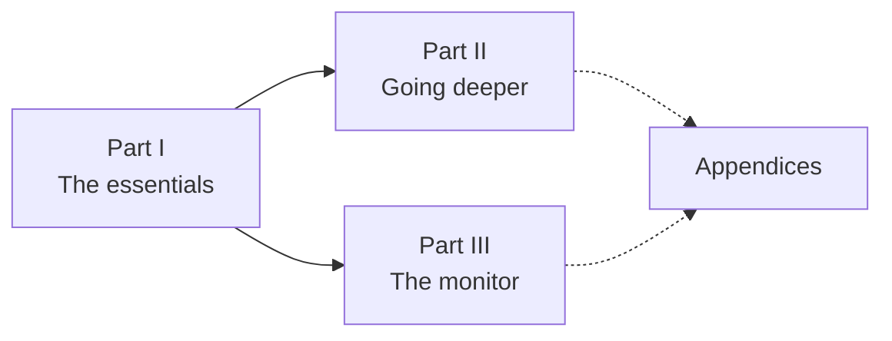

# How to read this manual

<p class="chapter-lead">This is the manual of newt, a backend framework for Bun. This page tells you who it is for, how it is laid out, which path to take through it, and what you need on your computer before the next chapter.</p>

## Who it is for

You are a backend developer. You know TypeScript well enough to read a generic type
without flinching, you have written an HTTP API or two, and you have seen at least one
of them grow into something nobody wanted to touch. You do not need to know Domain-Driven
Design, event sourcing or any particular framework. Every idea newt borrows from those
worlds is explained here the first time it appears, in plain words, with code you can
open in the repository.

The manual does not teach Bun, Zod or SQL. It uses all three, and it says what each line
does when it matters, but it assumes you can look up `z.object` or `Bun.serve` when
you need to.

## How it is laid out

The manual explains newt one concept at a time, and every concept is shown working in
**cooper**, a small but complete SaaS that lives in the same repository (`cooper/`).
You do not build cooper as you read: it is already built. You read its code, run it,
and change it if you like.



- **Part I, The essentials** (chapters 00 to 13). What everyone building with newt must
  know: contexts, modules, entities, use cases, repositories, routes, events, workers,
  how contexts talk to each other, testing and production. Each chapter is short and
  leaves edge cases for later.
- **Part II, Going deeper** (chapters 20 to 33). One subject per chapter: concurrency,
  aggregates, tenants, time, idempotency, queries, stores, HTTP security, rate limits,
  auth, frontends, MCP, observability and coding agents. These chapters assume Part I.
- **Part III, The monitor** (chapters 40 to 47). newt-monitor, the application that
  connects to yours and shows its structure, metrics, traces and queues while it runs.
- **Appendices**. Reference you come back to: [the rules and what newt throws](./a-rules),
  [the lint](./b-lint), [the command line](./c-cli), [every export](./d-exports) and
  [common problems](./e-problems).

## Three ways through it

**The fast path.** Read Part I in order, from [Why newt](./01-why-newt) to
[Running it in production](./13-production). Each chapter builds on the one before,
and together they are enough to build a real backend with newt. If you only have an
afternoon, this is the path.

**Going deeper.** Part II is not meant to be read front to back. Open a chapter when
you need it: when two people overwrite each other's work, read
[Versions, conflicts and guards](./20-concurrency); when you add a second tenant, read
[Tenants and scopes](./22-tenants). Every Part I chapter ends with a *Going further*
section that points at the Part II chapters that deepen it.

**The monitor.** Part III stands on its own once you know what a context, a use case
and an event are (chapters 03 to 10). Read it when you want to see an application from
the outside.

## How the callouts work

The manual uses five kinds of boxes. Each one always means the same thing, so you can
skim by them.

::: info Concept: Bounded context
A new idea, defined in two to four sentences the first time it appears. If you only
read these boxes, you get the vocabulary of newt.
:::

::: tip In cooper
How cooper does it, with the file to open: `cooper/backend/contexts/boards/boards.context.ts`.
:::

::: warning Watch out
A trap people fall into, and how to avoid it.
:::

::: danger Never
A rule newt enforces, at compile time, in the lint, or at runtime, and what you see when
you break it.
:::

::: details Under the hood: what this box is for
Optional depth: how something works inside. The fast reader can skip every one of these
and lose nothing needed to build.
:::

Diagrams are drawn in Mermaid. Code samples are taken from cooper, trimmed with `// …`
where a file is long, and they name the file they come from. When a sample is not from
cooper it is written against newt's real API, so it would compile.

## What you need

newt runs only on [Bun](https://bun.sh): its stores are built on `bun:sqlite` and
`Bun.SQL`, its server on `Bun.serve`. You need Bun 1.4.4 or later (the type check uses
`bun check`) and git.

Clone the repository and install its dependencies:

```sh
git clone https://github.com/aromero86/newt.git
cd newt
bun install
```

The repository is one Bun workspace: the framework in `packages/newt`, its lint, its
React packages and the monitor beside it in `packages/`, cooper in `cooper/`, and this
manual in `web/`. From the root, these are the commands you will use (they are the
`scripts` of the root `package.json`):

```sh
bun run typecheck      # bun check: the types of everything
bun run test           # bun test: every test
bun run lint           # eslint, with @newt-kit/eslint's rules for cooper
bun run cooper:seed    # cooper's demo data: three accounts, a workspace, two boards
bun run cooper         # cooper in development: every context on its port
```

Seed it once, then start it. `bun run cooper` serves three contexts, each on its own
port, each with its frontend built from its sources as you change them:

| Context | Address | Sign in as |
|---|---|---|
| `auth` | `http://localhost:3001` | where everyone signs in |
| `boards` | `http://localhost:3002` | `ana@cooper.dev` or `bob@cooper.dev` |
| `backoffice` | `http://localhost:3003` | `staff@cooper.dev` |

Every demo account's password is `cooper-demo`. The databases are SQLite files in
`data/`; delete them and seed again to start over.

::: tip In cooper
`cooper/AGENTS.md` lists cooper's contexts and conventions in a few lines, and
`packages/newt/AGENTS.md` is the whole of newt's rules on one page. Both are written
for coding agents, and both make a good cheat sheet for people too.
:::

## Your own application

The manual reads cooper from the repository, but newt itself comes from npm, in five packages
under `@newt-kit`:

| Package | What it is |
|---|---|
| `@newt-kit/newt` | The framework, one subpath per piece (`@newt-kit/newt/core`, `@newt-kit/newt/http`…), and the `newt` command |
| `@newt-kit/eslint` | Its lint ([appendix B](./b-lint)) |
| `@newt-kit/react` | What a React frontend thinks with ([Frontends](./30-frontends)) |
| `@newt-kit/react-ui` | Its components, and the lint that keeps them as they are |
| `@newt-kit/monitor` | newt-monitor ([part III](./40-monitor)) |

A new application starts like this:

```sh
bun init -y
bun remove typescript         # bun init's TypeScript 7: newt's lint runs on 6 for now
bun add @newt-kit/newt zod
bun add -d @newt-kit/eslint eslint typescript@npm:@typescript/typescript6@6.0.2
bunx @newt-kit/newt init      # AGENTS.md, CLAUDE.md and newt's lint
bunx @newt-kit/newt add module src/contexts/shop order
```

`newt init` and `newt add module` are in [appendix C](./c-cli). The module it writes compiles,
passes the lint and has a test: `bun check && bun test && bunx eslint` are green from the start.

A React frontend adds `@newt-kit/react` and `@newt-kit/react-ui`, `react` and `react-dom`, and
`bun-plugin-tailwind` to build its styles. Its `tsconfig.json` has the DOM in `lib`
(`["ESNext", "DOM", "DOM.Iterable"]`), and its stylesheet imports
`@newt-kit/react-ui/theme.css`: [Frontends](./30-frontends) tells the rest.

You are ready. The next chapter tells the story of why newt exists.

## Going further

- [Meet cooper](./02-meet-cooper): the application you will read throughout the manual.
- [The command line](./c-cli): `newt init` and `newt add module`.
