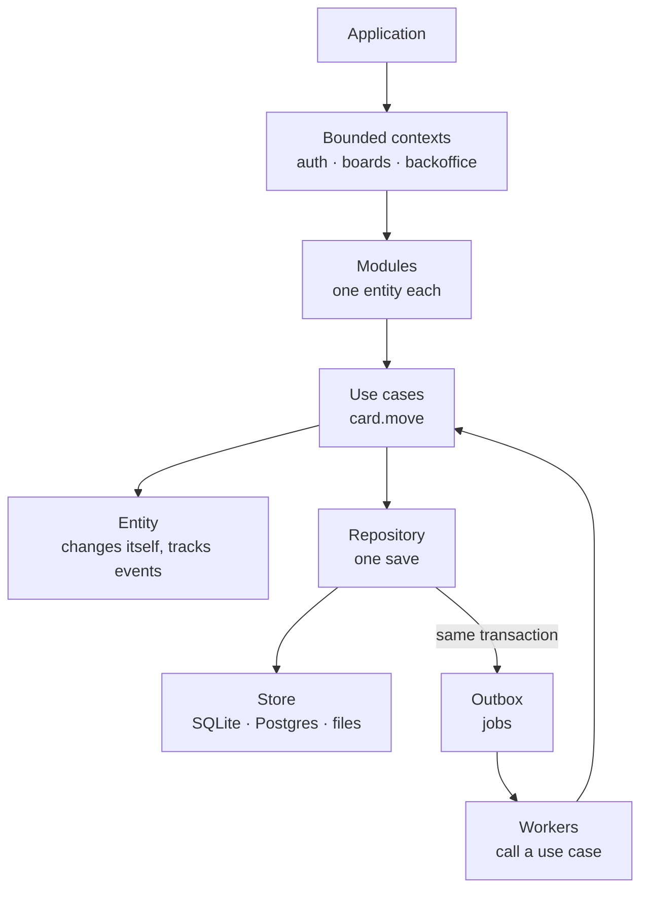
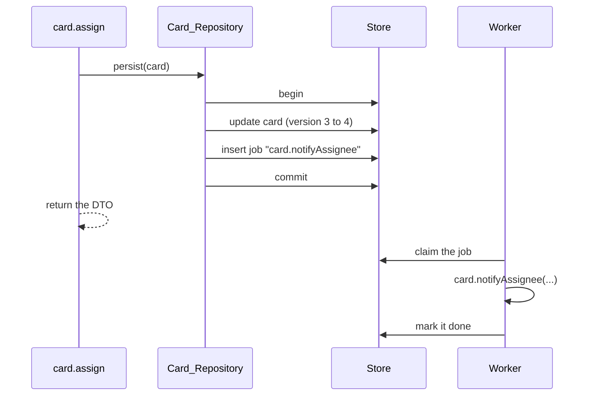
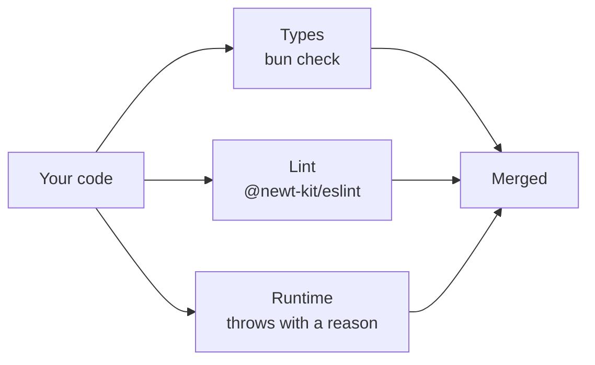

# Why newt

Most backends start clean and slowly rot. This chapter tells how that happens, one familiar step at a time, and shows the handful of ideas newt is built on to stop it. By the end you will have the mental model the rest of the manual fills in.

## The problem

Picture a small team building a tool for other teams: boards of cards, like Trello. On
day one the backend is a joy. There is a `POST /boards` route, a `boards` table and a
few lines between them. Anyone can read the whole thing in an afternoon.

Six months later, it is a different place. Nobody decided to make it worse. It just
happened, one reasonable shortcut at a time.

**Logic moved into the routes.** "A board's name is unique in its workspace" was checked
in `POST /boards`. Then someone added `PATCH /boards/:id` and forgot the check. Then a
CSV import was written as a script, and it checked names a third way. Now there are
three rules that almost agree.

**Events got lost.** When a card is assigned, the assignee gets an email. The route saves
the card, then publishes "card assigned" to a queue. One day the process restarts between
those two lines. The card is assigned, and nobody is ever told. Another day the save rolls
back after the message went out, and someone gets an email about a card that is not theirs.

**Two people overwrote each other.** Ana renames a card while Bob moves it. Both read the
card, both change their copy, both save. Bob's save writes the old title back over Ana's
new one. Nobody notices for a week.

**A tenant leaked.** Every query was supposed to say `where workspace_id = ?`. One new
query, for a search page, did not. For a few hours, a customer could see another
customer's cards.

**Nobody knew what called what.** The `card` code imports the `user` table to show a name,
the `billing` code reads `card` rows to count usage, and a nightly job writes to both. To
change a column you grep the whole repository and hope.

**And now agents write code too.** A coding agent is fast and willing, and it copies
whatever patterns it sees. In a codebase with no rails, it copies the shortcuts as eagerly
as the good parts, and it does so at a speed no reviewer can keep up with.

None of these is a bug you can fix once. Each is a missing *rule*: something the code
should make impossible, or at least loud.

## The idea

newt is a small set of rules about where each kind of code lives, and the machinery that
makes the rules cheap to follow. It is not new theory: most of it comes from Domain-Driven
Design and from what teams running event-driven systems learned the hard way. What newt
adds is that every rule is **checked**, by the types, by a lint, or by the runtime, so
that following it is the path of least resistance, for people and for agents.

Here is the whole picture. Each box is a chapter of Part I.

Read it top to bottom. An application is split into **bounded contexts**, each with its
own data. A context is made of **modules**, each owning one kind of thing. You ask a module
to do something by calling one of its **use cases**. The use case loads an **entity**, lets
it change itself, and hands it to the module's **repository**, which saves it to the
context's **store** in one transaction. What the entity said happened, its **domain
events**, are written into the **outbox** in that same transaction, and **workers** pick
them up afterwards and call other use cases.

Let's take the ideas one by one, against the problems above.

### Bounded contexts: walls with doors

::: info Concept: Bounded context
A part of the application that owns its own data, in its own store, and its own
vocabulary. Other contexts reach it only through its use cases and its events, never
through its tables. In cooper, `auth` knows people and workspaces, `boards` knows boards
and cards.
:::

The "nobody knows what calls what" problem starts when any code may read any table. A
context draws a wall: `boards` cannot open `auth`'s database, because it is a different
database. If `boards` needs to know whether Bob belongs to a workspace, it calls `auth`'s
use case and gets an answer. Which contexts may use which is declared once, and the lint
refuses an import that crosses a wall it should not. You will meet contexts in
[chapter 3](./03-contexts).

### Modules: one entity, one responsibility

::: info Concept: Module
The unit of code inside a context. A module owns exactly one entity (a card, an
invitation), changes it only through its use cases, and offers other modules a small,
fixed surface: its use cases, its schema, its events, its errors.
:::

A module is small on purpose. If describing what it does needs an "and", it is two
modules. Every module has the same files with the same names, so a person or an agent
opening one knows where everything is. Other modules can import only its public files;
its entity and its repository are its own. That is how "card code reads the user table"
becomes impossible: there is no import for it. See [chapter 4](./04-modules).

### Use cases: the only way in

::: info Concept: Use case
One thing you can ask a module to do: `card.move`, `invitation.accept`. It is a method
marked `@UseCase()`, it takes untrusted input, checks it, decides, saves once and returns
plain data. Routes, workers, scripts and MCP tools all call the same use cases.
:::

"Logic in the routes" disappears when a route has nothing to think about. In newt, a
route reads the request, calls one use case and answers. The rule about board names lives
in the board module's `create` and `update`, and the CSV script calls the same `create`.
There is one rule, in one place. Every use case is also a span of a trace, timed and
counted, so you can see what each request did. See [chapter 6](./06-use-cases).

### Entities change themselves, and tell what happened

::: info Concept: Entity
What a module keeps, with its behaviour. Its data is described by a Zod schema that
it can never break. It changes only through its own methods, named after what happened
(`assign`, `moveTo`, `revoke`), and each method notes the domain events it caused.
:::

A card is not a bag of fields any code may set. It is a `Card` with methods like
`assign(assigneeId, author)`, which changes the field and notes a `card.assigned` event in
one step. You cannot change a card and forget to tell, because changing and telling are the
same call. Every entity also carries a **version**: saving it checks the version is still
the one that was read, so Bob's save fails instead of overwriting Ana's, and the use case
runs again on fresh data. See [chapter 5](./05-entities) and, for the details of conflicts,
[Versions, conflicts and guards](./20-concurrency).

### The transactional outbox: no event lost, none made up

::: info Concept: Transactional outbox
A table in the context's own store where the jobs caused by an event are written in the
same transaction as the change that caused it. Either both are saved or neither is. A
worker reads the outbox afterwards and runs each job until it succeeds.
:::

This is the answer to the lost email. When the card module saves an assigned card, the
repository writes the card *and* a job "tell the assignee" in one transaction. If the
process dies a millisecond later, the job is still there when it comes back. If the save
rolls back, there is no job. The worker that sends the email runs after the commit, retries
with backoff when the mail server is down, and keeps a dead job for a person to look at
when it gives up.

The price is that the email leaves a moment *after* the answer, not during it. newt makes
that split explicit everywhere: what must be true now is saved in one transaction; what
follows from it happens soon after, in a worker, and is written so that running it twice
does no harm. See [Domain events](./09-events) and [Workers and the outbox](./10-workers).

### Scopes: the tenant is not optional

The tenant leak happened because a `where` clause was a thing you had to remember. In newt,
a repository of tenant rows declares its scope once, `{ field: 'workspaceId', current: currentWorkspaceId }`,
and every read and write it makes is filtered and checked by it. A repository with no
scope must say `scope: 'none'` and why. Forgetting is a type error. See
[Tenants and scopes](./22-tenants).

### Rules checked three ways

None of the above would hold for long if it were only written in a document. newt checks
its rules in three places, each catching what the others cannot:

- **The types** make wrong shapes impossible: a repository without a scope, a value
  object that never went through its checks, an entity built from a row without its
  version.
- **The lint** (`@newt-kit/eslint`) keeps the structure: the files a module has and how they are
  named, which files of another module you may import, which contexts a context may use,
  that every public method of a module is a `@UseCase`, how a worker's queue is named.
- **The runtime** catches what only shows while running, and throws a message that says
  what to do: a use case that writes into another module from a request
  (`[write rule] …`), a save that reads other rows without guarding them (`[guard rule] …`),
  an entity that breaks its own schema (`InvalidEntity`), an event told without a change
  (`EventWithoutChange`).

This is also what makes newt a good place for coding agents. The rules are short, written
in `AGENTS.md` beside the package, and when an agent breaks one, it gets an error that
names the rule and the fix. See [Built for coding agents](./33-agents).

### A monitor that sees everything

Finally, a newt application knows what it is made of. Each module passes its dependencies
to newt when it is built, each use case and subscription registers itself, and the
application can describe itself while it runs: its contexts, modules, use cases, events,
which module depends on which, and which queue reacts to which event. **newt-monitor**
reads that description, plus the traces and metrics newt records, and draws them: the
dependency graph, how long each use case takes, which queues are falling behind, which
jobs died and why.

<figure class="screenshot">
  
  
  <figcaption>cooper's modules and their dependencies, drawn by newt-monitor from what the running application says of itself.</figcaption>
</figure>

"Nobody knows what calls what" becomes a page you open. Part III is about the monitor,
starting at [newt-monitor](./40-monitor).

## Back to the problems

Here is the same list, with what newt does about each:

| What rots | What newt does |
|---|---|
| Logic in routes, rules in three places | A route calls one use case; the rule lives in the module, once. |
| An event lost, or told for a change that rolled back | Events become jobs in the outbox, in the transaction of the change. |
| Two people overwrite each other | Every entity has a version; a conflict runs the use case again. |
| A tenant leaks | Every repository declares its scope; reads and writes are filtered by it. |
| Nobody knows what calls what | Module and context boundaries in the lint; the application describes itself. |
| Agents copy the shortcuts | Short written rules, checked by types, lint and runtime, with errors that say the fix. |

## What newt is not

It helps to be clear about the edges.

- **Not an ORM.** newt does not map classes to tables or generate queries from relations.
  A repository reads and writes rows of its own table through a small criteria language
  (`{ boardId, position: { gte: 2 } }`), and when that is not enough you write SQL with
  Kysely in the repository. Entities never know about the database.
- **Not only a web framework.** There is an HTTP router (`@newt-kit/newt/http`), but it is a thin
  door: the same use cases are called from workers, scripts, tests and an MCP server.
  You could serve a context with no HTTP at all.
- **Not for every runtime.** newt runs only on Bun. It uses `bun:sqlite`, `Bun.SQL` for
  Postgres and MySQL, `Bun.serve`, `Bun.redis` and Bun's test runner. That focus keeps it
  small.
- **Not a microservices kit.** Contexts are walls inside one codebase. cooper runs its
  three contexts in one process, each on its own port and with its own database. You may
  split them across processes later; you do not have to start there.
- **Not magic.** There is no hidden code generation and no reflection over your files. A
  module is a class you can read; `newt add module` writes the skeleton and then it is
  yours.

## Recap

- Backends rot through missing rules, not through bad people: logic in routes, lost
  events, overwritten saves, leaking tenants, invisible dependencies.
- newt splits an application into **bounded contexts**, each made of **modules** with one
  **entity**, changed only through **use cases**.
- An entity changes itself and notes its **domain events**; the repository saves it once,
  with its version checked, and writes its events' jobs to the **outbox** in the same
  transaction.
- **Workers** run those jobs afterwards, retried until they succeed, and must be safe to run
  twice.
- Rules are checked by the **types**, the **lint** and the **runtime**, and the application
  **describes itself** for the monitor.

## Going further

- [Meet cooper](./02-meet-cooper): the application every chapter uses.
- [Versions, conflicts and guards](./20-concurrency): how a save keeps two people from
  overwriting each other.
- [Built for coding agents](./33-agents): `AGENTS.md`, `newt init` and why the error
  messages read the way they do.
- [The rules, and when newt throws](./a-rules): every rule on one page.
