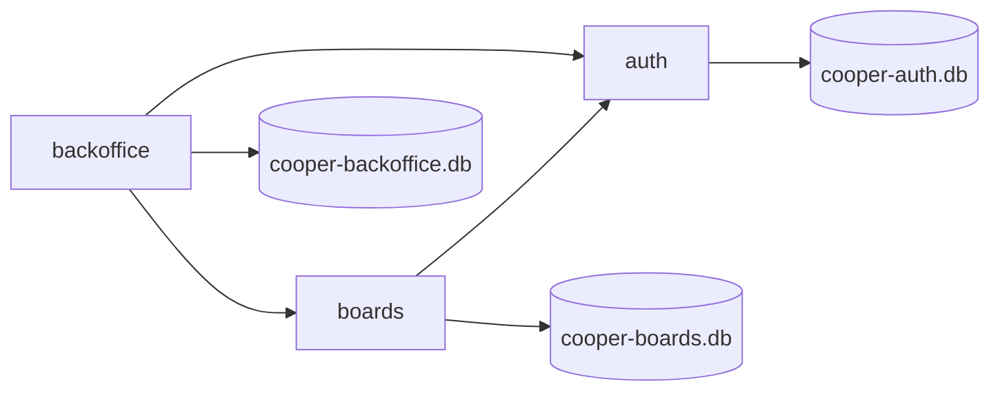
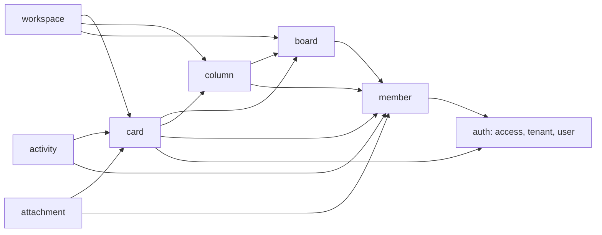
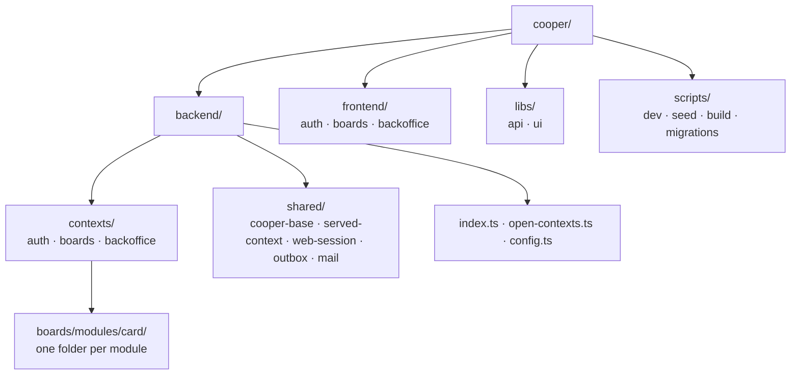

# Meet cooper

<p class="chapter-lead">Every chapter of this manual explains newt through one application: cooper, a small SaaS of boards and cards for teams. This chapter walks you through what cooper does, how its backend is cut into three contexts, where its code lives, and how to run it on your computer.</p>

## The problem

Examples in framework docs are usually too small to show anything that matters. A to-do
list has no tenants, no second service, no emails, no background work and nobody else
editing the same row. The trouble newt is built for only shows up when those things are
there.

So the manual uses a real application instead. cooper is small enough to read in a weekend
and big enough to have the problems a real SaaS has: workspaces that must not see each
other, people who sign in through an OAuth server, invitations by email, two people
dragging the same card, an AI assistant calling the API, and a staff console that reads
everything.

## What cooper does

cooper is a Trello for teams. A **workspace** is a team's space: Acme, say. A workspace
has **boards**, a board has **columns** (Backlog, In progress, Review, Done) and the
columns hold **cards**, numbered `#1`, `#2`… on each board. A card can be assigned to a
member of the workspace, who gets an email about it.

<figure class="screenshot">
  
  
  <figcaption>Acme's boards: every new workspace gets a Welcome board, made by a worker reacting to the workspace being created.</figcaption>
</figure>

<figure class="screenshot">
  
  
  <figcaption>One board: its columns, and cards that anyone in the workspace can drag, edit and assign.</figcaption>
</figure>

There are two kinds of people:

- **Members** use the product. Anyone can sign up, create a workspace (and become its
  admin), and invite others by email. Whoever accepts an invitation becomes a member.
- **Staff** work for the company that runs cooper. They do not sign up: someone gives
  them access to the **backoffice**, where they look at accounts, workspaces, metrics and
  jobs that failed.

Everybody signs in through one place, `auth`, which is a full OAuth 2.1 server. The boards
app and the backoffice are its clients, like any third-party app would be.

<figure class="screenshot">
  
  
  <figcaption>The sign-in page belongs to auth: boards and the backoffice send the browser here, and get it back through OAuth.</figcaption>
</figure>

cooper also has an **MCP server**, so an AI assistant like Claude can work on a person's
boards: list them, search cards, create, move and assign them. The assistant signs in
through the same OAuth server and acts as that person.

## Three contexts

cooper's backend is cut into three **bounded contexts**. Each owns its own data, in its
own database, and serves its own API and frontend on its own port.

| Context | What it knows | Port | Uses |
|---|---|---|---|
| `auth` | People, their sessions, workspaces (its *tenants*), who may enter what, and the OAuth server | 3001 | none |
| `boards` | Each workspace's boards, columns and cards, on the web and through MCP | 3002 | `auth` |
| `backoffice` | What the staff see and do across the other two | 3003 | `auth`, `boards` |



The arrows between contexts go one way only: `auth` uses nobody, `boards` uses `auth`, and
`backoffice` uses both. That is written once, in the root `eslint.config.js`, and the lint
refuses any import that breaks it:

```js
// eslint.config.js
const BACKEND = newt({
  root: import.meta.dirname,
  files: ['cooper/backend/**/*.ts', 'cooper/scripts/**/*.ts'],
  contexts: { folder: 'cooper/backend/contexts', uses: { auth: [], boards: ['auth'], backoffice: ['auth', 'boards'] } },
})
```

Notice what `auth` does *not* know: what a board is. It knows three general things that
let it serve any app:

- A **product** is an app that signs people in through auth. cooper has two: `cooper` (the
  boards app, where anyone may sign up) and `backoffice` (only for those given access).
- A **tenant** is a workspace: Acme, with the person who created it as its admin.
- An **access** says who may enter which product, and where: Ana in `cooper`, in the
  tenant Acme; the staff in `backoffice`, in no tenant at all.

So "Bob is a member of Acme" is, in auth's words, "Bob has access to the product `cooper`
in the tenant Acme". `boards` asks auth that question every time someone opens a
workspace.

::: info Concept: Tenant
One customer's slice of a multi-tenant application, whose data no other customer may
see. In cooper a tenant is a workspace. auth keeps the tenants; boards keeps rows that
belong to one (a board's `workspaceId`) and reads only the current one's.
:::

## The modules of each context

Each context is made of **modules**, each owning one thing. Every context lists its
modules in one function, `initializeModules`, in the order they are built: each one
after the modules it uses. These are the lists, from
`cooper/backend/contexts/*/initialize-modules.ts`.

**auth**

| Module | What it owns |
|---|---|
| `product` | The apps that sign people in, declared in code (no table) |
| `user` | Accounts: email, name, password hash, where their picture is read from |
| `avatar` | People's pictures, public: each one verified, and the older ones deleted |
| `session` | Who is signed in to auth itself |
| `access` | Who may enter each product, and in which tenant |
| `tenant` | The workspaces |
| `invitation` | Invitations to a workspace, sent by email |
| `oauthClient` | OAuth clients: each product's, and MCP clients that register themselves |
| `oauthGrant` | Authorization requests and their codes, with PKCE |
| `token` | Access and refresh tokens, and verifying them |
| `outbox` | The context's dead jobs, for the backoffice to see and retry |

**boards**

| Module | What it owns |
|---|---|
| `session` | boards' own web sessions, opened through auth's OAuth |
| `member` | Who belongs to each workspace: asks auth every time, keeps nothing |
| `board` | The boards of each workspace |
| `column` | The columns of each board |
| `card` | The cards, their numbers, positions and assignees |
| `attachment` | The files of each card, private to its workspace |
| `workspace` | A workspace as boards sees it: its welcome board, and cleaning up when it goes |
| `activity` | What happened to each card, and who did it: a log that only grows |
| `outbox` | Its dead jobs |

**backoffice**

| Module | What it owns |
|---|---|
| `session` | The staff's web sessions |
| `staff` | Who the staff are: asks auth every time |
| `user` | Accounts as the staff look them up, read through auth's use cases |
| `workspace` | Workspaces as the staff look at them, from auth and boards |
| `metric` | cooper's numbers, appended by workers following events |
| `outbox` | Its own dead jobs |
| `job` | Every context's dead jobs, through each one's `outbox` module |

Some modules keep no entity of their own: `member`, `staff`, `workspace` and the
backoffice's `user` only put other modules to work. That is fine: a module is one
responsibility, and sometimes the responsibility is "ask the module that knows".

::: tip In cooper
Two modules live outside every context, in `cooper/backend/shared/`: `WebSession_Module`
(`shared/web-session/`) and `Outbox_Module` (`shared/outbox/`). They are written once and
initialized in each context that needs them, over that context's own store. A web session
of boards is kept in boards' database, never in auth's.
:::

Here is how the modules of `boards` depend on each other and on auth. You will see this
diagram again, drawn by newt-monitor, in [The structure, drawn](./42-structure).



## Where the code lives

cooper is one folder of the monorepo, next to the framework in `packages/`. Its backend,
its frontends and its scripts are separate folders:



- `cooper/backend/index.ts` starts the backend: it opens the contexts, serves each one on
  its port and starts their workers, with `runContexts` from `@newt-kit/newt/application`.
- `cooper/backend/open-contexts.ts` opens the three contexts in order (auth, then boards,
  then backoffice), handing each the modules of the contexts it uses.
- `cooper/backend/config.ts` reads every setting from environment variables, with what
  development needs by default.
- `cooper/backend/contexts/<context>/` holds a context: its `<context>.context.ts`, its
  base, its `initialize-modules.ts`, its `migrations/sqlite` and `migrations/postgres`, and
  its `modules/`.
- `cooper/backend/shared/` holds what every context shares: `CooperBase`, `ServedContext`,
  the shared modules, the mailer, rate limits.

Open one module folder and you see the same files every newt module has. Here is boards'
card module:

```
cooper/backend/contexts/boards/modules/card/
  card.schema.ts       the contract: CardSchema, input schemas, CardFilter
  card.ts              the entity: Card
  card.repository.ts   Card_Repository, the only file that touches the store
  card.module.ts       Card_Module and its use cases
  card.routes.ts       its HTTP routes
  card.workers.ts      its reactions to events
  card.deps.ts         Card_Deps: the modules it uses
  card-options.ts      Card_Options: what the context configures it with
  card.test.ts
  events/              card-created.ts, card-moved.ts, card-assigned.ts…
  errors/              card-not-found.ts, too-many-cards.ts…
```

[Chapter 4](./04-modules) goes through each file.

### The frontends

Each context serves a React frontend beside its API, from `cooper/frontend/<context>/`:

- **auth**: sign up, sign in, and the consent page an OAuth client sends you to.
- **boards**: workspaces, boards, the board screen, card search, workspace settings and
  invitations.
- **backoffice**: an overview, users, workspaces, staff and dead jobs.

They are built with newt's frontend packages (`@newt-kit/react` for stores, forms and requests,
`@newt-kit/react-ui` for components) and reach the backend only through `cooper/libs/api`, the
API clients, which import nothing of the backend but its modules' `*.schema.ts` files.
The lint keeps it that way. [Frontends](./30-frontends) tells the whole story.

<figure class="screenshot">
  
  
  <figcaption>The backoffice: a third context that reads auth and boards through their use cases, and keeps only its sessions and analytics.</figcaption>
</figure>

### The MCP server

boards serves an MCP server at `/mcp` (`cooper/backend/contexts/boards/mcp/`). Its tools,
`list_workspaces`, `list_boards`, `get_board`, `list_members`, `search_cards`,
`create_card`, `move_card` and `assign_card`, call the same use cases as the web routes,
as the person whose access token the assistant brings. cooper still knows how each change
came in: its actor carries `via: 'web'` or `via: 'mcp'`, and each card's activity says
which. See [An MCP server](./31-mcp).

## Running it

From the root of the repository, install, seed, and start:

```sh
bun install
bun run cooper:seed
bun run cooper
```

`bun run cooper:seed` (`cooper/scripts/seed.ts`) opens the contexts and writes demo data
through their use cases, as a person would: a staff account, Ana's workspace Acme, Bob,
who joins it by accepting Ana's invitation, and a second board, Launch, full of cards. It is
safe to run again: what is there stays.

`bun run cooper` (`cooper/scripts/dev.ts`) starts the backend in one process with
`--watch`, so it restarts on every change of its own, and has each context serve its
frontend from its sources, which Bun rebuilds as you edit them. It refuses to start if any
of its ports is taken. Once it is up, it prints where each context lives:

```
  auth        http://localhost:3001
  boards      http://localhost:3002
  backoffice  http://localhost:3003
```

Open `http://localhost:3002` and sign in as `ana@cooper.dev` with the password
`cooper-demo`. Open `http://localhost:3003` and sign in as `staff@cooper.dev` to see the
backoffice. Emails do not leave your computer: in development they are printed to the
console, where you can copy an invitation's link.

A few settings are worth knowing from the start (all are in `cooper/backend/config.ts`):

| Variable | What it does |
|---|---|
| `COOPER_<CONTEXT>_DATABASE` | Each context's database: a SQLite file (by default `data/cooper-<context>.db`) or a `postgres://` address |
| `COOPER_<CONTEXT>_PORT` | Each context's port (3001, 3002, 3003 by default) |
| `COOPER_TRACE=1` | Every use case written to the console as it runs, with those it calls and how long each took |
| `COOPER_MONITOR_KEY` | Serves cooper's description, metrics and traces for newt-monitor, on port 3010 |

::: tip In cooper
To start over, stop cooper, delete the `data/cooper-*.db` files and seed again. Each
context brings its database up to date with its migrations as it opens, so there is no
separate step.
:::

To check that everything still holds after a change, run cooper's own commands, which
`cooper/AGENTS.md` lists:

```sh
bun check          # types
bun test cooper    # cooper's tests
bun run lint       # newt's lint (eslint.config.js)
```

::: warning Watch out
cooper's frontends are served from their sources only in development. To serve the built
ones (as production does), run `bun run cooper:build` first: it writes them to
`dist/cooper/<context>`, where each context looks for them by default.
:::

## Recap

- cooper is a small Trello for teams: workspaces, boards, columns and cards, with members
  and staff.
- Its backend is three contexts: `auth` (people, workspaces, OAuth), `boards` (the
  product, and an MCP server) and `backoffice` (the staff's console). Each has its own
  database and port.
- Contexts depend one way only: boards uses auth, backoffice uses both, as
  `eslint.config.js` declares in `contexts.uses`.
- Each context lists its modules in `initialize-modules.ts`, each after those it uses;
  every module folder has the same files.
- `bun run cooper:seed` then `bun run cooper` runs it all; sign in as
  `ana@cooper.dev` / `cooper-demo`.

## Going further

- [Bounded contexts](./03-contexts): what a context is in code, and how cooper opens and
  serves its three.
- [Auth, OAuth and web sessions](./29-auth): how auth signs people in to boards and the
  backoffice.
- [Frontends](./30-frontends) and [An MCP server](./31-mcp): cooper's other doors.
