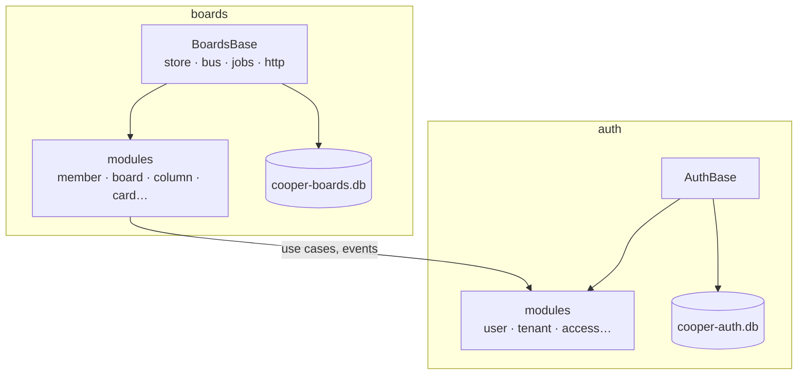
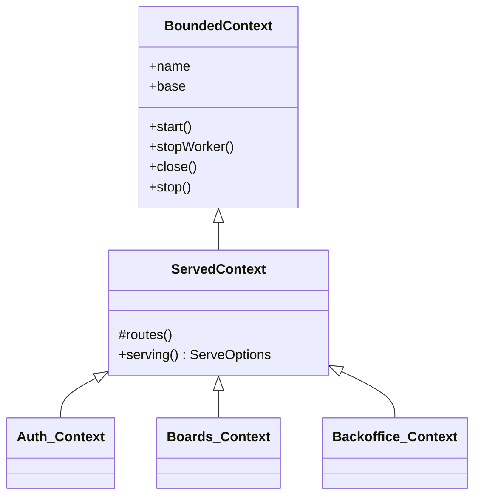
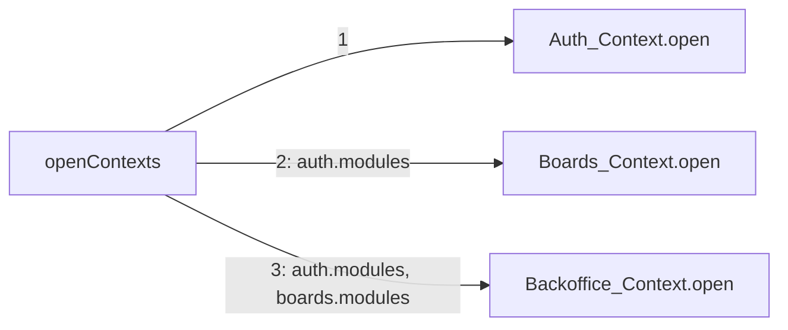
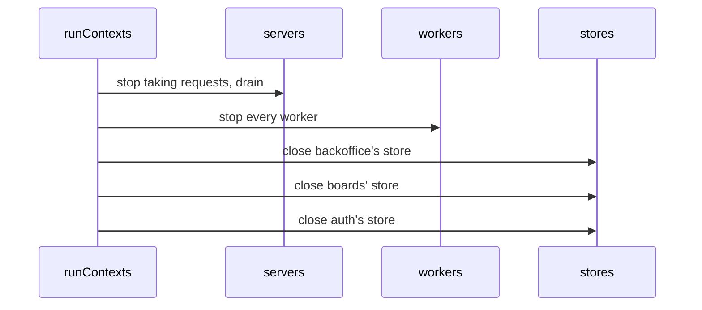

# Bounded contexts

<p class="chapter-lead">A backend that lets any code read any table ends up with every part depending on every other. This chapter shows how newt draws walls inside one codebase, with bounded contexts, and how cooper opens, wires, serves and stops its three. After it you can read any context of cooper and write your own.</p>

## The problem

In the early days of cooper's imaginary ancestor, everything was one database. The boards
code needed a person's name, so it joined `users`. The billing script needed card counts,
so it read `cards`. The admin console needed everything, so it read everything.

Then auth's team wanted to change how accounts are stored. They could not, because three
other parts of the code read the `users` table directly, each in its own way. No one had
decided that boards depended on the shape of auth's tables. It happened one join at a time.

The fix is not discipline. It is a wall that makes the join impossible, with a door in it
that is easy to use.

## The idea

::: info Concept: Bounded context
A part of the application that owns its own data, in its own store, and its own words.
Inside it, modules may call each other freely (in one direction). Outside it, other
contexts reach it only through its modules' use cases and its events. It never opens
another context's store.
:::

In newt a context is three things together:

- a **store**, the database it owns, with its own migrations;
- a **base**, the infrastructure every one of its modules receives (the store, the event
  bus, the job queue, its schedules, its rate limits);
- its **modules**, built on that base, each after those it uses.



boards' modules call auth's modules' use cases and subscribe to their events. They never
see `AuthBase` or `cooper-auth.db`. That is the whole contract between contexts.

## The base

Everything a module needs from the outside world comes in one object: the context's
**base**. It is an instance of `Base`, from `@newt-kit/newt/runtime`, or of a class that extends it.

```ts
import { Base, type BaseOptions } from '@newt-kit/newt/runtime'
```

`Base` is built from `BaseOptions`. Only two are required:

| Option | What it is |
|---|---|
| `name` | The context's name: `auth`, `boards`. Every span of its use cases says it. |
| `store` | Its store, opened and up to date. |
| `clock` | What tells it the time. The real time by default; a test gives one it moves by hand. |
| `tracer` | Who watches its use cases, if not the application's (`setTracer`). |
| `jobs` | How its worker runs jobs: concurrency, polling, lease, backoff (`JobQueueOptions`). |
| `writeRule` | What a use case writing to another module outside a worker gets: `'error'` (default), `'warn'` or `'off'`. |
| `guardRule` | What a save that reads other rows and guards nothing gets: `'error'` (default), `'warn'` or `'off'`. |
| `metrics` | Where it counts its events and times its use cases for the monitor. |
| `rateLimits` | Where its rate limits count (`RateLimitStore`): in memory unless told. |

From those, the base builds what its modules use:

| Property | What modules do with it |
|---|---|
| `base.name` | The context's name. |
| `base.store` | Repositories read and write their tables through it. |
| `base.invocations` | Every module passes it to `super`: it runs, traces and retries use cases. |
| `base.bus` | Modules declare their events on it (`eventsOf(base.bus, …)`). |
| `base.publisher` | Repositories publish the events of what they save through it. |
| `base.jobs` | The outbox's worker: the jobs of `handler` subscriptions. |
| `base.schedules` | Events told on a cron expression (`base.schedules.define(…)`). |
| `base.rateLimits` | Limits a use case defines (`base.rateLimits.define(…)`). |
| `base.metrics` | Where its counts go. |

You will meet each of these in its chapter. For now, the point is that a module receives
*one* object and finds everything there. There is no global registry, no container to
configure.

::: details Under the hood: what the base wraps
The base wraps the store you give it (`tracedStore`) so that each read and write becomes
a step of the trace in progress. Its `publisher` writes the jobs of every `handler`
subscription into the outbox in the transaction of the save, and, once the store commits,
runs the `fire-and-forget` subscriptions and wakes the worker. Its `invocations` keep a
registry of every module, use case, schedule and subscription made on it: that registry
is what `describeApplication` reads.
:::

### Extending the base

An application usually gives its modules more than newt's base: an HTTP router, a query
builder. It does that by extending `Base`, once, and every context uses its subclass.

::: tip In cooper
`cooper/backend/shared/cooper-base.ts` is the base of every context of cooper. It adds the
HTTP router every module registers its routes on, and makes rate limits count in a table
of the context's own store, so that several instances share them.
:::

```ts
// cooper/backend/shared/cooper-base.ts
export class CooperBase extends Base<CooperStore> {
  readonly rateLimitStore: RateLimitStore
  readonly http: HttpRouter

  constructor(options: BaseOptions<CooperStore>) {
    const rateLimits = options.rateLimits ?? new TableRateLimitStore(options.store.table<RateLimitRow>('rate_limit'))
    super({ ...options, rateLimits })
    this.rateLimitStore = rateLimits
    this.http = new HttpRouter({ rateLimits, clock: options.clock, rateLimit: API_LIMIT })
  }
}
```

`CooperStore` is `SqliteStore | PostgresStore`: cooper runs on either. Each context may
extend `CooperBase` again for what only it needs:

```ts
// cooper/backend/contexts/boards/boards-base.ts
export class BoardsBase extends CooperBase {
  readonly db = kyselyFor<BoardsDatabase>(this.store)
}
```

```ts
// cooper/backend/contexts/auth/auth-base.ts
export class AuthBase extends CooperBase {
  readonly oauth = new HttpRouter({ prefix: '', public: true, rateLimits: this.rateLimitStore, rateLimit: OAUTH_LIMIT })
}
```

boards adds Kysely on its store, for the queries a table cannot say (cards counted by
workspace). auth adds a second router at the root, for OAuth's addresses, which live
outside `/api`. The backoffice uses `CooperBase` as it is.

::: warning Watch out
Put in the base what *every* module of the context may use: infrastructure. A mailer,
a search index or a URL only one module needs is that module's **option**, given in
`initializeModules`, not a field of the base. [Modules](./04-modules) shows the
difference.
:::

## The context class

`BoundedContext`, also from `@newt-kit/newt/runtime`, is the context at runtime: a name and a base,
and what it takes to start and stop it.

```ts
// packages/newt/runtime/bounded-context.ts, its shape
export abstract class BoundedContext<B extends Base = Base> {
  protected constructor(readonly name: string, readonly base: B)
  start(): void                // starts the worker of its jobs
  stopWorker(): Promise<void>  // stops it, once the jobs in progress end
  close(): Promise<void>       // closes its store (and its own metrics)
  stop(): Promise<void>        // stopWorker, then close: a context on its own
}
```

That is all newt asks of a context. How it is opened, which modules it has and how it is
served are the application's to decide, and cooper decides them the same way for its
three contexts.

### cooper's ServedContext

Every context of cooper is served over HTTP on a port of its own, so cooper adds one
abstract class between `BoundedContext` and its contexts:

```ts
// cooper/backend/shared/served-context.ts
export abstract class ServedContext extends BoundedContext<CooperBase> {

  protected constructor(name: string, base: CooperBase, private readonly served: ServedContextConfig) {
    super(name, base)
  }

  /** What its server answers besides its modules' API: OAuth's endpoints, an MCP entry. */
  protected routes(): Bun.Serve.Routes<undefined, string> {
    return {}
  }

  serving(): ServeOptions {
    const hsts = new URL(this.served.publicUrl).protocol === 'https:'
    return { port: this.served.port, router: this.base.http, routes: this.routes(), frontend: this.served.frontendFolder, health: true, hsts }
  }
}
```

`serving()` says how the context is served: its port, its router (the API every module
registered routes on), extra routes beside it, the built frontend for every other address,
a health check at `/api/health`, and HSTS when its public address is HTTPS. auth overrides
`routes()` to add its OAuth router; boards adds its MCP server.



## Opening a context

A context is opened in four steps: open its store, build its base, build its modules,
and wrap it all in the context class. cooper puts them in a static `open` on each context.

```ts
// cooper/backend/contexts/boards/boards.context.ts
export class Boards_Context extends ServedContext {

  private constructor(base: BoardsBase, readonly modules: Boards_Modules, readonly config: Boards_Config, private readonly auth: Boards_Auth) {
    super('boards', base, config)
  }

  /** Opened after `auth`, which it uses; on the real time, unless a test gives it a `clock`. */
  static async open(config: Boards_Config, deps: Boards_ModuleDeps, clock?: Clock): Promise<Boards_Context> {
    const store = await openStore(config.database, join(import.meta.dir, 'migrations'))
    const base = new BoardsBase({ name: 'boards', store, clock })
    const modules = initializeModules(base, config, deps)
    // The cards' search starts empty in memory: every card is indexed before anyone searches.
    await modules.card.reindex()
    return new Boards_Context(base, modules, config, deps.auth)
  }

  // …
}
```

### Its store, and its migrations

The first line opens the context's own database. `openStore`
(`cooper/backend/shared/open-store.ts`) picks the adapter by the address: a `postgres://`
URL is Postgres, anything else a SQLite file.

```ts
// cooper/backend/shared/open-store.ts
export function openStore(database: string, migrations: string): Promise<CooperStore> {
  return isPostgres(database)
    ? PostgresStore.open({ url: database, migrations: join(migrations, 'postgres') })
    : SqliteStore.open({ path: database, migrations: join(migrations, 'sqlite') })
}
```

`SqliteStore.open` and `PostgresStore.open` bring the database **up to date as they open
it**: they apply the context's migrations not yet applied, then newt's own (the outbox's
tables). A context never runs on a database behind its code. Each context has one folder of
migrations per dialect:

```
cooper/backend/contexts/boards/migrations/
  sqlite/    00001_board_up.sql  00001_board_down.sql  00002_column_up.sql …
  postgres/  00001_board_up.sql  00001_board_down.sql  00002_column_up.sql …
```

::: danger Never
Never edit a migration that was applied. The store keeps a checksum of each one and
refuses to open when an applied file changed. A change of shape is a new file, in every
dialect the application runs on.
:::

The context's database is its own, with its own name: `data/cooper-boards.db` holds
boards, columns, cards, the idempotency keys of boards' API, boards' web sessions and its
rate limits, and nothing of auth. Two contexts may share a database server, as long as
each has its own database on it.

### Its base and its modules

The second line builds the base, with the context's name, its store and, in a test, a
clock. The third builds every module, in one function the context owns:

```ts
// cooper/backend/contexts/boards/initialize-modules.ts
export function initializeModules(base: BoardsBase, config: Boards_Config, deps: Boards_ModuleDeps) {
  const session = WebSession_Module.initialize(base, { /* … */ })
  const { user, tenant, access, invitation } = deps.auth
  const member = Member_Module.initialize(base, { auth: { access, tenant, user } })
  const board = Board_Module.initialize(base, { member })
  const column = Column_Module.initialize(base, { board, member })
  const card = Card_Module.initialize(base, { board, column, member, auth: { access } }, { mailer: deps.mailer, publicUrl: config.publicUrl, search: deps.search })
  const workspace = Workspace_Module.initialize(base, { board, column, card, member, auth: { tenant, access, invitation, user } })
  const activity = Activity_Module.initialize(base, { card, member, auth: { tenant } }, { log: deps.log ?? (() => {}) })
  const outbox = Outbox_Module.initialize(base)
  return { session, member, board, column, card, workspace, activity, outbox }
}

export type Boards_Modules = ReturnType<typeof initializeModules>
```

Read it as the context's table of contents. Each module is built after the ones it uses
and is handed them by name: `card` gets `board`, `column`, `member`, and auth's `access`.
Because each one can only be handed modules built before it, the dependencies between
modules cannot form a cycle. The function returns them all, and `Boards_Modules` is their
type, which the rest of the application uses to name them.

`initializeModules` is cooper's convention, not an API of newt: newt only asks that each
module is built on the base and given its dependencies. But the convention is worth
copying. It puts every dependency of the context in one place, in order, where a reader
sees them.

::: tip In cooper
Some modules have work to do as the context opens. boards indexes every card for search
(`modules.card.reindex()`), since its search index lives in memory. auth brings the OAuth
clients of its products in step with the code (`modules.oauthClient.declareProducts()`).
Both run in `open`, after the modules are built and before anyone is served.
:::

## Contexts that use other contexts

boards uses auth. That shows in three places, and only three.

First, `Boards_ModuleDeps` says what boards is given from outside: some of auth's
modules, a mailer, a search index.

```ts
// cooper/backend/contexts/boards/initialize-modules.ts
export type Boards_Auth = Pick<Auth_Modules, 'token' | 'user' | 'tenant' | 'access' | 'invitation'>

export type Boards_ModuleDeps = {
  auth: Boards_Auth
  mailer: Mailer
  search: CardSearch
  log?: (line: string) => void
}
```

It picks auth's **modules**, never `AuthBase` nor auth's store. boards calls
`deps.auth.access.check(…)` as it would call one of its own modules, and subscribes to
`deps.auth.tenant.events.created` as to its own events.

Second, whoever opens the contexts opens them in order and hands each one the modules
of the ones it uses:

```ts
// cooper/backend/open-contexts.ts
export async function openContexts(config: Config, options: OpenContextsOptions = {}) {
  const mailer = options.mailer ?? new ConsoleMailer(config.mail.from)
  const { clock } = options
  const auth = await Auth_Context.open(config.auth, { mailer }, clock)
  const boards = await Boards_Context.open(config.boards, { auth: auth.modules, mailer, search: new MemoryCardSearch(), log: config.trace ? line => console.log(line) : undefined }, clock)
  const backoffice = await Backoffice_Context.open(config.backoffice, { auth: auth.modules, boards: boards.modules }, clock)
  return { auth, boards, backoffice, all: [auth, boards, backoffice] as const }
}
```

Third, the lint. A context's files may import only from the contexts its `uses` lists in
`eslint.config.js`. boards may import auth's types (`Auth_Modules`, `Access_Module`), and
the lint (`newt/context-boundaries`) refuses an import from boards in auth, or from the
backoffice in either.



::: danger Never
Never hand another context's base or store to a context, and never wrap another
context's use cases in a port of plain functions
(`{ isMember: (w, u) => auth.access.check(…) }`). The lint, the dependency graph and
`describeApplication` all lose the dependency. Another context's modules are deps like
your own, grouped under that context's name.
:::

Contexts depend on each other as a tree, like modules do: each is opened after those it
uses, so none can use one opened after it. [Contexts working together](./11-between-contexts)
covers how they talk: calls, events, and who may write where.

## Serving and running

A context's server is `serve(options)`, from `@newt-kit/newt/http`: a `Bun.serve` with the
router's routes, the routes beside them, the health check, the frontend for every other
address, and newt's security headers on every answer. `ServeOptions` is what
`ServedContext.serving()` returns:

| Option | What it does |
|---|---|
| `port` | Where it listens. |
| `router` | The `HttpRouter` its modules registered their routes on. |
| `routes` | More routes beside the router's, as `Bun.serve` takes them. |
| `frontend` | The built frontend's folder, or, in development, its imported `index.html`. |
| `health` | `GET /api/health`, without a session: 200 while serving, 503 once stopping. |
| `drainMs` | How long it goes on answering once told to stop, its health a 503. |
| `trustProxy` | How many proxies in front of it add to `X-Forwarded-For`. |
| `hsts`, `securityHeaders`, `csp` | The security headers: see [HTTP security](./27-security). |
| `maxBodyBytes`, `idleTimeoutSeconds`, `development`, `publicFolder` | Limits and development mode. |

An application with several contexts runs them with `runContexts`, from
`@newt-kit/newt/application`. It serves each context that has a `serve`, starts every context's
worker, and on `SIGINT` or `SIGTERM` stops them all in the right order.

```ts
// cooper/backend/index.ts
const contexts = await openContexts(config)
const app = runContexts(contexts.all.map(context => ({
  context,
  serve: { ...context.serving(), drainMs: config.drainMs, trustProxy: config.trustProxy },
})), { tracer: cooperTracer(config) })
for (const [name, server] of Object.entries(app.servers)) console.log(`${name} listening on ${server.url}`)
```

`runContexts` takes a list of `{ context, serve? }` and `RunContextsOptions`: a `tracer`
for the whole application (one request that crosses contexts is one trace), whether to
listen for signals (`signals`, on by default), and `stopTimeoutMs`. It returns the running
servers, by context name, and a `stop()`.

### The order of stopping

Stopping is the opening in reverse, with one twist.



Every server stops first, so nothing new comes in. Then **every** worker stops, before any
store closes. The twist is why: when boards subscribes to an auth event with a `handler`,
the job is written in auth's outbox, in the transaction of auth's save, and auth's worker
runs it, which then writes to boards' store. So auth's worker may be writing into boards
right up to the moment it stops. Only when all workers are stopped do the stores close, the
last opened first, so no context closes before one that uses it.

A test that opens one context on its own just calls `context.stop()`: its worker, then its
store. Scripts that open every context, like the seed, use cooper's own `stopContexts`
(`cooper/backend/open-contexts.ts`), which does the same as `runContexts` without servers.

::: details Under the hood: start and stop are about the worker
`start()` starts the context's job worker (`base.jobs.start()`); nothing else runs in the
background. A context that is opened but not started still answers its use cases, saves,
and writes jobs to its outbox; nobody runs them until a worker starts. That is how tests
control background work: they leave the worker stopped and call `base.jobs.idle()` to run
what is pending, or start it and wait.
:::

## A context in a test

Because a context is only a base and modules, a test can build one with no server at all,
on a store in memory and a clock it moves by hand:

```ts
import { SqliteStore } from '@newt-kit/newt/adapter-sqlite'
import { Base } from '@newt-kit/newt/runtime'

let time = Date.parse('2026-01-01T00:00:00Z')
const clock = { now: () => new Date(time) }
const base = new Base({ name: 'shop', store: await SqliteStore.open({ path: ':memory:', migrations: 'migrations/sqlite' }), clock })
```

cooper's tests do the same with their own helpers, such as
`cooper/backend/contexts/boards/testing/open-test-boards.ts`, which opens boards on SQLite
in memory with a fake of the auth modules it uses. [Testing](./12-testing) shows them.

## Recap

- A **bounded context** owns its store, its base and its modules; other contexts reach it
  only through its modules' use cases and events.
- `Base` (`@newt-kit/newt/runtime`) is what every module receives: store, invocations, bus,
  publisher, jobs, schedules, rate limits, metrics. Applications extend it, as
  `CooperBase` adds an HTTP router.
- `BoundedContext` is a name, a base, `start`, `stopWorker`, `close` and `stop`. cooper's
  `ServedContext` adds `serving()`.
- A context opens its store (migrations applied as it opens), builds its base, then its
  modules in `initializeModules`, each after those it uses.
- Contexts use each other as a tree, declared in the lint's `contexts.uses`, and are handed
  each other's **modules**, never bases or stores.
- `runContexts` serves them, starts their workers, and stops servers, then every worker,
  then each store, last opened first.

## Going further

- [Modules](./04-modules): what `Card_Module.initialize` does with what it is given.
- [Contexts working together](./11-between-contexts): calls and events between contexts,
  and who may write where.
- [Stores and migrations](./26-stores): the stores newt ships, and running migrations by
  hand.
- [Running it in production](./13-production): cooper's backend as a deployed process.
