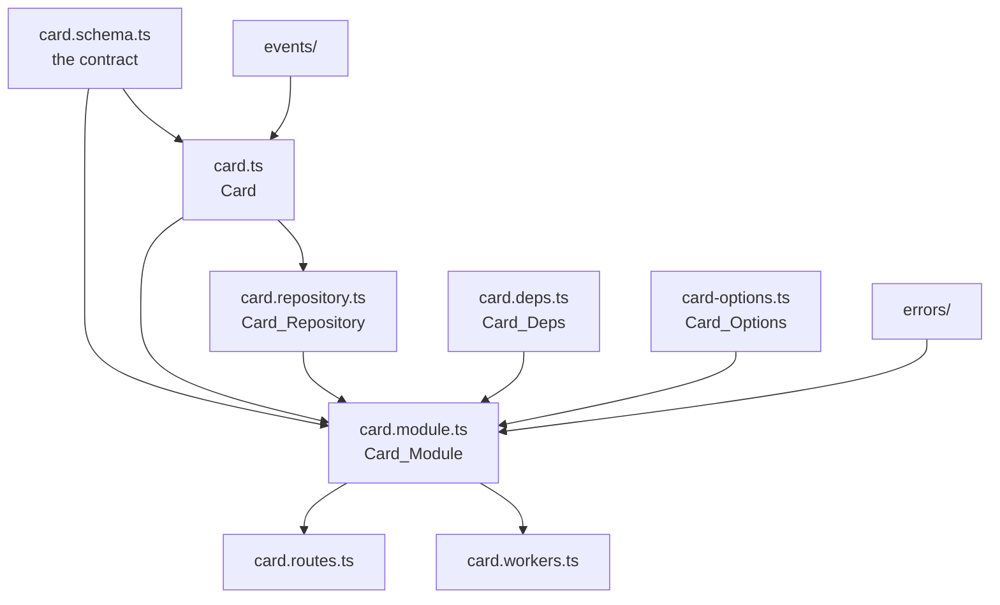
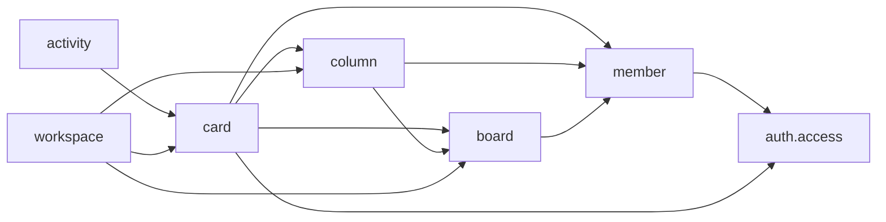

# Modules

<p class="chapter-lead">Inside a context, code still needs a shape, or it turns into one big service class that does everything. This chapter shows newt's unit of code, the module: one entity, one responsibility, the same files every time. After it you can open any module of cooper and know where everything is, and write one of your own.</p>

## The problem

Every backend has a `CardService`. It starts with `create` and `move`. Then it gets
`notifyAssignee`, because that is about cards. Then `exportToCsv`, `countForBilling`,
`syncWithSlack`. It imports the user repository to show names and the board repository to
check limits. Two years in, it is three thousand lines, it depends on half the codebase,
and every change to it breaks something unrelated.

The problem is not size. It is that nothing says what belongs in it, and nothing stops
anything else from reaching into it.

## The idea

::: info Concept: Module
A module owns **one entity** and has **one responsibility**. It changes its entity only
through its use cases, keeps it in its own table through its own repository, and tells
what happened through its events. Other modules reach it only through what it offers:
its use cases, its schema, its events, its errors and its value objects.
:::

Three rules give a module its shape:

1. **One responsibility.** If describing a module needs an "and", it is two modules.
   "The cards of each board" is one. "The cards, and what happened to them" is two: in
   cooper, `card` and `activity`.
2. **One entity.** A module keeps one kind of thing. Several modules may point at each
   other's things, but only by id: a card has a `boardId`, never a `Board`.
3. **The same files, every time.** Every module has the same files with the same names,
   so a person or a coding agent who opens one knows where to look. The lint
   (`newt/module-anatomy`) refuses any other file.

Some modules keep no entity at all: they answer by asking others. boards' `member` keeps
nothing and asks auth who belongs to each workspace; the backoffice's `workspace` puts
together screens from auth's and boards' use cases. They still have one responsibility.

## The anatomy of a module

Open `cooper/backend/contexts/boards/modules/card/`. Every module folder looks like this
one, with the module's name, in kebab case, at the start of every file:



| File | What it holds |
|---|---|
| `card.schema.ts` | The **contract**: the entity's Zod schema (`CardSchema`), its DTO type (`CardDTO`), the input schemas (`CardCreateSchema`, `CardMoveSchema`…), the filters a client may send (`CardFilter`). It imports only zod, `newt-kit/contract`, value objects and other schemas, so a frontend can import it. |
| `card.ts` | The **entity**, `Card extends Entity<typeof CardSchema>`. It re-exports the schema (`export * from './card.schema'`). |
| `card.repository.ts` | `Card_Repository`, the only file that touches the store. |
| `card.module.ts` | `Card_Module extends Module`: `static initialize`, its `events`, and its use cases. |
| `card.routes.ts` | `registerCardRoutes`: its HTTP routes, each calling one use case. |
| `card.workers.ts` | `registerCardWorkers`: its reactions to events and schedules. |
| `card.deps.ts` | `Card_Deps`: the modules it calls, of its context or another's, and ports. Types only. |
| `card-options.ts` | `Card_Options`: what its context configures it with. |
| `events/card-<verb>.ts` | One event class per file: `card-created.ts` holds `Card_Created`. |
| `errors/<error>.ts` | One error class per file: `card-not-found.ts` holds `CardNotFound`. |
| `value-objects/` | One value object per file (board has `value-objects/board-name.ts`). |
| `services/` | Logic its use cases share, one file each, when a private method is not enough. |
| `*.test.ts` | Its tests, beside the code. |

Only `card.module.ts`, `card.ts`, `card.schema.ts` and `card.repository.ts` are needed in
every module that keeps an entity. A module with no routes has no `card.routes.ts`, one
with no reactions no `card.workers.ts`.

::: tip In cooper
Compare `card/` with `cooper/backend/contexts/auth/modules/invitation/`: the same files,
named after `invitation`. Opening a module you have never seen, you already know that its
use cases are in `invitation.module.ts`, its contract in `invitation.schema.ts`, and that
the email it sends leaves from `invitation.workers.ts`.
:::

### The names

A module's folder name decides every other name. For a one-word module like `card` they are
obvious; a two-word one shows the rule. Here is auth's `oauth-grant`:

| Thing | Name |
|---|---|
| Folder and files | `oauth-grant/`, `oauth-grant.module.ts`, `oauth-grant-options.ts` |
| Module class | `OauthGrant_Module` |
| Module name (`super`) | `'oauthGrant'` |
| Entity | `OauthGrant` |
| Repository | `OauthGrant_Repository` |
| Table | `oauth_grant` |
| A use case | `oauthGrant.redeem` |
| An event | `oauthGrant.replayed`, class `OauthGrant_Replayed`, file `events/oauth-grant-replayed.ts` |
| An error code | `oauthGrant.not_found` |
| A queue | `<module>.<use case>.on.<module>.<event>`, as `invitation.send.on.invitation.created` |

The underscore in `OauthGrant_Module`, `Card_Deps`, `Card_Created` marks a name that
belongs to a module: what comes before it is the module, what comes after, what it is.

## The module class

Here is the top of `Card_Module`, trimmed to its shape:

```ts
// cooper/backend/contexts/boards/modules/card/card.module.ts
export class Card_Module extends Module {

  static initialize(base: BoardsBase, deps: Card_Deps, options: Card_Options): Card_Module {
    const module = new Card_Module(base, new Card_Repository(base), deps, options)
    registerCardRoutes(base, module, deps)
    registerCardWorkers(module, deps)
    return module
  }

  readonly events

  private constructor(
    base: BoardsBase,
    private readonly repo: Card_Repository,
    private readonly deps: Card_Deps,
    private readonly options: Card_Options,
  ) {
    super('card', base.invocations, deps)
    this.events = eventsOf(base.bus, {
      created: Card_Created,
      edited: Card_Edited,
      moved: Card_Moved,
      assigned: Card_Assigned,
      unassigned: Card_Unassigned,
      deleted: Card_Deleted,
    })
  }

  @UseCase()
  async move(id: string, input: unknown): Promise<CardDTO> {
    // …
  }

  // … more use cases, and private helpers
}
```

### `static initialize`

The context builds a module by calling `Card_Module.initialize(base, deps, options)`, never
`new`. The constructor is private. `initialize` is the one place where the module is
assembled:

1. it builds its repository on the base (`new Card_Repository(base)`);
2. it builds the module with the repository, deps and options;
3. it registers the module's routes on the base's router (`registerCardRoutes`);
4. it registers its workers, the subscriptions to its own and others' events
   (`registerCardWorkers`);
5. it returns the module, for the context to hand to the modules built after it.

So building a module is also wiring it. There is no step you can forget: a module
built is a module served and listening.

### `super(name, base.invocations, deps)`

The first line of the constructor gives newt three things:

- the module's **name**, `'card'`, the prefix of every use case (`card.move`) and of its
  events' names;
- the context's **invocations**, which run every `@UseCase` method: in its span, with
  retries on conflict, and with the write rule checked;
- the module's **deps**, all of them.

The deps are not stored by `Module`: the module keeps its own copy in a private field. They
are passed to `super` so that the context's registry can read them and tell which modules,
events and ports this module depends on. That is where `describeApplication`
(`newt-kit/runtime`) gets the graph of an application, and newt-monitor draws it.

::: warning Watch out
Pass **every** dep to `super`, including those only the routes or workers use. A module
that leaves one out still works, but the application's description, and the monitor's
dependency graph, no longer show that dependency. A module that passes none
(`super('product', base.invocations)`) depends on nothing as far as anyone can see.
:::

### Its events

`this.events = eventsOf(base.bus, { … })` declares which events the module tells, by a
short name: `card.events.moved` is the emitter of `Card_Moved`. Other modules subscribe to
them there (`deps.card.events.moved.subscribe(…)`), and so do the module's own workers.
[Domain events](./09-events) covers them.

### Its use cases

Every public method of a module is a use case, marked `@UseCase()`. Anything else is
`private`. The lint (`newt/use-case`) refuses a public method without the decorator, so a
module's public surface is exactly its list of use cases. [Use cases](./06-use-cases) is
about them.

## Deps and options

A module is given two kinds of things from outside, in two files.

### `<M>_Deps`: what it uses

```ts
// cooper/backend/contexts/boards/modules/card/card.deps.ts
import type { Access_Module } from '../../../auth/modules/access/access.module'
import type { Board_Module } from '../board/board.module'
import type { Column_Module } from '../column/column.module'
import type { Member_Module } from '../member/member.module'

export interface Card_Deps {
  /** That a card's board exists, in the current workspace. */
  board: Board_Module
  /** That a card's column exists, and is of its board; and where cards left in a removed column go. */
  column: Column_Module
  /** That a card's assignee belongs to its workspace, and where to write to them. */
  member: Member_Module
  /** auth taking someone's access away: their cards are left unassigned. */
  auth: {
    access: Access_Module
  }
}
```

Deps are **modules**, of the same context by their own name (`board`, `column`) and of
another context grouped under that context's name (`auth: { access }`). The module calls
them as `this.deps.board.get(boardId)` and `this.deps.auth.access…`, and its workers
subscribe to their events as `deps.auth.access.events.revoked`. The file has only
`import type`: a module never builds its deps, it is handed them.

A dep may also be a **port**: an interface in the module's own words for something that is
no module of the application, such as a mailer.

```ts
export interface Order_Deps {
  customer: Customer_Module          // its own context's
  billing: { invoice: Invoice_Module } // another context's
  mailer: Mailer                     // a port
}
```

### `<M>_Options`: how it is configured

```ts
// cooper/backend/contexts/boards/modules/card/card-options.ts
export type Card_Options = {
  /** What tells an assignee: the console in development, a list in a test. */
  mailer: Mailer
  /** Where people open boards: the links of its emails start there. */
  publicUrl: string
  /** Where the cards are searched: an index the cards keep as each one changes. */
  search: CardSearch
}
```

Options are configuration: numbers, URLs, the product id the module works for, how many
days an invitation lasts. The context passes them from its config in `initializeModules`.

::: details Under the hood: a port in deps, or in options
newt's own guidance puts ports in deps, where `describeApplication` lists them as a
dependency of kind `port`. cooper passes its mailer and its card search to `card` in
`Card_Options` instead, beside the URL their links need, which keeps them out of the
application's description. Both compile and both pass the lint; deps are the place when
you want the monitor to see the port.
:::

### Building them, in order

Back in the context's `initializeModules`, the deps and options are handed over, each
module after the ones it uses:

```ts
// cooper/backend/contexts/boards/initialize-modules.ts
const member = Member_Module.initialize(base, { auth: { access, tenant, user } })
const board = Board_Module.initialize(base, { member })
const column = Column_Module.initialize(base, { board, member })
const card = Card_Module.initialize(base, { board, column, member, auth: { access } }, { mailer: deps.mailer, publicUrl: config.publicUrl, search: deps.search })
```

Here is the result, the dependencies between boards' modules:



The arrows all point one way. `card` knows `column`, so `column` cannot know `card`: there
is no way to hand it a module built after it.

::: warning Watch out
What do you do when two modules seem to need each other? cooper meets it with columns and
cards: removing a column must check it has no cards, but `column` cannot ask `card`. The
answer in cooper is that the module that knows answers. `card.removeColumn` counts the
column's cards and then asks `column` to remove it (`cooper/backend/contexts/boards/modules/card/card.module.ts`),
a write into another module from a request that it declares with
`@UseCase({ writesTo: ['column'] })` and a comment saying why.
The other common answer is an event: the module lower down tells what happened, and the
one higher up reacts in a worker.
:::

## Module boundaries

A module may import from another module only what that one offers:

- its **module** (`board.module.ts`), to call its use cases;
- its **schema** (`board.schema.ts`), for its DTO types and input schemas;
- its **events** (`events/…`), to type a subscription;
- its **errors** (`errors/…`), to throw or recognise them;
- its **value objects** (`value-objects/…`).

Its entity, its repository, its routes and its workers are its own. The lint
(`newt/module-boundaries`) refuses an import of them from another module, however you
name the path:

```ts
// in cooper/backend/contexts/boards/modules/card/…
import type { ColumnDTO } from '../column/column.schema'          // fine: its contract
import { Column_Module } from '../column/column.module'            // fine: its use cases
import { Column_Repository } from '../column/column.repository'    // refused: column's own
```

Through the entity or the repository, a module could read or write another's data behind
its back, and skip its rules. Without them, the only way to change a column is to ask the
column module, whose use cases enforce its rules.

::: danger Never
A module never points at another's entity or table. A card keeps `columnId: string`, not
a `Column`, and reads columns through `this.deps.column.list(boardId)`. The lint's
`newt/module-boundaries` refuses the import, and newt's Golden rule 10 says why: a module
points at another's things only by id.
:::

## Writing a new module: `newt add module`

You can write a module by hand, but newt's command line writes the skeleton for you, named
as the lint wants, and it compiles and passes the lint as written:

```sh
bunx newt-kit add module cooper/backend/contexts/boards label
```

It writes `cooper/backend/contexts/boards/modules/label/` with `label.schema.ts`,
`label.ts`, `label.repository.ts`, `label.module.ts`, `label.deps.ts`, `label.routes.ts`,
`events/label-created.ts`, `errors/label-not-found.ts` and `label.test.ts`, and never
overwrites a file that is there. Then it tells you what is left to decide:

```
Next:
  decide the scope in cooper/backend/contexts/boards/modules/label/label.repository.ts: a tenant's { field, current }, or 'none' with the reason
  add a migration for the table 'label' in each dialect's migrations folder (FileStore needs none)
  initialize Label_Module in the context, after the modules it uses, with its deps
  bun check && bun test && bunx eslint
```

Those three steps are the part only you can do: say which tenant its rows belong to, give
it a table, and put it in `initializeModules` in its place. [The command line](./c-cli)
has the details.

## Recap

- A module owns **one entity** and **one responsibility**; if it needs an "and", it is
  two. Some modules keep no entity and only ask others.
- Every module has the same files, named after its folder: schema, entity, repository,
  module, routes, workers, deps, options, `events/`, `errors/`, `value-objects/`,
  `services/`, tests. The lint keeps the anatomy.
- `static initialize(base, deps, options)` builds its repository and the module, registers
  its routes and workers, and returns it.
- `super(name, base.invocations, deps)` names the module and hands newt **all** its deps,
  which is how the application describes its own dependencies.
- `<M>_Deps` lists modules (same context by name, other contexts under the context's name)
  and ports; `<M>_Options` is configuration.
- Another module is reached only through its module, schema, events, errors and value
  objects, and its things only by id.

## Going further

- [Entities and their schemas](./05-entities): what lives in `card.ts` and
  `card.schema.ts`.
- [Use cases](./06-use-cases): what lives in `card.module.ts`.
- [Aggregates](./21-aggregates): when one module saves several entities as one.
- [The lint](./b-lint): every rule of newt-kit-eslint, with what it says.
