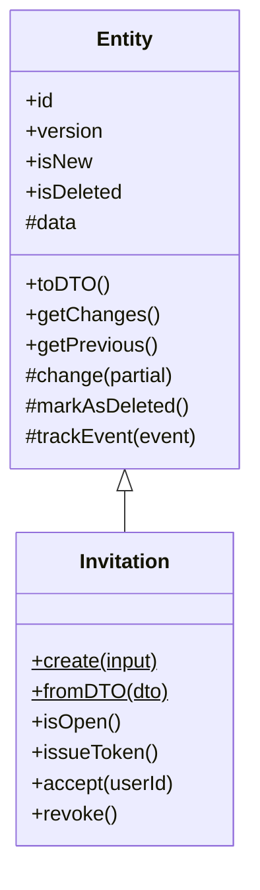
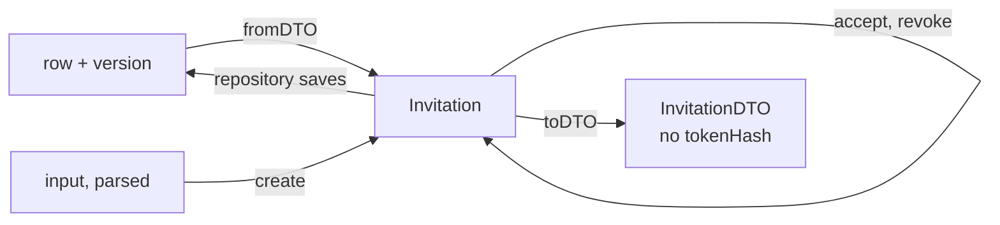

# Entities and their schemas

<p class="chapter-lead">When any code may set any field, the rules of your data end up scattered across every place that writes it. This chapter shows how newt keeps them in one place: an entity, whose schema it can never break, which changes only through methods named after what happened and notes the events they cause. After it you can read and write an entity like cooper's invitation, end to end.</p>

## The problem

An invitation to a workspace looks simple: an email, a workspace, a status. In a typical
backend it is a row, and any code may update it:

```ts
await db.update('invitations', id, { status: 'accepted' })
```

Then the rules start to leak. Somewhere, accepting must also record who accepted. Somewhere
else, an expired invitation must not be accepted. The email must be stored in lower case,
or two invitations to `Ana@Acme.dev` and `ana@acme.dev` get through. The link's token must
never be stored, only its hash. Each rule is honoured in the place its author remembered,
and nowhere else.

What is missing is a single object that *is* the invitation, knows its rules, and refuses
to break them.

## The idea

::: info Concept: Entity
What a module keeps, with its behaviour. Its data is described by a Zod schema, checked
every time it is built or changed. It changes only through its own methods, named after
what happened (`accept`, `revoke`), and each method notes the domain events it caused,
to be told when it is saved. It has an id, a version, and the times it was created and
last changed.
:::

An entity in newt is a class that extends `Entity`, from `newt-kit/core`:



Everything that changes the entity is `protected`: only its own methods can call `change`,
`markAsDeleted` and `trackEvent`. Code outside, a use case, calls `invitation.accept(userId)`
and nothing else. So the rules of an invitation can only live in `Invitation`.

## The schema is the contract

An entity starts with its schema, in its module's `<m>.schema.ts`. Here is the invitation's:

```ts
// cooper/backend/contexts/auth/modules/invitation/invitation.schema.ts
import { z } from 'zod'
import { Email } from 'newt-kit/contract'

export const InvitationStatusSchema = z.enum(['pending', 'accepted', 'revoked'])

/** Someone asked to join a workspace, by email, by its admin. */
export const InvitationSchema = z.object({
  id: z.uuidv7(),
  tenantId: z.uuidv7(),
  /** Who may accept it: whoever signs in with this email. */
  email: Email.schema,
  invitedBy: z.uuidv7(),
  status: InvitationStatusSchema,
  /** Who accepted it, once someone did. */
  acceptedBy: z.uuidv7().nullable(),
  expiresAt: z.iso.datetime(),
  createdAt: z.string().default(''),
  updatedAt: z.string().default(''),
})

export type InvitationDTO = z.infer<typeof InvitationSchema>
```

This one schema is many things at once:

- the **shape of the entity**, checked whenever it is built or changed;
- the **shape of its row**: its repository stores these fields;
- the **DTO** the module returns and its events carry (`InvitationDTO`);
- the **contract with clients**: cooper's frontends import `invitation.schema.ts` through
  `cooper/libs/api` to type what the API answers.

That is why the schema file may import only zod, `newt-kit/contract`, value objects and other
schemas (`newt/schema-imports` in the lint): a browser loads it.

A few rules hold for every entity schema:

- It is a `z.object` or a `z.strictObject`. A schema that keeps fields it does not name
  (`z.looseObject`, `.catchall`, `.passthrough`) is refused when the entity is built: a
  row's other columns would end up inside the entity.
- It has an `id`, `createdAt` and `updatedAt`. newt fills all three. The convention
  `z.string().default('')` for the timestamps lets the entity be built before newt stamps
  them.
- Ids are **UUIDv7** (`z.uuidv7()`): newt gives a new entity its id with
  `Bun.randomUUIDv7()`. Because v7 ids sort by time, they are also what pages of lists use as
  a stable cursor.

::: danger Never
Never take an id in a create input. A new entity gets its id from newt. An id a client
chose could collide, or guess at another's.
:::

### Input schemas, derived

What a client may send is described by **input schemas**, in the same file, derived from the
entity's so that a rule is written once:

```ts
// cooper/backend/contexts/boards/modules/card/card.schema.ts
const description = z.string().trim().pipe(CardSchema.shape.description)

export const CardCreateSchema = CardSchema.pick({ columnId: true, title: true }).extend({
  description: description.default(''),
  assigneeId: CardSchema.shape.assigneeId.default(null),
})
export const CardEditSchema = z.object({ title: CardSchema.shape.title, description }).partial()
export const CardMoveSchema = z.object({
  columnId: CardSchema.shape.columnId,
  position: CardSchema.shape.position.optional(),
})
```

`CardSchema.pick(...)` and `CardSchema.shape.title` reuse the entity's own rules: a title is
trimmed and has 1 to 200 characters, wherever it comes from. The input types are
`z.input<typeof CardCreateSchema>`, what a client writes, before defaults.

## The entity class

Here is `Invitation`, from `cooper/backend/contexts/auth/modules/invitation/invitation.ts`,
in pieces.

### Construction

```ts
/** The invitation as it is kept: what anyone sees, and the hash of its link's token. */
const InvitationEntitySchema = InvitationSchema.extend({
  /** Null until its email leaves: the token is made when it is sent, and only its hash kept. */
  tokenHash: z.string().nullable(),
})

export type InvitationEntityDTO = z.infer<typeof InvitationEntitySchema>

export class Invitation extends Entity<typeof InvitationEntitySchema, typeof InvitationSchema> {

  private constructor(input: EntityInput<InvitationEntityDTO>, isNew: boolean) {
    super(InvitationEntitySchema, input, isNew, InvitationSchema)
  }

  static fromDTO(dto: InvitationEntityDTO & { version: number }): Invitation {
    return new Invitation(dto, false)
  }

  // …
}
```

The constructor is **private**, and every entity has the same one: it takes the data
(`EntityInput`, where `id`, `createdAt`, `updatedAt` and `version` are optional) and whether
it is new, and passes them to `super` with the schema. `super` checks the data against the
schema, gives a new entity its id and timestamps, and keeps a copy of what it was, to know
later what changed.

There are two ways in, both static:

- **`fromDTO(dto)`** rebuilds an entity read from the store. It takes the row *with its
  version* (`dto & { version: number }`), and its repository is the only caller.
- **A named constructor** makes a new one. It is named after what happened in the domain,
  not `new` or `make`.

### Named after what happened

```ts
/** A new one, pending for some days: the email as someone typed it becomes an `Email`. */
static create(input: { tenantId: string, email: string, invitedBy: string, days: number }): Invitation {
  const { days, ...rest } = input
  const expiresAt = new Date(now().getTime() + days * 24 * 60 * 60_000).toISOString()
  const invitation = new Invitation({ ...rest, email: Email.from(rest.email), status: 'pending', acceptedBy: null, expiresAt, tokenHash: null }, true)
  invitation.trackEvent(new Invitation_Created(invitation.toDTO()))
  return invitation
}
```

cooper's entities show the range: an invitation and a card are `create`d, a user signs up
(`User.signUp`), a session is
`open`ed (`Session.open`), an OAuth client `register`s (`OauthClient.register`), an access
is `grant`ed (`Access.grant`), a column is `add`ed (`Column.add`), a token is `issue`d
(`Token.issue`), an activity entry is `record`ed (`Activity.record`). Each name says, in
the domain's words, how the thing came to be.

The constructor decides everything that is true of a new invitation: it is pending, nobody
accepted it, it expires in so many days, it has no token yet. The use case cannot get any
of that wrong, because it does not set it.

::: warning Watch out
Time is `now()` from `newt-kit/core`, never `new Date()`. `now()` reads the context's clock,
which a test moves by hand. An entity that calls `new Date()` cannot be tested at
"seven days later". See [Time and schedules](./23-time).
:::

### Methods that change it

```ts
get status(): InvitationStatus {
  return this.data.status
}

/** Pending and not expired: it can still be accepted. */
isOpen(at = now()): boolean {
  return this.data.status === 'pending' && new Date(this.data.expiresAt) > at
}

accept(userId: string): void {
  this.change({ status: 'accepted', acceptedBy: userId })
  this.trackEvent(new Invitation_Accepted(this.toDTO()))
}

revoke(): void {
  this.change({ status: 'revoked' })
  this.trackEvent(new Invitation_Revoked(this.toDTO()))
}
```

The entity reads its own fields through `this.data` (protected) and exposes what others
need through getters (`status`, `tenantId`, `email`) and questions (`isOpen`). It changes
itself through `this.change(partial)`, which:

- refuses a field its schema lacks (`UnknownEntityField`), or `createdAt`/`updatedAt`,
  which are newt's;
- parses the **whole** entity as it would be with the change, so refinements across fields
  still hold, and takes the values the schema gives (trimmed, defaulted);
- changes nothing at all if the parse fails, and throws `InvalidEntity`;
- stamps `updatedAt` with `now()` if anything actually changed.

Notice that `accept` does not check `isOpen()`. Whether accepting is allowed depends on more
than the invitation (is the workspace still there? is this the right person?), so the use
case checks it and then calls `accept`. The entity keeps what is true of itself: that
accepting sets both `status` and `acceptedBy`, always together.

### Deleting

An entity is deleted by a method of its own that calls `this.markAsDeleted()`:

```ts
// cooper/backend/contexts/boards/modules/board/board.ts
/** Out of every list, its name free again; its row stays, with what points at it. */
archive(): void {
  this.markAsDeleted()
  this.trackEvent(new Board_Archived(this.toDTO()))
}
```

Its repository then deletes it when it saves, softly or for good, as the repository is set
up. A deleted entity cannot be changed (`DeletedEntityNotChangeable`) nor deleted again
(`EntityAlreadyDeleted`), and one never saved cannot be deleted (`NewEntityNotDeletable`).

### Telling what happened

Every method above ends with `this.trackEvent(new …)`. That notes a **domain event**, to be
told when the entity is saved, and only if the save commits. The entity does not publish
anything; it only says what happened. [Domain events](./09-events) covers what happens
next. Three things are worth knowing now:

- An event replaces one of the same name noted before the save. Two edits before one save
  tell one `card.edited`, with both changes. cooper's `Card.create` notes `card.created`,
  and `Card.place`, called as the card is saved with its final number, notes it again with
  the right number: one event is told.
- An event comes with a change. Tracking one when nothing changed makes the save throw
  `EventWithoutChange`. Change what the event tells of (a status, a date) along with it.
- An "updated" event usually carries `{ dto, changes, previous }`, from the entity's
  `getChanges()` and `getPrevious()`:

```ts
// cooper/backend/contexts/boards/modules/card/card.ts
edit(changes: { title?: string, description?: string }, author: CardAuthor): void {
  this.change(changes)
  const diff = this.getChanges()
  if (diff) this.trackEvent(new Card_Edited({ dto: this.toDTO(), changes: diff, previous: this.getPrevious()!, ...author }))
}
```

If the title was set to what it already was, `getChanges()` is `null` and nothing is told.

## The version, and the times

Every entity has a `version`: 0 until it is first saved, one more on each save. Its
repository saves it only if the row still has the version it was read with. If someone else
saved it in between, the save throws `ConcurrencyConflict`, and the use case runs again from
the start, on fresh data. That is how cooper keeps Bob's move from writing over Ana's
rename. [Versions, conflicts and guards](./20-concurrency) tells the whole story.

`createdAt` and `updatedAt` are ISO strings, stamped by newt with the context's clock:
`createdAt` once, `updatedAt` on every change that changes something.

## DTOs out

A use case never returns an entity. It returns `entity.toDTO()`: a plain copy of its data,
JSON-ready, which nobody can use to change it.



### An entity with secrets: a public schema

The invitation's link carries a secret token. The store must keep only its hash, and nobody
outside the module should ever see even the hash. So `Invitation` has **two** schemas:

- `InvitationEntitySchema`, everything it keeps, `tokenHash` included, which its repository
  stores;
- `InvitationSchema`, what anyone else sees, without `tokenHash`.

`Entity<typeof InvitationEntitySchema, typeof InvitationSchema>` and the fourth argument to
`super` tell newt the difference. `toDTO()` then gives only the public schema's fields, so
neither the use case's answer nor the events carry the hash. The public schema may only
name fields the full one has: newt throws when the entity is built if it does not.

```ts
/**
 * A new token for its link, which only the email will carry: the one before, if
 * any, stops working. The store keeps its hash.
 */
issueToken(): SecretToken {
  const token = SecretToken.generate()
  this.change({ tokenHash: SecretToken.hash(token) })
  return token
}
```

The token is returned once, to the use case that sends the email, and is never kept.

::: danger Never
Never keep a secret in an entity: keep its hash, and give the entity a public schema
without it. cooper's `User` keeps a password hash and `Session` and `Token` keep token
hashes, the same way.
:::

## Value objects

Some values have rules of their own that hold wherever they appear: an email is trimmed and
in lower case; a board's name has no spaces around it nor two in a row. newt calls them
**value objects**.

::: info Concept: Value object
A value with rules of its own, defined once as a branded type and an object with a
`schema` (how it is kept, checked when it is read) and a `from` (what turns what someone
typed into the value, or refuses it). To the compiler, a plain string is not an `Email`
until it went through one of them.
:::

newt ships two, `Email` and `SecretToken` (exported by `newt-kit/core` and `newt-kit/contract`).
Here is one of cooper's own:

```ts
// cooper/backend/contexts/boards/modules/board/value-objects/board-name.ts
export type BoardName = string & z.$brand<'BoardName'>

export const BoardName = {
  /** How it is kept: what `from` makes of what someone typed. */
  schema: z.string()
    .min(1)
    .max(MAX_LENGTH)
    .refine(name => name === tidy(name), 'A board\'s name has no spaces around it, nor two in a row')
    .brand<'BoardName'>(),
  from(value: string): BoardName {
    const name = tidy(value)
    if (name.length === 0 || name.length > MAX_LENGTH) throw new InvalidBoardName(value)
    return name as BoardName
  },
} satisfies ValueObject<BoardName, string>
```

The entity's schema uses `BoardName.schema` for its `name` field, and the named constructor
turns the input into one: `new Board({ ...input, name: BoardName.from(input.name) }, true)`.
`from` throws the module's own `InvalidBoardName`, a `ValidationError`, so a bad name is a
400 with the code `board.invalid_name`. The schema refuses an untidy name read from the
store, which would be a bug.

The invitation does the same with newt's `Email`: `Email.schema` in the schema,
`Email.from(rest.email)` in `create`. So `Ana@Acme.dev ` becomes `ana@acme.dev` once, in one
place, and `invitation.email` has the type `Email`.

## When an entity throws

An entity throws for two different reasons, and newt tells them apart.

| Error | Means | Status |
|---|---|---|
| A value object's error (`InvalidEmail`, `InvalidBoardName`) | What someone typed is not valid | 400, its own code |
| `InvalidEntity` | The entity broke its own schema: a bug in a method, or a bad row | 500 |
| `UnknownEntityField` | `change` was given a field the schema lacks, or a timestamp | 500 |
| `DeletedEntityNotChangeable`, `EntityAlreadyDeleted`, `NewEntityNotDeletable` | A method misused after or before a delete | 500 |
| `EventWithoutChange` | An event tracked with nothing to save (thrown by the save) | 500 |

The first row is the client's mistake; the rest are yours. `InvalidEntity` and its siblings
are not domain errors, so a client gets a 500 that says nothing about the inside, and your
log gets the message with zod's issues. The rule that keeps it that way: a use case parses
its input with the input schema *before* it touches the entity, so a client's bad input is
always a 400 and never reaches `change`.

## Bigger than one entity

Some things are several entities that must change together, under one rule: a board's
cards, numbered without gaps; an order and its lines. newt handles them by letting a
repository save several entities of its module in one transaction, with guards for the rules
that span them. That is an **aggregate**, and it has its own chapter: [Aggregates](./21-aggregates).

## Recap

- An entity extends `Entity<typeof Schema>` and is described by a Zod `z.object` or
  `z.strictObject` with `id` (UUIDv7), `createdAt` and `updatedAt`, all filled by newt.
- The schema is the contract: entity, row, DTO, and the types the frontend imports. Input
  schemas derive from it.
- A private constructor, `fromDTO` for rows (with their version), and static constructors
  named after what happened (`create`, `open`, `register`, `grant`).
- Only the entity changes itself, with `this.change`, `this.markAsDeleted` and
  `this.trackEvent`, inside methods named after what happened.
- Use cases return `toDTO()`; an entity with secrets has a public schema, and keeps hashes,
  never secrets.
- Value objects are a branded type with `{ schema, from }`; their errors are 400s, an
  entity breaking its own schema is a 500.

## Going further

- [Use cases](./06-use-cases): how a use case validates, loads, checks and saves an
  entity.
- [Domain events](./09-events): what happens to what `trackEvent` noted.
- [Versions, conflicts and guards](./20-concurrency): the version, in depth.
- [Aggregates](./21-aggregates): several entities saved as one.
