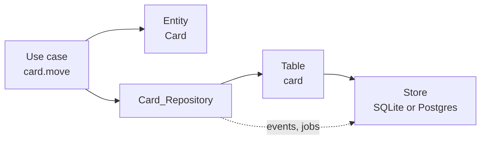

# Repositories and stores

<p class="chapter-lead">Somewhere, your entities have to be written down and read back. This
chapter shows where that happens in newt, and only there: the repository. By the end you can
write one, query it with criteria, save several rows as one, and pick the store a context runs on.</p>

## The problem

Picture cooper's card module a year from now, written without a rule about storage. The use
case `move` runs an `UPDATE card SET column_id = ?`. A worker that indexes cards for the search
runs its own `SELECT * FROM card`. The backoffice counts cards with a raw query on the boards
database. A test inserts rows straight into the table to set things up.

Each of those lines is reasonable on its own. Together they mean nobody can answer simple
questions. Which code changes a card? Which code forgets to filter by workspace? If the table
gets a new column, or moves from SQLite to Postgres, what breaks? The answer is "anything,
anywhere".

There is a second, quieter problem. A card's save is not only a row: it is a version check (did
someone else move this card a moment ago?), the events the card tells, and the jobs those events
start. If any code can write a row, any code can write it without those.

## The idea

newt draws one line: **only the repository touches the store.** Each module has one repository,
`<M>_Repository`, in `<m>.repository.ts`. It turns rows into entities and entities into rows. It
is the only file of the module that knows a table exists.

::: info Concept: Repository
The one place a module reads and writes its entities. It hides how they are stored (a table, a
JSON file, two tables) behind methods named in the domain's words: `inColumn(columnId)`,
`persistNew(card)`. Use cases ask it for entities and hand entities back; they never see a row.
:::

::: info Concept: Store
Where a context keeps its data: a SQLite file, a folder of JSON files, a Postgres or MySQL
database. Each context owns exactly one store, and no other context opens it. In newt the store
is a **port** (`Store`, in `newt-kit/port-store`), and each kind of database is an **adapter** that
implements it.
:::



The use case works with entities. The repository works with a `Table`, which works on the
store. Everything below the repository is the same for every module; everything above it
speaks the domain.

## In cooper: the board repository

Here is the whole repository of cooper's boards, from
`cooper/backend/contexts/boards/modules/board/board.repository.ts`, trimmed a little:

```ts
import { TableRepository } from 'newt-kit/repository'
import type { BoardsBase } from '../../boards-base'
import { currentWorkspaceId } from '../../workspace-scope'
import { Board, type BoardDTO } from './board'
import { BoardNameTaken } from './errors/board-name-taken'

/** Its row: the board, its version, and when it was archived (soft deleted). */
export type BoardRow = BoardDTO & { version: number, deletedAt: string | null }

export class Board_Repository extends TableRepository<Board, BoardRow, BoardsBase> {

  constructor(base: BoardsBase) {
    super(base, base.store.table<BoardRow>('board', { unique: [['workspaceId', 'name']] }), {
      // Archiving stamps `deletedAt`: an archived board is in no list, and its name is free again.
      softDelete: true,
      // Every find, count and page sees the current workspace's boards only.
      scope: { field: 'workspaceId', current: currentWorkspaceId },
    })
  }

  protected toEntity(row: BoardRow): Board {
    return Board.fromDTO(row)
  }

  // … persistWithNameFree, recentInEveryScope, purgeWorkspace
}
```

Four things are said here, and each one matters.

1. **The row type.** `BoardRow` is the entity's DTO plus a `version`, and here a `deletedAt`.
   A row is all of the entity's fields; newt keeps the version for you.
2. **The table.** `base.store.table<BoardRow>('board', …)` asks the context's store for a
   `Table`. The options are said in the same words for every store: `unique` lists the fields
   no two live rows share, `types` the fields a store cannot keep as they are (SQLite keeps a
   boolean as `0` or `1`, and JSON as text).
3. **The options.** `softDelete` and `scope`, below.
4. **`toEntity`.** The one method you must write: how a row becomes an entity. Almost always
   `Board.fromDTO(row)`.

The fields are camelCase in TypeScript (`workspaceId`) and snake_case in SQL (`workspace_id`);
the SQL adapters translate. You never write a column name outside a migration.

## What `TableRepository` gives you

`TableRepository` is the repository whose entities are the rows of one table. Say how a row
becomes an entity, and the rest comes done.

| Method | Does |
|---|---|
| `find(criteria?, options?)` | The entities that meet the criteria, by id unless `orderBy` says otherwise. |
| `first(criteria?, options?)` | The first of those, or `undefined`. |
| `count(criteria?)` | How many there are. |
| `page(criteria, page, { newestFirst? })` | A `Page` of them, by id, with a cursor. |
| `persist(...entities)` | Saves them, and what they tell, at once: all or none. |
| `toRow(entity)` / `toChanges(entity)` | How an entity becomes a row, and its changes an update. Override when rows differ. |
| `save(entities, write, hooks)` | *Protected.* A save with `before`, `after` and `guard`. |
| `saveRows(write, { guard })` | *Protected.* Rows of no entity, written as a save. |
| `purge(criteria)` | *Protected.* Removes rows for good, in every scope. |
| `findInEveryScope(criteria?, options?)` | *Protected.* Reads across scopes, on purpose. |

`find`, `first`, `count` and `page` are public, so a module's use cases can call them with plain
criteria. Everything that writes, or that crosses a tenant, is protected: the repository wraps it
in a method whose name says what it does.

`page` orders by id. Ids are UUIDv7, so that is the order they were created in; the cursor of a
page is the id of the last item of the page before. With `newestFirst` it walks the other way.
The board module lists a workspace's boards like this:

```ts
@UseCase()
async list(page: PageRequest): Promise<Page<BoardDTO>> {
  return mapPage(await this.repo.page({}, page, { newestFirst: true }), board => board.toDTO())
}
```

There is no `where workspaceId = ?` in sight. That is the scope.

## Every repository says its scope

A multi-tenant application has one bug that matters more than any other: a person of one
workspace sees another's data. newt makes the filter impossible to forget by making you say it
in the constructor, every time.

```ts
scope: { field: 'workspaceId', current: currentWorkspaceId }
```

With a scope, `find`, `first`, `count` and `page` see only the current workspace's rows, and a
save refuses an entity of another workspace. `current` reads the workspace scope a route, a
worker or a script entered; outside one it throws, so code that forgot to enter a workspace fails
loudly instead of reading everyone's rows.

Some rows belong to no tenant. A person belongs to many workspaces; a session is a person's; an
OAuth client is auth's. Those repositories say `scope: 'none'`, with a comment that says why.
From `cooper/backend/contexts/auth/modules/user/user.repository.ts`:

```ts
constructor(base: AuthBase) {
  // No scope: people belong to no tenant; they are in many.
  super(base, base.store.table<UserRow>('user'), { scope: 'none' })
}
```

The option is required: leaving it out does not compile. So dropping a scope is never an
accident; it is writing `'none'` where a reviewer will read it.

::: danger Never
Never drop a scope to make something work. A repository that must read across workspaces on
purpose (the backoffice looking at every board) calls the protected `findInEveryScope`, behind a
method named so: `recentInEveryScope(limit)` in cooper's `Board_Repository`. Saving an entity of
another scope throws `… belongs to workspaceId '…', not to the current one`.
:::

Scopes, how they are entered, and how a test proves isolation are the subject of
[Tenants and scopes](./22-tenants).

## Criteria

You ask a repository for rows with **criteria**: a plain object that says what a row must be
like. Every store understands it: SQLite and Postgres turn it into a `WHERE`; the files store
checks each row.

```ts
// A field set to a value must equal it; null is "has none".
await this.repo.find({ boardId, assigneeId: null })

// A field set to a condition must pass every operator in it.
await this.repo.count({ name: { ieq: 'roadmap' }, id: { ne: boardId } })

// Groups nest: `or` is at least one, `and` is every one.
await this.repo.find({ boardId, or: [{ position: { lt: 3 } }, { assigneeId: userId }] })
```

The operators are `eq`, `ne`, `in`, `gt`, `gte`, `lt`, `lte` and `ieq`. Two deserve a word:

- `ne` includes `null`: `{ assigneeId: { ne: null } }` means "has one".
- `ieq` is equality whatever the case of A to Z, as SQL's `lower()` compares: `Acme` and `acme`
  are equal, `Ä` and `ä` are not. cooper's board names are unique this way, and the unique
  index in its migration uses `lower(name)` so the database agrees.

A field left `undefined` is no condition at all. That makes optional filters free of `if`s:

```ts
// From board.module.ts: `id` is ignored when there is no id to leave out.
await this.repo.count({ name: { ieq: name }, id: exceptId === undefined ? undefined : { ne: exceptId } })
```

To combine two criteria, use `allOf(a, b)` from `newt-kit/core`. `TableRepository` itself uses it to
add the scope and the soft delete to whatever you ask.

::: details Under the hood: what criteria cannot say
Criteria compare fields to values. They do not join tables, group, or look inside a JSON field.
For those, a repository on a SQL store asks Kysely (`newt-kit/kysely`), still inside the repository.
cooper's `Card_Repository.countByBoard` groups cards by board with Kysely, and adds
`.where('workspaceId', '=', currentWorkspaceId())` itself: Kysely does not know about scopes.
`whereOf(store, criteria)` turns criteria into a Kysely `where`. See [Queries](./25-queries).
:::

### Filters a client sends

A client may want to filter a list too: the cards of one column, assigned to someone. Taking
criteria straight from a request would let anyone query any field with any operator. Instead a
module declares, in its schema, what a client may filter by: `defineFilter`, from `newt-kit/contract`.
From `cooper/backend/contexts/boards/modules/card/card.schema.ts`:

```ts
/** What a client may search cards by: these fields, these operators, nothing else. */
export const CardFilter = defineFilter({
  board: { field: 'boardId', value: z.string(), ops: ['eq', 'in'] },
  column: { field: 'columnId', value: z.string(), ops: ['eq', 'in'] },
  assignee: { field: 'assigneeId', value: z.string(), ops: ['eq', 'in'] },
  number: { field: 'number', value: z.number().int(), ops: ['eq'] },
}, { maxDepth: 2, maxConditions: 10 })
```

A client sends `{ field: 'column', op: 'in', value: ['…'] }`, or groups of them in `and` and `or`.
`CardFilter.schema` parses it (a 400 for anything else, or a filter nested too deep), and
`CardFilter.toCriteria` turns it into criteria. auth's user list does both in one line:

```ts
const criteria = filter === undefined ? {} : UserFilter.toCriteria<UserRow>(UserFilter.schema.parse(filter))
```

## Saving: one save, one transaction

`persist` saves entities and what they have to tell, all of them or none:

```ts
@UseCase()
async archive(id: string): Promise<void> {
  const board = await this.load(id)
  board.archive()
  await this.repo.persist(board)
}
```

Inside, a lot happens, in one transaction:

1. Each entity is written: inserted if new, updated if changed, deleted (or, with `softDelete`,
   stamped `deletedAt`) if deleted. One with nothing to save is not written.
2. Each update checks the version the entity was read at. If someone saved it since, the save
   throws `ConcurrencyConflict`, and the use case runs again (see
   [Concurrency](./20-concurrency)).
3. The events each entity tracked are published: their `handler` jobs are written to the outbox
   in the same transaction ([Domain events](./09-events)).
4. On commit, each entity is one version on. On rollback, each is put back as it was.

This is golden rule 5: **a transaction is one save**, never a whole use case. A use case that
needs several modules to change does not open a transaction around them; it saves its own
entity, and the others react to its event.

::: danger Never
Never call `store.transaction` in a module. The lint refuses it (`no-restricted-syntax`): write
through `persist`, `save` or `saveRows`. Saving a second module inside the same transaction (a
save hook calling another module) throws `[write rule] … one module per transaction`.
:::

### Rules over several rows: hooks

A version protects one row. Some rules span several: a workspace has one board of each name; a
board holds at most `MAX_CARDS` cards. For those, the protected `save` takes hooks. Here is how
cooper keeps board names unique, whatever two people do at once:

```ts
async persistWithNameFree(board: Board): Promise<void> {
  const { workspaceId, name } = board
  await this.save([board], each => this.write(each), {
    guard: [`boardName:${workspaceId}:${name.replace(/[A-Z]/g, letter => letter.toLowerCase())}`],
    after: async () => {
      if (await this.count({ name: { ieq: name } }) > 1) throw new BoardNameTaken(name)
    },
  })
}
```

`after` runs once the board is written, inside the transaction, and throws to roll it all back.
`guard` names what the rule protects, so no other save guarding the same key runs in between,
on any store. `before` writes what must go first. That is the short version; the long one, with
counters, positions and `this.conflict()`, is [Concurrency](./20-concurrency).

::: warning Watch out
A save that reads rows in its transaction must name a guard, or say `guard: []` to declare none is
needed. Otherwise newt throws `[guard rule] … reads … in a save that guards nothing`, on every
store, even SQLite where it would happen to work.
:::

### Rows that are no entity's

Some rows are not entities: a counter, a search index, a list of refresh tokens a grant spent.
`saveRows` writes them as a save does, in one transaction, under the same rules. And `purge`
removes rows for good, across scopes, for data that will tell nothing: a deleted workspace's
boards. From `cooper/backend/contexts/boards/modules/card/card.repository.ts`:

```ts
/** Removes every card of a workspace, and its boards' counters, for good. */
async purgeWorkspace(workspaceId: string): Promise<void> {
  await this.saveRows(async () => {
    await this.purge({ workspaceId })
    await this.counters.deleteMany({ workspaceId })
  })
}
```

A repository may hold more than one table: `Card_Repository` keeps a `card_counter` table beside
its cards, and auth's `Token_Repository` a `token_spent_refresh` table, written inside its own
`write` override. They are still that module's tables, and nobody else touches them.

## The store

The `Store` port is small. Its whole interface, from `packages/newt/port-store/store.ts`:

```ts
export interface Store {
  transaction<T>(fn: () => T | Promise<T>): Promise<T>
  guard(keys: string[]): Promise<void>
  afterCommit(fn: () => void): void
  afterRollback(fn: () => void): void
  table<Row extends StoredRow>(name: string, options?: TableOptions<Row>): Table<Row>
  readonly outbox: Outbox
  readonly migrations: Migrations
  close(): Promise<void>
}
```

Every adapter promises the same things: a transaction is all or nothing, outbox jobs included;
the current transaction follows the code across `await`s; transactions that guard the same key
never interleave; a stored row keeps its version. The repository builds on those promises, so it
moves from one store to another unchanged.

| Store | Package | Good for |
|---|---|---|
| `SqliteStore` | `newt-kit/adapter-sqlite` | Development, tests (`:memory:`), and a single server in production. |
| `FileStore` | `newt-kit/adapter-files` | Plain JSON files: tiny tools, no SQL. |
| `PostgresStore` | `newt-kit/adapter-postgres` | Several instances sharing one database. |
| `MySqlStore` | `newt-kit/adapter-mysql` | The same, on MySQL. |

A context picks its store when it opens. cooper picks by the address in its configuration, in
`cooper/backend/shared/open-store.ts`:

```ts
export function openStore(database: string, migrations: string): Promise<CooperStore> {
  return isPostgres(database)
    ? PostgresStore.open({ url: database, migrations: join(migrations, 'postgres') })
    : SqliteStore.open({ path: database, migrations: join(migrations, 'sqlite') })
}
```

Choosing between them, and what each one needs, is [Stores](./26-stores).

## Migrations

A store's structure changes through migrations: SQL files, one pair per change, in a folder per
dialect. Each of cooper's contexts has its own:

```text
cooper/backend/contexts/boards/migrations/
  sqlite/
    00001_board_up.sql
    00001_board_down.sql
    00002_column_up.sql
    …
  postgres/
    00001_board_up.sql
    …
```

A migration is named `<version>_<name>`, the version zero-padded. `open` applies every pending
one before anything reads the store, then newt's own (the outbox's `job` table, the schedules'
`schedule_tick`). `connect` opens the store as it is, for a script that migrates by hand.

```sql
-- cooper/backend/contexts/boards/migrations/sqlite/00001_board_up.sql
CREATE TABLE board (
  id TEXT PRIMARY KEY,
  workspace_id TEXT NOT NULL,
  name TEXT NOT NULL,
  description TEXT NOT NULL,
  created_at TEXT NOT NULL,
  updated_at TEXT NOT NULL,
  deleted_at TEXT,
  version INTEGER NOT NULL
);
-- A name is a workspace's once, whatever its case (A to Z, as `lower` and `ieq` compare).
CREATE UNIQUE INDEX board_name ON board (workspace_id, lower(name)) WHERE deleted_at IS NULL;
```

Note the partial unique index: unique among live rows only, so an archived board's name is free
again. The index is the last word on uniqueness; a row that breaks it is a `DuplicateValue`.

::: danger Never
Never edit a migration that has been applied. newt keeps each one's checksum, and refuses to open
a store whose applied script changed. A change of shape is a **new** file, in every dialect the
context runs on.
:::

## Recap

- Only the repository touches the store. Use cases see entities, never rows.
- `TableRepository` needs a table, its options and `toEntity`; it gives `find`, `first`, `count`,
  `page` and `persist`.
- Every repository says its `scope`: `{ field, current }` for a tenant's rows, or `'none'` with a
  reason.
- Criteria are plain objects with `eq, ne, in, gt, gte, lt, lte, ieq`, `and`, `or`, combined with
  `allOf`. Clients filter only through `defineFilter`.
- A transaction is one save. Rules over several rows go in `after`, under a narrow `guard`.
- A context has one store (SQLite, files, Postgres, MySQL), migrated by its own folder per dialect
  as it opens.

## Going further

- [Concurrency](./20-concurrency): versions, guards, `before` and `after`, `this.conflict()`.
- [Tenants and scopes](./22-tenants): defining a scope, entering it, testing isolation.
- [Queries](./25-queries): Kysely in a repository, `whereOf`, pages and their limits.
- [Stores](./26-stores): choosing a store, Postgres and MySQL, writing an adapter.
