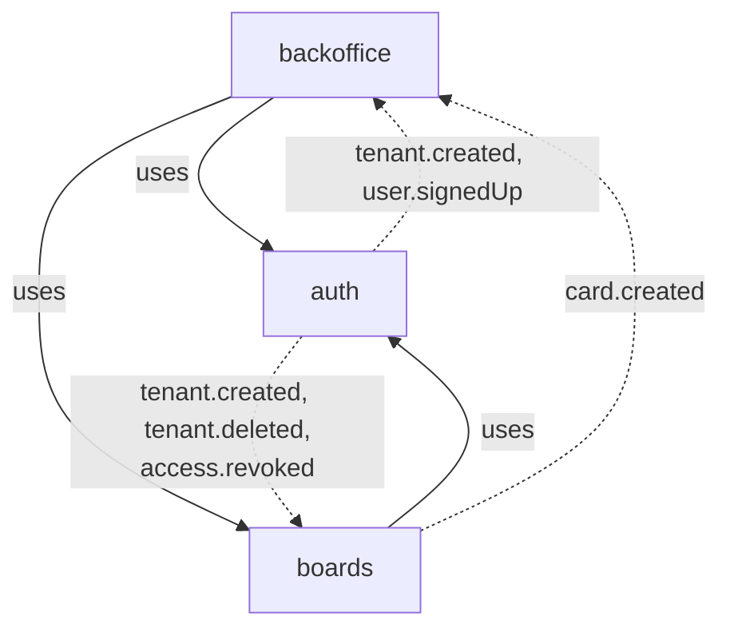
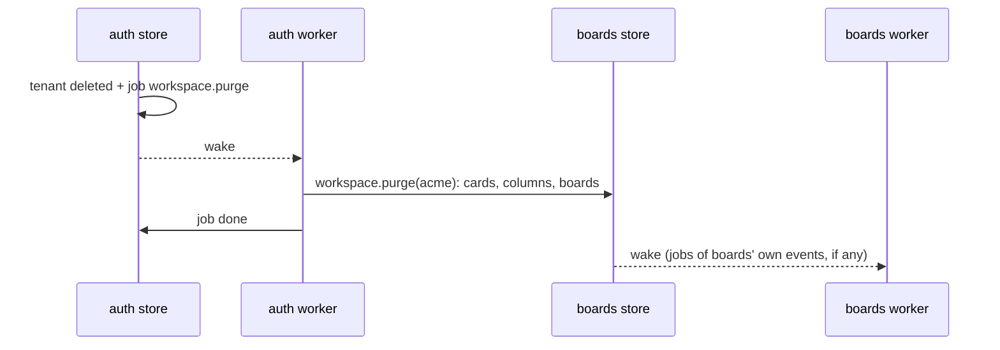
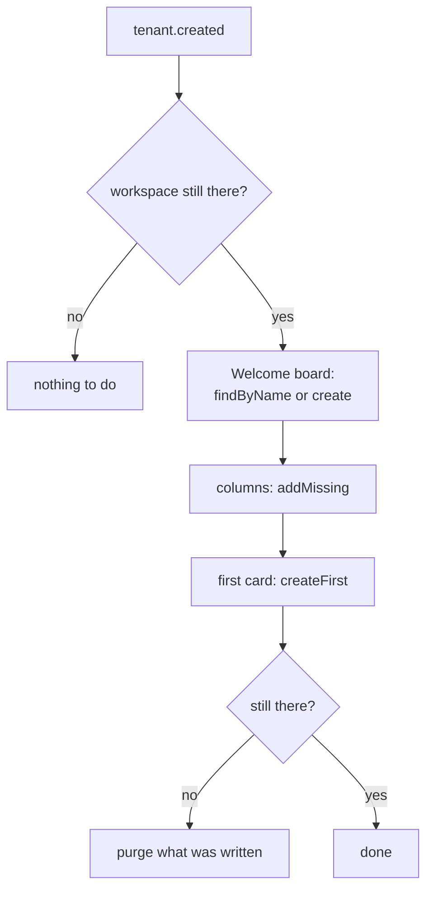

# Contexts working together

<p class="chapter-lead">A real application is several bounded contexts, and they need each other:
boards asks auth who belongs to a workspace, and must clean up when auth deletes one. This chapter
shows how one context calls another's use cases, hears its events, and runs work that spans both,
without the two tangling. Afterwards you can wire contexts the way cooper does.</p>

## The problem

cooper has three contexts. **auth** knows people, workspaces (it calls them tenants) and who may
enter what. **boards** keeps each workspace's boards, columns and cards. **backoffice** is the
staff's console, which reads both.

boards needs auth all the time. A request under `/api/workspaces/acme` must check that the person
belongs to acme. An assignee must be a member. When auth deletes a workspace, every board of it
must go; when auth creates one, it should get a welcome board.

There are tempting shortcuts. boards could open auth's database and read the `access` table. It
could get a function `isMember(w, u)` that someone wires to auth. auth could call boards when it
deletes a tenant. Each shortcut works on day one. Each one hides a dependency, or turns two
contexts into one ball, where neither can change without the other.

## The idea

Contexts depend on each other as a **tree**, and each one reaches another only through that one's
**modules**: its use cases, its events, its schemas and errors. Never its store, never its tables.



Solid arrows are calls: boards calls auth's use cases, the backoffice calls both. Dotted arrows are
events: each context hears the events of the contexts it uses. auth uses nobody; it never calls
boards. When auth deletes a workspace it says so, `tenant.deleted`, and boards reacts.

::: info Concept: Context dependency
A context **uses** another when its modules call that one's use cases or hear its events. Uses go
one way only: if boards uses auth, auth knows nothing of boards. The tree says the order contexts
open in (the used first) and keeps them from forming a cycle.
:::

## Another context's modules are deps

A module lists what it needs in its `<m>.deps.ts`. Another context's modules are there as its own
context's are, grouped under the other context's name. From
`cooper/backend/contexts/boards/modules/card/card.deps.ts`:

```ts
import type { Access_Module } from '../../../auth/modules/access/access.module'
import type { Board_Module } from '../board/board.module'
import type { Column_Module } from '../column/column.module'
import type { Member_Module } from '../member/member.module'

export interface Card_Deps {
  /** That a card's board exists, in the current workspace. */
  board: Board_Module
  /** That a card's column exists, and is of its board; and where cards left in a removed column go. */
  column: Column_Module
  /** That a card's assignee belongs to its workspace, and where to write to them. */
  member: Member_Module
  /** auth taking someone's access away: their cards are left unassigned. */
  auth: {
    access: Access_Module
  }
}
```

The module calls them as it calls its own: `this.deps.auth.access.check(…)`, and hears
`deps.auth.access.events.revoked`. The imports are `import type`: a module never builds another,
it is handed it.

boards keeps one module whose job is to ask auth: `member`. Everything else in boards asks
`member`, not auth directly. From `cooper/backend/contexts/boards/modules/member/member.module.ts`:

```ts
/**
 * Who belongs to each workspace, as `boards` asks it: the module that knows,
 * asked every time, never written in the actor. It keeps nothing: auth keeps the
 * workspaces (tenants of the product `cooper`) and who has access to each, and this
 * module asks it.
 */
export class Member_Module extends Module {
  // …
  @UseCase()
  async enter(workspaceId: string): Promise<WorkspaceScope> {
    if (!await this.belongs(workspaceId, currentActor().userId)) throw new WorkspaceNotFound(workspaceId)
    return { workspaceId }
  }

  private async belongs(workspaceId: string, userId: string): Promise<boolean> {
    const [granted, alive] = await Promise.all([this.deps.auth.access.check(userId, WORKSPACES_PRODUCT, workspaceId), this.isThere(workspaceId)])
    return granted !== null && alive
  }
}
```

It asks every time. Membership is never copied into the session or the actor: someone removed from
a workspace is out at their next request.

::: danger Never
Never wrap another context's use cases in a port of functions:
`{ isMember: (w, u) => auth.access.check(…) }`. It compiles and it works, but the dependency is gone
from everything that reads the code: the lint, newt-graph, `describeApplication` and newt-monitor
all lose it. A port is for what is no module of the application (a mailer, a search engine).
Another context's module is a dep, under that context's name.
:::

## The context that opens hands them over

Who builds a module gives it its deps. Each context's `initialize-modules.ts` builds its modules,
each after those it uses, and takes the other contexts' modules as an argument. From
`cooper/backend/contexts/boards/initialize-modules.ts`:

```ts
/** auth's modules `boards` uses. */
export type Boards_Auth = Pick<Auth_Modules, 'token' | 'user' | 'tenant' | 'access' | 'invitation'>

export function initializeModules(base: BoardsBase, config: Boards_Config, deps: Boards_ModuleDeps) {
  // …
  const { user, tenant, access, invitation } = deps.auth
  const member = Member_Module.initialize(base, { auth: { access, tenant, user } })
  const board = Board_Module.initialize(base, { member })
  const column = Column_Module.initialize(base, { board, member })
  const card = Card_Module.initialize(base, { board, column, member, auth: { access } }, { mailer: deps.mailer, publicUrl: config.publicUrl, search: deps.search })
  const workspace = Workspace_Module.initialize(base, { board, column, card, member, auth: { tenant, access, invitation, user } })
  // …
}
```

`Boards_Auth` picks exactly the auth modules boards may reach. And the application opens the
contexts in the order of the tree, each handing its modules to those that use it. From
`cooper/backend/open-contexts.ts`:

```ts
export async function openContexts(config: Config, options: OpenContextsOptions = {}) {
  const mailer = options.mailer ?? new ConsoleMailer(config.mail.from)
  const { clock } = options
  const auth = await Auth_Context.open(config.auth, { mailer }, clock)
  const boards = await Boards_Context.open(config.boards, { auth: auth.modules, mailer, search: new MemoryCardSearch(), /* … */ }, clock)
  const backoffice = await Backoffice_Context.open(config.backoffice, { auth: auth.modules, boards: boards.modules }, clock)
  return { auth, boards, backoffice, all: [auth, boards, backoffice] as const }
}
```

auth first, which uses nobody. Then boards, given auth's modules. Then the backoffice, given both.
Nobody is handed a base or a store: another context is reached through its modules only.

## The lint keeps the tree

Which contexts a context may know is said once, in the lint's configuration. From the repository's
`eslint.config.js`:

```js
const BACKEND = newt({
  root: import.meta.dirname,
  files: ['cooper/backend/**/*.ts', 'cooper/scripts/**/*.ts'],
  contexts: { folder: 'cooper/backend/contexts', uses: { auth: [], boards: ['auth'], backoffice: ['auth', 'boards'] } },
})
```

`newt/context-boundaries` refuses an import from a context `uses` does not list: auth importing
anything of boards fails the lint. And newt-kit-eslint refuses a `uses` that is not a tree: a cycle
fails before any file is linted, naming it (`auth → boards → auth`).

Inside the other context, the usual module boundary holds too (`newt/module-boundaries`): boards may
import auth's module, schema, events, errors and value objects, never its repository or entity.

## Hearing another context's events

A module subscribes to another context's events exactly as to its own. From
`cooper/backend/contexts/boards/modules/workspace/workspace.workers.ts`:

```ts
export function registerWorkspaceWorkers(workspace: Workspace_Module, deps: Workspace_Deps): void {
  deps.auth.tenant.events.created.subscribe(tenant => workspace.prepare(tenant.id), {
    strategy: 'handler',
    queue: 'workspace.prepare.on.tenant.created',
  })
  deps.auth.tenant.events.deleted.subscribe(tenant => workspace.purge(tenant.id), {
    strategy: 'handler',
    queue: 'workspace.purge.on.tenant.deleted',
    attempts: 10,
  })
}
```

`when` with a type guard is handy here, because another context's event is often broader than what
you care about. auth tells every access it revokes, to any product; boards only cares about
workspaces, from `card.workers.ts`:

```ts
deps.auth.access.events.revoked.subscribe(access => cards.unassignMember(access.tenantId, access.userId), {
  strategy: 'handler',
  queue: 'card.unassignMember.on.access.revoked',
  when: (access: AccessDTO): access is AccessDTO & { tenantId: string } => access.productId === WORKSPACES_PRODUCT && access.tenantId !== null,
})
```

The guard narrows the handler's payload: `access.tenantId` is a `string` there, not
`string | null`.

### Whose worker runs it

A `handler`'s job is written in the transaction of the save that tells the event, so it lands in
**that** save's store. `tenant.deleted` is told in auth's store: the job of
`workspace.purge.on.tenant.deleted` is in **auth's outbox**, and **auth's worker** runs it. It
calls boards' use case, which saves in boards' store; those saves tell boards' events, whose jobs
are in boards' outbox.



Two consequences. A test that waits for "the background work" waits for auth's jobs first, then
boards'. And an application stops every context's worker before it closes any store: auth's worker
may be writing boards' rows.

## Sagas: a workspace comes and goes

Ana creates the workspace acme. A moment later, acme should have a board in boards: *Welcome*, with
*To do*, *Doing* and *Done*, and a first card. When acme is deleted, everything acme had in boards
should go.

Neither is one save. The welcome board is a board, three columns and a card: four saves in three
modules. No transaction can hold them all; each module saves in its own. A piece of work made of
steps, each in its own transaction, is a **saga**.

::: info Concept: Saga
Work that spans several saves, often several modules or contexts, started by an event and run by a
worker until it completes. It holds together because of two things at once: the worker runs it
again until it succeeds, and each step finds what an earlier run did, so running again
**converges** on the same end.
:::

cooper's `workspace` module in boards keeps no table of its own. It reacts to auth's events and puts
boards' other modules to work. From `cooper/backend/contexts/boards/modules/workspace/workspace.module.ts`:

```ts
/**
 * A new workspace gets its welcome board … A worker calls it once auth created the
 * workspace (eventual consistency: for a moment, the workspace has no board), and it
 * writes in three modules, which only a worker may: if it fails halfway, its job runs it
 * again. Each step looks for what an earlier run did first …
 */
@UseCase()
async prepare(workspaceId: string): Promise<void> {
  if (!await this.deps.member.exists(workspaceId)) return
  await runInWorkspace(workspaceId, async () => {
    const board = await this.deps.board.findByName(WELCOME_BOARD.name)
      ?? await this.deps.board.create({ name: WELCOME_BOARD.name, description: WELCOME_BOARD.description })
    const [todo] = await this.deps.column.addMissing(board.id, [...WELCOME_BOARD.columns])
    await this.deps.card.createFirst(board.id, { columnId: todo.id, ...WELCOME_BOARD.card })
  })
  if (!await this.deps.member.exists(workspaceId)) await this.purge(workspaceId)
}

/** auth deleted a workspace: its cards, columns and boards go, in that order. */
@UseCase()
async purge(workspaceId: string): Promise<void> {
  await this.deps.card.purgeWorkspace(workspaceId)
  await this.deps.column.purgeWorkspace(workspaceId)
  await this.deps.board.purgeWorkspace(workspaceId)
}
```

Read `prepare` as steps, each of which asks before it makes:



- **Each step finds what an earlier run did.** If `prepare` failed after the board and one column,
  its job runs again from the top: `findByName` finds the board, `addMissing` adds only the columns
  missing, `createFirst` creates a card only if the board has none. A run over a finished board
  adds nothing.
- **Two runs at once** both look and find nothing. Each step's save checks again in its
  transaction: a unique index on the board's name, a count of columns of that name, a count of the
  board's cards. The loser gets a conflict, the use case runs again from the top, and finds what
  the winner made.
- **A job that runs late** may run after the workspace was deleted and purged. So `prepare` asks
  first whether the workspace is still there, and again at the end: if it went while `prepare`
  ran, it purges what it wrote. Whichever order the two jobs run in, a deleted workspace ends with
  nothing.
- **The purge converges.** Each part removes what is left. Run again after a failure halfway, it
  finishes; run over a workspace with nothing, it does nothing.

`prepare` writes into three modules that are not its own. From a request, the write rule would
refuse it; from a worker, it is allowed. cooper's test shows both, in `workspace.test.ts`:

```ts
await expect(inAcme(() => t.modules.workspace.prepare('acme'))).rejects.toThrow('[write rule] workspace.prepare writes to boards.board outside a worker: …')

// What a script does by hand, as the worker of `tenant.created` would.
await t.boards.base.jobs.runAsWorker(() => t.modules.workspace.prepare('acme'))
```

The deletion is a saga across contexts too. auth's `tenant.delete` marks the tenant deleted and
takes its accesses away. Then `tenant.deleted` sets the rest going, each from a worker: auth revokes
the workspace's invitations and removes any access left; boards purges its boards, columns and
cards; boards' activity purges its log. None of them knows about the others.

## Reading two contexts: the backoffice

The backoffice keeps almost nothing. Its screens are put together from the use cases of the
contexts that know. From `cooper/backend/contexts/backoffice/modules/workspace/workspace.module.ts`:

```ts
/** The boards created last across every workspace, each with its workspace's name: two calls. */
@UseCase()
async recentBoards(): Promise<RecentBoardDTO[]> {
  const boards = await this.deps.boards.board.recentInEveryWorkspace(RECENT_BOARDS)
  const tenants = new Map((await this.deps.auth.tenant.getMany([...new Set(boards.map(board => board.workspaceId))])).map(tenant => [tenant.id, tenant.name]))
  return boards.map(board => ({ id: board.id, name: board.name, workspaceId: board.workspaceId, createdAt: board.createdAt, workspaceName: tenants.get(board.workspaceId) ?? null }))
}
```

Two calls, one per context, never one per row: boards' recent boards, then auth's tenants by id, in
one `getMany`. Reads are fine from anywhere; it is writes that the write rule watches. The
`Backoffice_ModuleDeps` type picks exactly which modules of each context it may reach.

<figure class="screenshot">
  
  
  <figcaption>The backoffice: workspaces from auth, boards and cards from boards, put together by use cases.</figcaption>
</figure>

## Recap

- Contexts depend on each other as a tree, opened in its order; the lint's `contexts.uses` says it
  and refuses cycles.
- Another context's modules are deps, grouped under that context's name: `auth: { access }`.
- The context that opens hands its modules to those that use it; nobody gets another's store.
- Never wrap another context's use cases in a port of functions: the dependency disappears.
- A context hears another's events like its own; the job is in the publisher's outbox, run by its
  worker.
- A saga is steps from a worker, each finding what an earlier run did, so runs converge.

## Going further

- [Tenants and scopes](./22-tenants): who belongs where, and entering a workspace from a worker.
- [Idempotency](./24-idempotency): steps that run twice, at once, or late.
- [Authentication](./29-auth): how auth signs people in for the other contexts.
- [The structure](./42-structure): seeing contexts, modules and their dependencies in newt-monitor.
