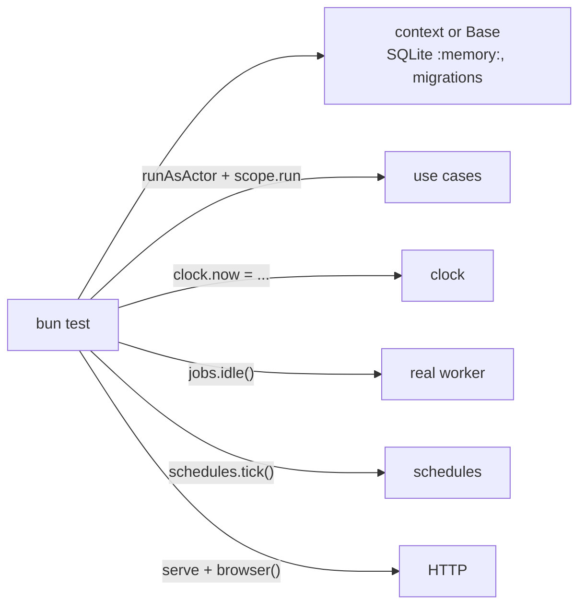

# Testing

<p class="chapter-lead">The rules of the earlier chapters only pay off if you can prove them: that
two people at once get distinct card numbers, that a job run twice sends one email, that another
workspace sees nothing. This chapter shows how to test a newt application fast and for real, with
no mocks of the framework, and which cases are worth the most.</p>

## The problem

Backend tests usually go wrong in one of two ways. Some mock everything: the repository, the bus,
the clock, until the test proves only that the mocks were called. Others boot the whole stack, a
real database and a broker, and wait for things with `sleep(500)`: slow, flaky, and still unable to
say "now it is three in the morning".

And the bugs that matter in production are rarely the ones a happy-path test finds. They are two
requests at once, a retry, a job that ran late, a person of another tenant. Those are exactly the
cases that are hard to set up.

## The idea

A newt context runs entirely in your test process. Its store is SQLite **in memory**, with the same
migrations as production. Its clock is a function you move. Its worker is real, and you wait for it
with `idle()`, never a sleep. So a test opens the real thing, in milliseconds, and drives it.



Tests sit beside the code (`board.test.ts` next to `board.module.ts`) and run with `bun test`.

## A base for a test

The smallest test opens a `Base` on a store in memory, with its migrations, and a clock of its own:

```ts
import { join } from 'node:path'
import { SqliteStore } from 'newt-kit/adapter-sqlite'
import { Base } from 'newt-kit/runtime'

let time = Date.parse('2027-03-15T12:00:00Z')
const clock = { now: () => new Date(time) }               // move time by hand
const base = new Base({
  name: 'shop',
  store: await SqliteStore.open({ path: ':memory:', migrations: join(import.meta.dir, 'migrations/sqlite') }),
  clock,
})
```

`:memory:` is a temporary file, so it behaves exactly as a file on disk does, transactions and all.
`open` applies the migrations as production does, so a broken migration fails the test too.

Most of the time you open the context itself, as the server does. cooper's auth test, from
`cooper/backend/contexts/auth/auth.test.ts`:

```ts
/** The time by auth's clock: a test moves it instead of waiting. */
let time: number

beforeEach(async () => {
  const mailer = new RecordingMailer()
  mails = mailer.mails
  time = Date.parse('2027-03-15T12:00:00Z')
  auth = await Auth_Context.open({ ...config.auth, database: ':memory:', port: 0 }, { mailer }, { now: () => new Date(time) })
  auth.start()
})

afterEach(() => auth.stop())
```

The mailer is a `RecordingMailer` that keeps every email in a list. That is the one kind of fake
worth having: a port's adapter for what is no module of the application (mail, a search engine). The
framework itself is never mocked.

## Acting as someone, somewhere

A use case reads who acts from `currentActor()` and where from the scope. A test sets both, the way
a route would:

```ts
await runAsActor({ userId: 'ana', via: 'web' }, () =>
  workspaceScope.run({ workspaceId: 'acme' }, () => boards.create({ name: 'Roadmap' })))
```

cooper wraps that in a helper, `as(userId, workspaceId, fn)`, in
`cooper/backend/contexts/boards/testing/open-test-boards.ts`, which also checks membership as a route
does. A board test then reads like the rule it proves. From `board.test.ts`:

```ts
const inAcme = <T>(fn: () => Promise<T>) => t.as('ana', 'acme', fn)
const create = (name: string) => inAcme(() => t.modules.board.create({ name }))

test('gives a name to one board of a workspace, whatever its case; another workspace has its own', async () => {
  await create('Roadmap')

  await expect(create('ROADMAP')).rejects.toMatchObject({ code: 'board.name_taken' })
  expect((await t.as('bea', 'globex', () => t.modules.board.create({ name: 'roadmap' }))).workspaceId).toBe('globex')
})
```

Assert on the error's `code`, not its message: the code is the contract.

## Waiting for workers: `idle()`, never a sleep

After a use case commits, its jobs run on the worker, a moment later. A test waits for them with
`base.jobs.idle()`, which resolves once no job is ready or in progress, including jobs those jobs
wrote:

```ts
// From card.test.ts: `t.settled()` is auth's `idle()`, then boards'.
await inAcme(() => t.modules.card.assign(plan.id, { assigneeId: 'bea' }))
expect(t.mails).toEqual([])
await t.settled()
expect(t.mails.map(mail => [mail.to, mail.subject])).toEqual([['bea@cooper.test', '#1 Plan is yours']])
```

The first `expect` matters as much as the last: the email does not leave from the use case, only
from its job.

When work crosses contexts, wait for each, in the order the work flows. cooper's end-to-end test,
from `cooper/backend/cooper.test.ts`:

```ts
/** Until the background work is done: auth's jobs (boards' reactions to auth's events among them), then boards'. */
async function settled() {
  await contexts.auth.base.jobs.idle()
  await contexts.boards.base.jobs.idle()
}
```

::: danger Never
Never `await Bun.sleep(…)` to wait for a worker. It is slow when the machine is fast and flaky when
it is slow. `idle()` waits exactly as long as the work takes.
:::

### Doing by hand what a worker would

Sometimes you want to call a handler's use case directly: to run it twice, or late, or to prove it
refuses to run outside a worker. `runAsWorker` runs a function as a job runs: no actor, no scope,
and allowed to write into other modules. From `workspace.test.ts`:

```ts
test('refuses to prepare a workspace outside a worker, since it writes in other modules, and prepares it in one', async () => {
  t.auth.join('acme', 'ana')

  await expect(inAcme(() => t.modules.workspace.prepare('acme'))).rejects.toThrow('[write rule] workspace.prepare writes to boards.board outside a worker: …')

  await t.boards.base.jobs.runAsWorker(() => t.modules.workspace.prepare('acme'))
  expect((await inAcme(() => t.modules.board.list({ size: 10 }))).total).toBe(1)
})
```

## Moving time

Anything that depends on time (a session's expiry, an invitation's days, a nightly purge) is
tested by moving the clock, not by waiting. Because the context's clock tells every `now()` its
use cases call, an expiry is one line. From `auth.test.ts`:

```ts
test('ends a session once its days pass by auth\'s clock', async () => {
  const { token } = await modules().session.signUp({ email: 'ana@cooper.test', name: 'Ana', password: 'a long password' })

  time += (config.auth.sessionDays - 1) * DAY_MS
  expect(await modules().session.authenticate(token)).not.toBeNull()
  time += DAY_MS
  expect(await modules().session.authenticate(token)).toBeNull()
})
```

A schedule is ticked by hand with `base.schedules.tick()`: it tells every schedule due by the
clock's now. Stop the schedules' own loop first, so only your tick tells:

```ts
test('removes the expired sessions every night at three, by auth\'s clock', async () => {
  await auth.base.schedules.stop()
  // … sign up, move the clock past the session's days, sign in again
  expect(await sessions()).toBe(2)

  await auth.base.schedules.tick()
  await settled()

  expect(await sessions()).toBe(1)
})
```

More on clocks and schedules in [Time](./23-time).

## Through HTTP

Use cases carry the rules, so most tests call them directly. A few should go through HTTP, to prove
the wiring: the routes, sessions, cookies, status codes. `serve` the context on a free port and talk
to it with `browser()`, from `newt-kit/testing`: a `fetch` that keeps each host's cookies and never
follows a redirect, so the test sees where it goes.

```ts
import { serve } from 'newt-kit/http'
import { browser, freePort } from 'newt-kit/testing'

beforeEach(async () => {
  contexts = await openContexts(testConfig(freePort(), freePort()), { mailer })
  servers = [serve(contexts.auth.serving()), serve(contexts.boards.serving())]
})

afterEach(async () => {
  await Promise.all(servers.map(server => server.stop()))
  await stopContexts(contexts)
})
```

`freePort()` gives a port nobody listens on, for a server that must know its address before it
starts (an OAuth server names itself in its metadata). Then a test signs someone up through the real
pages and calls the API as their browser. From `cooper.test.ts`:

```ts
test('a deleted workspace loses its boards, and nobody enters it', async () => {
  const { ana, bob, acme } = await acmeWithBob()
  await settled()

  expect((await call(ana.as, 'DELETE', `/workspaces/${acme.id}`)).status).toBe(204)
  await settled()

  expect(await contexts.boards.modules.board.listOf(acme.id, { size: 10 })).toMatchObject({ items: [], total: 0 })
  expect((await call(bob.as, 'GET', `/workspaces/${acme.id}/boards`)).status).toBe(404)
})
```

A request's `json` option is sent as the body, with `Content-Type: application/json`. Give
`browser(baseUrl)` a base address to write relative ones.

## Testing the hard cases

A test of the happy path is the least valuable test you will write. For each use case, ask five
questions, and write the test for each that applies.

| Case | How to write it | In cooper |
|---|---|---|
| **At once** | `Promise.allSettled` of many calls; count who won. | Four boards named Roadmap, ROADMAP… created at once: one wins. |
| **Twice** | Call a handler's use case twice with the same event id. | `notifyAssignee` with `event-1` twice sends one email. |
| **Refused** | `rejects.toMatchObject({ code })`. | `board.invalid_name`, `card.too_many`. |
| **Limits** | Fill to the limit, then go past it at once. | `MAX_CARDS - 3` cards, then six at once: three get in. |
| **Another tenant** | The same call as someone of another workspace: expect a 404. | Bea of globex gets `board.not_found` for acme's board. |

"At once" is the one people skip, and the one that finds the bugs. From `board.test.ts`:

```ts
test('gives a name to one of several boards created with it at once, whatever its case', async () => {
  const created = await Promise.allSettled(['Roadmap', 'ROADMAP', 'roadmap', 'RoadMap'].map(create))

  expect(created.filter(each => each.status === 'fulfilled')).toHaveLength(1)
  for (const each of created.filter(each => each.status === 'rejected')) expect(each.reason).toMatchObject({ code: 'board.name_taken' })
})
```

And "twice", from `card.test.ts`:

```ts
test('tells the assignee once, however many times the job of an assignment runs', async () => {
  const { id } = await create('Plan')
  const plan = await inAcme(() => t.modules.card.assign(id, { assigneeId: 'bea' }))

  // The job of one event, run twice (its first run failed after sending), and one of another event.
  await t.modules.card.notifyAssignee(plan, 'ana', 'event-1')
  await t.modules.card.notifyAssignee(plan, 'ana', 'event-1')
  await t.modules.card.notifyAssignee(plan, 'ana', 'event-2')

  expect(t.mails.map(mail => [mail.subject, mail.key])).toEqual([['#1 Plan is yours', 'card.notifyAssignee:event-1'], ['#1 Plan is yours', 'card.notifyAssignee:event-2']])
})
```

::: tip Every repository with a scope gets a test like this
Write one test per module where someone of another workspace tries to read, change and list the
first one's rows, and gets a 404. It is the test that catches a scope dropped by mistake.
:::

::: details Pausing a use case mid-way
To test a race in a precise order ("the column is removed while the card is being moved"), cooper's
`card.test.ts` has a `hold(module, useCase, 'before' | 'after')` helper built on `spyOn`: the next
call of that use case waits until the test releases it. The test starts the first call, waits for
`reached`, does the other thing, then calls `release()`. No timing involved.
:::

## Tests of other contexts: a fake that tells

boards' module tests do not open the real auth: they would need sign-ups and OAuth for every test.
`FakeAuth`, in `cooper/backend/contexts/boards/testing/fake-auth.ts`, is auth's modules as boards
needs them: who belongs to each workspace kept in memory, and auth's events told from a store of its
own, so boards' handlers are jobs of its worker exactly as they are of auth's.

```ts
/** A workspace is deleted, and nobody belongs to it any more: `tenant.deleted`. */
async deleteWorkspace(workspaceId: string): Promise<void> {
  this.members.delete(workspaceId)
  await this.tell(new Tenant_Deleted({ id: workspaceId }))
}

private async tell(event: DomainEvent): Promise<void> {
  await this.base.store.transaction(() => this.base.bus.publish(event))
}
```

Any use case it does not fake refuses with a message pointing at `cooper.test.ts`, which runs the
real auth. So boards' fast tests use the fake, and the end-to-end test proves the real wiring.

## Contract suites for ports

A port is a promise; every adapter of it must keep the same one. newt proves that with a **contract
suite**: one function that describes the tests, which every adapter's test calls.

```ts
// packages/newt/adapter-sqlite/sqlite-store.test.ts
describeStoreContract('SqliteStore', { open })

// packages/newt/adapter-redis/redis-rate-limit-store.test.ts
describeRateLimitContract('RedisRateLimitStore', {
  open: async () => new RedisRateLimitStore({ url: url!, prefix }),
  close: async store => store.close(),
})
```

`describeStoreContract` (from `newt-kit/port-store/contract`) checks transactions, isolation, versions,
criteria, the outbox and what is built on them, on SQLite, files, Postgres and MySQL alike.
`describeRateLimitContract` (from `newt-kit/port-rate-limit/contract`) does the same for rate limit
stores. cooper follows the pattern for its own port: `describeCardSearchContract`, in
`cooper/backend/contexts/boards/search/card-search.contract.ts`, which the memory search runs and
any real search engine would run too.

Suites that need a server skip without one: cooper's `postgres.test.ts` runs only when
`COOPER_TEST_POSTGRES_URL` is set.

## What cooper tests, and what not

- **Every module of boards and backoffice**, through its use cases, on a context opened with
  `openTestBoards` or `openTestBackoffice`: SQLite in memory, a fake auth, recording mailer.
- **auth as a context**, opened for real, its clock moved by hand (`auth.test.ts`, `oauth.test.ts`).
- **cooper end to end** over HTTP: the three contexts opened as the server opens them, a person
  signing up through the real pages, an MCP client connecting through OAuth (`cooper.test.ts`).
- **Its configuration** (`config.test.ts`): defaults, and what production refuses.
- **Postgres**, when there is one.

What it does not test: routes one by one (the end-to-end test covers the wiring), and frontend
components (they are checked by running them; only the frontend's core stores and clients have
tests).

## Recap

- Open the real context: SQLite `:memory:` with its migrations, a clock you move, a recording
  mailer.
- Act with `runAsActor` and `scope.run`; assert on error codes.
- Wait for workers with `base.jobs.idle()`, never a sleep; `runAsWorker` to run a handler by hand.
- Move time with the clock; tick schedules with `base.schedules.tick()`.
- Test HTTP with `serve`, `freePort()` and `browser()` from `newt-kit/testing`.
- Test the hard cases: at once, twice, refused, limits, another tenant.
- Prove every adapter of a port with its contract suite.

## Going further

- [Concurrency](./20-concurrency): what "at once" tests are proving.
- [Time](./23-time): clocks and schedules in depth.
- [Idempotency](./24-idempotency): what "twice" tests are proving.
- [Stores](./26-stores): writing an adapter, and running the store contract against it.
