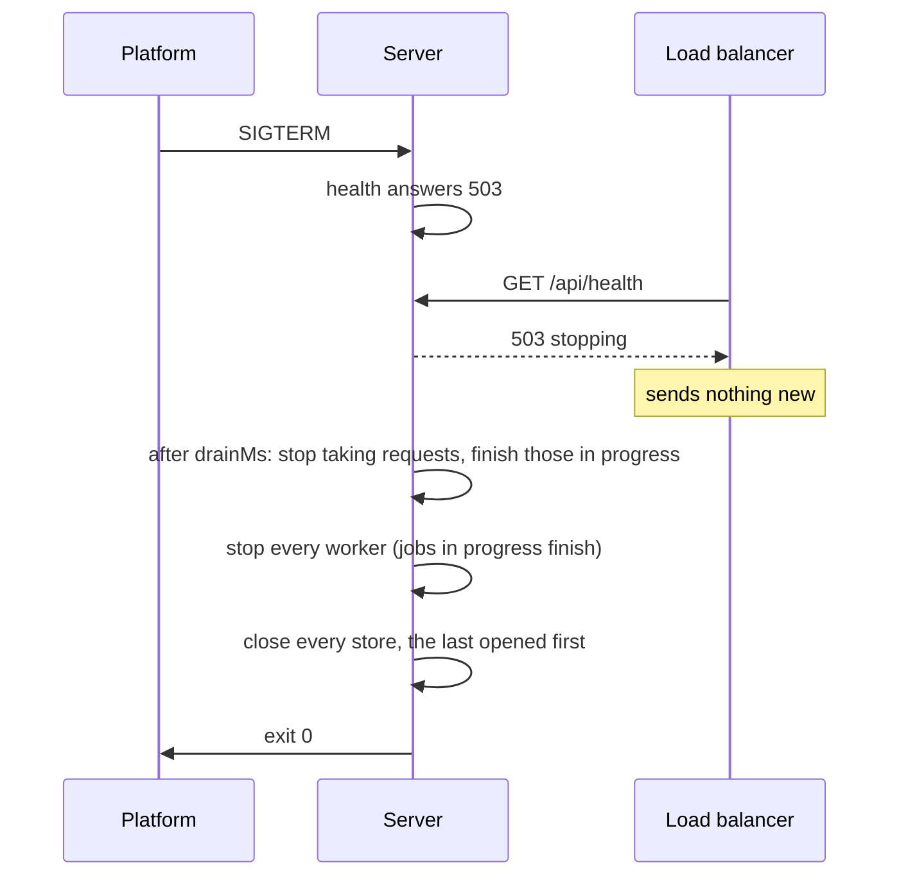

# Running it in production

<p class="chapter-lead">An application that works on your machine still has to start from an
environment, survive deploys, sit behind a proxy and tell you what it is doing. This chapter walks
through how cooper runs in production, piece by piece, and ends with a checklist you can apply to
your own.</p>

## The problem

The first production deploy of a backend is where the defaults bite. A port read as `"3001"` from
the environment, and compared as a number. A development secret, committed to the repository, that
nobody overrode. A deploy that kills the process mid-request, and mid-job. A rate limit that counts
every request as the load balancer's address. A migration that ran on one instance and not another.

None of this is business logic, and all of it must be right.

## The idea

newt's answer is a short list of habits, each one small:

- **Configuration is parsed**, from the environment, with zod: wrong values stop the process before
  it opens anything, and production refuses what is only fit for development.
- **One entry point runs every context**: `runContexts` serves them, starts their workers, and stops
  them in the right order on a signal.
- **Stopping drains**: health answers 503 for a moment, then requests in progress finish, then
  workers, then stores.
- **Migrations are applied as each store opens.**
- **The proxy in front is told about**: how many hops to trust, and whether the public address is
  HTTPS.



## Configuration from the environment

cooper reads every setting in one file, `cooper/backend/config.ts`, with one zod schema over
`process.env`:

```ts
/** An empty variable counts as unset: `COOPER_AUTH_PORT=` is the default port, not port 0. */
const unset = (value: unknown) => (value === '' ? undefined : value)
const variable = <T extends z.ZodType>(schema: T) => z.preprocess(unset, schema)
const port = (fallback: number) => variable(z.coerce.number().int().min(1).max(65_535).default(fallback))
const positive = (fallback: number) => variable(z.coerce.number().int().positive().default(fallback))

const EnvSchema = z.object({
  NODE_ENV: variable(z.string().optional()),
  COOPER_AUTH_PORT: port(3001),
  COOPER_AUTH_PUBLIC_URL: variable(z.url().optional()),
  COOPER_BOARDS_CLIENT_SECRET: variable(z.string().optional()),
  COOPER_AUTH_DATABASE: variable(z.string().default('data/cooper-auth.db')),
  COOPER_DRAIN_MS: positive(2000),
  COOPER_TRUST_PROXY: variable(z.coerce.number().int().min(0).default(0)),
  COOPER_OTLP_URL: variable(z.string().optional()),
  COOPER_MONITOR_KEY: variable(z.string().optional()),
  // … one line per variable
})
```

Every variable has a type and, where development needs one, a default. Development needs nothing set
at all: `bun run cooper` just works. Production is different, and says so in a `superRefine`:

```ts
.superRefine((env, context) => {
  if (env.NODE_ENV !== 'production') return
  for (const name of ['COOPER_BOARDS_CLIENT_SECRET', 'COOPER_BACKOFFICE_CLIENT_SECRET'] as const) {
    const secret = env[name]
    const problem = secret === undefined
      ? 'required in production'
      : secret === devClientSecrets[name]
        ? 'development\'s, which everyone knows: production refuses it'
        : secret.length < MIN_SECRET_LENGTH ? `${MIN_SECRET_LENGTH} characters or more in production` : undefined
    if (problem) context.addIssue({ code: 'custom', path: [name], message: problem })
  }
})
```

`readConfig` collects every problem and throws them together, each one named:

```text
cooper cannot start:
  COOPER_BOARDS_CLIENT_SECRET: required in production
  COOPER_BACKOFFICE_CLIENT_SECRET: development's, which everyone knows: production refuses it
```

The rest of the file turns the flat variables into a shape each context takes (`config.auth`,
`config.boards`, …), with a doc comment on each setting naming its variable. It is tested like any
code, in `config.test.ts`.

::: warning Watch out
A default is a promise that the value is safe everywhere. A secret's default never is: give it one
only for development, and refuse it in production, as cooper does. Anything that must differ per
environment (public addresses, secrets, databases) should be impossible to forget.
:::

## One entry point

cooper's backend is one file, `cooper/backend/index.ts`. Trimmed to its spine:

```ts
import { runContexts } from '@newt-kit/newt/application'
import { config } from './config'
import { cooperTracer, openContexts } from './open-contexts'

const contexts = await openContexts(config)

const app = runContexts(contexts.all.map(context => ({
  context,
  serve: { ...context.serving(), drainMs: config.drainMs, trustProxy: config.trustProxy },
})), { tracer: cooperTracer(config) })
for (const [name, server] of Object.entries(app.servers)) console.log(`${name} listening on ${server.url}`)
```

`openContexts` opens each context after the ones it uses (see
[Contexts working together](./11-between-contexts)). `runContexts`, from `@newt-kit/newt/application`, then:

1. Serves each context that has `serve`, each on its own port.
2. Starts each context's worker and schedules.
3. On `SIGINT` or `SIGTERM`, stops everything in order and ends the process.

The stop order is not a detail. Every server stops first, so no new work comes in. Then every
worker, because a context's worker may be running another context's handler, which writes to that
context's store. Only then each store closes, the last opened first. The metrics, traces and the
tracer flush last.

### Draining

A load balancer only stops sending traffic to an instance once its health check fails. If the
instance just closed, the requests in flight between the two would fail. So `serve`'s `stop()`
first marks the server as stopping: `GET /api/health` answers 503 `{ "status": "stopping" }`. It
keeps answering everything else for `drainMs` (cooper: `COOPER_DRAIN_MS`, 2 seconds). Then it stops
as Bun's server does, waiting for requests in progress; `runContexts` closes any still open after
`stopTimeoutMs`, 10 seconds by default, so a stream that never ends cannot hold a deploy.

Point your platform's health check at `/api/health`. Each cooper context answers it, without a
session.

## Migrations at open

Every context's store applies its pending migrations as it opens, before any module reads it:
`SqliteStore.open` and `PostgresStore.open` both do. A migration whose applied script changed since
stops the open, naming it. So a deploy that brings a new migration needs no extra step.

For looking before you leap, cooper has a script over each store's `migrations` (`status`, `up`,
`down`), which opens the stores with `connect`, migrating nothing:

```sh
bun run cooper:migrations status
bun run cooper:migrations down --context boards
```

With several instances on one database, the first to open applies the migration; the others find it
applied.

## The database

cooper runs on SQLite by default: one file per context, in `/app/data`, which must be a persistent
volume. That is a good production setup for one server. When several instances share the work,
point each context at Postgres instead: `COOPER_BOARDS_DATABASE=postgres://…`, and the context opens
a `PostgresStore` with its `migrations/postgres` folder. Nothing else changes: repositories, guards
and the outbox keep every promise on every store.

With several instances, also share what instances count: cooper's rate limits are counted in each
context's store (`TableRateLimitStore`), and its metrics and traces go to Redis when
`COOPER_REDIS_URL` is set. Choosing a store, and what Postgres and MySQL need, is
[Stores](./26-stores).

## The image

cooper's `Dockerfile` at the repository root builds one image for the whole backend:

```dockerfile
FROM oven/bun:1.4.2-alpine
WORKDIR /app

COPY package.json bun.lock ./
COPY packages/newt/package.json packages/newt/
# … the other workspaces' package.json
RUN bun install --frozen-lockfile

COPY . .
RUN bun run cooper:build

ENV NODE_ENV=production
ENV COOPER_MONITOR_HOSTNAME=0.0.0.0
EXPOSE 3001 3002 3003
ARG SOURCE_COMMIT=""
ENV SOURCE_COMMIT=${SOURCE_COMMIT}

CMD ["bun", "cooper/backend/index.ts"]
```

Dependencies are installed from the lockfile before the code is copied, so a code change does not
reinstall them. `cooper:build` builds the three frontends, which each context serves from
`dist/cooper/<context>`. `NODE_ENV=production` turns on the configuration's refusals.
`SOURCE_COMMIT` tells newt-monitor which commit is deployed. Three ports are exposed, one per
context; the monitor's (3010) is not.

## Behind a proxy

In production each context sits behind a reverse proxy that ends TLS and forwards plain HTTP. Two
things change because of it.

**The client's address.** Without help, every request seems to come from the proxy, and a rate
limit by address (`by: 'ip'`, as cooper's sign-in limit is) would count everyone as one person.
`serve`'s `trustProxy` says how many proxies in front add to `X-Forwarded-For`; with 1, the address
is the one the proxy saw. cooper reads it from `COOPER_TRUST_PROXY`.

::: danger Never
Never set `trustProxy` higher than the proxies you really have. Anyone can send an
`X-Forwarded-For` header; trusting one hop too many lets a client choose the address its rate limits
count.
:::

**HTTPS.** The request reaches the server as `http://`, but people open `https://`. cooper tells
each context its public address (`COOPER_<CONTEXT>_PUBLIC_URL`), and derives two things from it:
`ServedContext.serving()` turns on HSTS when it is HTTPS, so browsers come back only over HTTPS; and
auth's session cookie is `Secure` for the same reason.

```ts
// cooper/backend/shared/served-context.ts
const hsts = new URL(this.served.publicUrl).protocol === 'https:'
```

Headers, cookies and the CSP are in [Security](./27-security).

## Watching it

### newt-monitor

newt-monitor is newt's own monitor: the structure of an application, its use cases' timings, its
events, traces and queues, its instances. An application opens a small, signed endpoint for it with
`serveMonitor`, from `@newt-kit/newt/monitor`, only when given a key. From `cooper/backend/index.ts`:

```ts
// What cooper is made of, for whoever monitors it: only with a key, on a port no domain points at.
if (config.monitor.key) {
  const nonces = config.monitor.redisUrl ? new RedisNonces({ url: config.monitor.redisUrl, prefix: 'cooper:monitor:nonce' }) : undefined
  const monitor = serveMonitor(contexts.all, { name: 'cooper', port: config.monitor.port, hostname: config.monitor.hostname, key: config.monitor.key, nonces, disks: config.monitor.disks })
  console.log(`monitor listening on ${monitor.url}`)
}
```

The key (32 characters or more, `COOPER_MONITOR_KEY`) signs every request the monitor makes; it is
never sent. The port is reached over the private network only. Connecting the two is
[Connecting an application](./41-connecting).

<figure class="screenshot">
  
  
  <figcaption>cooper in newt-monitor: its use cases, events and queues, minute by minute.</figcaption>
</figure>

### OpenTelemetry

Every request, use case, job and store call is a span. To send them to any OpenTelemetry collector,
give `runContexts` an `OtlpTracer`, from `@newt-kit/newt/otel`. cooper does when `COOPER_OTLP_URL` is set, in
`open-contexts.ts`:

```ts
export function cooperTracer(config: Config): Tracer | undefined {
  const tracer = config.otlpUrl ? new OtlpTracer({ endpoint: config.otlpUrl, service: 'cooper' })
    : config.trace ? new ConsoleTracer() : undefined
  return tracer && filterSpans(tracer, name => !name.startsWith('job.'))
}
```

`filterSpans` leaves out the worker's own bookkeeping (`job.claim` every few seconds): what a job
does is a use case, and that one is traced. More in [Observability](./32-observability).

## The checklist

Before the first deploy, and after every change of shape:

- [ ] Every setting is read from the environment through one zod schema, and a wrong value stops
      the process, naming it.
- [ ] Production refuses development's secrets and requires its own (`NODE_ENV=production`).
- [ ] Each context's public address is HTTPS, and HSTS and `Secure` cookies follow from it.
- [ ] `trustProxy` is the number of proxies in front, no more.
- [ ] One entry point opens the contexts in order and runs them with `runContexts`.
- [ ] The platform's health check is `/api/health`, and `drainMs` covers its interval.
- [ ] Data lives on a persistent volume (SQLite), or in Postgres or MySQL for several instances.
- [ ] Every change of shape has a new migration, in every dialect the contexts run on; no applied
      one was edited.
- [ ] With several instances: rate limits, metrics, traces and the monitor's nonces are shared
      (the store's table, or Redis).
- [ ] The monitor's port is private, and its key 32 characters or more.
- [ ] Dead jobs are looked at: in the backoffice, newt-monitor, or both.
- [ ] `bun check`, `bun test` and the lint pass, with no rule silenced.

## Recap

- Configuration is a zod schema over the environment; production refuses what only development
  should have.
- `runContexts` serves every context, starts their workers, and on a signal stops servers, then
  workers, then stores.
- Stopping drains: health is 503 for `drainMs`, then requests in progress finish.
- Migrations apply as each store opens; a script looks and reverts.
- Behind a proxy: `trustProxy` for the client's address, an HTTPS public address for HSTS and
  secure cookies.
- `serveMonitor` with a key for newt-monitor; `OtlpTracer` for OpenTelemetry.

## Going further

- [Stores](./26-stores): SQLite, Postgres or MySQL in production.
- [Security](./27-security): headers, CSP, HSTS, cookies, proxies.
- [Rate limits](./28-rate-limits): where counts live with several instances.
- [Observability](./32-observability): tracers, traces and metrics.
- [Connecting an application](./41-connecting) and [Running the monitor](./47-running-the-monitor).
