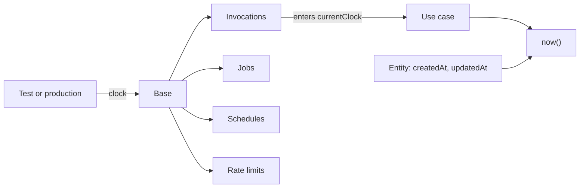
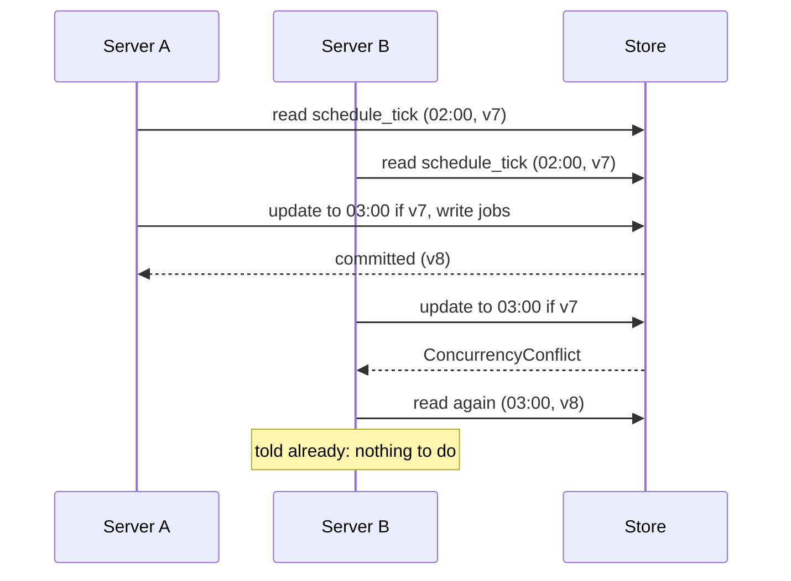
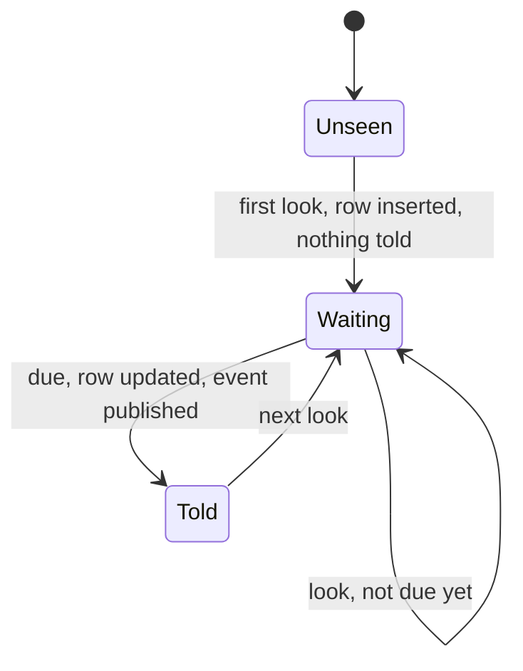

# Time and schedules

<p class="chapter-lead">An invitation that expires in a week, a session that ends after thirty days,
expired rows removed every night: code that depends on time is code you cannot test by
waiting. This chapter shows how newt makes time something a context is given, and how a
schedule turns the clock into an event. After it you can write code that expires, test it
in milliseconds, and run nightly work once, however many processes you deploy.</p>

## The problem

Ana invites Bob to the workspace *Acme*. The invitation is good for a week. You want a
test that proves Bob cannot accept it on the eighth day.

If the invitation reads the time with `new Date()`, the test has two bad choices: wait a
week, or reach into the row and rewrite `expiresAt` by hand, which tests your rewrite
and not the rule. The same holds for sessions that end, tokens that lapse, and rate
limits that forget.

There is a second problem behind the first. An expired session is only noticed when its
browser comes back. Nobody comes back for most of them, so their rows pile up. Something
must remove them, every night, at a fixed hour. And when cooper runs on three servers,
that something must run once, not three times.

## The idea

Time is a dependency, like the store. A context is handed a **clock**, and everything in
it asks that clock what time it is. In production the clock is the real one. In a test
it is a number you move.

::: info Concept: Clock
A `Clock` is an object with one method, `now(): Date` (`newt-kit/core`). A context's `Base`
takes one in its options; without it, it uses the real time. Everything that tells time
in the context goes by it: when entities are created and changed, when jobs are due,
when schedules fire, when rate limits forget.
:::

Code never holds the clock directly. It calls `now()`, from `newt-kit/core`, which answers
with the clock of the context whose work is running.



A **schedule** is the clock's voice: an event a context tells each time a cron
expression says it is due. Modules subscribe to it as to any other event, so nightly
work is a worker like every other ([Workers](./10-workers)).

## `now()`, never `new Date()`

```ts
// packages/newt/core/clock/now.ts
/** The time by the clock of the context at work (`currentClock`), or the real one outside any. */
export function now(): Date {
  return (currentClock.find() ?? systemClock).now()
}
```

`currentClock` is a scope (the same machinery as a workspace scope, see
[Tenants and scopes](./22-tenants)). Every use case runs inside its context's clock:
`Invocations.run` enters `currentClock` with the clock the `Base` was given. So any code
a use case reaches, an entity method, a value object, a repository, gets the context's
time from `now()` without being handed anything.

That is why the rule is short:

::: danger Never
`new Date()` with no argument in a module. It reads the machine's time, not the
context's, and a test that moves the clock will not move it. Write `now()`. Turning a
known instant into a `Date` is fine: `new Date(now().getTime() + days * DAY_MS)` builds a
date from the context's time. No lint rule catches a bare `new Date()` today: it is a
golden rule (13) you keep yourself.
:::

::: details Under the hood: who else reads the clock
`new Base({ …, clock })` hands the same clock to its `Invocations` (and through them to
`now()`), to its `JobQueue` (when a job is due, its backoff, its lease), to its
`Schedules`, to its `RateLimits`, and to its metrics (which minute a call is counted
in). The entity base class stamps `createdAt` and `updatedAt` with `now()`, and a
`TableRepository` with `softDelete` stamps `deletedAt` with it too. One clock, every
consumer.
:::

## In cooper: expiring by the clock

Each of cooper's contexts takes an optional clock when it opens, and hands it to its
base:

```ts
// cooper/backend/contexts/auth/auth.context.ts
  static async open(config: Auth_Config, deps: Auth_ModuleDeps, clock?: Clock): Promise<Auth_Context> {
    const store = await openStore(config.database, join(import.meta.dir, 'migrations'))
    const base = new AuthBase({ name: 'auth', store, clock })
    // …
  }
```

`openContexts` (`cooper/backend/open-contexts.ts`) takes one too and gives the same
clock to auth, boards and the backoffice, so a whole-app test moves time for all three at
once.

An invitation sets when it expires from `now()`, and says whether it is open by
comparing with `now()`:

```ts
// cooper/backend/contexts/auth/modules/invitation/invitation.ts
  static create(input: { tenantId: string, email: string, invitedBy: string, days: number }): Invitation {
    const { days, ...rest } = input
    const expiresAt = new Date(now().getTime() + days * 24 * 60 * 60_000).toISOString()
    // …
  }

  /** Pending and not expired: it can still be accepted. */
  isOpen(at = now()): boolean {
    return this.data.status === 'pending' && new Date(this.data.expiresAt) > at
  }
```

Notice what is *not* there: no job that flips the invitation to `expired` at the right
moment. Expiry is a comparison made when someone asks. A status that changes on its own
would need a worker to run on time, and would be wrong between its due moment and its
run. A date compared on read is never late.

The repository asks the same question in its criteria, so lists and the "one open
invitation per email" rule both ignore expired ones:

```ts
// cooper/backend/contexts/auth/modules/invitation/invitation.repository.ts
  open(tenantId: string, email?: Email): Criteria<InvitationRow> {
    return { tenantId, ...(email === undefined ? {} : { email }), status: 'pending', expiresAt: { gt: now().toISOString() } }
  }
```

Sessions do the same (`Session.open` and `isExpired` in
`cooper/backend/contexts/auth/modules/session/session.ts`).

::: tip In cooper
Dates are stored as ISO strings in UTC (`toISOString()`). They sort as text in every
store, so `expiresAt: { gt: now().toISOString() }` is a plain comparison on SQLite,
Postgres, MySQL and files alike.
:::

## Testing with a clock you move

A test makes its own clock out of a number, opens the context with it, and moves the
number:

```ts
// cooper/backend/contexts/auth/auth.test.ts
/** The time by auth's clock: a test moves it instead of waiting. */
let time: number

beforeEach(async () => {
  const mailer = new RecordingMailer()
  mails = mailer.mails
  // Set before auth opens: its schedules' first look, as it starts, is at noon of this day.
  time = Date.parse('2027-03-15T12:00:00Z')
  auth = await Auth_Context.open({ ...config.auth, database: ':memory:', port: 0 }, { mailer }, { now: () => new Date(time) })
  auth.start()
})
```

Then the week passes in one line:

```ts
// cooper/backend/contexts/auth/auth.test.ts
  test('cannot be accepted once their days pass by auth\'s clock', async () => {
    const [ana, bob] = [await signUp('Ana'), await signUp('Bob')]
    const acme = await as(ana, () => modules().tenant.create({ name: 'Acme' }))
    await as(ana, () => modules().invitation.create(acme.id, { email: 'bob@cooper.test' }))
    await settled()
    const token = linkToken()

    time += config.auth.invitationDays * DAY_MS
    expect(await modules().invitation.review(token)).toMatchObject({ open: false })
    await expect(as(bob, () => modules().invitation.accept(token))).rejects.toMatchObject({ code: 'invitation.not_open' })
  })
```

::: warning Watch out
Start the test clock at a fixed, readable instant (`Date.parse('2027-03-15T12:00:00Z')`),
not at `Date.now()`. A test that starts from the real time behaves differently at
midnight, on the last day of a month, or near three in the morning, when a nightly
schedule is due.
:::

## Schedules: the clock as an event

Now the expired sessions. Removing them is a use case like any other:

```ts
// cooper/backend/contexts/auth/modules/session/session.module.ts
  @UseCase()
  async purgeExpired(): Promise<number> {
    return this.repo.purgeExpired(now())
  }
```

```ts
// cooper/backend/contexts/auth/modules/session/session.repository.ts
  purgeExpired(at: Date): Promise<number> {
    return this.purge({ expiresAt: { lte: at.toISOString() } })
  }
```

What calls it is a schedule. The module defines one in its constructor, with a name and
a cron expression:

```ts
// cooper/backend/contexts/auth/modules/session/session.module.ts
    this.nightly = base.schedules.define('session.nightly', '0 3 * * *')
```

and its worker subscribes to it, exactly as to a domain event:

```ts
// cooper/backend/contexts/auth/modules/session/session.workers.ts
/** Every night, the sessions past their days go: nobody signs in with them again, and their rows would only pile up. */
export function registerSessionWorkers(sessions: Session_Module): void {
  sessions.nightly.subscribe(() => sessions.purgeExpired(), {
    strategy: 'handler',
    queue: 'session.purgeExpired.on.session.nightly',
  })
}
```

::: info Concept: Schedule
`base.schedules.define(name, cron)` returns an event emitter, like a module's `events`.
The event is named `name` (`<module>.<name>`, as any event: `session.nightly`) and its
payload is a `ScheduleTick`, `{ dueAt }`: the minute it was due, as an ISO string. With
`strategy: 'handler'` each tick becomes a job in the outbox, retried with backoff like
any other; with `fire-and-forget` it runs in memory.
:::

cooper has four of them, all at three in the morning, all purges:

| Schedule | Context | Worker |
|---|---|---|
| `session.nightly` | auth | `session.purgeExpired` |
| `token.nightly` | auth | `token.purgeExpired` |
| `oauthGrant.nightly` | auth | `oauthGrant.purgeExpired` |
| `session.nightly` | each context's web session (`cooper/backend/shared/web-session`) | its `purgeExpired` |

A schedule's name is unique within its context, not across contexts: each context has
its own `Schedules`.

### Cron, in UTC

The expression is standard five-field cron (`packages/newt/runtime/schedules/cron.ts`):
minute, hour, day of month, month, day of week (0 or 7 is Sunday). Each field takes `*`,
a value, a range (`1-5`), a step (`*/15`, `0-30/10`) or a list (`0,30`). As in classic
cron, when both day fields are restricted, a day matching either is due.

::: warning Watch out
Cron in newt is **UTC**, always. `0 3 * * *` is three in the morning in London in winter
and four in summer, and eleven at night in New York. Pick an hour that is quiet for
your users in UTC terms; there is no time zone option.
:::

## Once, however many processes

Run cooper on three servers and each one has auth's schedules. At three o'clock all three
see `session.nightly` due. Only one may tell it.

The store decides. Each store has a `schedule_tick` table (created by newt's own
framework migrations) with one row per schedule: the last `dueAt` told. Telling a tick
is one transaction:

```ts
// packages/newt/runtime/schedules/schedules.ts
  private fire(schedule: Schedule, dueAt: string): Promise<void> {
    const ticks = this.ticks ??= this.store.table<TickRow>('schedule_tick')
    return this.store.transaction(async () => {
      const [last] = await ticks.find({ id: schedule.name })
      // Seen for the first time: nothing before now is its.
      if (!last) return ticks.insert({ id: schedule.name, dueAt })
      if (last.dueAt >= dueAt) return
      await ticks.update(schedule.name, last.version, { dueAt })
      await this.publisher.publish(new schedule.event({ dueAt }))
    })
  }
```

The update is at the version read. Two processes that read the same row race to update
it; one wins, the other gets a `ConcurrencyConflict`, reads again, finds the tick told,
and does nothing. Publishing the event in the same transaction writes the handlers' jobs
to the outbox together with the row: the tick is recorded *and* its work is queued, or
neither.



Two more behaviours follow from storing only the last tick:

- **Missed ticks collapse.** If no process ran for three nights, the first one to start
  tells *one* tick, the latest due, not three. A purge of "everything expired by now"
  does the same work either way, which is the shape scheduled work should have.
- **A new schedule tells nothing of the past.** The first time a schedule is seen, its
  row is inserted with the latest due time and no event is told. It fires at its next
  due time, not once for every night before it existed.



::: details Under the hood: the loop
`Schedules` starts and stops with the context's jobs. Its loop calls `tick()`, then
sleeps until the nearest next due time of any schedule, a minute at most, so a clock that
jumped or a timer that fired late is noticed within a minute. A failed tick is logged
and tried again at the next look. Each schedule also remembers in memory the last
`dueAt` this process saw told, so a look that finds nothing due does not touch the store.
:::

::: tip In cooper
Because a tick can be late, collapsed, or (after a crash between commit and run) its job
retried, every scheduled worker in cooper reads "what is expired by `now()`" instead of
"what expired since the last run". Write scheduled work the same way: from the state, not
from the gap between ticks. See [Doing things once](./24-idempotency).
:::

## Testing a schedule: `tick()`

A test cannot wait for three o'clock either. It moves the clock past the due time and
calls `base.schedules.tick()`, which tells every schedule due by now that this process
has not seen told:

```ts
// cooper/backend/contexts/auth/auth.test.ts
  test('removes the expired sessions every night at three, by auth\'s clock', async () => {
    const sessions = () => auth.base.store.table('session').count({})
    // Its own loop stopped, once its first look, as auth started, is done: the test ticks
    // by hand. That first look told nothing of before: the next tick is tonight's.
    await auth.base.schedules.stop()
    await modules().session.signUp({ email: 'ana@cooper.test', name: 'Ana', password: 'a long password' })
    time += config.auth.sessionDays * DAY_MS
    await modules().session.signIn({ email: 'ana@cooper.test', password: 'a long password' })
    expect(await sessions()).toBe(2)

    await auth.base.schedules.tick()
    await settled()

    expect(await sessions()).toBe(1)
  })
```

Read it step by step:

1. The clock starts at noon on 15 March. `auth.start()` started the schedules, whose
   first look inserted each `schedule_tick` row (due 03:00 that morning) and told
   nothing.
2. `schedules.stop()` ends the background loop, so only the test ticks from now on.
3. Thirty days pass. Ana's first session is expired; her second, opened now, is not.
4. `tick()` sees `session.nightly` due (03:00 today is later than the stored 03:00 of
   15 March), records it and publishes the event; the handler's job is in the outbox.
5. `settled()` is `auth.base.jobs.idle()`: it waits until the jobs run. One session is
   left.

::: warning Watch out
Set the clock **before** the context opens. The first look happens as it starts, and it
fixes where each schedule stands. A clock moved backwards after that sees nothing due
until it passes the stored tick again.
:::

## Recap

- Time is a dependency: a `Clock` (`{ now(): Date }`) given to the `Base`, the real time
  by default.
- Code calls `now()` from `newt-kit/core`, which answers with the clock of the context at
  work; never `new Date()` with no argument.
- Expiry is best a date compared when someone asks (`isOpen`, criteria with
  `{ gt: now().toISOString() }`), not a status flipped by a job.
- `base.schedules.define(name, cron)` gives an event told when a UTC cron expression is
  due; subscribe to it with a `handler` like any event.
- Each tick is told once across processes: recorded in `schedule_tick` at its version,
  with the handlers' jobs, in one transaction. Missed ticks collapse into one; a new
  schedule waits for its next tick.
- Tests move their clock and call `base.schedules.tick()`, then `base.jobs.idle()`.

## Going further

- [Workers](./10-workers): how a tick's job is claimed, retried and declared dead.
- [Doing things once](./24-idempotency): why scheduled work reads the state, not the gap.
- [Rate limits](./28-rate-limits): the other consumer of the clock, counting by windows.
- [Testing](./12-testing): `base.jobs.idle()`, `runAsWorker` and the rest of a test's tools.
