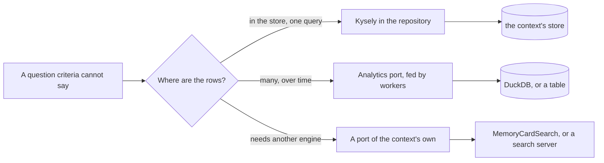
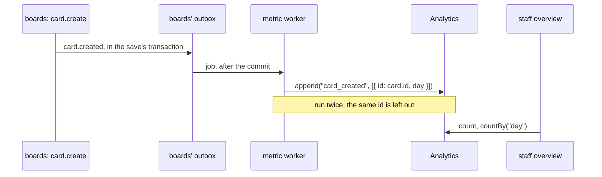
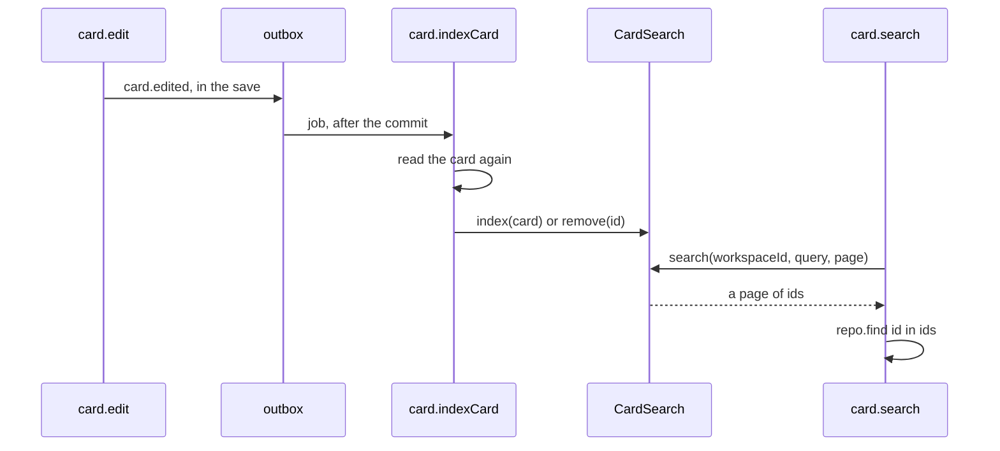
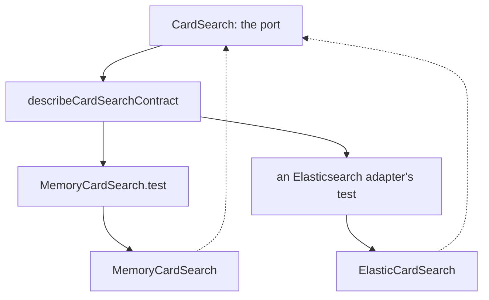

# Queries, analytics and ports

<p class="chapter-lead">Criteria take a module a long way, and then they stop: no "contains", no
"count them by board", no "how many cards were made each day this month". This chapter shows the
three places newt sends what criteria cannot say: a Kysely query in the repository, an analytics
database fed by workers, and a port of your own with an adapter behind it.</p>

## The problem

ana runs the *acme* workspace in cooper. Its boards hold four hundred cards now, and she
wants to type *plan* and see every card that mentions it, in *Doing*, assigned to bea. The
staff who look after cooper want something else: how many cards each workspace has, in one
list, and how many cards, workspaces and accounts were made each day of the last two weeks.

A repository answers with criteria ([Repositories](./07-repositories)):

```ts
{ boardId, columnId: { in: [todo, doing] }, assigneeId: 'bea', or: [{ number: 4 }] }
```

Equal, one of these, greater than, equal whatever the case, `and`, `or`. Every store answers
them the same way, which is why a module moves from SQLite to Postgres unchanged. But none of
those words is "contains", and nothing in criteria groups or adds up. Three different needs
hide in ana's and the staff's questions, and each has its own home:

- **A query the store can answer, but criteria cannot say**: cards counted by board. The rows
  are in the context's own database, so a SQL query is right there. newt gives you Kysely on
  the store's connection.
- **A question about many rows over time**: cards made per day. Asking it of the store, again
  and again, would put analytical work in the way of the transactions. newt has a port for it,
  `Analytics`, fed by workers.
- **A capability the store is not good at**: searching text. That belongs to a service made
  for it, behind a port of the context's own (`CardSearch`), with an adapter that can change.

## The idea



The rule that does not move: **only the repository touches the store**. Kysely is a tool the
repository uses, not a back door for use cases. Analytics and ports are the other side of the
line: they are not the store, they have no transactions of the module's, and they are fed from
workers after a save commits, never inside it.

::: info Concept: Port and adapter
A **port** is an interface the application owns, saying what it needs of something outside
it (send a mail, search cards, append analytics rows). An **adapter** is one implementation
of it (the console, a list in memory, Elasticsearch). Modules depend on the port; the context
that opens them picks the adapter. A **contract suite**, a set of tests every adapter runs,
proves an adapter keeps what the port promises.
:::

## Kysely in the repository

### Kysely on the store's connection

newt does not run Kysely on a database of its own. `kyselyFor(store)`, from `@newt-kit/newt/kysely`,
gives you Kysely on the **store's** connections:

```ts
// cooper/backend/contexts/boards/boards-base.ts
import { kyselyFor } from '@newt-kit/newt/kysely'
import { CooperBase } from '../../shared/cooper-base'
import type { BoardsDatabase } from './boards-database'

/**
 * What every module of `boards` receives: cooper's base, and Kysely on its store, for
 * the queries a table cannot say (cards counted by workspace and by board). Kysely
 * needs a SQL store: `boards` opens on SQLite or Postgres, and would open on MySQL the
 * same way, never on files.
 */
export class BoardsBase extends CooperBase {
  readonly db = kyselyFor<BoardsDatabase>(this.store)
}
```

What that buys, from the doc comment of `kyselyFor` (`packages/newt/kysely/kysely-for.ts`):

- **It joins the transaction in progress.** Inside `store.transaction` (a save, its
  `before` and `after`), a Kysely query reads and writes in that transaction.
- **Kysely's own transactions are refused.** `db.transaction()` throws: it would not be the
  store's, and the outbox, the guards and the write rule would not know about it.
- **Field names are the rows'.** You write `workspaceId`; a `CamelCasePlugin` turns it into
  `workspace_id` on the way. You never write a column name.
- **One query, three databases.** It takes a `SqliteStore` or a `SqlStore` (Postgres,
  MySQL), and picks Kysely's dialect from it. On the files store there is no Kysely.

The type `kyselyFor` takes is the shape of the database: each table by its name, with the
fields of its rows. You declared those already, one row type per repository:

```ts
// cooper/backend/contexts/boards/boards-database.ts
import type { SqliteRow } from '@newt-kit/newt/kysely'
import type { ActivityRow } from './modules/activity/activity.repository'
import type { BoardRow } from './modules/board/board.repository'
import type { CardCounterRow, CardRow } from './modules/card/card.repository'
import type { ColumnRow } from './modules/column/column.repository'

/**
 * The tables of `boards`, as its repositories query them with Kysely: each one by its
 * name, with the fields of its rows (`workspaceId`, never `workspace_id`). A
 * repository queries only its own table.
 */
export type BoardsDatabase = {
  board: SqliteRow<BoardRow>
  column: SqliteRow<ColumnRow>
  card: SqliteRow<CardRow>
  card_counter: SqliteRow<CardCounterRow>
  activity: SqliteRow<ActivityRow>
}
```

`SqliteRow<Row>` says a row as a raw query reads it back on SQLite: a boolean as 0 or 1
(`SqlBool`), an object or a list as its JSON text. A `Table` turns those back for you, from
its `types` option; a query of your own does not.

::: warning Watch out
Every table of the context is in the type, so Kysely would let `Card_Repository` read
`column`. Do not. A module reaches another only through its use cases
([Modules](./04-modules)); a join across two modules' tables ties them together where neither
the lint nor `describeApplication` can see it.
:::

### A count by board

A board's header in cooper shows how many cards it has. `count(criteria)` gives one number;
this is a `GROUP BY`:

```ts
// cooper/backend/contexts/boards/modules/card/card.repository.ts
  /** How many cards each board of the current workspace has: boards without any are not there. */
  async countByBoard(): Promise<CardCountByBoard[]> {
    const rows = await this.base.db
      .selectFrom('card')
      .select(eb => ['boardId', eb.fn.countAll<number>().as('cards')])
      .where('workspaceId', '=', currentWorkspaceId())
      .groupBy('boardId')
      .orderBy('boardId')
      .execute()
    return rows.map(row => ({ boardId: row.boardId, cards: Number(row.cards) }))
  }
```

Two lines matter more than the rest.

`.where('workspaceId', '=', currentWorkspaceId())` is **written by hand**. The repository's
`scope` ([Tenants and scopes](./22-tenants)) is applied by `find`, `count`, `page` and the
other methods of `TableRepository`. Kysely does not go through them, so it knows nothing of
the scope. Forget that `where`, and acme sees globex's boards in its counts.

::: danger Never
A Kysely query on a tenant's rows without `.where('workspaceId', '=', currentWorkspaceId())`
(or whatever your scope's field is). Nothing throws: the query just answers for every tenant.
The isolation test of the module, a second tenant who must see nothing, is what catches it.
:::

`Number(row.cards)`: a count comes back as a number on SQLite and as text (a `bigint`) on
Postgres. `Number` makes it the same everywhere. The same goes for any aggregate: write the
query once, normalise what it gives back.

### Criteria inside a query: `whereOf`

Sometimes the query is yours but its condition is something criteria say perfectly well. The
staff's backoffice asks how many cards each of a page of workspaces has:

```ts
// cooper/backend/contexts/boards/modules/card/card.repository.ts
  /**
   * How many cards each of these workspaces has, by one query that groups them.
   * Across workspaces on purpose: for the staff's backoffice, which looks at
   * all of them, never for a workspace's own work.
   */
  async countByWorkspace(workspaceIds: string[]): Promise<CardCountByWorkspace[]> {
    if (workspaceIds.length === 0) return []
    const rows = await this.base.db
      .selectFrom('card')
      .select(eb => ['workspaceId', eb.fn.countAll<number>().as('cards')])
      // Criteria, as a table takes them, said in Kysely's query by `whereOf`.
      .where(whereOf(this.store, { workspaceId: { in: workspaceIds } }))
      .groupBy('workspaceId')
      .execute()
    const counts = new Map(rows.map(row => [row.workspaceId, Number(row.cards)]))
    return workspaceIds.map(workspaceId => ({ workspaceId, cards: counts.get(workspaceId) ?? 0 }))
  }
```

`whereOf(store, criteria)`, from `@newt-kit/newt/kysely`, turns criteria into a Kysely condition,
**written exactly as that store's tables write it**: every operator and group, `null`,
`ieq` folding A to Z only, booleans as the dialect keeps them. A condition that a table and
your query both say therefore means the same thing in both. Use it for any filter a client
sent through a `defineFilter` ([Repositories](./07-repositories)): turn it into criteria with
`toCriteria`, put it in the query with `whereOf`, and keep the scope's `where` beside it,
never instead of it.

This query leaves the scope out **on purpose**: the staff look across workspaces. The name
and the comment say so, as they do for `findInEveryScope`. A method that reads across
tenants says it in its name, so a reader never has to guess.

A workspace with no cards has no row in a `GROUP BY`, so the method gives it its 0. And note
what it does not do: fetch ids to send back in an `in` of thousands. A query takes a limited
number of parameters; everything a question needs goes into one query.

::: details Under the hood: Kysely and the guard rule
A save that reads rows in its transaction without a `guard` breaks the guard rule
([Versions, conflicts and guards](./20-concurrency)). The rule learns what was read from the
tables (`SqlTable` and `FileTable` note each `find` and `count`). A Kysely query does not
pass through a table, so the rule does not see it. If an `after` checks a rule with Kysely,
name its guard all the same: the rule cannot remind you.
:::

### Writing with Kysely

Outside a transaction, SQLite refuses a write through Kysely, while Postgres and MySQL run it
at once, on its own. So: read with Kysely; write through the repository (`save`,
`saveRows`), and if a write needs Kysely (an `INSERT … ON CONFLICT`, say), put it inside a
`saveRows` or a hook, where it joins the save's transaction. On Postgres and MySQL a write's
result reports no rows changed (`numUpdatedRows` is `0n`), so do not branch on it.

## Analytics: a port that only appends

### Why not ask the store

The staff's overview wants cards, workspaces and sign-ups per day. You could count `card`
rows by `createdAt` with Kysely. But a deleted card is gone from `card`, and the count of
yesterday would drop today. The truth of what *happened* is the stream of events, not the
rows as they are now. And analytical questions get heavier with time: scanning months of rows
in the database that also takes every save is how a dashboard slows down an application.

So newt keeps those numbers apart, as a **projection**: workers follow the events of what
the stores saved, and append a row for each to a database made for reading a lot at once.



### The port

`@newt-kit/newt/port-analytics` is small on purpose:

```ts
// packages/newt/port-analytics/analytics.ts
export interface Analytics {
  /** Adds rows to a dataset; a row whose id is already there is left out. */
  append(dataset: string, rows: AnalyticsRow[]): Promise<void>
  close(): Promise<void>
}
```

An `AnalyticsRow` is anything with an `id`. Three promises come with it, from its doc comment:

- **It is only ever added to.** A row, once in, never changes or goes. What changes later is a
  new row telling it.
- **It has no transactions, so it is never a context's store.** It is fed by `handler`
  workers, after the events of what the store saved.
- **A row with an id already there is left out.** A worker may run twice; the id of what it
  counts (the event's, the card's) makes the second run add nothing.

Reading is not in the port. Analytical questions are each database's own language (DuckDB's
`time_bucket`, ClickHouse's), and a common query language would be the weakest of them. So
each adapter brings its own reading methods, and a module that reads says which it needs.

::: info Concept: Projection
A **projection** is data derived from events, kept for reading. It is never the truth (that is
the stores, with their transactions), it may be a moment behind, and it can be built again from
the events. It never stands in the way of what it counts.
:::

### In cooper: the metric module

The backoffice's `metric` module counts three things, each from another context's event:

```ts
// cooper/backend/contexts/backoffice/modules/metric/metric.workers.ts
export function registerMetricWorkers(metrics: Metric_Module, deps: Metric_Deps): void {
  deps.boards.card.events.created.subscribe(card => metrics.recordCard(card), {
    strategy: 'handler',
    queue: 'metric.recordCard.on.card.created',
  })
  deps.auth.tenant.events.created.subscribe(tenant => metrics.recordWorkspace(tenant), {
    strategy: 'handler',
    queue: 'metric.recordWorkspace.on.tenant.created',
  })
  deps.auth.user.events.signedUp.subscribe(user => metrics.recordSignUp(user), {
    strategy: 'handler',
    queue: 'metric.recordSignUp.on.user.signedUp',
  })
}
```

`handler`, not `fire-and-forget`: a number lost when the server stops would be wrong for good.
Each use case appends one row, keyed by the id of what it counts:

```ts
// cooper/backend/contexts/backoffice/modules/metric/metric.module.ts
  /** A card was made, in a board of a workspace. */
  @UseCase()
  async recordCard(card: CardDTO): Promise<void> {
    await this.options.analytics.append(METRIC_DATASETS.cardCreated, [{ id: card.id, workspaceId: card.workspaceId, day: dayOf(card.createdAt) }])
  }
```

The day comes from the card's `createdAt`, not from the time the worker runs: a job that runs
an hour late, or twice, still counts the card on the day it was made.

The module reads through an interface of cooper's own, beside the port:

```ts
// cooper/backend/shared/analytics/analytics-counts.ts
export interface AnalyticsCounts {
  /** How many rows a dataset has. */
  count(dataset: string): Promise<number>
  /**
   * How many rows of a dataset have each value of a field, in the order of the values,
   * from one on (`from`, compared as text: a day such as `2026-10-01`, a month).
   */
  countBy(dataset: string, field: string, options?: { from?: string }): Promise<AnalyticsCount[]>
}
```

and asks for both in its options, `analytics: Analytics & AnalyticsCounts`
(`cooper/backend/contexts/backoffice/modules/metric/metric-options.ts`). Its `overview` use
case adds them up for the last `days` days, filling in the days with none.

::: tip In cooper
The adapter is cooper's own, `SqlAnalytics` (`cooper/backend/shared/analytics/sql-analytics.ts`):
one table, `analytics_row`, in the backoffice's own database, each row whole as JSON, with
`(dataset, id)` as its primary key and `ON CONFLICT DO NOTHING` on insert. It is written with
Kysely, the same on SQLite and Postgres but for reading a field of the JSON
(`json_extract` against `->>`). For cooper's numbers that is enough; the port means it can be
swapped for DuckDB without touching the metric module.
:::

Note `SqlAnalytics.append` runs in a `store.transaction` of its own. It is a call out of the
module, like a mailer's send: never inside an entity's save, always from a worker.

### DuckDB: `@newt-kit/newt/adapter-duckdb`

For numbers that outgrow a table, newt brings `DuckDbAnalytics`, the port on DuckDB, a
database made for reading a lot at once. It needs `@duckdb/node-api`, an optional peer.

```ts
import { DuckDbAnalytics } from '@newt-kit/newt/adapter-duckdb'

const analytics = await DuckDbAnalytics.open({
  path: 'data/analytics.duckdb',
  datasets: { card_created: { columns: { workspaceId: 'VARCHAR', day: 'VARCHAR' } } },
})
await analytics.append('card_created', [{ id: card.id, workspaceId: card.workspaceId, day: '2026-10-26' }])
const perDay = await analytics.query<{ day: string, cards: number }>(
  'SELECT day, count(*) AS cards FROM card_created WHERE day >= $1 GROUP BY day ORDER BY day', ['2026-10-01'])
```

What it promises (`packages/newt/adapter-duckdb/duckdb-analytics.ts`):

- **A dataset declared with columns is a table of them**, which is what DuckDB reads fast. Any
  other dataset keeps each row whole as JSON. The column types are `VARCHAR`, `INTEGER`,
  `BIGINT`, `DOUBLE`, `BOOLEAN`, `TIMESTAMP`, `DATE` and `JSON` (`DuckDbColumnType`); `id` is
  every row's and is not declared.
- **Columns grow, never change.** A column declared later is added to a file that lacks it; a
  column declared with another type is refused: declare another column.
- **Reading is `query`**, in DuckDB's SQL, times as ISO strings and whole numbers as numbers.
  `run` is for keeping it (forgetting what is old, summing minutes into days), never for
  changing what a row said. `rows(dataset)` reads one whole, for tests.
- **One process writes it.** DuckDB lets no other process open the file to write meanwhile.
  Several instances of an application share a store, not a DuckDB file.

::: tip In newt-monitor
newt-monitor keeps each application's metrics in a DuckDB of its own
(`packages/newt-monitor/backend/shared/metrics-store/metrics-store.ts`): every metrics module
declares its datasets (`define`) and reads them with `query`, grouping by time as it reads.
That is the shape `DuckDbAnalytics` is made for. See [Metrics](./43-metrics).
:::

### Proving an adapter: `describeAnalyticsContract`

`@newt-kit/newt/port-analytics/contract` holds the suite every adapter runs, and `MemoryAnalytics`, an
adapter in memory for tests. An adapter's test hands the suite a fixture: how to open fresh,
empty analytics, and how to read a dataset back.

```ts
// cooper/backend/shared/analytics/sql-analytics.test.ts
describeAnalyticsContract('SqlAnalytics', {
  open,
  rows: (analytics, dataset) => analytics.rows(dataset),
})
```

The suite checks what the port promises: rows kept in their dataset, a row whose id is in
already never added again, the first row of an id staying as it was. cooper runs the same
suite on Postgres in `cooper/backend/postgres.test.ts`. An adapter is done when it passes;
its own extras (`countBy`) get tests of their own beside it.

## A port of your own: the cards' search

### Why the search left the table

cooper's first search was a Kysely query: `lower(title) like lower('%plan%')`, with the
filter through `whereOf` and the scope's `where`. It worked, and it showed where a database's
`like` stops. SQLite's `lower` folds A to Z only, so *ärger* does not find *Ärger im Büro*.
`like '%…%'` reads every row of the workspace. And words, their forms and relevance are not
SQL's job at all. A search is a capability of its own, which a search server does well and a
table does badly.

So the cards are searched through a **port**, `CardSearch`, which the context owns:

```ts
// cooper/backend/contexts/boards/search/card-search.ts
export type CardQuery = {
  text?: string
  criteria: Criteria<CardDTO>
}

export interface CardSearch {
  /** Keeps the card as it is now, in place of what it kept of it before, unless that is newer (a later `updatedAt`). */
  index(card: CardDTO): Promise<void>
  /** Forgets a card for good; a copy of it indexed afterwards is not kept if it is older than the removal. */
  remove(id: string): Promise<void>
  /** Forgets every card of a workspace. */
  removeWorkspace(workspaceId: string): Promise<void>
  /** A page of the ids of the workspace's cards that match, by id, as `PageRequest` pages. */
  search(workspaceId: string, query: CardQuery, page: PageRequest): Promise<Page<string>>
}
```

Look at what it says, and what it leaves out:

- **It speaks the module's language.** Criteria on `CardDTO`'s fields, a `PageRequest`, a
  `Page`. Nothing of Elasticsearch, nothing of SQL.
- **The workspace is an argument.** `search(workspaceId, …)` cannot be called without one.
  The port has no scope of its own to forget.
- **It returns ids, not cards.** The cards are in the store; the index only finds them.
- **It is a moment behind**, and says what that means: two jobs indexing one card may hand it
  copies in the wrong order, so `index` keeps the newer by `updatedAt`, and `remove` is not
  undone by a late, older copy.

It lives in `cooper/backend/contexts/boards/search/`, at the context's level, not inside the
card module's folder: a port is the context's choice of what it needs from outside, and the
context hands an adapter to the module through its options (`Card_Options.search`).

::: tip In cooper
`open-contexts.ts` opens boards with `search: new MemoryCardSearch()`. That is the one line
that would change for a search server.
:::

### The flow: written by workers, read by the use case



The cards own the index. Every event that changes what a search could find gets a worker that
calls one use case, `indexCard`:

```ts
// cooper/backend/contexts/boards/modules/card/card.workers.ts
  // The search finds each card as it is now: whatever happened to it, it is indexed again, or removed.
  cards.events.created.subscribe(card => cards.indexCard(card.workspaceId, card.id), { strategy: 'handler', queue: 'card.indexCard.on.card.created' })
  cards.events.edited.subscribe(({ dto }) => cards.indexCard(dto.workspaceId, dto.id), { strategy: 'handler', queue: 'card.indexCard.on.card.edited' })
  // … moved, assigned, unassigned, deleted: the same
```

and `indexCard` does not trust the event. It reads the card again, in its workspace, and hands
the search what is there now, or removes it:

```ts
// cooper/backend/contexts/boards/modules/card/card.module.ts
  async indexCard(workspaceId: string, id: string): Promise<void> {
    const card = await runInWorkspace(workspaceId, () => this.repo.first({ id }))
    if (card) await this.options.search.index(card.toDTO())
    else await this.options.search.remove(id)
    // …
  }
```

A worker runs with no scope, so it enters one (`runInWorkspace`) before using the scoped
repository ([Tenants and scopes](./22-tenants)). Run twice, it indexes the same card twice,
which is the same as once ([Doing things once](./24-idempotency)).

The search itself asks the port for ids and the repository for the cards:

```ts
// cooper/backend/contexts/boards/modules/card/card.module.ts
  @UseCase()
  async search(input: unknown, page: PageRequest): Promise<Page<CardDTO>> {
    const { text, filter } = CardSearchSchema.parse(input)
    const criteria = filter ? CardFilter.toCriteria<CardDTO>(filter) : {}
    const found = await this.options.search.search(currentWorkspaceId(), { text, criteria }, page)
    const cards = new Map((await this.repo.find({ id: { in: found.items } })).map(card => [card.id, card]))
    // The next page starts after the last id the search found, whether or not its card is still there.
    return mapPage({ ...found, nextCursor: found.items.at(-1) }, id => cards.get(id)?.toDTO())
  }
```

The client's filter goes through `CardFilter` (only `board`, `column`, `assignee`, `number`,
with their operators) and becomes criteria. The workspace comes from the scope, never from the
client. The cards are read from the store through the scoped repository, so even a broken
index could not hand acme a card of globex. A card deleted after the index found it is simply
left out by `mapPage`, which drops what the function returns as `undefined`, and the cursor
still moves past its id.

::: warning Watch out
A port's index is a moment behind. A test that creates a card and searches at once finds
nothing: wait for the workers first (`await base.jobs.idle()`), as cooper's card tests do.
:::

### In memory: `MemoryCardSearch`

cooper's adapter keeps every card in a `Map` and looks at all of them on each search
(`cooper/backend/contexts/boards/search/memory-card-search.ts`). It answers criteria with
`matches(card, criteria)` from `@newt-kit/newt/core`, the same function the files store and every
test double use, so a filter means in memory what it means in a table. It is enough for one
process, and what it keeps is lost when the process ends. So `Boards_Context.open` builds it
again before anyone searches:

```ts
// cooper/backend/contexts/boards/boards.context.ts
    // The cards' search starts empty in memory: every card is indexed before anyone searches.
    await modules.card.reindex()
```

`reindex` pages through every workspace's cards (`pageInEveryScope`, a method named for what it
does) and indexes each one.

### Its contract, as a suite

A port is a promise; the suite is how you keep it. cooper's sits beside the port:

```ts
// cooper/backend/contexts/boards/search/card-search.contract.ts
/** Checks an adapter of the cards' search keeps what `CardSearch` promises. */
export function describeCardSearchContract(name: string, open: () => CardSearch | Promise<CardSearch>): void {
  describe(`${name} keeps the CardSearch contract`, () => {
    // …
    test('finds a workspace\'s cards only', async () => {
      const ours = cardOf({ title: 'Plan' })
      await search.index(ours)
      await search.index(cardOf({ title: 'Plan', workspaceId: 'globex' }))

      expect(await ids('plan')).toEqual([ours.id])
    })
    // …
  })
}
```

and each adapter runs it in one line:

```ts
// cooper/backend/contexts/boards/search/memory-card-search.test.ts
describeCardSearchContract('MemoryCardSearch', () => new MemoryCardSearch())
```

The suite says, in tests, everything the interface's comments say in words: text in the title
or description whatever its case (*ärger IM* finds *Ärger im Büro*), `%` and `_` only
themselves, criteria alone or with text, only the workspace asked for, the newer of two
copies kept whichever comes last, a removed card kept out when an older copy comes late,
`removeWorkspace` forgetting one workspace and only it, and pages by id with an exact total.



That is what makes the adapter replaceable. An `ElasticCardSearch` would live in `search/`
beside the memory one, and be done when the same suite passes against a real server: the
workspace as a `term` filter always, the criteria translated to a `bool` query, `updatedAt`
as an external version so the server refuses an older copy, pages by `search_after` on `id`.
Nothing outside `search/` would change but the line in `open-contexts.ts`, and the `reindex`
at every start, since a server keeps its index. The cards, their workers, the use case and the
route stay as they are.

::: details Writing a contract suite of your own
Follow the shape newt's own suites have (`describeStoreContract` in
`@newt-kit/newt/port-store/contract`, `describeAnalyticsContract` in `@newt-kit/newt/port-analytics/contract`):

- **A function, not a test file**: `describeXContract(name, open)`, exported from a
  `*.contract.ts` beside the port, so every adapter's `*.test.ts` calls it.
- **A fixture that opens it fresh** for every test (`beforeEach`), and closes it after, so
  tests never see each other's data. For a server, a new index or schema with a random name.
- **One test per promise**, named as the promise reads, and the hard cases first: at once,
  twice, out of order, another tenant.
- **Only the port's methods.** If a test needs to read back what the port cannot (analytics
  has no reading method), the fixture brings a way (`rows`).
- **Skipped without its server.** An adapter that needs one runs only when an environment
  variable gives its address, as cooper's Postgres tests do ([Stores and migrations](./26-stores)).
:::

### When a port, when Kysely

Both answer "criteria cannot say this". Choose by where the answer lives:

| You need | Use |
|---|---|
| A count, a sum, a `GROUP BY`, a join within one module's table, from the context's store | Kysely in the repository, with the scope's `where` |
| A filter a client sends, in a query of your own | `defineFilter` → `toCriteria` → `whereOf` |
| Numbers over time, from events, that must not slow the store | `Analytics`, fed by `handler` workers |
| Something another engine does well (text search, geo, vectors) | A port of the context's own, an adapter, a contract suite |
| Something that is no module of the application (mail, payments) | A port in the module's deps ([Between contexts](./11-between-contexts)) |

## Recap

- Criteria are the default; when they cannot say something, the repository uses Kysely
  (`kyselyFor(store)`, on `base.db`), which runs on the store's connection and joins its
  transaction, and refuses transactions of its own.
- A Kysely query on tenant rows adds the scope's `where` by hand
  (`.where('workspaceId', '=', currentWorkspaceId())`); one that reads across tenants says so in
  its name. `whereOf` puts criteria into a query exactly as the tables say them.
- Analytics is a projection: `handler` workers append rows keyed by the id of what they count to
  `Analytics`, which only appends and has no transactions; reading is each adapter's own
  (`DuckDbAnalytics.query`, cooper's `AnalyticsCounts`).
- A capability the store is bad at goes behind a port the context owns, in the module's language,
  the tenant an argument, fed by workers that read again what they index.
- Every port has a contract suite, a `describeXContract` function every adapter's test calls;
  an adapter is done when it passes.

## Going further

- [Tenants and scopes](./22-tenants): the scope a Kysely query must add, and `findInEveryScope`.
- [Doing things once](./24-idempotency): why every worker that feeds a projection keys by id.
- [Stores and migrations](./26-stores): the Store port and its contract suite, the model for yours.
- [Versions, conflicts and guards](./20-concurrency): guarding a rule checked with a query of your own.
- [Metrics](./43-metrics): newt-monitor's own analytics, on DuckDB.
