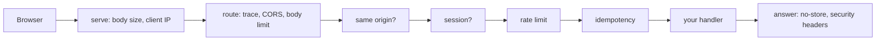
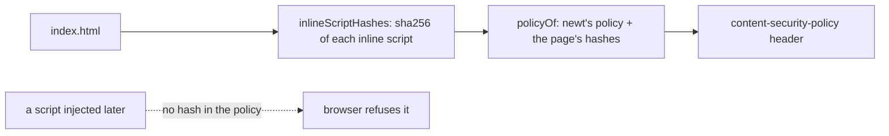
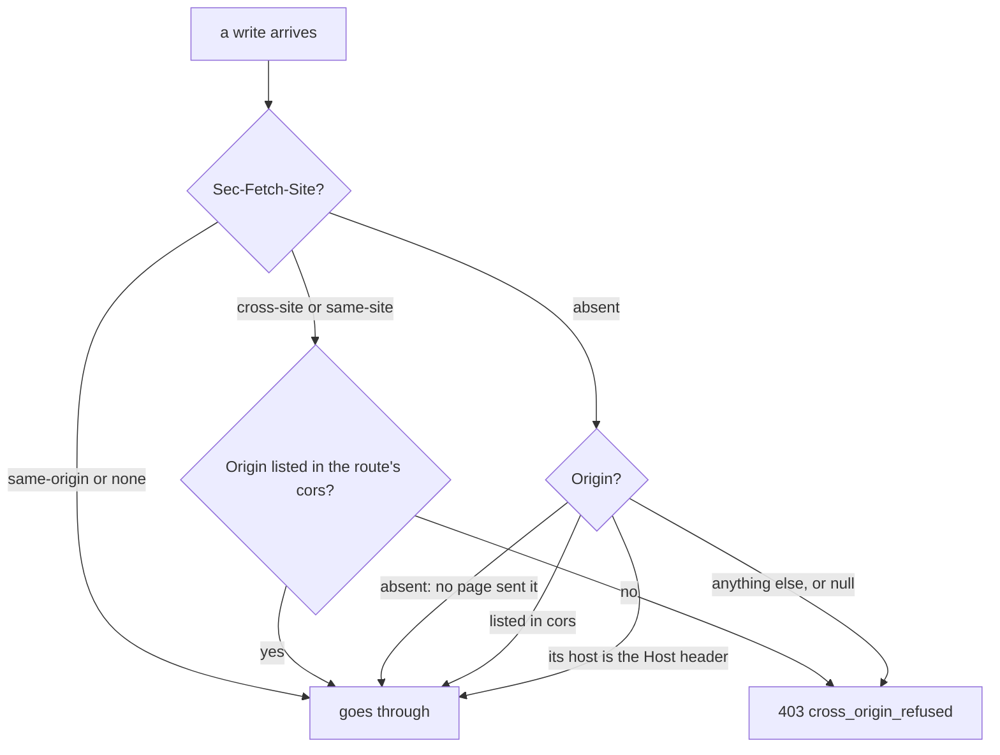
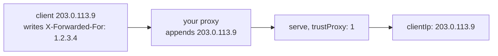

# HTTP security

<p class="chapter-lead">A web server on the open internet is attacked from the first minute: by
other sites' pages, by scripts that send what they like, by people who copy your database. This
chapter walks through everything newt does about it before you write a line, why each default is
what it is, and the few switches you turn yourself.</p>

## The problem

cooper has three servers on three domains: `auth`, where people sign in; `boards`, the SaaS;
and `backoffice`, the staff's console. Each one keeps a session in a cookie, answers JSON under
`/api`, and hands out a single-page frontend for every other address.

Think about what can go wrong with just that:

- A page on `evil.example` holds a hidden form that posts to `boards/api/.../cards`. The
  browser sends the person's cookie along. A card appears that nobody wrote.
- The same page loads the consent screen of `auth` inside an invisible frame, places a button of
  its own over "Allow", and steals a click.
- A shared proxy keeps a copy of `GET /api/session` and shows Ana's account to the next person.
- Someone posts a 2 GB body to `/api/session/sign-in` until the process runs out of memory.
- A script injected into a comment reads `document.cookie` and mails the session away.
- A stolen backup of the database is opened, and every session token in it still works.

None of these needs a bug in your use cases. They are the plumbing's problems, and a framework
that leaves them to each application leaves most of them open. newt closes them by default, in
`@newt-kit/newt/http`, and lets a route open what it must, by name.

## The idea: closed until a route says otherwise

Every protection in this chapter sits somewhere on the path of a request. It helps to see the
whole path once:



Read it as a series of gates. `serve` (in `packages/newt/http/serve.ts`) notes where the request
came from and refuses a body longer than any route takes. The router (`http-router.ts`) wraps each
route in layers: a span for the trace, CORS headers when the route asks for them, the body limit,
then the origin check for writes, the session, the rate limit, and idempotency. On the way out,
every API answer is marked `Cache-Control: no-store`, and `serve` adds the security headers to
every answer at all, the frontend's too.

The rule behind the whole design is in one sentence of `RouteOptions`:

> Reachable without signing in. Every other route needs a session.

Everything else follows the same pattern. Secure is the default; the opposite is an option with a
name you can grep for: `public: true`, `cors`, `crossOrigin: true`, `maxBodyBytes`,
`securityHeaders`, `csp`.

::: info Concept: Secure by default
A framework is secure by default when the code you write without thinking is the safe code, and
the unsafe choice costs an explicit word. In newt, forgetting an option never opens a door; it
closes one, and the route answers 401, 403 or 413 until you say why it should not.
:::

## Sessions on every route

A route you register on a router needs a signed-in actor. The router asks its authenticator, a
function the module that knows the sessions installs:

```ts
// cooper/backend/contexts/auth/modules/session/session.module.ts
base.http.authenticateWith(request => module.authenticate(request.cookies.get(SessionCookie) ?? undefined))
```

An `Authenticator` is `(request: BunRequest) => Promise<Actor | null>`. When it returns `null`,
or no authenticator was installed at all, the route throws `NotSignedIn`, a 401 with code
`not_signed_in`. When it returns an actor, the route runs inside `runAsActor(actor, ...)`, so every
use case it calls finds `currentActor()` without anyone passing a user id.

A route that strangers must reach says so:

```ts
// cooper/backend/contexts/auth/modules/session/session.routes.ts
base.http.post('/session/sign-in', async request => {
  const { user, token } = await sessions.signIn(await request.json())
  keep(request, token)
  return Response.json(user)
}, { public: true, rateLimit: SIGN_IN_LIMIT })
```

Notice what you do not see: no `requireAuth` middleware to remember, no list of protected paths
that drifts away from the routes. A new route is protected the moment it exists.

::: tip In cooper
cooper has two kinds of authenticator. Browsers carry a cookie: `auth` checks its own sessions,
and `boards` and `backoffice` check theirs (`cooper/backend/shared/web-session`, chapter
[Auth](./29-auth)). The MCP server carries a bearer token instead, and uses newt's
`bearerAuthenticator(verify)`, which reads `Authorization: Bearer <token>` (RFC 6750) and asks
`verify` whose it is (`cooper/backend/contexts/boards/mcp/mcp.ts`, chapter [MCP](./31-mcp)).
:::

## Headers on every answer

Some protections are just a header the browser obeys. newt sends three on every answer that
goes through `serve`, whatever produced it: a route, an error, the health check, a route beside
the router, the frontend, even a redirect. They live in `SECURITY_HEADERS`:

| Header | Value | Why |
|---|---|---|
| `x-content-type-options` | `nosniff` | A file is never taken for another type than it says: an uploaded "image" is never run as a script. |
| `referrer-policy` | `strict-origin-when-cross-origin` | Another site is told only the origin a link was followed from, never the full address with its ids and tokens. |
| `x-frame-options` | `DENY` | No answer is shown inside someone else's page. |

The headers are added by `withHeaders`, which never overwrites one the answer already has: an
answer's own come first. A route that sends its own `referrer-policy: no-referrer` keeps it.

You change the set with `serve`'s `securityHeaders`. Each header you give replaces newt's, `null`
leaves one out, and `false` sends none:

```ts
serve({
  port, router,
  securityHeaders: { 'permissions-policy': 'camera=()', 'x-frame-options': null },
})
```

::: details Under the hood: why a redirect needs a copy
`Response.redirect(...)` returns a response whose headers are immutable. `withHeaders` checks
which headers are missing and, if any are, builds `new Response(response.body, response)`, a copy
whose headers can change. The same trick appears in the CORS and rate-limit layers. It is why the
test "a redirect carries them too" exists in `packages/newt/http/security-headers.test.ts`.
:::

### Nothing an API answers is cached

What an API answers is someone's, as it is now. A proxy or a browser that keeps a copy of
`GET /api/session` can show it to the wrong person, or show a list that changed. So every answer
from a router's routes, its 404s and 405s too, carries `Cache-Control: no-store`, added by the
router's `noStore` wrapper. A route that knows better says so itself, with its own
`cache-control` header, and wins. The frontend's files carry no such header: a built bundle with a
hash in its name may well be cached.

### HSTS: come back only over HTTPS

A person types `cooper.example` and the browser tries plain HTTP first. Someone on the same café
network can answer that first request. HTTP Strict Transport Security tells the browser, once it
has reached you over HTTPS, never to try plain HTTP again for a while.

It is off unless you ask, because on `http://localhost` it would lock your browser out of every
local server on that host. `serve`'s `hsts` takes `true` (a year) or a `Hsts`
`{ maxAgeSeconds?, includeSubDomains?, preload? }`:

```ts
// cooper/backend/shared/served-context.ts
serving(): ServeOptions {
  const hsts = new URL(this.served.publicUrl).protocol === 'https:'
  return { port: this.served.port, router: this.base.http, routes: this.routes(), frontend: this.served.frontendFolder, health: true, hsts }
}
```

cooper decides from the address people open, its `publicUrl`, and not from how the request reached
it. In production a proxy terminates TLS and speaks plain HTTP to cooper, so cooper never sees
HTTPS itself; the public address is the truth.

::: warning Watch out
`includeSubDomains` and `preload` are promises about every subdomain of yours, for a year, that
you cannot take back quickly. Turn them on only when every subdomain is already HTTPS.
:::

## A Content-Security-Policy for the frontend

Escaping output in React stops most injected scripts. A Content-Security-Policy stops the rest:
the browser refuses to run any script the policy does not name, wherever it came from.

`serveFrontend(folder, csp?)` serves a built frontend: a file when the path names one, otherwise
`index.html`, so the frontend's router handles the address. Every HTML page it hands out carries a
`content-security-policy` header, built from newt's `CONTENT_SECURITY_POLICY`:

```ts
// packages/newt/http/content-security-policy.ts
export const CONTENT_SECURITY_POLICY = {
  'default-src': ["'self'"],
  'script-src': ["'self'"],
  'style-src': ["'self'", "'unsafe-inline'"],
  'img-src': ["'self'", 'data:', 'blob:'],
  'font-src': ["'self'", 'data:'],
  'connect-src': ["'self'"],
  'object-src': ["'none'"],
  'base-uri': ["'self'"],
  'frame-ancestors': ["'none'"],
}
```

Scripts, styles, fonts and images come from the page's own origin, requests go only to its own
API, plugins are off, and no other site may frame it. Styles may be inline, because `style`
attributes and a chart's computed colors are everywhere and are not a way to run code.

### Inline scripts, by their hashes

A built page often has a small inline script: a theme switch that must run before the first paint,
say. `'unsafe-inline'` for scripts would undo the whole policy. Instead, `serveFrontend` reads each
page, finds its inline scripts with `inlineScriptHashes(html)`, and adds the SHA-256 of each one to
`script-src`:



The page's own scripts run; a script that an attacker manages to inject has a different hash and
does not. `policyOf(own, inlineScripts)` builds the header; the policy of each page is cached by
its path and its modification time, so a page rebuilt while the server runs gets its new hashes.

You change the policy with `serve`'s `csp`, directive by directive: each one you give replaces
newt's, `null` leaves one out. `false` sends no policy at all, except `frame-ancestors 'none'`:
whatever you turn off, a page is never framed.

::: details Why framing gets special care
`x-frame-options: DENY` from `SECURITY_HEADERS` and `frame-ancestors 'none'` in the policy say the
same thing to old and new browsers. `serveFrontend` sets `x-frame-options` itself too, so even a
frontend served outside `serve` keeps it. The reason is written in its doc comment: a frame could
hide a page and steal a click, "such as the yes of a consent page". auth's OAuth consent screen
(chapter [Auth](./29-auth)) is exactly that page.
:::

::: warning Watch out
A frontend served from its sources in development, `frontend: indexHtml` imported as an HTML
bundle, has no policy: Bun's hot reloading runs scripts of its own that no hash could name. The
policy applies to a built folder, which is what production serves.
:::

## Body limits

Every request body is read into memory. Without a limit, one client can make your process allocate
whatever it sends. newt's limit is `MAX_BODY_BYTES`, a mebibyte (`1024 * 1024`), on every route
unless it says otherwise.

The limit is a route option, `maxBodyBytes`, so a router, a group or a route can set it:

```ts
// cooper/backend/contexts/auth/modules/oauth-client/oauth-client.routes.ts
base.oauth.post('/oauth/register', async request => {
  // …
}, { cors: OPEN_TO_BROWSERS, rateLimit: REGISTER_LIMIT, maxBodyBytes: REGISTRATION_MAX_BYTES,
     onError: error => toOauthErrorResponse(error, 'invalid_client_metadata') })
```

A dynamic client registration is a small JSON document; there is no reason to read a megabyte of
it, so cooper lowers the limit there.

A body past the limit is `PayloadTooLarge`: a 413 with code `payload_too_large`, in the API's
format, before the route runs. How newt knows depends on the request:

- **With `Content-Length`**, the check is immediate: a request that says it is too long never gets
  read.
- **Without one** (a chunked body, sent in pieces), `handle` replaces the request's `json`, `text`,
  `formData`, `arrayBuffer`, `bytes` and `blob` with versions that count as they read and throw
  the moment the total passes the limit. Whichever way the route reads its body, the limit holds.

There is one more layer underneath. Bun itself has `maxRequestBodySize`, a hard cap on what it
reads from the socket at all. `serve` sets it to the longest body any route takes,
`Math.max(options.maxBodyBytes ?? MAX_BODY_BYTES, router.largestBody())`, so a route that takes
4 MiB still works, and nothing longer is read by anyone. `serve`'s own `maxBodyBytes` is the limit
for the routes beside the router's (a webhook, say).

::: tip In cooper
The tests in `packages/newt/http/body-limit.test.ts` read as a specification: a megabyte unless
told; a route, a group or a router says its own; a body with no length is refused as it is read,
"however the route reads it"; and the server takes the longest any route takes.
:::

### The body must say what it is

Two neighbouring checks live in the same place. A body read with `request.json()` must say it is
JSON (`Content-Type: application/json`, or a type like `application/merge-patch+json`), or the
route answers 415 `unsupported_media_type`. And a body that is not valid JSON or a valid form is a
400 `malformed_body`, the client's fault, not a 500.

The 415 is a security check in disguise. A plain HTML form on another site can post
`application/x-www-form-urlencoded` or `text/plain` without asking anyone. It cannot post
`application/json` without a CORS preflight, which your server refuses. So a JSON API that insists
on its content type is already hard to forge from another site. The next section makes it
impossible.

## The origin check

Back to the hidden form on `evil.example`. The browser sends the person's cookie with it; the
session is valid; the route would run. This is cross-site request forgery, and the defence is to
ask where the request came from.

Modern browsers say so in `Sec-Fetch-Site`: `same-origin` for a page of your own origin,
`same-site` for a sibling subdomain, `cross-site` for anyone else, and `none` when the person did it
themselves (typed the address, a bookmark). Older ones send only `Origin`. newt's `sameOrigin`
wraps every route that writes, that is every `POST`, `PUT`, `PATCH` and `DELETE`, and decides:



A refused write is `CrossOriginRefused`, a `ForbiddenError` with code `cross_origin_refused`: a
403, before the session is even checked. Signed in or not, another site's page cannot act through
your routes.

Three details are worth knowing:

- **Reads are never checked.** A `GET` changes nothing, so it goes through from anywhere. That is
  also why a route that changes something must not be a `GET`.
- **No header at all goes through.** A request without `Sec-Fetch-Site` and without `Origin` comes
  from no page: a server, `curl`, a webhook. It carries no browser's cookies by accident, so it
  has nothing to forge.
- **`same-site` is refused too.** `boards.cooper.example` is the same site as
  `auth.cooper.example`, and it still may not write to it. Each of cooper's contexts is its own
  origin with its own cookies, and none acts for another through the browser.

A route opens the check in one of two ways. A route with `cors` takes writes from the origins it
lists (or from any, with `origin: '*'`), because it has decided those pages may call it. And
`crossOrigin: true` takes them all, for the rare form another site posts back on purpose: a
payment provider's return, an identity provider's `form_post`.

::: danger Never
Never use `crossOrigin: true` to "fix" a 403 from your own frontend. A 403
`cross_origin_refused` from your own pages means the page and the API are on different origins; put
them on the same one, or list the frontend's origin in `cors` if it is truly separate and carries
no cookies.
:::

## CORS, and why never with cookies

CORS is the browser's way of letting a page of one origin read what another origin answers. newt's
`Cors` is a route option (or a group's, or a router's):

```ts
// packages/newt/http/cors.ts
export type Cors = {
  origin: '*' | string[]   // the origins that may: `*` for any, or the ones listed. Never with cookies.
  headers?: string[]       // what the page may send besides the simple headers
  expose?: string[]        // what the page may read of the answer besides the simple headers
  maxAge?: number          // how long the preflight's answer is kept: a day unless told
}
```

A path with a `cors` route answers the browser's preflight (`OPTIONS`) with
`access-control-allow-methods`, `-headers` and `-max-age`; every answer of the route, errors too,
says `access-control-allow-origin` for an origin it allows. A path without one answers `OPTIONS`
with a 405, like any method it lacks. A listed origin is echoed back only when it is the one asking,
with `vary: origin` so caches do not mix them up.

What newt never sends is `access-control-allow-credentials`. That is the meaning of "never with
cookies" in the type's comment: a page of another origin may call a CORS route, but its request
carries no cookies of yours, so it acts as nobody unless it brings its own credentials, a bearer
token.

::: tip In cooper
`cooper/backend/shared/cors.ts` declares `OPEN_TO_BROWSERS`, `origin: '*'`, with the headers MCP
clients send (`authorization`, `mcp-protocol-version`, `mcp-session-id`...) and the ones they read
(`mcp-session-id`, `www-authenticate`). The MCP inspector runs in a browser, discovers how to sign
in, registers, trades its code for a token and calls the MCP server, all from another origin. Any
origin may, because who it is travels in its bearer token, never in a cookie.
:::

## Session cookies

A session token in a cookie is only as safe as the cookie's attributes. Getting them right by hand,
every time, in every context, is how one context ends up with a cookie a script can read.
`setSessionCookie` sets them as they must be:

```ts
// packages/newt/http/session-cookie.ts
export function setSessionCookie(request: BunRequest, name: string, value: string, { secure, maxAgeSeconds, path = '/' }: SessionCookieOptions): void {
  request.cookies.set(name, value, { httpOnly: true, sameSite: 'lax', secure, path, maxAge: maxAgeSeconds })
}
```

- **`HttpOnly`**: the page's scripts cannot read it. A script that gets injected despite the policy
  still cannot carry the session away.
- **`SameSite=Lax`**: another site's requests (a form post, an image, a fetch) do not carry it; a
  link someone follows to your site does, so they arrive signed in. This and the origin check
  defend against forgery from two sides.
- **`Secure`** when you say so: the cookie travels only over HTTPS. On `http://localhost` it must
  be off, or the browser would never send it back, so it is an option, not a constant.

`clearSessionCookie(request, name, { secure, path })` ends it: the same cookie, empty, with
`maxAge: 0`, so the browser drops it. Clearing with the same attributes matters; a cookie set on
one path and cleared on another stays.

```ts
// cooper/backend/shared/web-session/web-session.routes.ts (trimmed)
setSessionCookie(request, cookies.signIn, pending, { secure, path: '/api/session', maxAgeSeconds: SIGN_IN_SECONDS })
// …
clearSessionCookie(request, cookies.signIn, { secure, path: '/api/session' })
// …
setSessionCookie(request, cookies.session, token, { secure, maxAgeSeconds: options.days * 24 * 60 * 60 })
```

The first cookie holds the pending state of a sign-in (chapter [Auth](./29-auth)) and goes only to
`/api/session`, for a few minutes. The second is the session itself.

## Secrets: keep the hash, not the thing

A session token, an invitation link, an OAuth code: each is a secret handed to one person. If your
database keeps them as they are, whoever reads the database (a backup on a laptop, a replica, a
log of queries) holds every one of them.

newt's `SecretToken` value object, in `@newt-kit/newt/core`, keeps the pattern in one place:

```ts
// packages/newt/core/value-objects/secret-token/secret-token.ts (trimmed)
export const SecretToken = {
  schema: z.string().regex(/^[A-Za-z0-9_-]{43}$/).brand<'SecretToken'>(),
  from(value: string): SecretToken { /* InvalidSecretToken (400) for anything else */ },
  generate(): SecretToken { /* 32 random bytes, base64url */ },
  hash(token: SecretToken): string { /* sha256, hex */ },
}
```

The token is 32 random bytes; the database keeps only `SecretToken.hash(token)`; the person keeps
the token. To check one, hash what they send and look the hash up. A copy of the database opens
nothing. And because the type is branded, a string from a cookie or a link is a `SecretToken` only
once `SecretToken.from` checked it.

```ts
// cooper/backend/contexts/auth/modules/session/session.ts
static open(userId: string, days: number): { session: Session, token: SecretToken } {
  const token = SecretToken.generate()
  // …
  return { session: new Session({ userId, tokenHash: SecretToken.hash(token), expiresAt }, true), token }
}
```

The entity returns the token once, to the use case that hands it to the cookie, and keeps only
`tokenHash`. cooper's invitations and OAuth grants do the same. An entity like this has a public
schema too, `Entity<typeof Full, typeof Public>`, so even its hash never leaves in a DTO.

::: details When you must read the secret back: the monitor's `KeyCipher`
Sometimes a hash is not enough. newt-monitor signs its requests to the applications it watches with
each one's key, so it needs the key itself. `KeyCipher`
(`packages/newt-monitor/backend/shared/key-cipher.ts`) seals it with AES-256-GCM, using a key
derived from the monitor's secret with HKDF-SHA256, a fresh nonce per text, and the application's id
bound to the ciphertext as associated data: a sealed key copied to another application's row does
not open there, and one changed in the store does not open at all. Without `NEWT_MONITOR_SECRET`, a
copy of the database opens nothing. Reach for this only when you must use the secret later; when
you only check it, keep the hash.
:::

## Where a request came from

Rate limits by address (chapter [Rate limits](./28-rate-limits)) and audit logs need the client's
IP. Behind a load balancer, the socket's address is the load balancer's. The real one is in
`X-Forwarded-For`, which each proxy appends to; but a client can write that header too, and put any
address it likes at the front.

newt reads it the safe way. `serve`'s `trustProxy` says how many proxies stand in front of you;
`clientIp(request)` is then the address the first of them saw, counted from the *end* of the
header, where only your proxies wrote:



With `X-Forwarded-For: 1.2.3.4, 203.0.113.9` and `trustProxy: 1`, newt takes the last entry; the
`1.2.3.4` the client made up is ignored. Without `trustProxy` (the default, `0`), it takes the
socket's address and never reads the header at all. `clientIp` is `null` for a request `serve` did
not take, such as one built in a test.

::: tip In cooper
`COOPER_TRUST_PROXY` in `cooper/backend/config.ts` becomes `trustProxy` for every context's
server, in `cooper/backend/index.ts`. newt-monitor has the same switch, `NEWT_MONITOR_TRUST_PROXY`.
:::

::: warning Watch out
Set `trustProxy` to exactly the number of proxies you run. Too few and everyone shares your load
balancer's address, and its rate limit. Too many and a client's made-up entry is taken as the
truth, and a client can pick a fresh address for every request.
:::

## Errors that say nothing about the inside

The last default is about what leaves when things go wrong. A route that throws a domain error
answers `{ error, code }` with its base class's status; anything unexpected is a 500 with code
`internal` and a generic message, and the details go to the log. What throws outside a route, in a
route beside the router's, gets the same 500 from `serve`'s `error` handler, never Bun's error page
with your source code, unless you set `development: true`.

## Threats, and what newt does

| Attack | What newt does | Where |
|---|---|---|
| Calling a private route without signing in | Every route needs a session unless `public: true`: 401 `not_signed_in`. | `HttpRouter` |
| Another site's form or script writing as the signed-in person (CSRF) | Writes from other origins refused: 403 `cross_origin_refused`; JSON bodies must say so (415); session cookies are `SameSite=Lax`. | `sameOrigin`, `handle`, `setSessionCookie` |
| Clickjacking: your page in a hidden frame | `x-frame-options: DENY` on every answer, `frame-ancestors 'none'` in every page's policy. | `SECURITY_HEADERS`, `serveFrontend` |
| An injected script running | Content-Security-Policy: only your own scripts and inline scripts by their hash. | `CONTENT_SECURITY_POLICY`, `inlineScriptHashes` |
| An injected script stealing the session | Session cookies are `HttpOnly`. | `setSessionCookie` |
| A file sniffed as another type | `x-content-type-options: nosniff`. | `SECURITY_HEADERS` |
| Ids and tokens leaking in the referrer | `referrer-policy: strict-origin-when-cross-origin`. | `SECURITY_HEADERS` |
| A cache keeping someone's answer | `Cache-Control: no-store` on every API answer. | `HttpRouter` |
| Downgrade to plain HTTP | HSTS when the public address is HTTPS. | `hsts` |
| Huge bodies exhausting memory | 1 MiB per route unless told, 413 `payload_too_large`, chunked bodies counted as read, Bun's `maxRequestBodySize` above all. | `MAX_BODY_BYTES`, `handle`, `serve` |
| Reading another origin's answers with the person's cookies | CORS never allows credentials. | `corsHeaders` |
| A stolen database opening sessions | Only hashes of tokens are stored; secrets the app must read back are sealed. | `SecretToken`, `KeyCipher` |
| Spoofing the client address | Only the trusted proxies' entries of `X-Forwarded-For`. | `trustProxy`, `clientIp` |
| Guessing passwords, flooding endpoints | Rate limits per actor, address or key. | chapter [Rate limits](./28-rate-limits) |
| Stack traces leaking internals | Unexpected errors are a bare 500 `internal`. | `toErrorResponse`, `serve` |

## Recap

- Every route needs a session; strangers reach only what says `public: true`.
- `serve` adds `SECURITY_HEADERS` to every answer, HSTS when asked; the router marks every API
  answer `no-store`. An answer's own headers always win.
- `serveFrontend` gives every page a Content-Security-Policy whose `script-src` holds the hashes
  of the page's own inline scripts; nothing else of theirs runs, and no page is ever framed.
- Bodies are limited to 1 MiB unless a route says `maxBodyBytes`: a 413, with or without a
  `Content-Length`.
- Writes from other origins are a 403 `cross_origin_refused` unless the route's `cors` lists the
  origin or it says `crossOrigin: true`. CORS never carries cookies.
- `setSessionCookie` makes a cookie `HttpOnly`, `SameSite=Lax` and `Secure` when told;
  `SecretToken` keeps only hashes; `trustProxy` makes `clientIp` the real client.

## Going further

- [Rate limits](./28-rate-limits): the last gate, per actor, address or key.
- [Auth, OAuth and web sessions](./29-auth): how cooper's sessions, consent page and tokens use
  every piece of this chapter.
- [An MCP server](./31-mcp): bearer tokens and an API open to every origin.
- [Production](./13-production): `trustProxy`, HTTPS and the rest of running it for real.
