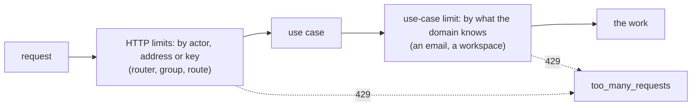
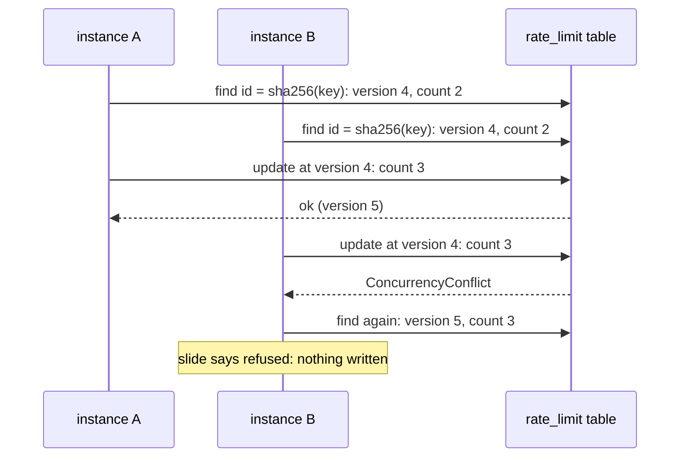
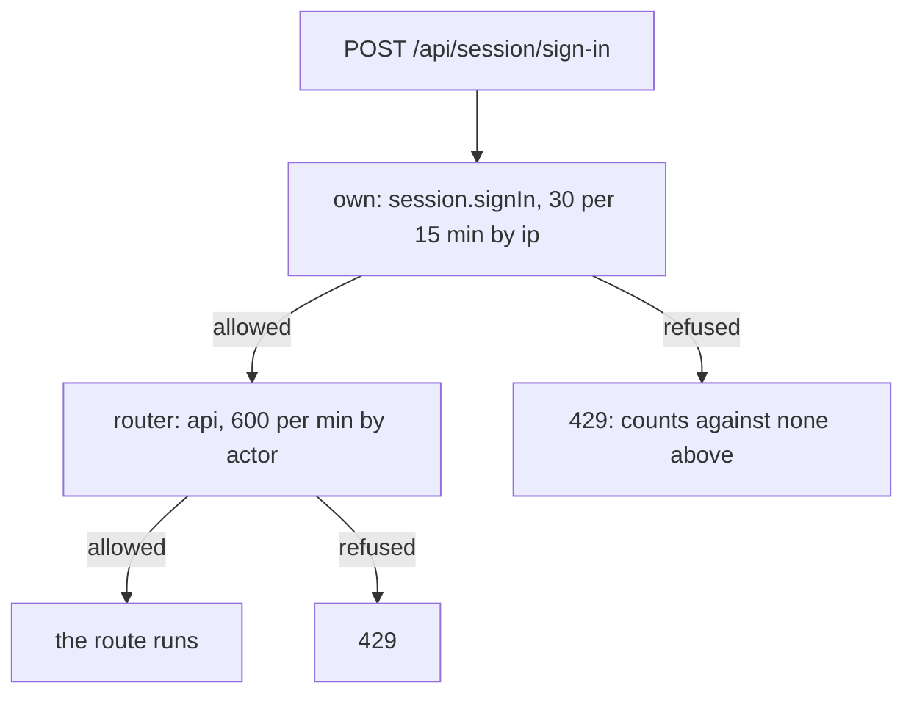
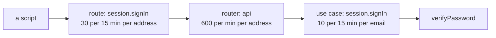

# Rate limits

<p class="chapter-lead">Some requests are fine once and dangerous a thousand times: a sign-in, an
invitation, a client registration, an AI assistant calling tools in a loop. This chapter shows how
newt counts what each caller did lately, refuses past a limit with a 429 that says when to come
back, and keeps that count right across several instances.</p>

## The problem

cooper's sign-in takes an email and a password. Nothing in it is wrong, and yet a script can try
ten thousand passwords for `ana@example.com` in an afternoon. The invitation endpoint sends an
email for each call: a workspace admin's compromised account can turn cooper into a spam cannon.
The OAuth registration endpoint is open to anyone, by design: a script can fill your
`oauth_client` table. And a person's AI assistant, connected through MCP, can get stuck in a loop
and call `list_cards` forty times a second.

Each of these needs the same thing: a count of what one caller did in the last few minutes, and a
refusal once it passes a number. What differs is **who** the caller is (a person, an address, an
email, a workspace) and **where** you count (at the door, for any request; or inside a use case,
for one specific action).

## The idea: a rule, a key, a store

A rate limit in newt has three parts:

- A **rule**, `RateLimitRule`: `{ limit, windowMs }`, at most `limit` takes in any `windowMs`.
- A **key**: whose count it is. `ana@example.com`, a workspace id, `ip:203.0.113.9`.
- A **store**, `RateLimitStore`: where the counts live, so every process that shares it shares
  them.

Each attempt is a **take**. The store answers a `RateLimitTake`:

```ts
// packages/newt/port-rate-limit/rate-limit-take.ts
export type RateLimitTake = {
  allowed: boolean
  limit: number          // the rule's limit
  remaining: number      // how many more takes the key has now: 0 when it was refused
  retryAfterMs: number   // how long until a take would be let through: 0 when this one was
}
```

A take that is refused is **not counted**. Someone hammering a closed door does not keep it closed
longer; once their window slides away, they may try again.

There are two places to take from a limit, and they answer different questions:



**HTTP limits** sit at the door. They know only the request: who is signed in, the address it came
from. They are cheap and blunt, and they protect the server as a whole. **Use-case limits** sit
inside the domain, where the use case knows what the request is about: the email someone is trying
to sign in as, the workspace an invitation goes to. They protect a resource, whoever asks.

::: info Concept: Rate limit
A rule of how often one key may do something, counted in a store every instance shares. Past it,
newt throws `TooManyRequests`, a 429 with code `too_many_requests` and a `Retry-After` header in
whole seconds. A refused take is not counted.
:::

## The sliding window

The simplest counter is a fixed window: count takes per calendar minute, reset at :00. It has a
well-known hole: a caller who sends `limit` requests at 10:00:59 and `limit` more at 10:01:00 sends
twice the limit in two seconds. A true sliding log (remember every take's time) fixes it, but costs
memory per take.

newt uses the middle road, a **sliding window counter**. It keeps, per key, just three numbers, a
`WindowCount`:

```ts
// packages/newt/port-rate-limit/window-count.ts
export type WindowCount = {
  start: number     // when its window began, in milliseconds
  count: number     // takes in that window
  previous: number  // takes in the window before
}
```

Windows are aligned to multiples of `windowMs`. To decide a take at time `now`, `slide` (in
`packages/newt/port-rate-limit/slide.ts`) pretends the previous window's takes were spread evenly,
and counts only the part of it that still overlaps the last `windowMs`:

```text
            previous window              current window
        |--------------------------|--------------------------|
        0s                        60s        80s             120s
                       |<-------- the last 60 s --------->|
                       20s                                80s
                       ^ two thirds of the previous window still overlap

  used = previous × (1 − elapsed / windowMs) + count
       =    3     × (1 −   20    /   60    ) +   0     =  2
```

That is the whole formula:

```ts
const elapsed = now - start
const used = moved.previous * (1 - elapsed / windowMs) + moved.count
if (used + 1 <= limit) { /* allowed: count + 1, remaining floor(limit - used - 1) */ }
```

Walk through it with the contract suite's own example, a rule of 3 per minute:

1. At 59 s, three takes. Window `[0, 60)`: `count = 3`. A fourth would be refused.
2. At 80 s, the key moves into window `[60, 120)`: `previous = 3`, `count = 0`, `elapsed = 20 s`.
   `used = 3 × (1 − 20/60) = 2`. One more fits: allowed, `remaining: 0`.
3. Another take at 80 s: `used = 2 + 1 = 3`, and `3 + 1 > 3`: refused.
4. How long to wait? Until enough of the previous window has slid away that `used + 1 ≤ 3` again:
   `60 × (1 − (3 − 1 − 1) / 3) − 20 = 20 s`. At 100 s, `used = 3 × (1 − 40/60) + 1 = 2`, and the
   take goes through.

`slide` computes that wait exactly, so `retryAfterMs` is honest: the contract suite checks that a
take one millisecond earlier is refused and one at exactly that moment is allowed.

When more than a whole window has passed since a key's last take, both counts start at zero. When
exactly one has, `count` becomes `previous`. That "moving" is the first thing `slide` does.

::: details Under the hood: why approximate is good enough
The sliding counter assumes the previous window's takes were evenly spread, which they rarely are.
The error is bounded by the previous window's count and shrinks to nothing as the window slides on;
it never lets through twice the limit, as a fixed window can. In exchange, a key costs three
numbers, whatever its traffic: the store's row or Redis key never grows. Cloudflare and others use
the same approximation for the same reason.
:::

## The port and its stores

`RateLimitStore` is a port with two methods:

```ts
// packages/newt/port-rate-limit/rate-limit-store.ts
export interface RateLimitStore {
  take(key: string, rule: RateLimitRule, at: Date): Promise<RateLimitTake>
  forget(key: string): Promise<void>
}
```

The time comes in as `at`, never from the store's own clock: tests move it by hand, and every
instance agrees on what "now" is. `forget` erases a key, as after a sign-in that worked. Every
store implements `take` the same way: read the key's `WindowCount`, call `slide`, and write back
what it answers, only when the take is allowed.

newt ships three:

| Store | Where the counts live | For |
|---|---|---|
| `MemoryRateLimitStore` | a `Map` in the process | one instance, tests; the default |
| `TableRateLimitStore` | a table of the context's store (`@newt-kit/newt/port-rate-limit`) | several instances sharing a database, no Redis |
| `RedisRateLimitStore` | one Redis key per key (`@newt-kit/newt/adapter-redis`) | several instances, a Redis at hand |

### In memory

`MemoryRateLimitStore` keeps a map from key to `WindowCount`. Keys whose windows have both slid
away are swept as new takes come, at most once a minute. It is the default for `Base` and for
`HttpRouter`, which is right for one process and wrong for two: behind a load balancer, each
instance would count only what it saw, and the limit would be multiplied by the number of
instances.

### On a table

`TableRateLimitStore` keeps one row per key, a `RateLimitRow`, on any newt store (SQLite, files,
Postgres, MySQL):

```ts
// packages/newt/port-rate-limit/rate-limit-row.ts
export type RateLimitRow = {
  id: string         // the key's hash
  version: number
  start: string      // when its window began: an ISO date
  count: number
  previous: number
  expiresAt: string  // when it is forgotten, once both windows slid away
}
```

The key is stored as its SHA-256, never as itself: a key may be an email, and the table needs only
to find it again. Each take is a read and a write of the row at its version. Two instances taking
the same key at once collide on the version (`ConcurrencyConflict`) or on the primary key
(`DuplicateValue`, for the first row); the loser reads again and decides again, up to ten times. So
ten takes at once against a limit of three let exactly three through, which the contract suite
checks with `Promise.all`.



Expired rows are deleted by their `expiresAt`, at most once a minute, as takes come. The table needs
a migration in each dialect your context runs; cooper's is the same in every context:

```sql
-- cooper/backend/contexts/auth/migrations/sqlite/00011_rate-limit_up.sql
CREATE TABLE rate_limit (
  id TEXT PRIMARY KEY,
  version INTEGER NOT NULL,
  start TEXT NOT NULL,
  count INTEGER NOT NULL,
  previous INTEGER NOT NULL,
  expires_at TEXT NOT NULL
);
CREATE INDEX rate_limit_expires_at ON rate_limit (expires_at);
```

### On Redis

`RedisRateLimitStore`, in `@newt-kit/newt/adapter-redis`, keeps each key's `WindowCount` as JSON in one Redis
key, under a prefix (`newt:rate` unless told, so several applications share one Redis). It does the
same compare-and-swap as the table, with a small Lua script that writes the new count only if the
key still holds what was read, and sets it to expire once both windows have slid away. Redis forgets
old keys on its own; nothing needs sweeping.

```ts
import { RedisRateLimitStore } from '@newt-kit/newt/adapter-redis'

const rateLimits = new RedisRateLimitStore({ url: process.env.REDIS_URL!, prefix: 'cooper:rate' })
```

::: details The contract suite
Every store proves it keeps the port's promises by running `describeRateLimitContract(name,
fixture)`, from `@newt-kit/newt/port-rate-limit/contract`. The suite takes a fixture that opens a fresh store
and closes it, and checks everything this section said: up to the limit with what is left, refused
past it with an exact wait, a refused take not counted, the previous window counted as it overlaps,
keys apart, `forget`, takes at once, and a rule that cannot count refused. `MemoryRateLimitStore`,
`TableRateLimitStore` on SQLite, files, Postgres and MySQL, and `RedisRateLimitStore` all run it. A
store you write runs it too.
:::

::: danger Never
A rule must be able to count: `limit` a whole number from 1, `windowMs` a whole number of
milliseconds from 1. `checkRule` throws otherwise, on every take and when a limit is defined, with
a message that says which.
:::

## Use-case limits

Some limits belong to the domain. "An email may be tried with ten wrong passwords every fifteen
minutes" is about the email, from any address; only the use case knows the email. Such limits are
defined by a module on its base:

```ts
// cooper/backend/contexts/auth/modules/session/session.module.ts (trimmed)
/** The wrong passwords one email may be tried with, from any address: a sign-in that works forgets them. */
private readonly signIns

private constructor(base: AuthBase, /* … */) {
  super('session', base.invocations, deps)
  this.signIns = base.rateLimits.define('session.signIn', { limit: 10, windowMs: 15 * MINUTE })
}

@UseCase()
async signIn(input: unknown): Promise<{ user: UserDTO, token: SecretToken }> {
  const { email, password } = SessionSignInSchema.parse(input)
  const attempts = email.trim().toLowerCase()
  await this.signIns.take(attempts)
  const user = await this.deps.user.verifyPassword(email, password)
  if (!user) {
    log.warn('sign in refused', { email })
    throw new InvalidCredentials()
  }
  await this.signIns.forget(attempts)
  return { user, token: await this.open(user.id) }
}
```

Read it slowly, because each line is a decision:

- `base.rateLimits` is the context's `RateLimits`. `define(name, rule)` returns a `RateLimit`, with
  `take(key)` and `forget(key)`.
- The name is `<module>.<name>`, like a schedule's: `session.signIn`. A name of another shape, or
  one defined twice, throws when the module is built.
- The key is the email, **normalised**: `Ana@Example.com ` and `ana@example.com` share a count.
- The take comes **before** the password is checked. Otherwise a refused attacker would still learn
  whether each password was right.
- A sign-in that works **forgets** the attempts. Ana, who mistyped twice, is not punished on her
  next mistake.

Inside, the store's key is `<context>:<name>:<key>`, `auth:session.signIn:ana@example.com`, so no
two limits share a count, even two contexts on one store.

::: tip In cooper
`invitation.create` counts per workspace, not per person: a workspace may send at most 50
invitations an hour, whoever of its admins sends them (`cooper/backend/contexts/auth/modules/invitation/invitation.module.ts`).
The take comes after the admin check, so a stranger's attempts do not use up the workspace's count:

```ts
this.sent = base.rateLimits.define('invitation.create', { limit: 50, windowMs: HOUR })
// in create(tenantId, input):
await this.assertAdmin(tenantId)
await this.sent.take(tenantId)
```
:::

Every take is a span of the trace in progress, kind `rate-limit`, named after the limit, with its
`limit`, `windowMs` and, on the way out, `remaining`. Its key is left out on purpose: it may be an
email. A refused take is the span's error, and the use case's outcome in the monitor
(chapter [Traces and metrics](./32-observability)).

::: warning Watch out
A use case runs again on `ConcurrencyConflict`, and its take runs again with it. A take is not
irreversible, but it counts: a use case that conflicts often uses up its limit faster. Put the take
early, as cooper does, before the reads that are likely to conflict.
:::

## HTTP limits

At the door, newt counts with `HttpRateLimit`, a `RateLimitRule` with a name and a "by":

```ts
// packages/newt/http/http-rate-limit.ts
export type HttpRateLimit = RateLimitRule & {
  name: string                                              // limits of the same name share a count
  by?: 'actor' | 'ip' | ((request: BunRequest) => string | null)
}
```

`by` says who each count is:

| `by` | Counts | Use it for |
|---|---|---|
| `'actor'` (default) | the signed-in actor's id; the client address when no one is signed in | an API's general limit |
| `'ip'` | the client address, even when someone is signed in | sign-in, sign-up, open endpoints |
| a function | the key it returns; `null` leaves the request out | an API key, a tenant from a header |

The address is `clientIp(request)`: the socket's, or behind `trustProxy` proxies the one the first
of them saw (chapter [HTTP security](./27-security)). Without `trustProxy`, behind a load balancer,
everyone has the balancer's address and shares one count.

### Where limits go, and how they stack

`rateLimit` is a route option, so it goes on a router, a group or a route. Unlike every other
option, where a route's own replaces its router's, rate limits **add up**: a route counts against
its router's limit, its group's and its own, each a count of its own.



They are taken innermost first. A request the route's own limit refuses counts against none of the
ones above it, so a burst at the sign-in does not use up the person's general API budget.

Limits that share a `name` share a count, which is how a router's limit becomes the whole
context's: every route has the same `api` limit, keyed by the same actor. And the same limit given
twice (on the router and again on the route) counts once.

A route that must not be counted at all says `rateLimit: false`, and leaves out every limit above
it.

Within the limits, the answer says how close the caller is, by the closest of them:

```text
ratelimit-limit: 30
ratelimit-remaining: 29
```

Past one, it is `TooManyRequests` through the route's `onError` (an OAuth route answers in OAuth's
format): a 429, `{ error, code: 'too_many_requests' }`, with `retry-after` in seconds, rounded up.

::: tip In cooper
Every limit of cooper lives in one file, `cooper/backend/shared/rate-limits.ts`, each with a
comment saying why it is the number it is:

```ts
/** What one person may ask of a context's API: plenty for anyone using it, not for a script gone wrong. */
export const API_LIMIT: HttpRateLimit = { name: 'api', limit: 600, windowMs: MINUTE }

/** What one address may try to sign in with, whatever the emails: past it, someone is guessing. */
export const SIGN_IN_LIMIT: HttpRateLimit = { name: 'session.signIn', limit: 30, windowMs: 15 * MINUTE, by: 'ip' }

/** How many accounts one address may open. */
export const SIGN_UP_LIMIT: HttpRateLimit = { name: 'session.signUp', limit: 10, windowMs: HOUR, by: 'ip' }

/** What one address may ask of OAuth's endpoints: a client signing someone in asks a few times. */
export const OAUTH_LIMIT: HttpRateLimit = { name: 'oauth', limit: 60, windowMs: MINUTE, by: 'ip' }

/** How many clients one address may register: an MCP client registers once. */
export const REGISTER_LIMIT: HttpRateLimit = { name: 'oauthClient.register', limit: 10, windowMs: HOUR, by: 'ip' }

/** How many requests one address may leave waiting for an answer: each sign-in through a product is one. */
export const AUTHORIZE_LIMIT: HttpRateLimit = { name: 'oauthGrant.request', limit: 120, windowMs: HOUR, by: 'ip' }

/** What one person's AI assistant may ask of the MCP server: a conversation calls tools in bursts. */
export const MCP_LIMIT: HttpRateLimit = { name: 'mcp', limit: 120, windowMs: MINUTE }
```
:::

### The router's store and clock

A router counts in its own `MemoryRateLimitStore` unless told otherwise. `HttpRouterOptions` takes
`rateLimits`, the store, and `clock`, what tells the time, so a test that moves its `Base`'s clock
moves the router's limits too. cooper builds both from one store in its base:

```ts
// cooper/backend/shared/cooper-base.ts
export class CooperBase extends Base<CooperStore> {
  readonly rateLimitStore: RateLimitStore
  readonly http: HttpRouter

  constructor(options: BaseOptions<CooperStore>) {
    const rateLimits = options.rateLimits ?? new TableRateLimitStore(options.store.table<RateLimitRow>('rate_limit'))
    super({ ...options, rateLimits })
    this.rateLimitStore = rateLimits
    this.http = new HttpRouter({ rateLimits, clock: options.clock, rateLimit: API_LIMIT })
  }
}
```

Three things happen here. `BaseOptions.rateLimits` is where the use-case limits count; cooper gives
the same `TableRateLimitStore` to the router, so all of a context's counts live in its own database
and every instance on it shares them. The router's default `rateLimit: API_LIMIT` makes every route
of the API count against `api`. And a test can hand a `MemoryRateLimitStore` instead, as
`cooper/backend/shared/web-session/web-session.test.ts` does.

auth's second router, for OAuth's addresses at the root, and boards' MCP router reuse the same
store with limits of their own:

```ts
// cooper/backend/contexts/auth/auth-base.ts
export class AuthBase extends CooperBase {
  readonly oauth = new HttpRouter({ prefix: '', public: true, rateLimits: this.rateLimitStore, rateLimit: OAUTH_LIMIT })
}

// cooper/backend/contexts/boards/mcp/mcp.ts
const router = new HttpRouter({ prefix: '', cors: OPEN_TO_BROWSERS, rateLimits: options.rateLimits, rateLimit: MCP_LIMIT })
```

::: warning Watch out
The HTTP key and the use-case key never collide, even with the same name. cooper's
`SIGN_IN_LIMIT` route limit and session's `session.signIn` use-case limit are both called
`session.signIn`, but the router's keys start with `http:` and are by address, the module's start
with the context's name and are by email. They are two counts, on purpose.
:::

## Sign-in, layer by layer

cooper's sign-in is the clearest picture of how the layers work together. Three limits stand
between a script and a password:



- One address guessing many emails runs into the first: 30 tries per quarter hour.
- Many addresses (a botnet) guessing one email run into the third: 10 wrong tries per quarter hour
  for that email, from anywhere. When Ana signs in correctly, her count is forgotten.
- The router's `api` limit is the floor beneath everything.

None of these touches the route's code, and the use case says its limit in two lines.

::: warning Watch out
A limit by email can lock the real owner out while someone else is guessing. cooper accepts that:
the lock lasts at most fifteen minutes and lifts by itself, and its window slides, so it lifts
gradually. If that is not acceptable for you, keep the per-email limit higher and lean on the
per-address one.
:::

## Testing limits

Tests hand the base a clock and move it, never sleep:

```ts
let time = Date.parse('2026-01-01T10:00:00.000Z')
const clock = { now: () => new Date(time) }
const router = new HttpRouter({ clock, rateLimit: { name: 'things', limit: 2, windowMs: MINUTE } })
// … two calls go through, the third is a 429 …
time += MINUTE * 2
// … and now it may again
```

`packages/newt/http/rate-limit.test.ts` and `packages/newt/runtime/rate-limits/rate-limits.test.ts`
read as the specification of everything in this chapter: by actor, by address, by key, stacking,
`false`, a shared store across routers "as instances behind a balancer do", two contexts on one
store kept apart.

## Recap

- A rate limit is a rule (`{ limit, windowMs }`), a key and a store; a refused take is not counted.
- Counts slide: the previous window counts as much as it still overlaps the last `windowMs`, three
  numbers per key, and `retryAfterMs` is exact.
- `MemoryRateLimitStore` for one instance; `TableRateLimitStore` (a `rate_limit` table, with a
  migration) or `RedisRateLimitStore` when instances share the work. All run the contract suite.
- Use-case limits: `base.rateLimits.define('<module>.<name>', rule)`, then `take(key)` before what
  they guard and `forget(key)` when it worked.
- HTTP limits: `rateLimit` on a router, group or route, by `'actor'`, `'ip'` or a function; they add
  up, innermost first, and `false` opts out.
- Past a limit, a 429 `too_many_requests` with `Retry-After`; within, `ratelimit-limit` and
  `ratelimit-remaining`.

## Going further

- [HTTP security](./27-security): `trustProxy` and `clientIp`, which `'ip'` limits rely on.
- [Auth, OAuth and web sessions](./29-auth): the endpoints these limits guard.
- [An MCP server](./31-mcp): `MCP_LIMIT` and an assistant calling in bursts.
- [Stores](./26-stores): writing a store of your own, and how contract suites prove ports.
- [Traces and metrics](./32-observability): the `rate-limit` span.
