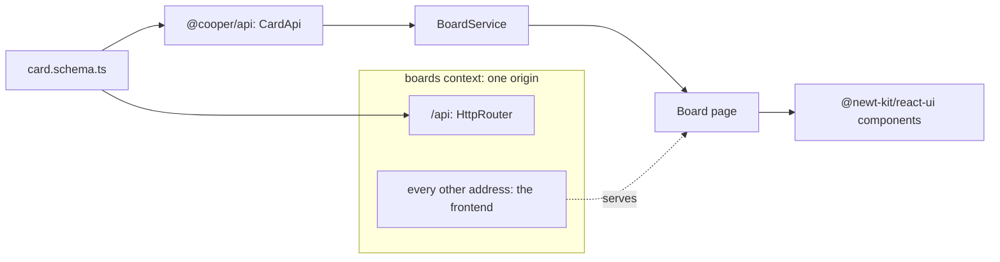
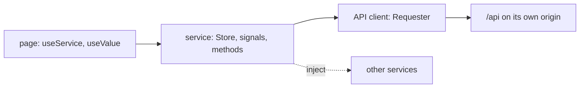

# Frontends

<p class="chapter-lead">A backend is half an application. This chapter shows how a newt context
serves its own frontend with Bun's HTML imports, how the frontend shares the backend's schemas
without importing its code, and how `@newt-kit/react` and `@newt-kit/react-ui` give every page the same
shape: a page renders, a service thinks, an API client talks.</p>

## The problem

cooper has three frontends, one per context: auth's sign-in and consent pages, the boards, and the
staff's backoffice. Each needs to be built, served, and kept in step with its API.

Every frontend team knows how this drifts. The backend renames `assignee` to `assigneeId`; the
frontend's hand-written type still says `assignee`, and the bug appears in production. The backend
says a title has at most 200 characters; the form says 255. Business rules creep into components.
Each page fetches in its own way, handles 401 in its own way, and styles its buttons in its own
way. Two years later, nobody can change anything without reading every page.

newt's answer has three parts: **one origin per context**, so the frontend and its API share
cookies and no CORS is involved; **one contract**, the module's schema file, imported by both
sides; and **one shape for every page**, enforced by two small libraries and their lint.

## The idea: one context, one origin, one contract



A context's server answers its API under `/api` and hands its frontend's `index.html` to every
other address, so the frontend's router decides what `/w/acme/boards/1` shows. The page calls
`/api/...` on its own origin; the session cookie is the origin's own; the origin check of chapter
[HTTP security](./27-security) lets its writes through and refuses everyone else's.

## Serving a frontend

`serve` takes a `frontend` option in two forms, and that is the whole difference between
development and production.

### In development: from its sources

Bun can import an HTML file. The import is an `HTMLBundle`, which Bun builds as it serves it, with
its scripts, its styles and Tailwind, and reloads as its sources change:

```ts
// cooper/backend/frontend-sources.ts
export async function frontendSources(): Promise<Record<string, { frontend: HTMLBundle }>> {
  const [auth, boards, backoffice] = await Promise.all([
    import('../frontend/auth/index.html'),
    import('../frontend/boards/index.html'),
    import('../frontend/backoffice/index.html'),
  ])
  return { auth: { frontend: auth.default }, boards: { frontend: boards.default }, backoffice: { frontend: backoffice.default } }
}
```

The imports are dynamic and only run when asked (`COOPER_FRONTEND_SOURCES=1`, which `bun run
cooper` sets), so production never builds frontends as it starts. Given an `HTMLBundle`, `serve`
routes `/*` to it, and serves the files of `publicFolder` by their address. `development: true`
turns on Bun's hot reloading.

```ts
// cooper/backend/index.ts (trimmed)
serve: { ...context.serving(), drainMs: config.drainMs, trustProxy: config.trustProxy,
         ...(sources?.[context.name] ? { ...sources[context.name], development: true } : {}) },
```

### In production: a built folder

`bun run cooper:build` builds each frontend with `Bun.build`, its `index.html` as the entry point,
into `dist/cooper/<app>`:

```ts
// cooper/scripts/build.ts (trimmed)
const built = await Bun.build({
  entrypoints: [join(source, 'index.html')],
  outdir: out,
  plugins: [tailwind],
  minify: true,
  publicPath: '/',     // from the root: the app's router serves index.html at every address
  sourcemap: 'linked',
  target: 'browser',
})
```

Given a folder as a string, `serve` uses `serveFrontend(folder, csp)`: a file when the path names
one inside the folder, otherwise `index.html`. It never leaves the folder, however the path is
written (encoded dots, a NUL); it answers 503 while the folder has no `index.html`; and every HTML
page carries a Content-Security-Policy that lets the page's own inline scripts run by their hashes.

::: tip In cooper
Each of cooper's `index.html` has one inline script, which sets the `dark` class before the first
paint so the stored theme never flashes the other one
(`cooper/frontend/boards/index.html`). In production it runs because `serveFrontend` put its
SHA-256 in `script-src`; anything injected next to it would not. That is chapter
[HTTP security](./27-security)'s `inlineScriptHashes` at work.
:::

::: warning Watch out
A frontend served from its sources has no Content-Security-Policy: Bun's reloading runs scripts of
its own. Test security headers against a build.
:::

## @newt-kit/newt/contract: what a browser may load

A frontend wants to import a module's schema: its types for the API client, and sometimes its zod
schemas as values, to validate a form with the backend's own rules. A schema imports value objects
and error classes from newt. But `@newt-kit/newt/core` keeps the scope a use case runs in (who acts, in which
workspace, in which transaction) in an `AsyncLocalStorage`, from `node:async_hooks`, which a
browser does not have.

So newt has a second door to the same classes: **`@newt-kit/newt/contract`**, the files of core that keep no
scope and run anywhere.

| Export | What |
|---|---|
| `DomainError`, `ValidationError`, `UnauthorizedError`, `ForbiddenError`, `NotFoundError`, `ConflictError` | the bases of every domain error |
| `ValueObject`, `Email`, `InvalidEmail`, `SecretToken`, `InvalidSecretToken` | value objects and their errors |
| `defineFilter`, `Filter`, `FilterField`, `FilterNode`, `FilterLimits` | the filters a client may send |
| `Page`, `PageRequest`, `ErrorBody` | lists and errors on the wire |
| `ApplicationDescription` and its parts, metrics and trace types | what newt-monitor's frontend reads |

These are the same classes `@newt-kit/newt/core` exports, not copies: an `Email` made in the browser throws
the same `InvalidEmail` as on the server.

::: danger Never
A `<m>.schema.ts` takes from newt only `@newt-kit/newt/contract` (lint rule `newt/schema-imports`). Import
`@newt-kit/newt/core` there and the schema can no longer go to the browser: Bun replaces `node:async_hooks`
with an empty stand-in, and the page breaks as soon as it loads.
:::

### The schema is the contract

A module's schema file is the one file of the backend a client needs. cooper's API clients live in
`cooper/libs/api/`, one folder per backend module, and each re-exports its module's contract beside
its client:

```ts
// cooper/libs/api/board/index.ts
// The contract comes from the backend module; the client is ours.
export type { BoardCreateDTO, BoardDTO, BoardUpdateDTO } from '../../../backend/contexts/boards/modules/board/board.schema'
export type { BoardViewDTO } from '../../../backend/contexts/boards/modules/workspace/workspace.schema'
export * from './board.api'
```

The frontend imports `@cooper/api/board` (a path alias in `cooper/frontend/tsconfig.json`). When
the backend renames a field, the frontend stops compiling. There is only one declaration of
`BoardDTO`, so the two sides cannot disagree about it.

The lint holds the line from both sides (`eslint.config.js`): the frontend never imports
`backend/` at all; `@cooper/api` may import a backend module's `*.schema.ts` and nothing else. A
use case, an entity or a repository never reaches a browser.

## @newt-kit/react: where state lives

`packages/newt-react` is what a React frontend thinks with, apart from how it looks. Its rules fit
in three sentences, from its `AGENTS.md`:

- **A page renders, and does nothing else.** It reads a service's signals with `useValue`, calls its
  methods on events, and composes components. No `fetch`, no business rule.
- **A service holds the state and the logic** of one thing: a class with a `Store`, whose parts it
  exposes as read-only signals, and methods that change it.
- **An API client is one class per backend module**, extending `Requester`.



### API clients: `Requester`

```ts
// cooper/libs/api/board/board.api.ts (trimmed)
export class BoardApi extends Requester {
  protected readonly path = '/workspaces'

  /** A page of the workspace's boards, the newest first. */
  list(workspaceId: string, page?: PageRequest) {
    return this.get<Page<BoardDTO>>(`/${workspaceId}/boards`, page)
  }

  view(workspaceId: string, boardId: string) {
    return this.get<BoardViewDTO>(`/${workspaceId}/boards/${boardId}/view`)
  }

  create(workspaceId: string, input: BoardCreateDTO) {
    return this.post<BoardDTO>(`/${workspaceId}/boards`, input)
  }
}
```

`Requester` gives its subclasses `get`, `post`, `put`, `patch` and `delete`, under
`Requester.baseUrl` (`/api` unless told). Every failure is an `ApiError` with the HTTP `status`, the
`message` and newt's error `code`, so a service branches on `card.not_found`, never on a message.
Status 0 is no answer at all. Any 401 calls `Requester.onUnauthorized`, which an app sets once:

```tsx
// cooper/frontend/boards/main.tsx (trimmed)
rootInjector.get(ThemeService)
Requester.onUnauthorized = () => rootInjector.get(SessionService).expired()
```

::: warning Watch out
Never name a client's method `get`, `post`, `put`, `patch` or `delete`: it hides `Requester`'s own,
and the client calls itself forever. That is why `BoardApi` has `getBoard`, not `get`.
:::

### Services and their injector

A service is a plain class. It gets other services and API clients with `inject(Service)`; a
component gets them with `useService(Service)`. There is one instance per injector, and the root
injector (`rootInjector`) makes any service the first time it is asked.

```ts
// cooper/frontend/boards/modules/boards/board/board.service.ts (trimmed)
export class BoardService {
  private readonly boardApi = inject(BoardApi)
  private readonly store = new Store<BoardState>({ workspaceId: '', boardId: '', view: null, loading: false, notFound: false, failure: null })

  private readonly view = this.store.select('view')
  readonly loading = this.store.select('loading')
  readonly notFound = this.store.select('notFound')
  /** From left to right. */
  readonly columns = computed(() => [...(this.view.value?.columns ?? [])].sort(byPosition))

  async load(workspaceId: string, boardId: string): Promise<void> {
    this.store.patch({ workspaceId, boardId, view: null, loading: true, notFound: false, failure: null })
    await this.refresh()
    this.store.patch({ loading: false })
  }
  // …
}
```

`Store` keeps a service's state in one signal (`@preact/signals-core`). `select(key)` hands out a
read-only part of it, so a component that reads `columns` does not repaint when `loading` changes.
`patch`, `update` and `reset` change it. A component reads a signal with `useValue(signal)`, which
repaints it when, and only when, that signal changes.

`<Provide services={[...]}>` gives part of the tree its own instances: a page's state that must
start fresh each time the page opens. They are disposed when it unmounts (a service with
`dispose()` is `Disposable`), and only on a real unmount: React's StrictMode unmount-and-mount in
development is told apart.

```tsx
// cooper/frontend/auth/pages/sign-up/sign-up.tsx (trimmed)
export function SignUp() {
  return (
    <Provide services={[SignUpService]}>
      <SignUpWrapped />
    </Provide>
  )
}

function SignUpWrapped() {
  const service = useService(SignUpService)
  const submitting = useValue(service.form.submitting)
  const failure = useValue(service.form.failure)
  // …
}
```

::: tip In cooper
A service built while a page opens may not see the route's params yet. cooper's services take them
in a method, `load(workspaceId, boardId)`, never in the constructor. And `BoardService.refresh`
numbers each read so only the latest one's answer is applied: an older answer landing last would
undo a newer move.
:::

### Forms with the backend's schema

`FormStore` validates with a zod schema before sending, and maps the backend's error codes to
fields after:

```ts
// cooper/frontend/auth/pages/sign-up/sign-up.service.ts
export class SignUpService {
  private readonly api = inject(SessionApi)
  private readonly session = inject(SessionService)

  readonly form = new FormStore(UserSignUpSchema, { email: '', name: '', password: '' }, { errorFields: { 'user.email_taken': 'email' } })

  submit(productId: string | undefined): Promise<boolean> {
    return this.form.submit(async account => this.session.signedIn(await this.api.signUp({ ...account, productId })))
  }
}
```

`UserSignUpSchema` is auth's own, from `user.schema.ts`. "Use at least 8 characters" shows under the
password before anything is sent, and the backend says the same if a request skips the form. When
the backend answers `user.email_taken`, the message lands under the email field; a failure that
belongs to no field is `form.failure`. `<FormField form={form} name="email" label="Email" />`,
from `@newt-kit/react/form-field`, binds a @newt-kit/react-ui field to it: value, change and error.

Sometimes a form needs its own words for the same limits, for the person typing. cooper's card form
does that, and says so in a comment: "the backend checks them again"
(`cooper/frontend/boards/modules/boards/board/board-card-form.ts`).

### Lists, paged as newt pages them

`ListStore` pages as a newt use case does, with a `Page` and its cursor: `loadFirstPage`,
`loadMore`, `hasMore`, `loading`, and `prepend`, `replace` and `remove`, to keep a list in step
after a change without reloading. A list the backend bounds (a workspace's members) is plain state
in a service, whole.

## @newt-kit/react-ui: one look

`packages/newt-react-ui` is the components: layout (`Stack`, `Inline`, `Grid`, `Box` and its rows,
`Card`), pages (`AppShell`, `PageHeader`, `PageBody`, `NarrowPage`, `SidebarLayout`), text, forms
(`Field`, `Input`, `Select`, `Textarea`, `Checkbox`), feedback (`Alert`, `toast`, `Dialog`,
`ConfirmDialog`, `EmptyState`, `Skeleton`), and data (`Table`, `Stat`, `LineChart`, `BarChart`,
`TimeSeries`, `Waterfall`, `Graph`). Each one is imported by its folder:
`import { Button } from '@newt-kit/react-ui/button'`.

Its one rule is short:

> **A page composes components. It never styles.**

Outside an app's own components folder there is no `className`, no `style`, no HTML element but
`form` and `fieldset`. When nothing fits, the app makes a component in its components folder, which
wraps or composes the library's and may style there, with the theme's Tailwind tokens. The lint,
`newtReactUi` from `@newt-kit/react-ui/lint`, refuses anything else:

```js
// eslint.config.js (trimmed)
const FRONTEND = newtReactUi({
  files: ['cooper/frontend/**/*.{ts,tsx}'],
  components: ['cooper/libs/ui/**', 'cooper/frontend/*/components/**'],
  imports: [BACKEND_IMPORTS],
})
```

The theme is one stylesheet, `@import "@newt-kit/react-ui/theme.css"`, light by default, dark with the
`dark` class on `<html>`, which `ThemeService` keeps and remembers (`THEME_STORAGE_KEY`).

::: info Concept: A frontend with nothing to decide
@newt-kit/react and @newt-kit/react-ui take away the decisions that make two pages different without a
reason: where state goes, how a request is made, how a 401 is handled, what a button looks like.
What is left in a page is what is specific to it. That is also what makes a page easy for a coding
agent to write correctly (chapter [Built for coding agents](./33-agents)).
:::

## cooper's three frontends

<figure class="screenshot">
  
  
  <figcaption>The boards frontend: one board, its columns and their cards, all from BoardService.</figcaption>
</figure>

| Frontend | Context | What it is |
|---|---|---|
| `cooper/frontend/auth` | auth | sign-up, sign-in, the consent page for OAuth clients, errors |
| `cooper/frontend/boards` | boards | workspaces, boards, cards, search, settings, invitations |
| `cooper/frontend/backoffice` | backoffice | the staff's console: users, workspaces, dead jobs, metrics |

Each has the same layout: `index.html` and `main.tsx` (the root, the router, the toaster),
`app.routes.tsx`, `pages/` (pages of the app as a whole: home, sign-in, not found), `modules/` (the
parts of the app, each with its pages and services), `services/` (what the whole app shares: the
session), and, in boards and backoffice, `guards/` (who may open a route). They share `cooper/libs/api` (the clients) and `cooper/libs/ui` (cooper's
own components, such as its logo and the board's lanes).

<figure class="screenshot">
  
  
  <figcaption>auth's frontend: where every app of cooper sends people to sign in.</figcaption>
</figure>

The boards and backoffice frontends never see a token. Their "sign in" button is a link to their own
`/api/session/sign-in`, and the server does the rest (chapter [Auth](./29-auth)). From the
frontend's side, a session is a `GET /api/session` that answers who you are, or a 401 that sends you
to sign in.

## Recap

- One origin per context: its API under `/api`, its frontend for every other address; no CORS, and
  its own cookies.
- `serve`'s `frontend` is an imported `index.html` in development (built as served, reloaded) or a
  built folder in production (`serveFrontend`, with a CSP that hashes inline scripts).
- `@newt-kit/newt/contract` is the part of core a browser may load; a `<m>.schema.ts` imports only it, so the
  frontend shares the backend's types and schemas, never its code.
- @newt-kit/react: a page renders, a service (`Store`, `inject`) thinks, an API client (`Requester`)
  talks. `FormStore` validates with the backend's schema and maps error codes to fields; `ListStore`
  pages as newt pages.
- @newt-kit/react-ui: a page composes components and never styles; its lint enforces it.

## Going further

- [HTTP security](./27-security): the Content-Security-Policy, the origin check, session cookies.
- [Auth, OAuth and web sessions](./29-auth): how the boards' sign-in works behind the button.
- [Queries](./25-queries): `defineFilter`, the filters a client may send.
- [Built for coding agents](./33-agents): why `@newt-kit/react` and `@newt-kit/react-ui` ship an `AGENTS.md`.
- `packages/newt-react/AGENTS.md` and `packages/newt-react-ui/AGENTS.md`: the full rules.
