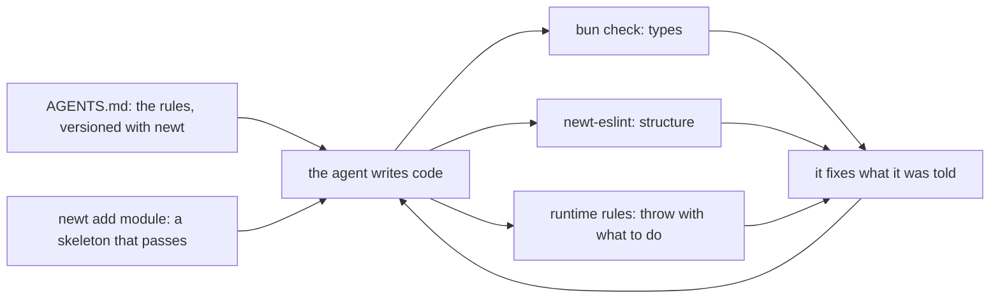
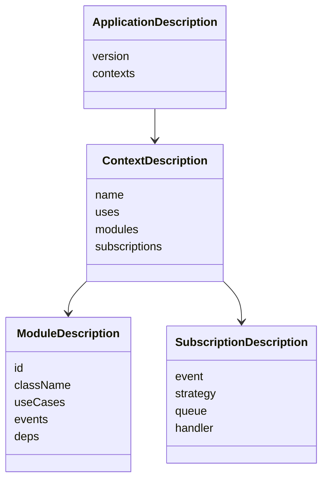

# Built for coding agents

<p class="chapter-lead">More and more of the code in an application is written by a coding agent:
Claude Code, Cursor, Copilot. An agent is fast, tireless and has read every framework's docs, and it
still writes code that compiles, passes the tests, and quietly breaks your architecture. This
chapter shows why structure is what keeps it on track, and the pieces newt ships so that an agent
finds the rules, follows them, and is stopped when it does not.</p>

## The problem

Ask an agent to "let workspace admins archive a board, and email the members". It will do it, in a
minute. And unless something stops it, it will very likely:

- send the email from the use case, before the save commits, so a save that fails has already told
  everyone;
- write to the `member` module's table directly, because it is right there;
- take `userId` from the request body, because the route has it;
- skip the workspace check in one of three routes, because the other two had it in a helper;
- return every board of the workspace, because the test had three.

None of this is a bug the tests catch. The tests were written by the same agent, in the same
minute, with the same blind spot. A human reviewer catches some of it, on a good day.

The agent is not careless. It is missing context: it does not know your rules, and nothing tells
it when it breaks one. Give it both, and it gets dramatically better.

## The idea: rules it can read, checks it cannot skip



newt is built around one bet: an architecture that is **written down, checked by machines, and
explained in the error messages** is one an agent can follow. Each piece below is ordinary
engineering that helps humans as much, but agents are the reason it is all there and all
consistent.

1. **The rules, where the agent will read them**: `AGENTS.md`, shipped inside the package,
   versioned with the code it describes.
2. **A start that is already right**: `newt init` and `newt add module`.
3. **Guard-rails**: the type checker, the lint, and rules that throw at runtime, each with a message
   that says what to do.
4. **A way to ask the application what it is**: `describeApplication`, and the monitor's MCP
   server for production.

::: info Concept: Guard-rail
A check that turns a rule into a failure the agent sees in its own loop: a type error, a lint
error, an exception in a test. A rule only in a document is a suggestion. A rule with a guard-rail
is a rule, and its message is the agent's next instruction.
:::

## AGENTS.md, shipped with the package

`AGENTS.md` is the convention coding agents look for: a file of instructions for whoever writes
code in this repository. newt ships its own, at `packages/newt/AGENTS.md`, inside the package. When
you install newt, it lands in `node_modules/newt/AGENTS.md`, at the version you installed.

That last point matters more than it looks. A framework's docs on a website describe its latest
version; the agent's training data describes an older one. The `AGENTS.md` in `node_modules`
describes exactly the code next to it. Upgrade newt, and the rules upgrade with it.

What is in it is dense on purpose: what newt is in five lines, the thirteen golden rules, a
module's anatomy as a table, the shape of an entity, a repository, a use case, a save, an event, a
worker, a route, a scope, an error; a table of **every message newt throws** with what it means and
what to do; every lint rule; how to test; and a definition of done. It is the manual's Part I,
compressed for a reader who reads it every time.

::: tip In cooper
newt keeps its `AGENTS.md` honest with a test, `packages/newt/agents.test.ts`. It fails when
`AGENTS.md` does not name every rule of newt-eslint, or does not explain every `[... rule]` prefix
the framework throws (`[write rule]`, `[guard rule]`), or when a phrase it quotes is no longer the
framework's. A new rule, or a renamed message, cannot ship without its entry.
:::

newt's other packages do the same. `newt-react` and `newt-react-ui` each ship an `AGENTS.md` (the
shape of a frontend; the components and the rule that a page never styles), and say so in their
`package.json`:

```jsonc
// packages/newt-react-ui/package.json (trimmed)
"newt": {
  "agents": "AGENTS.md",
  "skills": ["skills/newt-react-ui"]
}
```

`newt-react-ui` also ships a Claude Code **skill**, a folder of instructions an agent loads when it
is about to write UI.

## newt init: an application set up for agents

`newt init`, in an application's folder, writes three files and never overwrites one:

- **`AGENTS.md`**, the application's own: one line that sends agents to
  `node_modules/newt/AGENTS.md` (found here or in a folder above, as in a monorepo), and sections
  for what is the project's: what it is, its contexts and which ones each uses, its conventions,
  its commands.
- **`CLAUDE.md`**, Claude Code's memory, which imports them all with `@`: the project's
  `AGENTS.md`, newt's, and the `AGENTS.md` of every dependency whose `package.json` has a `newt`
  field. Each such package's skills are copied into `.claude/skills/`.
- **`eslint.config.js`** with newt's preset, `newt()`, unless this folder or one above already has
  an ESLint configuration (then it says to add the preset there).

cooper's are what `newt init` writes, filled in:

```md
<!-- cooper/CLAUDE.md -->
@AGENTS.md
@../node_modules/newt/AGENTS.md
```

```md
<!-- cooper/AGENTS.md (trimmed) -->
## Contexts

- boards: the boards of each workspace, their columns and cards. Uses auth.
- auth: people, the workspaces (its tenants) and who may enter each, and how people
  sign in. Uses none.
- backoffice: what the staff see and do across the others. Uses auth and boards.

## Conventions

- Every context's base is a `CooperBase` (shared/cooper-base.ts); a module registers
  its routes on `base.http`, in its `<m>.routes.ts`.
- boards' repositories are scoped by workspace (contexts/boards/workspace-scope.ts).
```

Keep the project's `AGENTS.md` short and true. It is not a design document; it is what an agent
must know about *this* project that newt's rules do not say.

## newt add module: a skeleton that already passes

The most common task is "add a module". `newt add module <context-folder> <name>` writes a
module's skeleton with every file of its anatomy, named as the lint wants:

```sh
newt add module src/contexts/shop price-change
```

From the folder name `price-change` it derives `PriceChange_Module`, `price-change.schema.ts`,
the entity `PriceChange`, `PriceChange_Repository`, the table `price_change`. The skeleton compiles
and passes the lint. Then it says what is left, the decisions it cannot make for you:

```text
Next:
  decide the scope in src/contexts/shop/modules/price-change/price-change.repository.ts: a tenant's { field, current }, or 'none' with the reason
  add a migration for the table 'price_change' in each dialect's migrations folder (FileStore needs none)
  initialize PriceChange_Module in the context, after the modules it uses, with its deps
  bun check && bun test && bunx eslint
```

An agent that starts from the skeleton starts from the right shape. It fills in a schema, an entity
method, a use case, instead of inventing a folder layout that the lint will refuse twenty files
later. Chapter [The command line](./c-cli) has every option.

## Guard-rails, in three layers

An agent works in a loop: write, run, read what failed, fix. newt puts a check in each step of that
loop, from the cheapest to the most thorough.

### The types

`bun check` catches the shape of things: a DTO that lost a field, a schema the frontend and the
backend disagree on (they share it, chapter [Frontends](./30-frontends)), a dep a module does not
have. Many of newt's APIs are typed so the wrong thing does not compile: a route's params come from
its path's type, a group's from its prefix's, an entity's `change` takes only its schema's fields.

### The lint

`newt-eslint` (`packages/newt-eslint`) checks what types cannot: the architecture. Its rules:

| Rule | Keeps |
|---|---|
| `newt/module-anatomy` | a module's files and folders, named after it |
| `newt/module-boundaries` | another module reached only through its module, schema, events, errors, value objects |
| `newt/context-boundaries` | a context imports only the contexts its `uses` lists, never in a cycle |
| `newt/queue-name` | a handler's queue is `<module>.<use case>.on.<module>.<event>`, and calls that use case |
| `newt/use-case` | every public method of a `Module` is `@UseCase`; others are `private` |
| `newt/route-body` | no `await request.json() as X` in a route: the use case parses `unknown` |
| `newt/schema-imports` | a schema takes from newt only `newt/contract` |
| `no-restricted-syntax` | no `transaction` in a module |
| `@typescript-eslint/no-floating-promises` | every promise awaited |

The messages are written for whoever reads them next, and that is often an agent. When a card
module imports the board module's repository, `newt/module-boundaries` says:

```text
'../board/board.repository' is board's own: a module reaches another through its use cases
(`board.module.ts`), its schema, its events, its errors and its value objects.
```

That is not just "forbidden import". It says what the rule is and what to do instead. An agent
reads it and calls `deps.board` the right way. The lint for frontends, `newtReactUi` from
`newt-react-ui/lint`, does the same for pages: no `className`, no `style`, no raw HTML elements.

::: danger Never
Never silence a rule to pass. `AGENTS.md` says so, in those words, and names the one accepted
exception: a test's own subscription, with `eslint-disable-next-line newt/queue-name` and the
reason. Tell your agent the same in your project's `AGENTS.md` if it ever tries.
:::

### Runtime rules that throw with what to do

Some rules are about what the code *does*, which neither types nor lint can see. newt checks them
as it runs, in every test, and throws with a message that names the rule and the fix:

```text
[write rule] card.archive writes to boards.member outside a worker: write it from a worker
reacting to an event, or list it in its writesTo
```

```text
[guard rule] board.create reads board in a save that guards nothing: on Postgres and MySQL another
save may change what it read before it commits. Name what its rule protects in the save's guard
```

```text
Order's schema keeps fields it does not name (z.looseObject, .catchall, .passthrough): a row's
other columns would end up in the entity. Make it a z.object, which drops them, or a z.strictObject
```

Each one is a decision an agent gets wrong naturally: writing into another module from a request
(golden rule 6), checking a rule over rows without guarding it (chapter
[Concurrency](./20-concurrency)), a loose schema. And each one fails in the agent's own test run,
before review, with its next step in the message. `AGENTS.md`'s "When newt throws" table lists them
all; the test above keeps that table complete.

Many errors work the same way at a smaller scale: `NoActor` says to read who from the payload or
use `runAsActor`; a rate limit with a bad name says it is named `<module>.<name>`, "as
session.signIn"; a missing scope says which helpers enter one
(`cooper/backend/contexts/boards/workspace-scope.ts`).

::: tip In cooper
A rule that holds in production must hold in tests. That is why newt's runtime rules are not a
"strict mode" you turn on: they always run. The agent's tests exercise them, and so the agent meets
them, every time.
:::

## What an application knows of itself

An agent asked to "add a worker when a card is archived" must first know: which module tells
`card.archived`? Who already listens? Does `activity` depend on `card`? Reading forty files to find
out is slow and error-prone. Asking the application is neither.

`describeApplication(contexts)`, from `newt/runtime`, returns what the application registered
while it was opened: every module, every `@UseCase` of each, the events each tells (schedules
among them), what each depends on, and every subscription. Nothing is read from the code; it is
what was built.

```ts
// describe-cooper.ts: a script beside cooper/
import { describeApplication } from 'newt/runtime'
import { config } from './cooper/backend/config'
import { openContexts, stopContexts } from './cooper/backend/open-contexts'

const contexts = await openContexts({
  ...config,
  auth: { ...config.auth, database: ':memory:' },
  boards: { ...config.boards, database: ':memory:' },
  backoffice: { ...config.backoffice, database: ':memory:' },
})
const application = describeApplication([...contexts.all])
console.log(JSON.stringify(application.contexts[1]!.modules.find(module => module.name === 'board'), null, 2))
await stopContexts(contexts)
```

```json
{
  "id": "boards/board",
  "context": "boards",
  "name": "board",
  "className": "Board_Module",
  "useCases": [
    { "id": "boards/board.list", "name": "board.list", "writesTo": [], "retryOnConflict": true }
  ],
  "events": [
    { "id": "boards/board.created", "name": "board.created", "schedule": null },
    { "id": "boards/board.archived", "name": "board.archived", "schedule": null }
  ],
  "deps": [
    { "name": "member", "kind": "module", "target": "boards/member" }
  ]
}
```

(Trimmed: the real output lists every use case and event.)

An `ApplicationDescription` is `{ version: 1, contexts }`; each `ContextDescription` has its
`name`, the contexts it `uses`, its `modules` and the `subscriptions` to its events. A
`ModuleDependency` is a `module`, the `events` of one, or a `port`.



This is why `AGENTS.md` insists that a module pass **all** of its deps to `super`, and that another
context's modules be handed as they are, never wrapped in a port of functions: the description
reads deps from what the constructor gave `Module`. A dep wrapped as
`{ isMember: (w, u) => auth.access.check(...) }` is a port with no target, and the dependency
disappears from the description, from the lint and from the monitor's graph.

::: warning Watch out
`describeApplication` knows what was built, not what calls what. It sees that `card` depends on
`board`, not which use case of `card` calls which of `board`, nor the routes. And a module that
passed no deps to `super` has none, as far as it can tell.
:::

The same description is what `serveMonitor` answers at `GET /v1/structure`, and what newt-monitor
draws as each application's contexts, modules and dependency graph, version by version.

<figure class="screenshot">
  
  
  <figcaption>describeApplication, drawn: every module of cooper and what it depends on.</figcaption>
</figure>

## Reading production: the monitor's MCP server

The last piece closes the loop. An agent that wrote a change should be able to see how it behaves
once deployed: whether `card.move` got slower, whether a new queue has dead jobs, what the trace of
a failed request says. newt-monitor has its own MCP server, built exactly as cooper's (chapter
[An MCP server](./31-mcp)): a router at the root, bearer tokens from its own auth, a resource of
its own, one server per request, every tool read only.

Its tools, in `packages/newt-monitor/backend/contexts/monitor/mcp/mcp-tools.ts`:

| Tool | Answers |
|---|---|
| `list_apps` | the applications it watches; every other tool takes one's id |
| `get_structure`, `list_versions` | what an application is made of, version by version |
| `use_case_totals`, `use_case_series` | calls, durations, outcomes, per use case |
| `errors_totals`, `error_codes` | which errors, how often |
| `event_totals` | events told |
| `queues`, `dead_jobs` | how full each queue is, and the jobs that died |
| `list_traces`, `get_trace` | single runs, span by span |
| `system_and_instances`, `system_series` | CPU, memory, event loop, disks |
| `list_deployments` | what was deployed, and when |

Connected to it, an assistant can answer "why did `card.move` start failing after yesterday's
deploy?" by itself: `list_deployments`, then `error_codes` for that use case, then `list_traces`
and `get_trace` for one that failed, with its spans, its queries' shapes and its log lines. It
reads counts and shapes, never your data, because that is all `serveMonitor` serves. Chapter
[Asking Claude about production](./46-asking-claude) walks through it.

## Working with an agent on a newt application

What this means day to day:

- **Start every task from the rules.** With `CLAUDE.md` in place, Claude Code reads newt's
  `AGENTS.md` every session. With another agent, point it at `node_modules/newt/AGENTS.md`.
- **Start every module from `newt add module`.** The skeleton is the anatomy.
- **Make the loop include all three checks.** `bun check && bun test && bunx eslint` is the
  definition of done in `AGENTS.md`. An agent that runs only the tests misses the lint, and the lint
  is where the architecture lives.
- **Let the errors teach.** When a runtime rule throws, the right fix is in the message. Resist the
  agent's instinct to work around it (a `try`, a disabled rule, `scope: 'none'` "to make it work").
- **Ask for the hard tests.** `AGENTS.md` lists them: at once (`Promise.allSettled`), twice,
  refused, limits crossed, another tenant. An agent writes them well when asked, and rarely
  unasked.
- **Keep the project's `AGENTS.md` true.** When you add a context or a convention, add a line.

## Recap

- An agent breaks architecture not out of carelessness but for lack of context and feedback; newt
  gives it both.
- `AGENTS.md` ships inside the package, versioned with the code it describes, and a test keeps it
  complete; newt-react and newt-react-ui ship theirs, and newt-react-ui a skill.
- `newt init` writes the project's `AGENTS.md`, a `CLAUDE.md` that imports every package's rules,
  and the lint; `newt add module` writes a skeleton that compiles and passes.
- Three layers of guard-rails: types, newt-eslint, and runtime rules that throw with the fix in
  the message.
- `describeApplication` says what the application is made of, from what it registered; it is also
  the monitor's structure and graph.
- newt-monitor's MCP server lets an assistant read production: metrics, errors, queues, traces.

## Going further

- [The rules](./a-rules) and [The lint](./b-lint): every rule, in full.
- [The command line](./c-cli): `newt init` and `newt add module`.
- [Common problems](./e-problems): what each message means.
- [An MCP server](./31-mcp): how an MCP server is built with newt.
- [newt-monitor](./40-monitor) and [Asking Claude about production](./46-asking-claude).
