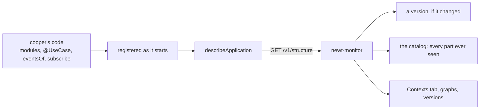
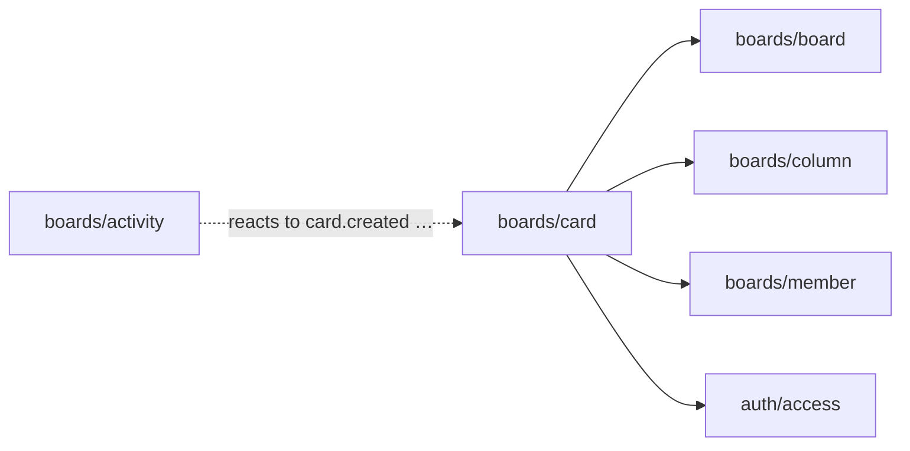
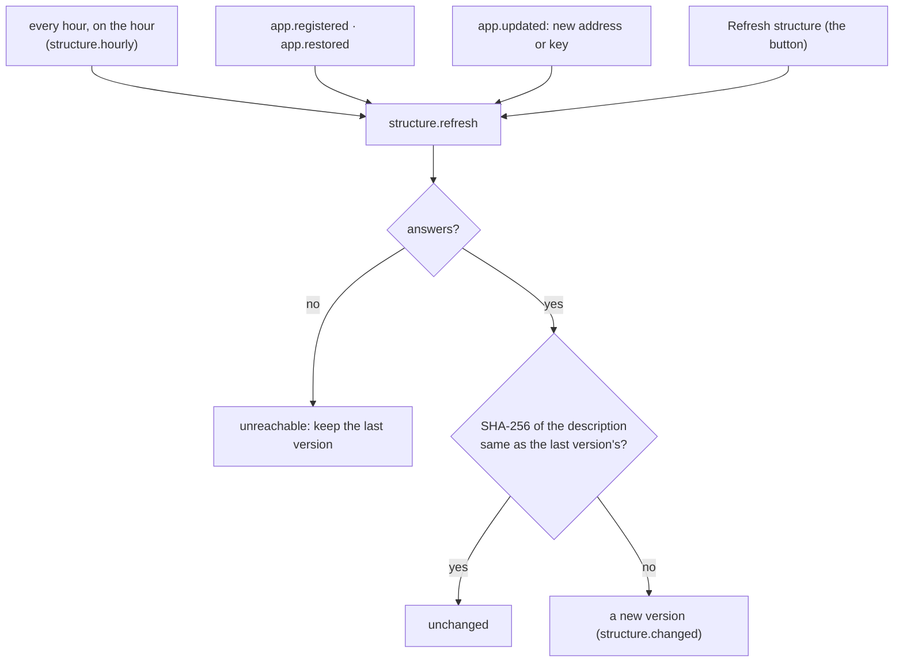
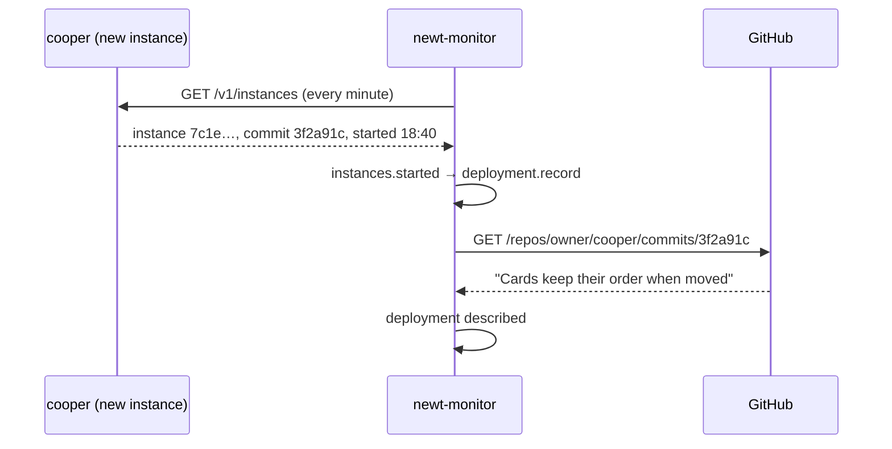

# The structure, drawn

<p class="chapter-lead">Architecture diagrams go stale the week after they are drawn. This chapter shows how newt-monitor draws cooper's structure from cooper itself, while it runs: its contexts, modules, use cases, events, workers and schedules, the graph of what uses what, and how all of it changed from one deployment to the next.</p>

## The problem

There is a diagram of cooper on the team's wiki. It has three boxes, `auth`, `boards` and
`backoffice`, and arrows between them. It was right in March. Since then someone added an
`activity` module that reacts to every card event, someone else made `backoffice` read
`boards` directly, and a nightly job was renamed. Nobody updated the drawing, because
nobody ever does.

When you join the team, or come back to cooper after six months, or try to understand why
a change in `card` broke the backoffice, the question is always the same: **what is cooper
made of right now, and what uses what?** The honest answer lives in the code, spread over
dozens of files. And what is *deployed* may not even be what is on `main`.

## The idea

newt's structure is not a convention you hope people follow. It is registered. Each
module is initialized into its context, each use case is decorated, each event is named,
each subscription has a queue, each schedule has a cron. So the running application can
describe itself exactly, and `describeApplication` does:

::: info Concept: The application's description
What `describeApplication(contexts)` returns while the application runs: every context
with the contexts it uses, every module with its use cases, the events it tells (its
schedules among them) and its deps, and every subscription to a context's events with its
queue. Its ids are stable: a module is `boards/card`, a use case `boards/card.create`, an
event `boards/card.created`.
:::

The monitor reads it from `GET /v1/structure`, keeps a **version** each time it changes,
and draws it. Nothing in the monitor is configured by hand: rename a module, deploy, and
the monitor shows the new name and remembers the old one.



## What a description holds

Here is a trimmed piece of cooper's description, `boards` and its `card` module:

```jsonc
{
  "version": 1,
  "contexts": [
    {
      "name": "boards",
      "uses": ["auth"],
      "modules": [
        {
          "id": "boards/card",
          "context": "boards",
          "name": "card",
          "className": "Card_Module",
          "useCases": [
            { "id": "boards/card.create", "name": "card.create", "writesTo": [], "retryOnConflict": true },
            { "id": "boards/card.removeColumn", "name": "card.removeColumn", "writesTo": ["column"], "retryOnConflict": true }
            // …
          ],
          "events": [
            { "id": "boards/card.created", "name": "card.created", "schedule": null }
            // … card.edited, card.moved, card.assigned, card.unassigned, card.deleted
          ],
          "deps": [
            { "name": "board", "kind": "module", "target": "boards/board" },
            { "name": "auth.access", "kind": "module", "target": "auth/access" }
            // …
          ]
        }
        // … activity, board, column, member, workspace
      ],
      "subscriptions": [
        { "event": "boards/card.created", "strategy": "handler", "queue": "card.indexCard.on.card.created",
          "handler": "card.indexCard", "attempts": null, "filtered": false }
        // …
      ]
    }
    // … auth, backoffice
  ]
}
```

Each piece answers a question you would otherwise grep for:

| Field | The question |
|---|---|
| `uses` | Which contexts does this context's code depend on? (Found from its modules' deps, so it agrees with what newt-kit-eslint's `contexts.uses` declares.) |
| `useCases[].writesTo` | Besides its own module, which modules may this use case write to? |
| `useCases[].retryOnConflict` | Does it run again on a concurrency conflict, or not? |
| `events[].schedule` | Is this event a schedule? With which cron? |
| `deps[]` | What does the module need: another module (`kind: module`), the events of one (`kind: events`), or a port, an object in its own words (`kind: port`)? |
| `subscriptions[]` | Who reacts to this context's events: a `handler` with its queue, its use case, its attempts, whether it filters with `when`; or a `fire-and-forget` listener. |

::: tip In cooper
`activity` subscribes to every card event with queues like
`activity.recordCreated.on.card.created`, and `card` reacts to its own events to index
cards for search (`card.indexCard.on.card.edited`). Both appear in `boards`'
`subscriptions`, each with its handler, without anyone listing them by hand.
:::

## The Contexts tab

The **Contexts** tab is the description, drawn.

<figure class="screenshot">
  
  
  <figcaption>A module's page: its use cases with their last 24 hours, the events it tells, what it depends on and what it reacts to, beside the tree of contexts and modules.</figcaption>
</figure>

On the left is a tree, like a repository's folders: **All contexts**, then each context,
and the modules of the one you are in. On the right, the page of what you chose.

**All contexts** lists them with what each uses.

**A context's page** says which contexts its modules use, each a link. Then a graph of what
it has to do with the others, its modules in a box, the contexts they use on the left and
the contexts that use them on the right. Then its modules, each with its count of use
cases, events and deps. Last, **who hears its events**: every subscription, the handler
that runs it, whether that handler is in another context, and how: "a job in queue
`card.indexCard.on.card.created`", or "fire-and-forget: no job", "only when it says so"
(it has a `when`), and its attempts if they are not the default.

**A module's page** is the richest:

- **Use cases**, each with its last 24 hours (calls, p90, errors and failures), "writes also
  to `boards/column`" or "writes only to its own module", and "retried on a conflict" or
  "never retried on a conflict". Each links to its metrics.
- **Events it tells**, each with how many times it was told in 24 hours and who hears it.
  A schedule shows its cron as a badge: `0 3 * * *`.
- **Depends on**: each dep by its key: "the module `boards/board`"; for a dep that is only
  another module's events (`tenants: tenant.events`), "the events … of" that module; or "a
  port: an object in its own words".
- **Reacts to**: the events its use cases handle, with the handler and its queue.

Every module name is a link to its own page, so you can walk cooper's dependencies with
the mouse.

### Removed parts

A **Show removed** toggle on a context's or a module's page adds, marked as removed, what
earlier versions had and this one does not: a module that was split, a use case renamed,
an event no longer told. Open a removed module and you see the use cases and events it had,
and when it went. That is the catalog, below.

## The graph

Graphs appear in three places, each drawn from the description:

- On the **overview**, "How its contexts use each other": one node per context, an arrow
  for each `uses`.
- On a **context's page**, "What it has to do with other contexts".
- On a **module's page**, "What it uses, and what uses it": the module in the middle, what
  it uses on the left, what uses it on the right, one step and no further.

<figure class="screenshot">
  
  
  <figcaption>What a module uses and what uses it. Solid arrows are deps; with "Show reactions", dashed arrows are events one module's use cases handle.</figcaption>
</figure>

An arrow goes from a module to what it **uses**. Solid arrows come from its deps: another
module, or the events of one taken as a dep. **Show reactions** adds dashed arrows: a
module whose use case handles another module's event depends on that event, even though
no dep says so. Ports draw no arrow: a port is an object in the module's own words, and the
monitor cannot tell whose it is.



That is the drawing on the wiki, except that it is never wrong. If `backoffice` starts using
`boards`, the arrow appears with the deploy.

::: details Under the hood: how the graph is built
The frontend builds every graph from the description alone (`app-structure.ts`). For each
module, each dep that is not a port gives an edge to its `target`. With reactions, each
subscription whose handler is a use case of some module gives a dashed edge from that
module to the module that tells the event. Two edges between the same pair become one,
solid if either is. A context's graph collapses the modules of other contexts into their
context, so a whole context's web still fits on one screen.
:::

## Versions

An application's structure changes when you deploy a new module, use case, event or
subscription. The monitor keeps each one it sees as a **version**.



The structure is read every hour, as soon as an application is registered or restored, when
its address or key changes, and whenever you press **Refresh structure**. Each read
compares the SHA-256 of the description with the last version's. Only a different hash
makes a new version, which `structure.changed` announces. So a version is not "a read": it
is "a moment the structure changed". A deploy that fixes a bug inside a use case makes no
version at all.

**Settings → Versions** lists them, newest first, like a repository's commits: when each was
read, its hash's first seven characters, and a **Latest** badge on the current one.

<figure class="screenshot">
  
  
  <figcaption>A version each time cooper's structure changed, newest first. Open one to see what it added and what it removed.</figcaption>
</figure>

Open one and you get its **diff** against the version before: **Added** and **Removed**, each
part with its kind (context, module, use case, event) and where it is, each a link. The first
version has nothing to compare with: it says everything in it was new, and counts its
contexts, modules, use cases and events.

::: tip In cooper
Rename `card.indexCard` to `card.index` and deploy. The next read makes a version whose
diff shows `card.indexCard` removed and `card.index` added, and the queues named after it
change too. The [Queues](./45-queues) tab then flags any job still waiting under the old
queue name as an **Orphan**.
:::

## Deployments

A version says *what* changed. A **deployment** says *which commit* is running, and when it
arrived.

Each instance tells the monitor the commit it was built from (`serveMonitor`'s `commit`,
`SOURCE_COMMIT` by default). The first time the monitor hears of an instance with a commit it
has not seen for that application, it records a deployment: that commit, deployed when that
instance started. If you told the monitor where the code is (**Settings → General →
Repository**), it asks GitHub for the commit's message: its first line becomes the
deployment's title, the rest its description.



You see deployments in three places:

- In the **band** of every page: the commit of the newest instance alive, short, with its
  title, linked to the commit on GitHub.
- On **every chart**, as a mark at the moment it was deployed, with its title. Before any
  deployment is known, versions of the structure mark the charts instead.
- To **Claude**, through `list_deployments` ([Asking Claude](./46-asking-claude)).

Telling the monitor the repository later describes the last 50 deployments still without a
title. GitHub not answering is retried, as any job is; a commit GitHub does not have, or
cannot show with the token, stays untitled.

::: warning Watch out
No commit, no deployments. Locally `SOURCE_COMMIT` is unset, so the instance says `null`, and
the charts mark versions instead. In an image, pass the commit as a build argument, as
cooper's `Dockerfile` does (`ARG SOURCE_COMMIT`); Coolify fills it in when "Include Source
Commit in Build" is on.
:::

## The catalog

Versions are snapshots. The **catalog** is the index across all of them: every context,
module, use case and event any version of the application ever had, each with three dates.

::: info Concept: The catalog
For each part of an application (by kind and id, `useCase` `boards/card.create`): when the
first version that had it was taken (`firstSeenAt`), when the last version that had it was
taken (`lastSeenAt`), and when the first version without it was taken (`archivedAt`, null
while it is there). What goes is archived, never deleted, and comes back as it was if it
returns.
:::

After each new version, a worker brings the catalog up to date: new parts appear, parts
still there are seen again, parts gone are archived. It reads the latest version whatever
told it to, so running it twice, or late, comes to the same result.

The catalog is what **Show removed** draws, and its API answers questions no single version
can:

```sh
# every use case boards ever had, gone ones too
GET /api/apps/:id/catalog?kind=useCase&context=boards&status=all
# one part, with its dates and details
GET /api/apps/:id/catalog/:itemId
```

Each item keeps `details`: what the description said of it, a use case's `writesTo` and
`retryOnConflict`, an event's schedule, a module's deps.

## Recap

- `describeApplication` reads the running application's structure; the monitor fetches it
  from `GET /v1/structure`. Nothing is configured by hand.
- The Contexts tab draws it: contexts, modules, use cases (`writesTo`, `retryOnConflict`),
  events and schedules, deps, and who reacts to what, through which queue.
- Graphs show what uses what; dashed arrows add reactions to events.
- A version is kept only when the description's hash changes; its diff says what was added
  and removed.
- Deployments come from each instance's commit, titled from GitHub, and mark every chart.
- The catalog keeps every part any version had, with when it came and when it went.

## Going further

- [Modules](./04-modules) and [Between contexts](./11-between-contexts): where the structure
  this chapter draws comes from.
- [Metrics](./43-metrics): what the numbers beside each use case and event mean.
- [The lint](./b-lint): `contexts.uses` and the rules the graph reflects.
