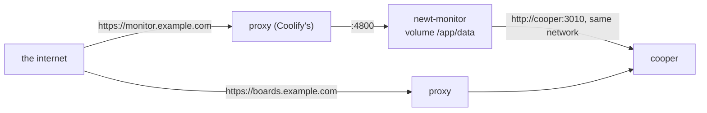
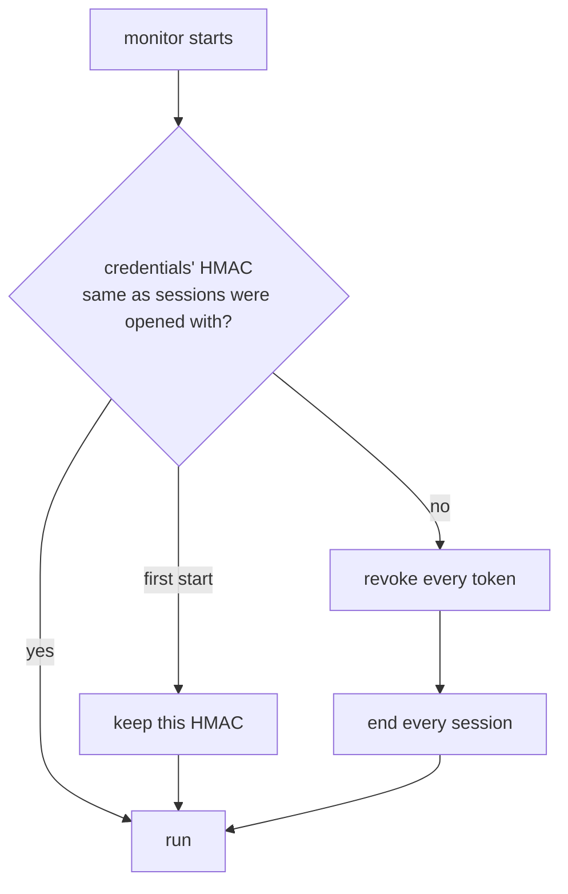
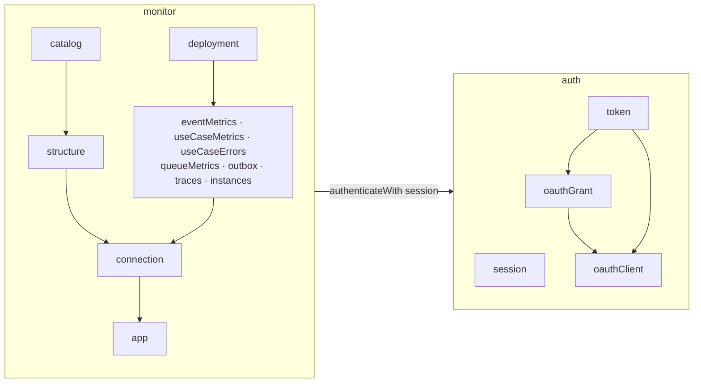

# Running the monitor

<p class="chapter-lead">A monitor that sees production must be at least as well guarded as production. This chapter runs newt-monitor: its settings, its image, its databases, how it protects the keys, sessions and tokens it holds, and, to close Part III, how it is built with newt, as a second example beside cooper.</p>

## The problem

You run one monitor for all your newt applications. It holds every application's key, which
is enough to read everything that application tells. It has a sign-in page on a public
address, so anyone can guess at its password. It issues OAuth tokens to AI assistants. And
it keeps months of metrics that you would rather not lose in a redeploy.

None of that can be an afterthought. It has to be the default, with few knobs, each one
explained.

## Starting it

The monitor is a newt application with one entry point, published as `@newt-kit/monitor`
with its pages built. Anywhere Bun runs:

```sh
NEWT_MONITOR_USER=ana \
NEWT_MONITOR_PASSWORD='a long password' \
NEWT_MONITOR_SECRET="$(openssl rand -base64 48)" \
bunx @newt-kit/monitor
```

From the repository it is the same entry point, `bun packages/newt-monitor/backend/index.ts`.

```text
newt-monitor listening on http://localhost:4800/
```

From the repository, its pages are built first, with `bun run monitor:build` at the root (the
image does it). In development, `bun run monitor` starts it with `--watch`, and serves its pages
from their sources, rebuilt and reloaded as they change; its user, password and secret come
from the environment (or `.env`) all the same.

Without a user, a password or a secret it does not start, and it says every problem at once:

```text
newt-monitor: it cannot start:
  NEWT_MONITOR_USER: Invalid input: expected string, received undefined
  NEWT_MONITOR_PASSWORD: Invalid input: expected string, received undefined
  NEWT_MONITOR_SECRET: Invalid input: expected string, received undefined
```

## Its configuration

Every setting is an environment variable, read and checked once at start
(`packages/newt-monitor/backend/config.ts`). A wrong one stops it before it opens anything.

| Variable | Default | What it is |
|---|---|---|
| `NEWT_MONITOR_USER` | none: required | Who signs in. One person. |
| `NEWT_MONITOR_PASSWORD` | none: required | Their password: 12 characters or more. |
| `NEWT_MONITOR_SECRET` | none: required | What the applications' keys are encrypted with, 32 characters or more. Lose it, and every key must be given again. |
| `NEWT_MONITOR_PORT` | `4800` | Where it listens. Empty is the default, not port 0. |
| `NEWT_MONITOR_DATA` | `data/newt-monitor.db` | Its SQLite database: a file, made with its folder if missing, or `:memory:`. The other databases go beside it. |
| `NEWT_MONITOR_PUBLIC_URL` | `http://localhost:4800` | Where people open it, without a trailing slash. On `https`, its cookie is `Secure` and browsers are told to keep to HTTPS. Its OAuth addresses and MCP resource are built on it. |
| `NEWT_MONITOR_SESSION_HOURS` | `12` | How long a session lasts. |
| `NEWT_MONITOR_TRUST_PROXY` | `0` | How many proxies in front of it add to `X-Forwarded-For`, so its rate limits count the person's address, not the proxy's: `1` behind Coolify's. Empty is the default. |
| `NEWT_MONITOR_GITHUB_TOKEN` | none | A GitHub token that reads the applications' repositories (Contents: read), for the commits' messages. Without one, only public repositories are read. |
| `NEWT_MONITOR_FRONTEND` | the package's `dist/frontend` | Its built pages. |
| `NEWT_MONITOR_FRONTEND_SOURCES` | `0` | `1` serves the pages from their sources (what `bun run monitor` sets): development only. |

::: danger Never
Never put the monitor behind a proxy without setting `NEWT_MONITOR_TRUST_PROXY`, and never set
it higher than the number of proxies you really have. Too low, every request seems to come
from the proxy, and one stranger guessing passwords locks you out too; too high, a client can
write its own `X-Forwarded-For` and pick its address.
:::

## Its image

`monitor.Dockerfile`, at the repository's root, builds one image with the monitor and its
pages:

```dockerfile
# monitor.Dockerfile
FROM oven/bun:1.4.2-alpine
WORKDIR /app

COPY package.json bun.lock ./
COPY packages/newt/package.json packages/newt/
COPY packages/newt-eslint/package.json packages/newt-eslint/
COPY packages/newt-monitor/package.json packages/newt-monitor/
COPY packages/newt-react/package.json packages/newt-react/
COPY packages/newt-react-ui/package.json packages/newt-react-ui/
RUN bun install --frozen-lockfile

COPY bunfig.toml tsconfig.base.json ./
COPY packages/newt packages/newt
COPY packages/newt-react packages/newt-react
COPY packages/newt-react-ui packages/newt-react-ui
COPY packages/newt-monitor packages/newt-monitor
RUN bun run monitor:build

ENV NODE_ENV=production
ENV NEWT_MONITOR_DATA=/app/data/newt-monitor.db
EXPOSE 4800
CMD ["bun", "packages/newt-monitor/backend/index.ts"]
```

It installs the workspace, copies only newt, the React packages its pages use, and the monitor,
builds the pages, and runs the backend. `/app/data` must be a **persistent volume**.



On a platform like Coolify: the monitor gets a domain of its own and its port 4800 behind the
proxy, with `NEWT_MONITOR_PUBLIC_URL=https://monitor.example.com` and
`NEWT_MONITOR_TRUST_PROXY=1`. It joins the network of the applications it watches, and reaches
each one's endpoint by its name on that network (`http://cooper:3010`), a port no domain points
at.

## Its databases

Everything lives beside `NEWT_MONITOR_DATA`, in one folder:

| File | Whose | What |
|---|---|---|
| `newt-monitor.db` | the `monitor` context | Applications (keys sealed), connections, structure versions, the catalog, retention, deployments, each metric module's feed, its outbox. |
| `newt-monitor-auth.db` | the `auth` context | Sessions, OAuth clients, grants and tokens (hashes only), and the hash of the credentials sessions were opened with. |
| `metrics/<appId>.duckdb` | every metrics module | One DuckDB per application: event counts, use case timings and errors, queue flows and depth, instances, system, traces. |

Back up the folder, and you back up the monitor. With `NEWT_MONITOR_DATA=:memory:`, all three
live in memory, which is what the tests use.

::: warning Watch out
DuckDB holds a lock on its file. During a redeploy, the old container may still hold an
application's file when the new one starts; the monitor tries to open it again at the next
collection, so a minute or two of collections may be late, never lost.
:::

## What it serves

One process, one port:

| Address | What |
|---|---|
| `/api/...` | Its API, every route behind the session cookie but signing in. An address no route takes is a `404`, never the app. |
| `GET /api/health` | Up or stopping, without a session, for whatever watches it. |
| `/mcp` | Its MCP server, behind an OAuth token ([Asking Claude](./46-asking-claude)). |
| `/oauth/...`, `/.well-known/...` | OAuth's endpoints and metadata, public. |
| anything else | A file of its built pages, or their `index.html`. A `503` "The frontend is not built" until `monitor:build` has run; the API works all the same. |

Every answer carries newt's security headers (`nosniff`, a strict referrer policy,
`X-Frame-Options: DENY`).

## Security

### One person

The monitor has one user, from its environment. Signing in compares the user and the password
each by the SHA-256 of both sides, in constant time, and checks both even when the first is
wrong. A wrong user answers as late as a wrong password, and neither answer says which it was.

### Sessions

Signing in opens a session and puts its token in a cookie, `newt_monitor_session`:
`HttpOnly` (the page's scripts cannot read it), `SameSite=Strict` (sent only to the monitor),
`Secure` on `https`, for `NEWT_MONITOR_SESSION_HOURS`. The database keeps only the token's
hash, so a copy of it opens no session. An expired session is closed when its browser comes
back; every night at 03:00 (UTC) the expired ones are removed.

### Rate limits

Only what *anyone* may ask is limited; what the signed-in person asks is not.

| What | Limit | Counted by |
|---|---|---|
| Sign in, from one address | 10 tries in 15 minutes | address |
| Sign in, everyone together | 100 tries in an hour | all |
| OAuth's endpoints | 60 requests a minute | address |
| Registering an OAuth client | 10 an hour, at most 16 KiB each, a name of 80 characters and 10 redirect addresses of 2,000 characters | address |
| Authorization requests left waiting | 30 an hour | address |

The total limit means many addresses guessing together still guess slowly: past it, even you
wait, up to an hour. The limits count in the monitor's memory, because it is one process
(`MonitorBase` gives every router a `MemoryRateLimitStore`); a restart forgets them. They are
defined in `packages/newt-monitor/backend/shared/rate-limits.ts`, with newt's `HttpRateLimit`
([Rate limits](./28-rate-limits)).

### New credentials end everything

The auth database keeps an HMAC, under the secret, of the user and password that sessions were
opened with. When the monitor starts with another user or password (one leaked, so you changed
it), it notices, **revokes every MCP client's tokens, then ends every session**, in that order,
so a start that stops halfway does it all again next time. Changing the password is the one
switch that cuts off everyone and everything at once.



### HTTPS

When `NEWT_MONITOR_PUBLIC_URL` is `https`, every answer tells browsers to come back only over
HTTPS for a year (HSTS), even though the proxy in front speaks HTTP to the monitor, and the
session cookie is `Secure`.

### The applications' keys

The monitor needs each application's key itself, to sign with it, so it cannot keep only a
hash. It **seals** each one with `KeyCipher`: AES-256-GCM, with a key derived from
`NEWT_MONITOR_SECRET` (HKDF-SHA256), a new nonce for every text, and the application's id bound
to it. So:

- a copy of the database, without the secret, opens no key;
- a sealed key moved to another application's row does not open there;
- a sealed key changed in the store does not open at all.

Start the monitor with another secret and the keys it kept no longer open: each application's
connection says `key_unreadable`, and you give each key again in its Settings.

::: details Under the hood: the sealed text
`v1.<nonce>.<ciphertext>.<tag>`, each part base64url. The `v1` names the scheme, so another can
come later and both be read.
:::

### OAuth tokens

Every OAuth client registers itself and is public; it proves itself with PKCE (S256 only).
Redirect addresses are `https`, or `http` only on `localhost`, `127.0.0.1` or `[::1]`, and never
with a fragment. Tokens are kept as hashes, and are good only for the monitor's MCP server
(the resource `<public url>/mcp`). An access token lasts an hour, a refresh token 30 days
unused, and each refresh replaces both. A code traded twice was copied: the tokens it gave are
revoked. OAuth's and the MCP server's endpoints answer pages of any origin, but never with
cookies: who calls is in the token.

### Talking to applications

The monitor signs every request it sends, waits 5 seconds at most, and **never follows a
redirect**: it asks the address it was given and no other, so an application cannot send it,
and its signed headers, elsewhere ([Connecting an application](./41-connecting)).

## Built with newt

newt-monitor is a second example beside cooper, smaller and different. cooper is a SaaS with
tenants and three contexts serving three frontends; the monitor is an internal tool with one
user, two contexts on one port, and a lot of scheduled work.



**Two contexts.** `auth` says who may enter: the one person (`session`), the MCP clients
(`oauthClient`), their authorization requests (`oauthGrant`) and their tokens (`token`).
`monitor` holds the applications and what it learns of each. Each context has its own SQLite
database. `main` opens `auth` first, then `monitor` with `auth`'s modules, and serves both on
`monitor`'s port with `runContexts`.

```ts
// packages/newt-monitor/backend/main.ts
export async function main(env: Record<string, string | undefined>): Promise<RunningContexts> {
  const config = readConfig(env)
  const auth = await Auth_Context.open(config)
  const monitor = await Monitor_Context.open(config, { auth: auth.modules })
  // …
  const app = runContexts([{ context: auth }, { context: monitor, serve: { ...monitor.serving(auth.routes()), ...sources } }])
  // …
}
```

Every route of `monitor` runs as whoever `auth` says its session cookie is, with one line in
its `initialize-modules.ts`:

```ts
// packages/newt-monitor/backend/contexts/monitor/initialize-modules.ts
base.http.authenticateWith(request => deps.auth.session.authenticate(request.cookies.get(SESSION_COOKIE) ?? undefined))
```

**Thirteen modules** in `monitor`, each with one responsibility:

| Module | Its responsibility |
|---|---|
| `app` | The applications: where they are, their keys sealed, their life (archive, restore, delete). |
| `connection` | Talking to each one, signed, and whether it answers. |
| `structure` | What each is made of, a version each time it changes; read every hour. |
| `catalog` | Every part any version had, when it came and when it went. |
| `retention` | How long each application's metrics and traces are kept. |
| `eventMetrics` | Event counts, every minute. |
| `useCaseMetrics` | Use case timings, every minute. |
| `useCaseErrors` | Use case errors and failures, every minute. |
| `queueMetrics` | Queue flows, every minute. |
| `outbox` | A snapshot of the queues every minute; dead jobs as someone looks. |
| `traces` | Traces, every minute; the trace header. |
| `instances` | Instances and the system, every minute. |
| `deployment` | Each commit deployed, titled from GitHub. |

**Schedules do the work.** Each collecting module defines its own: `eventMetrics.minutely`
(`* * * * *`) and `eventMetrics.nightly` (`30 3 * * *`), and so on, and `structure.hourly`
(`0 * * * *`). A schedule is an event, so each is subscribed to by a worker that calls one use
case, `collectAll` or `keepAll`. When the monitor restarts, the outbox still has the jobs.

**Events tie modules together without coupling them.** Registering an application tells
`app.registered`; `structure` reacts by reading it. A new version tells `structure.changed`.
A new instance tells `instances.started`; `deployment` records the commit, then tells
`deployment.recorded`, and describes it from GitHub in its own job. Deleting an application
tells `app.deleted`, and *each* module that knows something of it forgets its own part, on a
queue of its own (`structure.forget.on.app.deleted`, `traces.forget.on.app.deleted`…). No
module deletes another's rows; a job told late, after the application is gone, does nothing.

**A shared port for analytics.** The metrics modules share one `MetricsStore`: one DuckDB per
application, where each module declares its own datasets and touches only them. The context
closes it after its store.

**The MCP server only calls use cases.** `contexts/monitor/mcp/mcp-tools.ts` registers fifteen
tools on `@modelcontextprotocol/sdk`'s `McpServer`, each one a call to a module's use case, as
a route is. Nothing in it reads a table.

**Its pages** are a React app in `packages/newt-monitor/frontend`, built with `@newt-kit/react` and
`@newt-kit/react-ui`, served by the monitor itself. Of the backend, they import only the modules'
`*.schema.ts`, the contract both share. [Frontends](./30-frontends) covers that pattern.

::: tip In cooper
Compare the two. cooper's contexts use each other (`boards` uses `auth`, `backoffice` uses
both) and serve one frontend each; the monitor's `monitor` uses `auth` the same way, through
its modules, but both share a port. cooper uses Postgres or SQLite; the monitor SQLite and
DuckDB. The rules are the same: modules own their rows, use cases are the only way in, events
cross modules, workers react. Open the monitor's own Contexts tab on itself and it draws all of
this.
:::

## Recap

- Run it with `NEWT_MONITOR_USER`, `NEWT_MONITOR_PASSWORD` (12+) and `NEWT_MONITOR_SECRET`
  (32+); `monitor.Dockerfile` builds its image; `/app/data` is a persistent volume.
- Set `NEWT_MONITOR_PUBLIC_URL` to its `https` address and `NEWT_MONITOR_TRUST_PROXY` to the
  proxies in front; `NEWT_MONITOR_GITHUB_TOKEN` for private repositories.
- Three stores: `newt-monitor.db`, `newt-monitor-auth.db`, and a DuckDB per application in
  `metrics/`.
- One person; sessions in an `HttpOnly`, `SameSite=Strict` cookie; sign-in limited to 10 per
  15 minutes per address and 100 an hour in all; new credentials revoke every token and end
  every session; HSTS on `https`.
- Applications' keys are sealed with AES-256-GCM under the secret; OAuth tokens are hashed and
  bound to `/mcp`.
- It is built with newt: `auth` and `monitor`, thirteen modules, schedules and workers, the
  same rules as cooper.

## Going further

- [Production](./13-production): running a newt application, which the monitor is.
- [Security](./27-security) and [Rate limits](./28-rate-limits): the pieces of newt the monitor
  uses to guard itself.
- [Auth](./29-auth): OAuth in cooper, the pattern the monitor's `auth` follows.
