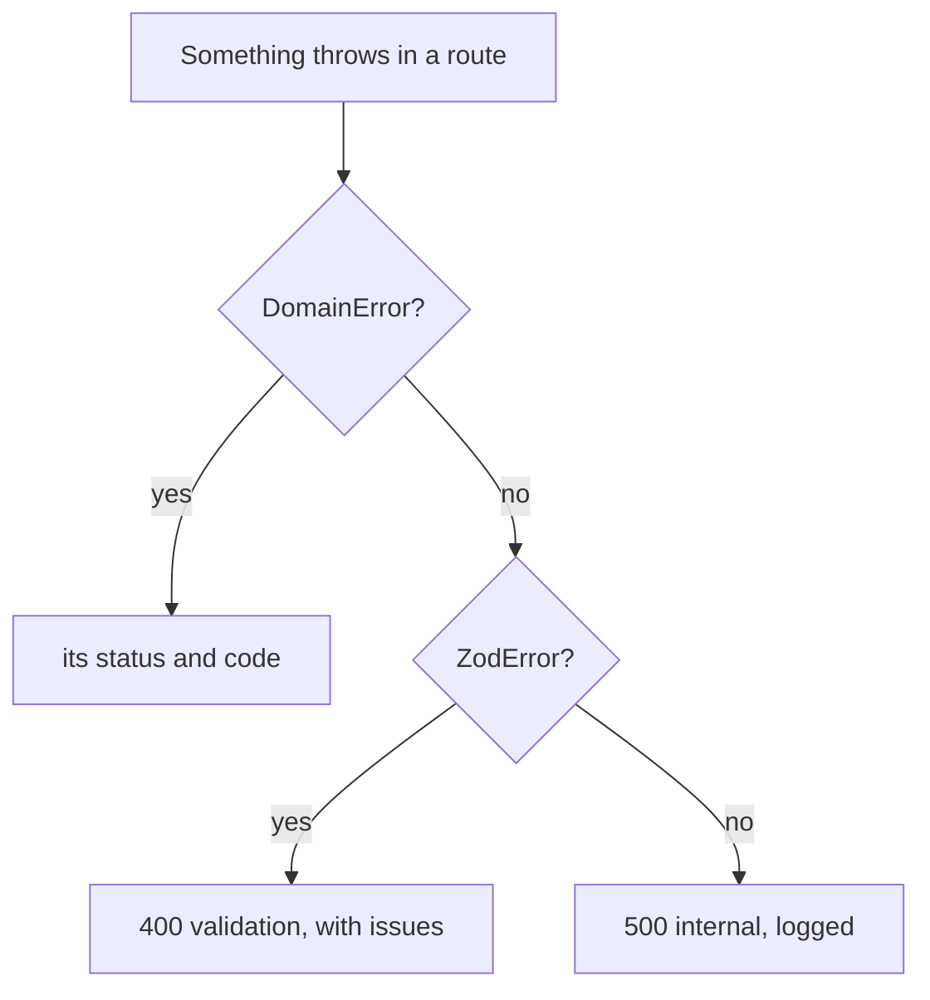

# A. The rules, and when newt throws

Every rule of newt on one page, each with the reason it exists and the
chapter that teaches it; then every error newt throws at runtime, what it means and what to do;
and every HTTP error code with its status. Come back here when something refuses.

Three checks keep an application honest, and this appendix is about the third:

- **the types** (`bun check`) refuse what cannot compile: a repository with no `scope`, an actor
  without a field your application added;
- **the lint** (`newt-kit-eslint`, [appendix B](./b-lint)) refuses what the compiler cannot see: a
  file a module does not have, an import across a boundary, a queue named wrong;
- **the runtime** throws when the code breaks a rule only a running program can tell: a write
  outside a worker, a save that reads rows and guards nothing, an event with no change.

The rules come from `packages/newt/AGENTS.md`, which ships with the package and is what a coding
agent reads first. The messages below are quoted from the code; where cooper replaces one with
`setMessages` (`cooper/backend/shared/messages.ts`) the `code` stays the same, and the code is
what a client acts on.

## The golden rules

The thirteen rules that never break. Each is short enough to remember; the reason is what makes
it worth keeping.

| # | Rule | Why | Taught in |
|---|---|---|---|
| 1 | **One module, one responsibility.** If describing it needs an "and", it is two. | A module owns one entity and its rules; two responsibilities in one grow two sets of rules that meet only by accident, and nobody can tell which use case guards which. | [Modules](./04-modules) |
| 2 | **A route does not think.** It reads the request, calls one use case, answers. | Whatever a route decides, an MCP tool, a worker or a script would have to decide again. Put it in the use case and every door shares it. | [HTTP](./08-http) |
| 3 | **Only the entity changes itself**, with methods named after what happened. | The entity's schema and methods are where its invariants live. A field set from outside skips them, and tells no event. | [Entities](./05-entities) |
| 4 | **Only the repository touches the store.** | One place knows the table, the scope and the guards. Moving to another store, or finding every read of a table, is one file. | [Repositories](./07-repositories) |
| 5 | **A transaction is one save** (`repo.persist(...)`), never a whole use case. | A transaction held across a use case holds the store while it waits for anything else. A save is short, so it may run again on a conflict. | [Repositories](./07-repositories), [Concurrency](./20-concurrency) |
| 6 | **A use case writes into another module only from a worker** reacting to an event; an exception says `@UseCase({ writesTo: ['other'] })` with its reason in a comment. | Two modules written from one request fail halfway with nothing to finish them. A worker's job is retried until it completes. | [Workers](./10-workers), [Between contexts](./11-between-contexts) |
| 7 | **What cannot be undone leaves from a worker** (an email, a call out), never from the use case that makes the change. | A use case runs again on a conflict, and a save may roll back: the email would go twice, or for a change that never happened. | [Workers](./10-workers) |
| 8 | **A job may run more than once**: a second run finds nothing to do. | The outbox delivers at least once: a worker that stops halfway, or a lease that runs out, runs the job again. | [Workers](./10-workers), [Idempotency](./24-idempotency) |
| 9 | **Modules and contexts never depend on each other in a cycle.** | A cycle has no order to open, test or reason about; each side can break the other. | [Contexts](./03-contexts), [Modules](./04-modules) |
| 10 | **A module points at another's things only by id**, never by its entity or table. | An entity held across modules is a change made where its owner cannot check it. An id asks the owner every time. | [Modules](./04-modules), [Aggregates](./21-aggregates) |
| 11 | **No list is returned whole unless the domain bounds it**; every other list is a `Page`. | A list that grows with the data is fine on the first day and a timeout on the thousandth. | [Use cases](./06-use-cases), [Queries](./25-queries) |
| 12 | **Who acts is `currentActor()`**, never a user id passed by hand. May they: ask the module that knows, every time; a stranger gets a 404, not a 403. | An id passed by hand can be anyone's. Permissions cached in the actor outlive their revocation. A 403 tells a stranger the thing exists. | [Use cases](./06-use-cases), [Tenants](./22-tenants), [Auth](./29-auth) |
| 13 | **Time is `now()`**, never `new Date()`; tests hand the base a clock. | Expiries, schedules and backoffs are tested by moving time, not by waiting for it. | [Time](./23-time) |

::: tip In cooper
Every rule above has a counterpart in cooper's backend. Rule 6's exception, for one, is rare and visible: a handful
of use cases say `writesTo` with the reason beside it (`tenant.create` in
`cooper/backend/contexts/auth/modules/tenant/tenant.module.ts`, `card.removeColumn` in
`cooper/backend/contexts/boards/modules/card/card.module.ts`), and everything else that crosses modules is a `handler` worker.
:::

## The rules, by subject

The golden rules are the spine. These are the ones built on them, grouped by where you meet them.

### Project and modules

| Rule | Why | Chapter |
|---|---|---|
| A context opens its store, builds its `Base` and initializes its modules; it receives its config and never reads the environment. | One place reads the environment (`config.ts`); a context opened in a test gets what the test hands it. | [Contexts](./03-contexts) |
| Every module has the same files, named after it; `newt add module` writes them. | Anyone (or any agent) finds everything in any module without looking. | [Modules](./04-modules), [C](./c-cli) |
| A module's `*.schema.ts` is its public contract; from newt it imports only `newt-kit/contract`. | A frontend imports the schema: `newt-kit/core` would pull the server (`node:async_hooks`) into the browser. | [Modules](./04-modules), [Frontends](./30-frontends) |
| A module reaches another only through its module, schema, events, errors and value objects. | Its entity, repository and tables are its own business: they change without warning. | [Modules](./04-modules), [B](./b-lint) |
| A module passes **all** its deps to `super`, those only its routes or workers use too. | That is how `describeApplication` and the monitor know what depends on what. | [Modules](./04-modules), [Structure](./42-structure) |
| Another context's modules are deps grouped under its name (`auth: { access: Access_Module }`), never a port of functions over its use cases. | A port of functions hides the dependency from the lint and from `describeApplication`. | [Between contexts](./11-between-contexts) |
| A port in the module's words is for what is no module of the application (a mailer, a search). | Ports are where adapters plug in; a module of yours is not an adapter. | [Stores](./26-stores) |

### Entities and use cases

| Rule | Why | Chapter |
|---|---|---|
| An entity's schema is `z.object` or `z.strictObject`, never `looseObject`, `catchall` or `passthrough`. | A row's other columns would end up in the entity. newt throws when it is built. | [Entities](./05-entities) |
| Ids are UUIDv7, given by `Entity`. A create input never takes an id. | Ids sort by time, so pages have a stable cursor; a client never chooses one. | [Entities](./05-entities) |
| An entity with a secret has a public schema (`Entity<typeof Full, typeof Public>`); keep a hash, never the secret. | `toDTO()` then never shows it, in an answer or an event; a copy of the database opens nothing. | [Entities](./05-entities), [Auth](./29-auth) |
| Every public method of a module is a `@UseCase()`; helpers are `private`. | A method that is not one runs outside the write rule, the retry on a conflict and the trace. | [Use cases](./06-use-cases) |
| What a client sends comes in as `unknown` and is parsed with the input schema. | Validation lives in one place, the use case, for every door. | [Use cases](./06-use-cases) |
| Validate twice: the input in the use case (a 400), the state in the entity (`InvalidEntity`, a 500). | The first is the client's mistake; the second is yours. | [Entities](./05-entities) |
| A use case runs again on `ConcurrencyConflict`, up to three more times: nothing irreversible before the save. `retryOnConflict: false` with its reason for one that must not. | Retrying is what makes optimistic concurrency invisible to people. | [Concurrency](./20-concurrency) |
| Extend `Actor` for who someone is and how they came (`via`), never for what they may do. | Permissions in the actor are stale the moment they are revoked. | [Auth](./29-auth) |

### Saving

| Rule | Why | Chapter |
|---|---|---|
| Every repository states its `scope`: `{ field, current }` for a tenant's rows, or `'none'` with a comment saying why. | Leaving it out does not compile, so a scope is never dropped by forgetting it. | [Repositories](./07-repositories), [Tenants](./22-tenants) |
| A rule over several rows is checked in the save's `after`, under a `guard` as narrow as the rule; `guard: []` says none is needed. | On Postgres and MySQL saves run side by side; without a guard, two of them both pass the check. | [Concurrency](./20-concurrency) |
| Check first in the use case for the clear answer; a unique index has the last word (`DuplicateValue`). | The check gives a message people understand; the index holds when two arrive at once. | [Concurrency](./20-concurrency) |
| A row created meanwhile has no version: check in `after` and call `this.conflict()`. | A version protects a row that exists, never one that does not yet. | [Concurrency](./20-concurrency) |
| Several entities of one module saved at once are one `persist(a, b)`. | All or none, in one transaction. | [Repositories](./07-repositories), [Aggregates](./21-aggregates) |
| Never `store.transaction` in a module. | A save runs the transaction, checks the write rule and publishes the events; a transaction of your own does none of that. | [Repositories](./07-repositories), [B](./b-lint) |
| A read across every scope is the protected `findInEveryScope`, behind a method named so. | A read that ignores the tenant should say it out loud. | [Tenants](./22-tenants) |

### Events, workers and schedules

| Rule | Why | Chapter |
|---|---|---|
| An event is told only after its save commits, and only with a change. | A listener never hears what did not happen; an event with nothing saved would tell what no row shows. | [Events](./09-events) |
| An event's payload is JSON (`type`, not `interface`), and it only grows. | Jobs written today are read by tomorrow's code. | [Events](./09-events) |
| What only the moment knows (who acted) goes in the payload. | A handler runs with no actor and no scope. | [Events](./09-events), [Workers](./10-workers) |
| What matters is `strategy: 'handler'`, a job in the outbox; `'fire-and-forget'` is for what may be lost. | A job is written in the save's transaction: stored with the change or not at all. | [Workers](./10-workers) |
| A handler's queue is `<module>.<use case>.on.<module>.<event>`, and calls that use case of its own module. | The name tells who reacts with what to which event, in logs, the monitor and the lint. Renaming it leaves pending jobs behind. | [Workers](./10-workers), [Queues](./45-queues) |
| Key what must happen once by the event's id (`event.id`, the same on every run). | A job run twice then sends one email. | [Workers](./10-workers), [Idempotency](./24-idempotency) |
| A worker running late reads again what it is about. | The card may be gone by the time its job runs. | [Workers](./10-workers) |
| What is due at a time is a schedule (`base.schedules.define`), told once per tick across processes. | A `setInterval` runs once per instance. | [Time](./23-time) |

### HTTP and security

| Rule | Why | Chapter |
|---|---|---|
| Pass the body as it came: `await request.json()`, never `as X`. | Saying its type before anything checked it lets an unparsed body through silently. | [HTTP](./08-http), [B](./b-lint) |
| Never catch in a route: a domain error becomes `{ error, code }` with its base class's status. | One translation, the same for every route. | [HTTP](./08-http) |
| A client acts on `code`, which never changes; `setMessages` once at startup puts newt's messages in your words. | Messages change with the language; codes are the contract. | [HTTP](./08-http) |
| Every route needs a session unless `{ public: true }`. | Closed by default: a route you forgot to mark is not open. | [HTTP](./08-http), [Security](./27-security) |
| Other origins only with `cors`, and never with cookies: who calls goes in a bearer token. | A cookie travels with any request the browser sends, forged ones too. | [Security](./27-security) |
| A write from a page of another origin is refused (403) unless its `cors` names it; `crossOrigin: true` only for a form another site posts back on purpose. | That is what a forged form or script sends. | [Security](./27-security) |
| A session lives in a cookie set with `setSessionCookie`: `HttpOnly`, `SameSite=Lax`, `Secure` over HTTPS. | Scripts cannot read it; other sites' requests do not carry it. | [Auth](./29-auth), [Security](./27-security) |
| A POST that creates takes `{ idempotency: { table } }`; the client sends a new `Idempotency-Key` per submit. | A retry after a lost answer gets the first answer, not a second card. | [Idempotency](./24-idempotency) |
| A route that anyone may hammer (sign-in, sign-up, OAuth) has a `rateLimit`; a use case guarding a secret takes from a `base.rateLimits` limit. | Guessing passwords is a matter of tries. | [Rate limits](./28-rate-limits) |
| Behind a proxy, `serve` is told `trustProxy`. | Otherwise every request comes from the proxy's address, and an `ip` limit counts everyone as one. | [Rate limits](./28-rate-limits), [Production](./13-production) |

### Migrations, tests and production

| Rule | Why | Chapter |
|---|---|---|
| A change of shape is a new migration per dialect; an applied one is never edited. | Its checksum is checked: a store refuses to open with one that changed. | [Stores](./26-stores), [Production](./13-production) |
| Wait for workers with `base.jobs.idle()`, never a sleep. | A sleep is too long on a fast machine and too short on a slow one. | [Testing](./12-testing) |
| Move time with the base's clock and `base.schedules.tick()`. | Tests of expiries finish in milliseconds. | [Testing](./12-testing), [Time](./23-time) |
| Test the hard cases: at once, twice, refused, limits crossed, another tenant. | The easy case works the first time; these are where bugs live. | [Testing](./12-testing) |
| A port is proved by a contract suite every adapter runs (`describeStoreContract`). | An adapter that passes it keeps every promise of the port. | [Stores](./26-stores) |
| One tracer for every context of a process. | A request that crosses contexts is one trace. | [Observability](./32-observability) |

## When newt throws

What follows is every error newt throws while an application runs, by where you meet it. Errors
that are `DomainError`s become HTTP answers with their status and `code`; the others are
programming errors, and a client sees a 500 that says nothing about the inside
(`{ "error": "Something went wrong", "code": "internal" }`) while the log keeps the message.

::: info Concept: domain error
A `DomainError` is an error the application expects: a card not found, a name taken. It has a
stable `code` and a `status` decided by its base class: `ValidationError` 400,
`UnauthorizedError` 401, `ForbiddenError` 403, `NotFoundError` 404, `ConflictError` 409. Your
own errors extend one of these, one class per file in the module's `errors/`.
:::

### The write rule and the guard rule

These are the two runtime rules that keep transactions honest. Both throw by default; the base's
`writeRule` or `guardRule` set to `'warn'` turns them into a warning printed once, while an
application moves to the rule, and `'off'` silences them.

| Message | Means | Do |
|---|---|---|
| `[write rule] <use case> writes to <context>.<module> outside a worker: write it from a worker reacting to an event, or list it in its writesTo` | A use case saved in another module from a request (or a script), not from a worker. | Make the other module react to an event of yours with a `'handler'` worker. If the person needs both in the answer, `@UseCase({ writesTo: ['other'] })` with the reason. |
| `[write rule] <use case> saves <module> in the transaction that saved <others>: one module per transaction; …` | Two modules saved in one transaction, in a worker too: a save hook that called another module's saving use case. | Save the second after the first commits, from a worker reacting to its event. |
| `[guard rule] <use case> reads <tables> in a save that guards nothing: on Postgres and MySQL another save may change what it read before it commits. Name what its rule protects in the save's guard` | A save read rows in its transaction (in `before`, `after`, a `find`) and named no `guard`. | Add ``guard: [`<what>:<keys>`]`` as narrow as the rule, or `guard: []` if nothing read needs one. |

::: danger Never
Do not set `writeRule: 'off'` to make a test pass. The rule fires because a failure between the
two writes would leave half the work done with nothing to finish it.
:::

### Saving and concurrency

| Error | Status, code | Means | Do |
|---|---|---|---|
| `ConcurrencyConflict`: "Someone changed it in the meantime. Try again." | 409 `concurrency_conflict` | Someone saved the row since it was read, and the use case already ran four times (or says `retryOnConflict: false`). | Usually nothing: it runs again by itself. If it reaches the client, the row is very busy: take the hot value in `before` under a `guard`. |
| `DuplicateValue`: "There is already one with this `<fields>`" | 409 `duplicate_value` | A unique index refused the row. It is a `ConcurrencyConflict`, so the use case ran once more. | Check first in the use case and throw your own error (`board.name_taken`); keep the index as the last word. |
| `SaveRolledBack`: "`<Entity> <id>` was in a save that rolled back: read it again, and save that one" | 500 | An entity of a save that failed is saved again: what it holds may not be what is stored. | Read it again from the repository and change that copy. |
| `This call belongs to a transaction that has ended: …` | 500 | A call inside a transaction was left without `await`, or a branch of a `Promise.all` kept running after another threw. | Await every call. The lint's `no-floating-promises` catches most. |
| `The transaction is rolled back: a save that joined it failed, …` | 500 | A save inside a transaction failed and its error was caught; the transaction cannot go on. | Do not catch errors of a save to carry on in the same transaction. |
| `Waited 30000 ms for the store: a transaction holds it. …` | 500 | Code inside a transaction asked for the store from outside it (an `EventEmitter`, a timer) and waits for itself. | Move that work to a worker. |
| `Waited <n> ms for the guard '<key>', which another transaction holds` | 500 | Postgres or MySQL: a guard key was held too long by another save. | Keep saves short; check that the guard is not wider than the rule. |
| `<Entity> <id> belongs to <field> '<value>', not to the current one: a repository saves only its scope's` | 500 | Saving an entity of another tenant than the scope in progress. | Enter the right scope; never move rows across scopes. |
| `TextWithNul` | 400 `validation` | A string with the NUL character, which Postgres cannot keep. | Refuse it in the input schema. |

### Entities

| Error | Means | Do |
|---|---|---|
| `InvalidEntity`: "`<Entity> <id>` does not pass its schema: `<field>: <issue>`" | The entity broke its own schema: a bad row read, or a value a method computed wrong. A bug, a 500. | Validate the client's input in the use case first; fix the entity method. zod's issues are its `cause`. |
| `EventWithoutChange`: "`<Entity> <id>` tells `<events>` but has nothing to save: …" | An event was tracked with no change to save. | Change what it tells of (a status, a date) along with it, or do not track it. |
| `UnknownEntityField`: "Unknown field '`<f>`' for this entity" | `change()` was given a field the schema lacks. | Fix the method, or add the field to the schema. |
| `UnknownEntityField`: "Field '`<f>`' cannot be changed: the framework keeps it, …" | `change()` was given `createdAt` or `updatedAt`. | Leave them to newt. |
| `DeletedEntityNotChangeable`, `EntityAlreadyDeleted` | A change or a delete after a delete. | Fix the use case's order. |
| `NewEntityNotDeletable`: "Cannot delete an entity that was never persisted" | Deleting one never saved. | Do not create it, or save it first. |
| `<Entity>'s schema keeps fields it does not name (z.looseObject, .catchall, .passthrough): …` | Thrown when the entity is built. | Use `z.object` or `z.strictObject`. |
| `<Entity>'s public schema has '<f>', which its schema does not: …` | The public schema names a field the full one lacks. | The public schema is a `pick` of the full one. |
| `<Entity> read from storage comes with its version` | `fromDTO` was called without a `version`. | Pass the row as read, with its `version`. |

### Events, workers and schedules

| Message | When | Do |
|---|---|---|
| `A handler's queue is '<module>.<use case>.on.<event>': '<queue>' is not` | At `subscribe`: the queue does not end with the event it is subscribed to. | Name it `<module>.<use case>.on.<module>.<event>`. The lint catches it first. |
| `A handler of '<event>' is named '<handler's module>.<use case it calls>.on.<event>', not '<queue>'` | At startup, from the worker. | The same. |
| `A handler named '<queue>' is subscribed already` | Two subscriptions with one queue. | One queue per handler: name each after the use case it calls. |
| `The handler '<queue>' runs at least once: its attempts are a whole number from 1, …` | `attempts` below 1. | Give 1 or more (5 by default). |
| `A job queue runs at least one job at a time: …` | `jobs.concurrency` below 1. | Give 1 or more (10 by default). |
| `[JobQueue] <n> job(s) of '<queue>' wait, and no worker serves that queue: was its handler renamed or removed?` | A warning: jobs wait under a queue nobody registers. | Put the old name back until they are done, or do their work by hand. |
| `A schedule is named as an event, '<module>.<name>': '<name>' is not` | `base.schedules.define`. | `invitation.expire`, not `expire-invitations`. |
| `A schedule named '<name>' is defined already` | Defined twice. | One definition, subscribed as often as needed. |
| `A cron expression has five fields (…)`, `'<part>' is not a <field> (…)`, `The cron expression '<e>' is never due` | A wrong cron expression. | Five fields, in UTC: `'0 3 * * *'`. |

### Who and where

| Error or message | Status, code | Means | Do |
|---|---|---|---|
| `NoActor`: "Sign in to continue" | 401 `not_signed_in` | `currentActor()` outside any actor: a handler, a script, a test. | Read who from the event's payload; wrap the call in `runAsActor(actor, fn)`. On a public route, `findCurrentActor()` returns `undefined` instead. |
| `NotSignedIn`: "Sign in to continue" | 401 `not_signed_in` | A route that is not `public` got a request its authenticator did not recognise. | Sign in; or mark the route `{ public: true }` if nobody can be signed in for it. |
| `Nothing is in the <name> scope here: enter it with its run` | 500 | A scope's `current()` outside it. A scope defined with `missing` throws that error instead (cooper's: "No workspace here: …"). | Enter it: a route group's middleware, `scope.run(value, fn)` in a worker, script or MCP tool. |

### HTTP

| Error | Status, code | Means | Do |
|---|---|---|---|
| `ApiRouteNotFound`: "There is no route for `<method> <path>`" | 404 `route_not_found` | Nothing under the prefix matches. | Check the path and the prefix (`/api` unless told). |
| `MethodNotAllowed`: "`<method>` is not allowed on `<path>`" | 405 `method_not_allowed` | The path exists, the method does not. `Allow` lists those it has. | Use one of them. `OPTIONS` is a 405 too, unless a route of the path has `cors`. |
| `MalformedBody`: "The body of the request cannot be read" | 400 `malformed_body` | The body is not JSON (or not a form) as the route reads it. | Send valid JSON. |
| zod's `ZodError`: "The request is not valid" | 400 `validation`, with `issues` | The body failed the use case's input schema. | Read `issues`, field by field. |
| `UnsupportedMediaType`: "The body of the request must be sent as application/json" | 415 `unsupported_media_type` | A JSON body sent without `Content-Type: application/json` (or `…+json`). | Send the header. A form posted by another site cannot. |
| `PayloadTooLarge`: "The body of the request is longer than the `<n>` bytes it may be" | 413 `payload_too_large` | The body passed the route's `maxBodyBytes` (a megabyte unless told). | Send less, or raise `maxBodyBytes` on that route. |
| `CrossOriginRefused`: "This cannot be done from a page of another site" | 403 `cross_origin_refused` | A write (POST, PUT, PATCH, DELETE) from a page of another origin that the route's `cors` does not name. | Serve the page from the same origin, name its origin in `cors`, or (a form another site posts back) `crossOrigin: true`. |
| `IdempotencyKeyInUse`: "A request with this Idempotency-Key is still in progress: …" | 409 `idempotency_key_in_use` | The same key again while the first is still running (for a minute at most). | Retry once the first ends. |
| `IdempotencyKeyReused`: "This Idempotency-Key was sent before with another body: …" | 422 `idempotency_key_reused` | A key reused for another request. | A new key per submit; the same key only to resend the same one. |
| `Route <method> <path> is registered twice` | at startup | Two routes on one method and path. | Remove one. |

### Rate limits

| Error or message | Status, code | Means | Do |
|---|---|---|---|
| `TooManyRequests`: "Too many requests: try again in `<s>` s" | 429 `too_many_requests`, with `Retry-After` | A route's `rateLimit`, or a use case's `base.rateLimits` limit, was passed. Its `limit` names which one. | Wait `Retry-After` seconds. In tests, see [E](./e-problems#a-test-gets-429). |
| `A rate limit is named <module>.<name>, as session.signIn: <name>` | at startup | `base.rateLimits.define` with a bad name. | `<module>.<name>`. |
| `Rate limit <name> is defined twice` | at startup | Two `define` calls with one name. | One definition. |
| `A rate limit's limit is a whole number from 1: …`, `A rate limit's window is a whole number of milliseconds from 1: …` | at startup | A rule that counts nothing. | `limit` and `windowMs` are positive integers. |
| `Rate limit: <key> was taken by others <n> times in a row` | 500 | `RedisRateLimitStore`: a key so busy its optimistic write lost every try. | Rare; a limit shared by too many callers at once. Check its `by`. |

### Migrations and stores

| Message | Means | Do |
|---|---|---|
| `Migration <name> was changed after it was applied: put its up file back as it was, and make the change a new migration` | An applied migration's checksum no longer matches. | `git checkout` the file; write the change as the next migration. Line ends do not count. |
| `Migrations <a> and <b> share the version <n>: renumber one` (SQLite) / `… have the same number` (Postgres, MySQL) | Two migrations with one number, usually from two branches. | Renumber the one not applied anywhere yet. |
| `Migration <name> is missing its down file` (or `up`) | A migration without its pair. | Every migration is an `_up.sql` and a `_down.sql`. |
| `Last applied migration <name> is not in the migrations folder` | The database is ahead of the code. | Go forward again, or `down` it from the branch that has it. |
| `The migrations folder '<f>' cannot be read` | The path is wrong, or another dialect's. | Point the store at `migrations/<dialect>`. |
| `The migration leaves rows pointing at rows that do not exist: …` | SQLite: a migration broke a foreign key. | Fix the data in the migration before the constraint. |
| ``A write runs inside `store.transaction` `` | SQLite: something wrote outside a transaction (Kysely, the raw connection). | Write inside a save (`save`, `saveRows`), or `store.transaction` in a script. |
| `SQLite rolled the transaction back on its own, after an error inside it: nothing in it is stored` | An error inside a SQLite transaction (a constraint) ended it. | Find the statement that failed. |
| ``Transactions run with `store.transaction`, never Kysely's own: …`` | Kysely's `transaction()` was called. | Kysely's queries join the store's transaction; use a save. |
| `The store is locked by <who> (<path>)` | `FileStore`: another process holds its folder. | One process per files store. |
| `A collection is named with up to 100 letters, …`, `A record's id is made of …` | `FileStore`: a name or id it cannot keep as a file. | Use plain names. |
| `A limit is a whole number, 0 or more: …` | A `find` with a bad `limit`. | Pass an integer. |

### Configuration

| Message | Means | Do |
|---|---|---|
| `The monitor's key has at least 32 characters: it does not start without one` | `serveMonitor` without a long enough key. | Give it a key of 32 characters or more. |
| `A sample rate is a share, from 0 to 1, …`, `The most log lines a trace keeps is a whole number, …` | `setTraces` with bad options. | A share from 0 to 1; an integer. |

## HTTP error codes

Every `code` newt itself sends, with its status. Your own errors add theirs, under the status of
their base class. A body is always `{ error, code }` (`ErrorBody`, in `newt-kit/contract`), plus
`issues` for `validation`.

| Code | Status | Error class | Sent when |
|---|---|---|---|
| `validation` | 400 | zod's `ZodError`, `TextWithNul` | The input fails its schema; a string holds NUL on Postgres. |
| `malformed_body` | 400 | `MalformedBody` | The body cannot be read as JSON or a form. |
| `reference_not_found` | 400 | `ReferenceNotFound` | `resolveRefs` finds no row for an id the client sent. |
| `invalid_email` | 400 | `InvalidEmail` | `Email.from` refuses what was typed. |
| `invalid_secret_token` | 400 | `InvalidSecretToken` | `SecretToken.from` refuses a token. |
| `not_signed_in` | 401 | `NotSignedIn`, `NoActor` | No session on a route that needs one; no actor where one is read. |
| `cross_origin_refused` | 403 | `CrossOriginRefused` | A write from another origin's page. |
| `route_not_found` | 404 | `ApiRouteNotFound` | Nothing under the prefix matches. |
| `method_not_allowed` | 405 | `MethodNotAllowed` | The path has no route for that method. |
| `concurrency_conflict` | 409 | `ConcurrencyConflict` | Saved by someone else since read, after the retries. |
| `duplicate_value` | 409 | `DuplicateValue` | A unique index refused the row. |
| `idempotency_key_in_use` | 409 | `IdempotencyKeyInUse` | The same key while the first is in progress. |
| `payload_too_large` | 413 | `PayloadTooLarge` | The body is longer than `maxBodyBytes`. |
| `unsupported_media_type` | 415 | `UnsupportedMediaType` | JSON without `Content-Type: application/json`. |
| `idempotency_key_reused` | 422 | `IdempotencyKeyReused` | The same key with another body. |
| `too_many_requests` | 429 | `TooManyRequests` | A rate limit passed; `Retry-After` says when to try again. |
| `internal` | 500 | anything else | Anything unexpected; it says nothing about the inside. |

A few answers carry no `{ error, code }` body:

| Status | Sent by | When |
|---|---|---|
| 503 | `serve`'s health (`GET /api/health`) | The server is stopping, for `drainMs` before it closes. |
| 503 | `serveFrontend` | "The frontend is not built: its folder has no index.html". |
| 401, 404, 405 | `serveMonitor` | A request to the monitor endpoint not signed with its key; a path it lacks; a method other than `GET`. |

::: tip In cooper
OAuth's endpoints answer in OAuth's own format, `{ error, error_description }`, through
`toOauthErrorResponse` as their `onError`
(`cooper/backend/contexts/auth/modules/oauth-client/oauth-client.routes.ts`). The status is the
same; the body follows RFC 6749.
:::

## Recap

- The thirteen golden rules never break; the reason for each is what makes it worth keeping.
- The types, the lint and the runtime each catch what the others cannot.
- A `DomainError` becomes its status and `code`; anything else is a 500 that says nothing.
- `[write rule]` and `[guard rule]` are the runtime's two transaction rules; `'warn'` is for a
  migration, never a fix.
- A client acts on `code`, never on the message.

## Going further

- [B. The lint](./b-lint): the rules the editor checks.
- [E. Common problems](./e-problems): symptoms first, for when you do not know which error it is.
- [HTTP](./08-http) and [Security](./27-security): how errors become answers, and why the
  defaults refuse what they refuse.
