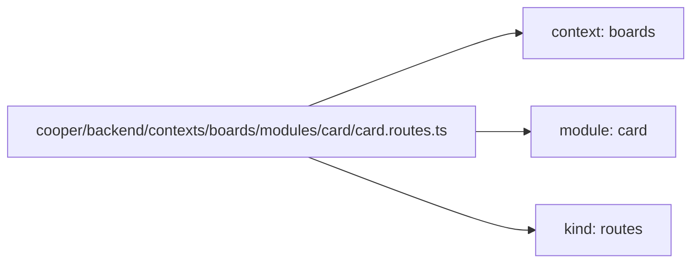
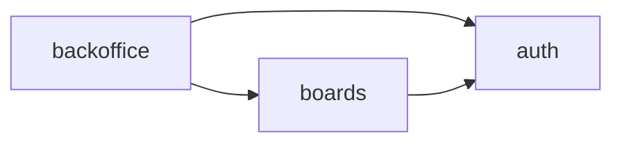

# B. The lint

<p class="chapter-lead">Every rule of <code>@newt-kit/eslint</code>, what it says, and a wrong and a right
example of each; how to configure it, cooper's configuration, and the one disable newt accepts.</p>

The compiler checks types; it cannot see that a module has a file no module has, that a schema
imports the server, or that a queue names a use case its callback never calls. `@newt-kit/eslint` (in
`packages/newt-eslint`) checks what the compiler cannot. It runs in the editor, as you type, and
in `bun run lint`.

```sh
bun add -d @newt-kit/eslint eslint
bun run lint        # "lint": "eslint" in package.json
```

::: tip TypeScript 7
typescript-eslint does not run on TypeScript 7 yet, so `@newt-kit/eslint` brings its own
TypeScript 6 for it. The application keeps the TypeScript 7 that `bun init` adds, and
`bun check` runs on it; a config of its own parses with the same TypeScript 6 through the
package's `parser`.
:::

## How it finds modules and contexts

The lint never asks you to register anything. It reads the path of each file:



- A **module** is a folder inside a `modules/` folder.
- Its **context** is the folder that holds `modules/`. So `src/contexts/shop/modules/order/`
  and `app/modules/order/` are both found. A `modules/` at the project's root has the project as
  its context.
- `contexts.folder` tells `newt/context-boundaries` where the contexts live; each folder in it
  is one.

## The rules at a glance

| Rule | Applies to | Says |
|---|---|---|
| `newt/module-anatomy` | files under `**/modules/*/` | A module has only the files and folders every module has, named after it. |
| `newt/module-boundaries` | files under `**/modules/*/`, and, with `contexts`, a context's files outside its modules | A module reaches another only through its module, schema, events, errors and value objects. |
| `newt/queue-name` | files under `**/modules/*/` | A handler's queue is `<module>.<use case>.on.<module>.<event>`, and its callback calls that use case. |
| `newt/schema-imports` | `<m>.schema.ts` | A schema takes from newt only `@newt-kit/newt/contract`. |
| `newt/use-case` | every `*.module.ts` | Every public method of a `Module` is a `@UseCase`. |
| `newt/route-body` | every `*.routes.ts` | A route passes the body as it came, never asserting its type. |
| `newt/context-boundaries` | files of a context, with `contexts` | A context imports only the contexts its `uses` lists. |
| `no-restricted-syntax` | files under `**/modules/*/` | No `transaction` inside a module. |
| `@typescript-eslint/no-floating-promises` | every linted file | Every promise is awaited. |

## `newt/module-anatomy`

**Says:** a module is made of the files every module has, named after it, and the four folders
a module may have.

| Allowed | Holds |
|---|---|
| `<m>.module.ts`, `<m>.ts`, `<m>.schema.ts`, `<m>.repository.ts` | The module, the entity, the contract, the repository. |
| `<m>.routes.ts`, `<m>.workers.ts`, `<m>.deps.ts`, `<m>-options.ts` | Its routes, its reactions, its deps, its options. |
| `*.test.ts` | Tests, beside the code. |
| `events/<m>-<event>.ts` | One event per file, named after the module. |
| `errors/`, `value-objects/`, `services/` | One class per file. |

Its messages: `'<file>' is not a file a module has: …`, `'<folder>' is not a folder a module
has: …`, `An event's file is named '<m>-<event>.ts', not '<file>'.`

::: code-group

```txt [Wrong]
modules/card/helpers.ts                 a file no module has
modules/card/utils/format.ts            a folder no module has
modules/card/events/assigned.ts         an event not named after its module
```

```txt [Right]
modules/card/services/due-date.ts       shared logic of its use cases
modules/card/card.ts                    the entity
modules/card/events/card-assigned.ts    the event card.assigned
```

:::

**Why:** anyone, or any agent, opens any module and knows where everything is. `newt add module`
([appendix C](./c-cli)) writes a skeleton that passes it.

## `newt/module-boundaries`

**Says:** a module imports from another only its module (`<m>.module.ts`), its schema, its
events, its errors and its value objects: never its entity, repository, tables, routes, workers
or deps, nor its folder (`../board`). A context's own files outside its modules (a barrel, an
`index.ts`) re-export only those too.

Its messages: ``'<path>' is <m>'s own: a module reaches another through its use cases
(`<m>.module.ts`), its schema, its events, its errors and its value objects.`` and, for a barrel,
`A barrel re-exports '<path>', <m>'s own file: …`.

::: code-group

```ts [Wrong]
// modules/card/card.module.ts
import { Board } from '../board/board'                        // another module's entity
import { Board_Repository } from '../board/board.repository'  // another module's repository
```

```ts [Right]
// cooper/backend/contexts/boards/modules/card/card.deps.ts
import type { Board_Module } from '../board/board.module'
import type { Column_Module } from '../column/column.module'
// and in card.module.ts
import type { ColumnDTO } from '../column/column.schema'
```

:::

**Why:** an entity or a repository is its module's business. Reached from outside, it would be
changed where its owner cannot check it, and refactored at the risk of every module that grabbed
it ([Modules](./04-modules)).

## `newt/queue-name`

**Says:** a handler's queue is `<module>.<use case>.on.<module>.<event>`, as the framework
requires at startup:

- it starts with the module of the file it is in;
- its callback calls that use case on that module (`this`, or an object TypeScript says is a
  `<M>_Module`; without type information, a name typed `<M>_Module` or named after the module or
  its English plural, `cards` for `card`);
- it ends with the event it is subscribed under (`events.assigned` → `….assigned`).

A callback that is neither written there nor a function of the file
(`cards.notifyAssignee.bind(cards)`) is not looked into.

Its messages: `'<queue>' is not a handler's queue: it is '<module>.<use case>.on.<module>.<event>', …`,
`This queue is '<m>.…': the handlers in <file> are <m>'s, …`,
`This queue says the handler calls <m>'s '<useCase>', but its callback calls no '<useCase>' of <m>: …`,
`This queue ends with '.on.<event>', the event it subscribes to.`

::: code-group

```ts [Wrong]
// modules/card/card.workers.ts
cards.events.assigned.subscribe(({ dto, by }, { id }) => cards.notifyAssignee(dto, by, id), {
  strategy: 'handler',
  queue: 'notify-assignee',                       // not the shape
})
cards.events.assigned.subscribe(({ dto, by }, { id }) => cards.notifyAssignee(dto, by, id), {
  strategy: 'handler',
  queue: 'card.sendEmail.on.card.assigned',       // the callback calls no sendEmail
})
```

```ts [Right]
// cooper/backend/contexts/boards/modules/card/card.workers.ts
cards.events.assigned.subscribe(({ dto, by }, { id }) => cards.notifyAssignee(dto, by, id), {
  strategy: 'handler',
  queue: 'card.notifyAssignee.on.card.assigned',
})
```

:::

**Why:** the queue is how jobs find their handler after a restart, and how a person reading the
monitor knows who reacts with what to which event ([Workers](./10-workers),
[Queues](./45-queues)). Renaming it leaves pending jobs behind, so it had better be right the
first time.

## `newt/schema-imports`

**Says:** a module's schema (`<m>.schema.ts`), which a frontend may import, takes from newt only
`@newt-kit/newt/contract`: never `@newt-kit/newt/core` nor any other entry, not even for a type. Only the schema's own
imports are checked, not those of the files it imports.

Its message: `'<path>' is the server's: <file> is imported by the frontend, so it takes from newt
only '@newt-kit/newt/contract' (value objects and their errors, defineFilter, Page, PageRequest, ErrorBody).`

::: code-group

```ts [Wrong]
// modules/card/card.schema.ts
import { defineFilter } from '@newt-kit/newt/core'
```

```ts [Right]
// cooper/backend/contexts/boards/modules/card/card.schema.ts
import { defineFilter } from '@newt-kit/newt/contract'
import { z } from 'zod'
```

:::

**Why:** `@newt-kit/newt/core` keeps scopes on `AsyncLocalStorage` (`node:async_hooks`); a browser has none.
`@newt-kit/newt/contract` is the part of core that runs anywhere ([Frontends](./30-frontends)).

::: warning Watch out
A value object the schema imports is not checked. If it imports `@newt-kit/newt/core`, the browser's
bundler warns `Module "node:async_hooks" has been externalized …` instead
([E](./e-problems#the-browser-warns-about-node-async-hooks)).
:::

## `newt/use-case`

**Says:** in a `*.module.ts`, a class extending `Module` marks each method it offers (not
`private`, `protected` or `static`, nor the constructor or a getter) with `@UseCase`. A function in
a public field is refused too, since it cannot be marked. It reads every `*.module.ts` wherever it
is, a shared module outside `modules/` too.

Its messages: `'<name>' is a public method of <M>_Module without @UseCase: whatever a module
offers is a use case. Mark it @UseCase(), or make it private if only the module calls it.` and
`'<name>' is a public function of <M>_Module in a field, which @UseCase cannot mark: …`

::: code-group

```ts [Wrong]
export class Card_Module extends Module {
  async unassign(cardId: string): Promise<CardDTO> { /* … */ }   // no @UseCase
  readonly count = (boardId: string) => this.repo.count({ boardId })  // a public function field
}
```

```ts [Right]
export class Card_Module extends Module {
  @UseCase()
  async unassign(cardId: string): Promise<CardDTO> { /* … */ }

  private load(id: string): Promise<Card> { /* … */ }           // a helper is private
}
```

:::

**Why:** a method without `@UseCase` runs outside the write rule, the retry on a conflict and the
trace; the monitor never sees it ([Use cases](./06-use-cases)).

## `newt/route-body`

**Says:** in a `*.routes.ts`, `await request.json() as X` (or `<X>…`, or
`const body: X = await request.json()`) is refused. The use case takes the body as `unknown` and
parses it with its input schema. `as unknown`, or a schema's `parse` in the route, is fine.

Its message: ``The body is not <X> until something parses it: pass `await request.json()` as it
came to a use case that takes `unknown` and parses it with its input schema.``

::: code-group

```ts [Wrong]
workspace.patch('/cards/:cardId', async request =>
  Response.json(await cards.edit(request.params.cardId, await request.json() as CardEditDTO)))
```

```ts [Right]
// cooper/backend/contexts/boards/modules/card/card.routes.ts
workspace.patch('/cards/:cardId', async request =>
  Response.json(await cards.edit(request.params.cardId, await request.json())))
```

:::

**Why:** the assertion tells the compiler the body is checked when nothing checked it. A use case
that forgot to parse it would get it raw, and the compiler would not say ([HTTP](./08-http)).

## `newt/context-boundaries`

**Says:** with `contexts`, a context imports only the contexts its `uses` lists. `uses` lists
every context, each with the ones it uses (`[]` for none). A context folder it does not list uses
no other; a file directly in the contexts' folder belongs to none, imports no context and is
imported by none.

Its messages: `'<path>' is the context <other>'s, and <context> uses <uses>: contexts use only the
ones they say, never in a cycle.`, and two for a file at the contexts' folder itself.

Building the preset throws, before linting anything, when `uses` names a context it does not list
(``@newt-kit/eslint: the context 'x' uses 'y', which is not in `uses`: …``) or makes a cycle
(``@newt-kit/eslint: contexts never use each other in a cycle, and `uses` says a → b → a.``).

::: code-group

```ts [Wrong]
// cooper/backend/contexts/auth/… (auth uses no other context)
import type { Board_Module } from '../../boards/modules/board/board.module'
```

```ts [Right]
// cooper/backend/contexts/boards/modules/card/card.deps.ts (boards uses auth)
import type { Access_Module } from '../../../auth/modules/access/access.module'
```

:::

**Why:** contexts form a tree, opened in order, each after those it uses ([Contexts](./03-contexts),
[Between contexts](./11-between-contexts)). The lint keeps the tree a tree.

::: details Under the hood: how the boundaries read imports
Both boundary rules read where an import lands, however it is written: `import`, `export … from`,
`import()`, `import x = require()` and `require()`; relative, with an extension
(`./board.module.js`) or not, or an alias of the tsconfig's `paths`. Aliases are read from the
program typescript-eslint builds, as the preset does; without it, only relative imports are
checked.
:::

## Besides newt's own rules

The preset turns on two more rules for a newt application.

**No transaction in a module** (`no-restricted-syntax`). `transaction` inside a module, called or
taken (`store.transaction(…)`, `store['transaction']`, `const { transaction } = store`), is refused
with: `A module writes through its repository's save (or saveRows), which runs the transaction,
checks the write rule and publishes the events: never in a transaction of its own.`

::: code-group

```ts [Wrong]
await this.base.store.transaction(async () => {
  await this.repo.persist(card)
  await this.repo.persist(other)
})
```

```ts [Right]
await this.repo.persist(card, other)     // one save, all or none
```

:::

**Every promise awaited** (`@typescript-eslint/no-floating-promises`). A save left unawaited runs
after its transaction ended, and newt throws `This call belongs to a transaction that has ended`.
This rule needs a `tsconfig.json` that includes every file it lints, or references a project that
does.

::: code-group

```ts [Wrong]
order.cancel(reason)
this.repo.persist(order)
```

```ts [Right]
order.cancel(reason)
await this.repo.persist(order)
```

:::

## Configuration

The preset is `newt(options)`, from `@newt-kit/eslint`. It returns a flat config: the rules, the
TypeScript parser (`projectService: true`), and the files each rule looks at.

| Option | Default | Means |
|---|---|---|
| `files` | `['**/*.ts']` | The globs of the files it lints. |
| `contexts` | none | `{ folder, uses }`: the folder of the contexts, and which ones each one uses. Turns on `newt/context-boundaries`. |
| `root` | ESLint's cwd | The config's folder, which `files` and `contexts.folder` are read from: `import.meta.dirname`. |

The smallest configuration, for an application that is only a backend:

```js
// eslint.config.js
import { newt } from '@newt-kit/eslint'

export default newt({
  root: import.meta.dirname,
  contexts: { folder: 'src/contexts', uses: { auth: [], shop: ['auth'] } },
})
```

The rules alone are exported as `plugin`, for a configuration of your own.

::: tip In cooper
The repository keeps one `eslint.config.js` at its root. cooper's backend and newt-monitor's
each take newt's preset, kept to their files with `files`, and their frontends take
`@newt-kit/react-ui`'s lint:

```js
// eslint.config.js
const BACKEND = newt({
  root: import.meta.dirname,
  files: ['cooper/backend/**/*.ts', 'cooper/scripts/**/*.ts'],
  contexts: { folder: 'cooper/backend/contexts', uses: { auth: [], boards: ['auth'], backoffice: ['auth', 'boards'] } },
})

const MONITOR = newt({
  root: import.meta.dirname,
  files: ['packages/newt-monitor/{scripts,backend}/**/*.ts'],
  contexts: { folder: 'packages/newt-monitor/backend/contexts', uses: { auth: [], monitor: ['auth'] } },
})

export default [
  { ignores: ['packages/newt/**', 'packages/newt-eslint/**', 'web/**', '**/dist/**', '.claude/**', '.review/**'] },
  ...BACKEND,
  ...MONITOR,
  // … the frontends' lint, and restricted imports for the API clients
]
```

`contexts.uses` is the whole map of cooper: `auth` uses none, `boards` uses `auth`, and
`backoffice` uses both.
:::



## The one accepted disable

Never silence a rule to make the lint pass. There is one exception, and it says why on the line
above: a **test's own subscription**, which belongs to no module and so has no use case to name in
its queue.

```ts
// cooper/backend/contexts/backoffice/modules/job/job.test.ts
// A reaction to boards' cards that fails while the "mail server" is down, at its only attempt.
// It is the test's own, of no module: its queue names none.
let down = true
t.boards.modules.card.events.created.subscribe(() => {
  if (down) throw new Error('the mail server is down')
// eslint-disable-next-line newt/queue-name
}, { strategy: 'handler', queue: 'test.tellSomeone.on.card.created', attempts: 1 })
```

::: danger Never
`eslint-disable` for any other rule, or for `newt/queue-name` in a module's own code. If a rule
refuses what you need, the design is usually the problem: a module that wants another's entity
wants a use case of it instead.
:::

## Recap

- The lint reads paths: a module is a folder in `modules/`, its context the folder above.
- Seven rules of newt's own, plus no transactions in a module and no floating promises.
- `contexts.uses` lists every context and whom it uses; a cycle stops the lint before it starts.
- `files` and `root` keep the preset to an application's files in a monorepo.
- One disable is accepted: `newt/queue-name` on a test's own subscription, with the reason.

## Going further

- [A. The rules](./a-rules): the runtime's rules, which the lint cannot see.
- [C. The command line](./c-cli): `newt init` writes the lint's config; `newt add module` writes a
  module that passes it.
- [Modules](./04-modules): why a module's anatomy and boundaries are what they are.
