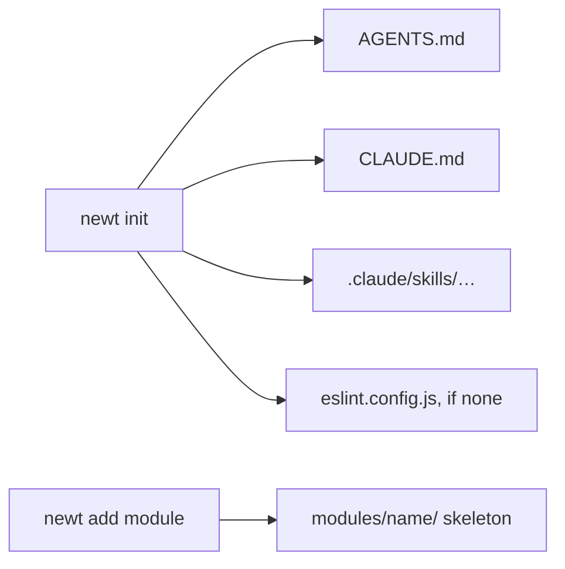

# C. The command line

<p class="chapter-lead">newt ships one command, <code>newt-kit</code> (also <code>newt</code> once installed), with two jobs: setting an
application up for coding agents, and writing a module's skeleton. This appendix lists every
command, what it writes and what it prints; then the scripts of this repository that run cooper
and the monitor.</p>

The command lives in `packages/newt/cli/` and is the package's `bin`, under two names:

```jsonc
// packages/newt/package.json
"bin": { "newt-kit": "./cli/newt.ts", "newt": "./cli/newt.ts" }
```

Run it as `bunx newt-kit`: that name is the package's own, so `bunx` finds it even before the
package is installed. Inside an application that has it, `newt` is the same command.

It writes files and imports none of newt's pieces. It **never overwrites a file**: one that is
there already is named as skipped and left as it was, so running a command twice is safe.

```sh
bunx newt-kit init                                   # in an application's folder
bunx newt-kit add module src/contexts/shop order     # a module's skeleton
bunx newt-kit help                                   # the usage
```

## Commands at a glance

| Command | Writes | Exit code |
|---|---|---|
| `newt init` | `AGENTS.md`, `CLAUDE.md`, newt packages' skills in `.claude/skills/`, and `eslint.config.js` if none is found | 0 |
| `newt add module <context-folder> <name>` | A module's skeleton in `<context-folder>/modules/<name>/` | 0; 1 for a name that is not kebab-case |
| `newt`, `newt help`, `newt --help`, `newt -h` | Nothing: prints the usage | 0 |
| anything else | Nothing: prints the usage | 1 |

An error (a bad module name) prints its message alone and exits with 1.



## `newt init`

Run it in an application's folder. It takes no options.

| File | What it holds | When |
|---|---|---|
| `AGENTS.md` | The application's own instructions for coding agents: sections to fill in (this project, its contexts, its conventions) and its commands (`bun check`, `bun test`, `bunx eslint`). It opens by sending agents to newt's rules, `node_modules/newt-kit/AGENTS.md`. | Always, unless it exists. |
| `CLAUDE.md` | Claude Code's memory: `@AGENTS.md`, `@<path to newt's AGENTS.md>`, and one `@…/AGENTS.md` for each newt package the application depends on that has rules of its own. | Always, unless it exists. |
| `.claude/skills/<skill>/…` | The Claude Code skills a newt package ships, copied whole (newt-kit-react-ui's `newt-kit-react-ui` skill). | For each package that declares skills. |
| `eslint.config.js` | newt's lint, `export default newt()` from `newt-kit-eslint`, with a comment showing `contexts`. | Only if no ESLint configuration (`eslint.config.{js,mjs,cjs,ts,mts}`) is in this folder or any above. |

::: info Concept: rules that ship with the package
`node_modules/newt-kit/AGENTS.md` is newt's own: the golden rules, a module's anatomy, a snippet of
each piece, what to do about each error newt throws, the lint's rules and a definition of done.
It ships with the package, so it always describes the version installed. The application's
`AGENTS.md` says only what is the application's own.
:::

**How it finds things.** newt's `AGENTS.md` and an ESLint configuration are looked for in the
folder and in each folder above, as Bun installs and as ESLint finds its configuration. An
application inside a monorepo points at the root's `node_modules`, and keeps the root's lint.

**Which packages count.** A dependency (or dev dependency) in the application's `package.json`
whose own `package.json` has a `newt` key:

```jsonc
// packages/newt-react-ui/package.json
"newt": {
  "agents": "AGENTS.md",
  "skills": ["skills/newt-react-ui"]
}
```

`agents` is imported by `CLAUDE.md`; each folder in `skills` is copied into `.claude/skills/`.
`newt-kit-react` declares `agents` only.

**What it prints.** One line per file, then what is left to do. In a new folder:

```text
wrote    AGENTS.md
wrote    CLAUDE.md
wrote    eslint.config.js

Next:
  bun add newt-kit zod
  bun add -d newt-kit-eslint eslint typescript@npm:@typescript/typescript6@6.0.2
  fill in AGENTS.md: the project, its contexts, its conventions
  newt add module <context-folder> <module>   e.g. newt add module src/contexts/shop order
```

In a project made with `bun init`, two things change. Its `CLAUDE.md` is there already, so it
is left, and the line says the two imports to add to it: `@AGENTS.md` and newt's. And its
`package.json` asks for TypeScript 7, which typescript-eslint cannot run on yet, so `Next:`
starts with `bun remove typescript` before the line that adds TypeScript 6.

Run again, it writes nothing: `skipped  AGENTS.md (it is there already: left as it was)`, and the
same for the others. Where an ESLint configuration is found above, it says so instead of writing
one:

```text
skipped  eslint.config.js (../eslint.config.js is there: add newt-kit-eslint's preset to it, `newt()`)
```

::: tip In cooper
cooper sits in a monorepo whose root has the lint, so `cooper/CLAUDE.md` is two lines:

```text
@AGENTS.md
@../node_modules/newt-kit/AGENTS.md
```

and its `eslint.config.js` is the root's ([appendix B](./b-lint#configuration)).
:::

## `newt add module <context-folder> <name>`

Writes the skeleton of a module in `<context-folder>/modules/<name>/`, with the anatomy and the
names newt's lint asks for. It takes no options.

`<name>` is the module's folder, in kebab case: lower-case words of letters and digits joined by
hyphens (`/^[a-z][a-z0-9]*(-[a-z0-9]+)*$/`). Every other name is derived from it:

| Name | For `price-change` | Used as |
|---|---|---|
| folder | `price-change` | The folder and its files. |
| module | `priceChange` | The module's name, its use cases' and events' prefix (`priceChange.create`). |
| entity | `PriceChange` | The entity; `PriceChange_Module`, `PriceChange_Repository`, `PriceChange_Deps`. |
| table | `price_change` | The table its repository reads. |
| plural | `priceChanges` | The variable that holds the module in its routes. |
| path | `price-changes` | Its routes' path: `/price-changes`, `/price-changes/:id`. |

The plural follows English: `box` → `boxes`, `category` → `categories`.

| File | What it holds |
|---|---|
| `<name>.schema.ts` | The contract, with zod: `<M>Schema` (`id`, `name`, `createdAt`, `updatedAt`), `<M>CreateSchema` picked from it, and their DTO types. |
| `<name>.ts` | The entity: a private constructor, `fromDTO`, and `create`, which tracks `<M>_Created`. Re-exports the schema. |
| `<name>.repository.ts` | `<M>_Repository extends TableRepository`, with `scope: 'none'` and a comment: **decide it**. |
| `<name>.module.ts` | `<M>_Module`: `static initialize`, its `events`, and two use cases, `create(input: unknown)` and `get(id)`. |
| `<name>.deps.ts` | `<M>_Deps`, empty, with a comment on what goes in it. |
| `<name>.routes.ts` | `POST /<path>` (201) and `GET /<path>/:id`, passing the body as it came. |
| `events/<name>-created.ts` | `<M>_Created`, the event `<module>.created`. |
| `errors/<name>-not-found.ts` | `<M>NotFound extends NotFoundError`, code `<module>.not_found`. |
| `<name>.test.ts` | Three tests on a `FileStore` in a temporary folder: creates and finds, refuses an empty name, and not found. |

The skeleton compiles, passes the lint and its own tests. What it cannot know is left to you, and
the command prints it:

```text
wrote    src/contexts/shop/modules/price-change/price-change.schema.ts
wrote    src/contexts/shop/modules/price-change/price-change.ts
wrote    src/contexts/shop/modules/price-change/price-change.repository.ts
wrote    src/contexts/shop/modules/price-change/price-change.module.ts
wrote    src/contexts/shop/modules/price-change/price-change.deps.ts
wrote    src/contexts/shop/modules/price-change/price-change.routes.ts
wrote    src/contexts/shop/modules/price-change/events/price-change-created.ts
wrote    src/contexts/shop/modules/price-change/errors/price-change-not-found.ts
wrote    src/contexts/shop/modules/price-change/price-change.test.ts

Next:
  decide the scope in src/contexts/shop/modules/price-change/price-change.repository.ts: a tenant's { field, current }, or 'none' with the reason
  add a migration for the table 'price_change' in each dialect's migrations folder (FileStore needs none)
  initialize PriceChange_Module in the context, after the modules it uses, with its deps
  bun check && bun test && bunx eslint
```

::: warning Watch out
The skeleton's repository says `scope: 'none'` only so that it compiles. Rows of a tenant need
`{ field: 'workspaceId', current: currentWorkspaceId }` and the field in the schema; rows of no
tenant keep `'none'` with the reason in the comment ([Tenants](./22-tenants)).
:::

A name that is not kebab-case is refused, with exit code 1:

```text
'Price' is not a module's folder name: lower-case words in kebab case, as price-change
```

The skeleton's `<M>_Module.initialize` takes `Base & { readonly http: HttpRouter }`: replace it
with your context's own base (cooper's `BoardsBase`), as its comment says.

## Scripts of this repository

These are not newt's commands but the root `package.json`'s scripts, which the manual uses to run
cooper and the monitor.

| Script | Runs | What it does |
|---|---|---|
| `bun run typecheck` | `bun check` | Types of the whole repository. |
| `bun test` | `bun test` | Every test. |
| `bun run lint` | `eslint` | The lint ([appendix B](./b-lint)). |
| `bun run cooper` | `cooper/scripts/dev.ts --watch` | cooper in development: one backend process, every context on its port, each frontend served from its sources. Refuses to start if a port is taken. |
| `bun run cooper:seed` | `cooper/scripts/seed.ts` | cooper's demo data, written through the use cases: a staff user, and Ana's workspace Acme with Bob in it. Safe to run again. |
| `bun run cooper:migrations <status\|up\|down> [--context auth\|boards\|backoffice]` | `cooper/scripts/migrations.ts` | Each context's migrations by hand. `status` also names applied migrations whose file changed; `down` needs `--context`. |
| `bun run cooper:build` | `cooper/scripts/build.ts` | Builds each frontend into `dist/cooper/<app>`, the folder its context serves in production. |
| `bun run cooper:replicas` | `cooper/scripts/replicas.ts` | Two instances of cooper's backend side by side, sharing the databases and one Redis (`COOPER_REDIS_URL`), for the monitor to show more than one instance. |
| `bun run monitor` | `packages/newt-monitor/scripts/dev.ts` | newt-monitor in development. |
| `bun run monitor:build` | `packages/newt-monitor/scripts/build.ts` | Builds newt-monitor's frontend. |
| `bun run ui` | `packages/newt-react-ui/gallery/serve.ts` | newt-kit-react-ui's gallery of components. |
| `bun run docs:dev`, `docs:build` | VitePress | This manual. |

## Recap

- `newt init` writes `AGENTS.md`, `CLAUDE.md`, newt packages' skills, and the lint's config if
  there is none; it looks for newt and the lint in the folders above.
- `newt add module <context-folder> <name>` writes nine files that compile, lint and test.
- Neither ever overwrites a file.
- What the skeleton leaves to you: the scope, a migration per dialect, and initializing the
  module in its context.

## Going further

- [Modules](./04-modules): what each file of the skeleton is for.
- [B. The lint](./b-lint): what the skeleton is shaped to pass.
- [Agents](./33-agents): how coding agents use the `AGENTS.md` that `newt init` writes.
