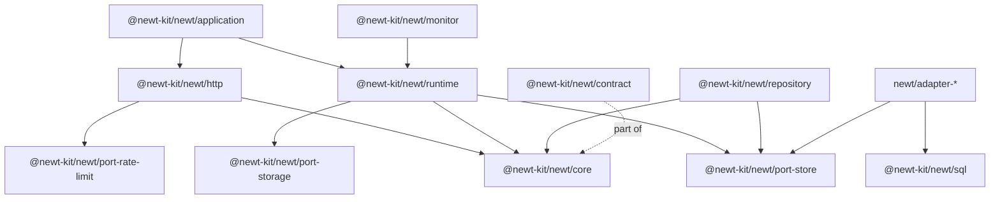

# D. Every export

Every subpath of the <code>newt</code> package and everything it exports,
one table each: what the export is, in one line, and the chapter that covers it. Use it to find
where something is imported from, or what a name you met in code is for.

newt is one package with one entry per piece, its `exports` in `packages/newt/package.json`. There
is no `import … from '@newt-kit/newt'`: you always name the piece, so a frontend never pulls in the server
and an application that never uses Kysely never loads it.

The pieces build on each other; an arrow reads "is built on":

A few things to know before the tables:

- **`@newt-kit/newt/contract` is the browser's part of `@newt-kit/newt/core`.** It re-exports the errors' base
  classes, the value objects, filters and pages, and the types the monitor reads. A module's
  `*.schema.ts` imports from it, never from core ([B](./b-lint#newt-schema-imports)).
- **Some names come from two entries.** `@newt-kit/newt/runtime` re-exports the metric and trace types of
  `@newt-kit/newt/contract`; `@newt-kit/newt/adapter-postgres` and `@newt-kit/newt/adapter-mysql` re-export `SqlTable`. They
  are the same thing; import from whichever entry you already use.
- **`…/contract` subpaths are test suites** (`describeStoreContract` and friends): they run under
  `bun test` only.
- **Kind** says `class`, `function`, `const` or `type` (a type or an interface: nothing at
  runtime).
- `newt/cli` is not an export but the package's `bin` ([C](./c-cli)).

| Subpath | What it is | Optional peer |
|---|---|---|
| [`@newt-kit/newt/core`](#newt-core) | Modules, entities, use cases, actor and scopes, time, errors, events, criteria, pages, value objects, tracing, logs. | |
| [`@newt-kit/newt/contract`](#newt-contract) | What a backend and its clients share, and a browser may load. | |
| [`@newt-kit/newt/port-store`](#newt-port-store) | The port every store implements. | |
| [`@newt-kit/newt/port-store/contract`](#newt-port-store-contract) | The suite that checks a store. | |
| [`@newt-kit/newt/port-outbox`](#newt-port-outbox) | The port of a store's outbox of jobs. | |
| [`@newt-kit/newt/port-analytics`](#newt-port-analytics) | The port of an analytical database. | |
| [`@newt-kit/newt/port-analytics/contract`](#newt-port-analytics-contract) | Its suite, and one in memory. | |
| [`@newt-kit/newt/port-rate-limit`](#newt-port-rate-limit) | Where rate limits count, in memory and on a table. | |
| [`@newt-kit/newt/port-rate-limit/contract`](#newt-port-rate-limit-contract) | The suite that checks a rate limit store. | |
| [`@newt-kit/newt/repository`](#newt-repository) | Repositories. | |
| [`@newt-kit/newt/runtime`](#newt-runtime) | A context at runtime: `Base`, `BoundedContext`, jobs, schedules, rate limits, metrics, traces. | |
| [`@newt-kit/newt/sql`](#newt-sql) | What every SQL store shares. | |
| [`@newt-kit/newt/adapter-sqlite`](#newt-adapter-sqlite) | The SQLite store. | |
| [`@newt-kit/newt/adapter-postgres`](#newt-adapter-postgres) | The Postgres store. | |
| [`@newt-kit/newt/adapter-mysql`](#newt-adapter-mysql) | The MySQL store. | |
| [`@newt-kit/newt/adapter-files`](#newt-adapter-files) | A store of JSON files. | |
| [`@newt-kit/newt/adapter-redis`](#newt-adapter-redis) | Rate limits on Redis. | |
| [`@newt-kit/newt/port-storage`](#newt-port-storage) | The port of where files are kept, and what a module holds of them. | |
| [`@newt-kit/newt/port-storage/contract`](#newt-port-storage-contract) | The suite that checks a storage adapter. | |
| [`@newt-kit/newt/adapter-storage-s3`](#newt-adapter-storage-s3) | Files on S3, R2 or MinIO. | |
| [`@newt-kit/newt/adapter-storage-disk`](#newt-adapter-storage-disk) | Files in a folder of the server. | |
| [`@newt-kit/newt/adapter-duckdb`](#newt-adapter-duckdb) | Analytics on DuckDB. | `@duckdb/node-api` |
| [`@newt-kit/newt/kysely`](#newt-kysely) | Kysely on a store's connection. | `kysely` |
| [`@newt-kit/newt/http`](#newt-http) | A context's HTTP entry, on `Bun.serve`. | |
| [`@newt-kit/newt/application`](#newt-application) | All contexts in one process. | |
| [`@newt-kit/newt/otel`](#newt-otel) | A tracer that sends spans over OTLP. | |
| [`@newt-kit/newt/monitor`](#newt-monitor) | The endpoint a monitor reads. | |
| [`@newt-kit/newt/testing`](#newt-testing) | Helpers for HTTP tests. | |

## `@newt-kit/newt/core`

What an application builds its modules with. Everything not exported here is private.

### Modules, entities and use cases

| Export | Kind | What it is | Chapter |
|---|---|---|---|
| `Module` | class | The base of every module: its name, its invocations, its deps; `resolve` and `resolveRefs` for its use cases. | [Modules](./04-modules) |
| `Ref` | type | Another module's row as a named reference: `{ id, name }`. | [Use cases](./06-use-cases) |
| `RefFinder` | type | A module whose rows can stand in as a `Ref`: `find({ id: [...] })`. | [Use cases](./06-use-cases) |
| `Entity` | class | An entity: its data kept valid by its schema, what changed, and the events it tells. `Entity<typeof Full, typeof Public>` for one with secrets. | [Entities](./05-entities) |
| `EntityInput` | type | What builds an entity: its data, id and timestamps optional, and its version when read. | [Entities](./05-entities) |
| `EntitySchema` | type | The shape an entity's schema must have: a `z.object` or `z.strictObject` with id and timestamps. | [Entities](./05-entities) |
| `InvalidEntity` | class | Thrown when an entity breaks its schema: a bug, a 500. | [Entities](./05-entities), [A](./a-rules#entities) |
| `UseCase` | function | The decorator that makes a method a use case: traced, retried on a conflict, under the write rule. | [Use cases](./06-use-cases) |
| `UseCaseOptions` | type | `retryOnConflict` and `writesTo`. | [Use cases](./06-use-cases), [Concurrency](./20-concurrency) |
| `WriteRule` | type | `'error'`, `'warn'` or `'off'`: what a write outside a worker gets. | [Between contexts](./11-between-contexts) |
| `GuardRule` | type | `'error'`, `'warn'` or `'off'`: what a save that reads and guards nothing gets. | [Concurrency](./20-concurrency) |
| `Invocations` | type | Every call to a use case, each a span: what `base.invocations` is. | [Observability](./32-observability) |

### Who is doing it, and where

| Export | Kind | What it is | Chapter |
|---|---|---|---|
| `Actor` | type | Who is doing the work; an application augments it (`via`). | [Use cases](./06-use-cases), [Auth](./29-auth) |
| `currentActor` | function | Who is doing the work in progress; throws `NoActor` outside one. | [Use cases](./06-use-cases) |
| `findCurrentActor` | function | The same, or `undefined`: for a public route that shows more to someone signed in. | [Auth](./29-auth) |
| `runAsActor` | function | Runs a function as an actor, down to every use case it calls. | [Use cases](./06-use-cases), [Testing](./12-testing) |
| `NoActor` | class | 401 `not_signed_in`: `currentActor()` with nobody acting. | [A](./a-rules#who-and-where) |
| `defineScope` | function | A value that travels with the work, like the actor: a workspace, a tenant. | [Tenants](./22-tenants) |
| `DefineScopeOptions` | type | `missing`: the error `current()` throws outside the scope. | [Tenants](./22-tenants) |
| `Scope` | type | What `defineScope` gives: `run`, `current`, `find`. | [Tenants](./22-tenants) |

### Time

| Export | Kind | What it is | Chapter |
|---|---|---|---|
| `Clock` | type | `{ now(): Date }`: what tells a context the time. | [Time](./23-time) |
| `systemClock` | const | The real time. | [Time](./23-time) |
| `now` | function | The time by the clock of the context at work. Use it, never `new Date()`. | [Time](./23-time) |

### Errors and messages

| Export | Kind | What it is | Chapter |
|---|---|---|---|
| `DomainError` | class | The base of every expected error: a `status` and a stable `code`. | [HTTP](./08-http) |
| `ErrorBody` | type | What a client receives: `{ error, code, issues? }`. | [HTTP](./08-http) |
| `ValidationError` | class | Base of 400s. | [HTTP](./08-http) |
| `UnauthorizedError` | class | Base of 401s: not signed in, or credentials wrong. | [HTTP](./08-http) |
| `ForbiddenError` | class | Base of 403s: signed in, but may not. | [HTTP](./08-http) |
| `NotFoundError` | class | Base of 404s. | [HTTP](./08-http) |
| `ConflictError` | class | Base of 409s. | [HTTP](./08-http) |
| `ConcurrencyConflict` | class | 409: saved by someone else since read; the use case runs again. | [Concurrency](./20-concurrency) |
| `DuplicateValue` | class | 409: a unique index refused the row; `fields` names it when it can. | [Concurrency](./20-concurrency) |
| `ReferenceNotFound` | class | 400: an id sent by a client points nowhere (`resolveRefs`). | [Use cases](./06-use-cases) |
| `TooManyRequests` | class | 429: a rate limit passed; `limit` and `retryAfterMs`. | [Rate limits](./28-rate-limits) |
| `Messages` | type | newt's messages, by code. | [HTTP](./08-http) |
| `setMessages` | function | Replaces some of newt's messages for the whole process; returns what restores them. | [HTTP](./08-http) |

### Events

| Export | Kind | What it is | Chapter |
|---|---|---|---|
| `DomainEvent` | type | Something that happened, told after its save commits: `name`, `occurredAt`, `payload`. | [Events](./09-events) |
| `Json` | type | What a payload may hold: what comes back from JSON as it went in. | [Events](./09-events) |
| `DomainEventClass` | type | An event's class: its static `eventName` and its constructor. | [Events](./09-events) |
| `DomainEventEmitter` | class | One kind of event a module tells; others `subscribe` to it. | [Events](./09-events) |
| `EventSource` | type | What a module needs of an event it reacts to: only `subscribe`. | [Between contexts](./11-between-contexts) |
| `Subscription` | type | How to react: `'handler'` (with `queue`, `attempts`) or `'fire-and-forget'`, and `when`. | [Workers](./10-workers) |
| `eventsOf` | function | A module's emitters, one per event class: `this.events = eventsOf(base.bus, { … })`. | [Events](./09-events) |
| `EmittersOf` | type | The type `eventsOf` returns. | [Events](./09-events) |
| `EventBus` | type | Where events are published and subscribed: `base.bus`. | [Events](./09-events) |
| `EventHandler` | type | What hears an event on the bus. | [Events](./09-events) |
| `EventMeta` | type | A handler's second argument: the event's `id`, `name` and `occurredAt`. | [Workers](./10-workers) |
| `EventPublisher` | type | Where repositories publish what entities tell: `base.publisher`. | [Events](./09-events) |
| `SubscribeOptions` | type | The bus's options for a subscription: its mode, queue, attempts. | [Workers](./10-workers) |

### Criteria and filters

| Export | Kind | What it is | Chapter |
|---|---|---|---|
| `Criteria` | type | What rows must be like: field by field, with operators, `and` and `or`. | [Repositories](./07-repositories), [Queries](./25-queries) |
| `Condition` | type | What one field must pass: its operators. | [Queries](./25-queries) |
| `Operator` | type | `in`, `ne`, `gt`, `gte`, `lt`, `lte`, `ieq`. | [Queries](./25-queries) |
| `allOf` | function | Two criteria at once. | [Queries](./25-queries) |
| `isCondition` | function | Whether a criterion is a condition, not a value to equal. For adapters. | [Stores](./26-stores) |
| `CriteriaNode` | type | Criteria as a tree, what a store translates. | [Stores](./26-stores) |
| `criteriaTree` | function | Criteria as that tree. | [Stores](./26-stores) |
| `matches` | function | Whether a row meets criteria, as SQL would: for stores that check rows one by one. | [Stores](./26-stores) |
| `compare` | function | How two values sort, as the SQL stores sort them. | [Stores](./26-stores) |
| `defineFilter` | function | The filters a client may send for a list, and nothing else. | [Queries](./25-queries) |
| `FilterLimits` | type | How deep and how many conditions a filter may have. | [Queries](./25-queries) |
| `Filter` | type | What `defineFilter` gives: a schema and its criteria. | [Queries](./25-queries) |
| `FilterField` | type | One field a client may filter by, and its operators. | [Queries](./25-queries) |
| `FilterNode` | type | A filter as a client sends it. | [Queries](./25-queries) |

### Pages

| Export | Kind | What it is | Chapter |
|---|---|---|---|
| `Page` | type | One page of a list: `items`, `hasMore`, `total`, `nextCursor`. | [Queries](./25-queries) |
| `PageRequest` | type | `{ size, cursor }`: which page. | [Queries](./25-queries) |
| `toPage` | function | A page from rows read with one more than its size. | [Queries](./25-queries) |
| `mapPage` | function | A page of other items made from each item: entities into DTOs. | [Use cases](./06-use-cases) |
| `allPages` | function | Every item of a list read in pages: only for lists that are never long. | [Queries](./25-queries) |

### Value objects

| Export | Kind | What it is | Chapter |
|---|---|---|---|
| `ValueObject` | type | `{ schema, from }`: a value's rules, defined once. | [Entities](./05-entities) |
| `Email` | const and type | An email address, trimmed and lower-cased; branded. | [Entities](./05-entities) |
| `InvalidEmail` | class | 400 `invalid_email`. | [A](./a-rules#http-error-codes) |
| `SecretToken` | const and type | An unguessable token; `generate`, `hash`, `from`. | [Auth](./29-auth) |
| `InvalidSecretToken` | class | 400 `invalid_secret_token`. | [Auth](./29-auth) |

### Tracing and logs

| Export | Kind | What it is | Chapter |
|---|---|---|---|
| `Tracer` | type | Who watches the invocations: an APM, OpenTelemetry, a log. | [Observability](./32-observability) |
| `Span` | type | One step a tracer watches. | [Observability](./32-observability) |
| `SpanAttributes` | type | What describes a span. | [Observability](./32-observability) |
| `NoopTracer` | class | A tracer that does nothing: the default. | [Observability](./32-observability) |
| `setTracer` | function | One tracer for the whole application. `runContexts` calls it. | [Observability](./32-observability) |
| `filterSpans` | function | A tracer that passes on only the spans a function keeps. | [Observability](./32-observability) |
| `keepTrace` | function | Keeps the trace in progress whatever its sampling, with a reason. | [Traces](./44-traces) |
| `log` | const | The application's log: `log.info(message, fields)`, into the console and the trace. | [Observability](./32-observability) |
| `setLogger` | function | Where log lines go instead of the console. | [Observability](./32-observability) |
| `ConsoleLogger` | class | The log on the console, one line each. | [Observability](./32-observability) |
| `Logger` | type | Where log lines go. | [Observability](./32-observability) |
| `LogFields` | type | What a line says beside its message. | [Observability](./32-observability) |
| `LogLevel` | type | `debug`, `info`, `warn`, `error`. | [Observability](./32-observability) |
| `LogLine` | type | One line, with its context and trace. | [Observability](./32-observability) |
| `TraceSampling` | type | The share of uneventful traces kept, overall or by use case, route, queue or context. | [Traces](./44-traces) |
| `SamplingRules` | type | Those shares by name. | [Traces](./44-traces) |

## `@newt-kit/newt/contract`

What a backend and its clients share. Nothing here keeps a scope, so a frontend imports it as it
is. Everything is also in `@newt-kit/newt/core` (or, for the monitor's types, `@newt-kit/newt/runtime`).

| Export | Kind | What it is | Chapter |
|---|---|---|---|
| `DomainError`, `ValidationError`, `UnauthorizedError`, `ForbiddenError`, `NotFoundError`, `ConflictError` | class | The errors' base classes, as in core. | [Frontends](./30-frontends) |
| `ValueObject`, `Email`, `InvalidEmail`, `SecretToken`, `InvalidSecretToken` | type, const, class | The value objects and their errors, as in core. | [Frontends](./30-frontends) |
| `defineFilter`, `FilterLimits`, `Filter`, `FilterField`, `FilterNode` | function, type | Client filters, as in core. | [Queries](./25-queries) |
| `Page`, `PageRequest` | type | Pages, as in core. | [Frontends](./30-frontends) |
| `ErrorBody` | type | What a failed request answers. | [Frontends](./30-frontends) |
| `ApplicationDescription` | type | What an application says it is made of (`describeApplication`). | [Structure](./42-structure) |
| `ContextDescription`, `ModuleDescription`, `UseCaseDescription`, `EventDescription`, `ModuleDependency`, `SubscriptionDescription` | type | Its parts: contexts, modules, use cases, events, deps, subscriptions. | [Structure](./42-structure) |
| `EventCount`, `EventCounts` | type | How many times an event was told, per minute; the minutes since a cursor. | [Metrics](./43-metrics) |
| `UseCaseTiming`, `UseCaseTimings` | type | How a use case's calls went, per minute: count, retries, durations by bucket. | [Metrics](./43-metrics) |
| `Outcome` | type | How a call that threw ended: an `error` it says may happen, or a `failure`. | [Metrics](./43-metrics) |
| `QueueFlow`, `QueueFlows` | type | How a queue's jobs went, per minute: published, delivered, redelivered, dead, waits. | [Queues](./45-queues) |
| `DeadJob`, `DeadJobs` | type | A job out of attempts; a page of them. | [Queues](./45-queues) |
| `OutboxState`, `QueueState` | type | Every queue's depth now, and whether a worker serves it. | [Queues](./45-queues) |
| `ClosedTraces`, `Trace`, `TraceSpan`, `TraceJob`, `TraceLog`, `TracedEvent`, `SpanKind`, `SpanAttributeValue` | type | Recorded traces and their parts. | [Traces](./44-traces) |
| `LogFields`, `LogLevel` | type | As in core. | [Observability](./32-observability) |
| `histogramBucketOf`, `histogramBucketMs`, `histogramPercentile` | function | Duration histograms: a duration's bucket, a bucket's time, a percentile. | [Metrics](./43-metrics) |
| `HISTOGRAM_FLOOR_MS`, `HISTOGRAM_GROWTH` | const | The shortest time told apart (0.1 ms); each bucket 10% longer. | [Metrics](./43-metrics) |

## `@newt-kit/newt/port-store`

The port a store implements: tables, transactions, outbox and migrations.

| Export | Kind | What it is | Chapter |
|---|---|---|---|
| `Store` | type | Where a context keeps its data: the port every adapter implements. | [Stores](./26-stores) |
| `Table` | type | A table of rows with an id and a version, in any storage. | [Stores](./26-stores) |
| `TableOptions` | type | What a table needs said of its rows: `unique` fields and `types`. | [Stores](./26-stores) |
| `FieldType` | type | `boolean` or `json`, for stores with no such type. | [Stores](./26-stores) |
| `FindOptions` | type | `orderBy` and `limit`. | [Repositories](./07-repositories) |
| `NewRow` | type | A row about to be inserted. | [Stores](./26-stores) |
| `StoredRow` | type | A row with its id and version. | [Stores](./26-stores) |
| `Migrations`, `MigrationStatus` | type | A store's migrations, and what `status()` tells: applied, pending, changed. | [Stores](./26-stores), [Production](./13-production) |
| `migrationName` | function | `00003_product-code`. | [Stores](./26-stores) |
| `migrationChecksum` | function | A migration's SHA-256, line ends normalised. | [Stores](./26-stores) |
| `TransactionScope` | class | The transaction machinery every adapter builds on. | [Stores](./26-stores) |
| `noteRead` | function | Tells the save in progress a table read rows, for the guard rule. | [Stores](./26-stores) |

## `@newt-kit/newt/port-store/contract`

| Export | Kind | What it is | Chapter |
|---|---|---|---|
| `describeStoreContract` | function | The suite that checks an adapter keeps every promise of `Store`. | [Stores](./26-stores) |
| `StoreFixture` | type | How the suite opens fresh stores of an adapter. | [Stores](./26-stores) |
| `ThingRow` | type | The row of the suite's table. | [Stores](./26-stores) |

## `@newt-kit/newt/port-outbox`

| Export | Kind | What it is | Chapter |
|---|---|---|---|
| `Outbox` | type | Where a store keeps its jobs, in the same storage as its data. | [Workers](./10-workers), [Stores](./26-stores) |
| `Job` | type | A job: written with its change, claimed with a lease. | [Workers](./10-workers) |
| `JobClosing` | type | How a claim ends: done, dead, or pending again. | [Stores](./26-stores) |
| `JobQuery` | type | Which jobs `list` reads. | [Queues](./45-queues) |
| `JobQueueRegistration` | type | A queue a worker runs. | [Stores](./26-stores) |
| `QueueDepth` | type | How full a queue is: ready, retrying, running, dead, oldest wait. | [Queues](./45-queues) |
| `depthOf` | function | A queue's depth from its jobs, for adapters that read them all. | [Stores](./26-stores) |
| `isSameClaim` | function | Whether a write on a job still belongs to its claim. | [Stores](./26-stores) |

## `@newt-kit/newt/port-analytics`

| Export | Kind | What it is | Chapter |
|---|---|---|---|
| `Analytics` | type | An analytical database, only appended to, fed by workers. | [Stores](./26-stores) |
| `AnalyticsRow` | type | A row of a dataset: anything, with an id. | [Stores](./26-stores) |

## `@newt-kit/newt/port-analytics/contract`

| Export | Kind | What it is | Chapter |
|---|---|---|---|
| `describeAnalyticsContract` | function | The suite that checks an analytics adapter. | [Stores](./26-stores) |
| `AnalyticsFixture` | type | How the suite opens and reads an adapter. | [Stores](./26-stores) |
| `MemoryAnalytics` | class | Analytics in memory, for tests. | [Stores](./26-stores) |

## `@newt-kit/newt/port-rate-limit`

Where rate limits count what each key did lately.

| Export | Kind | What it is | Chapter |
|---|---|---|---|
| `RateLimitStore` | type | The port: `take` and `forget`. | [Rate limits](./28-rate-limits) |
| `RateLimitRule` | type | `{ limit, windowMs }`: at most `limit` takes in any window. | [Rate limits](./28-rate-limits) |
| `RateLimitTake` | type | What a take answered: `allowed`, `remaining`, `retryAfterMs`. | [Rate limits](./28-rate-limits) |
| `RateLimitRow` | type | A key's row, as `TableRateLimitStore` keeps it (with its SQL in the doc comment). | [Rate limits](./28-rate-limits) |
| `WindowCount` | type | A key's count: its window's start, this window's and the last. | [Rate limits](./28-rate-limits) |
| `slide` | function | One take under a sliding window: the arithmetic every store shares. | [Rate limits](./28-rate-limits) |
| `checkRule` | function | Throws for a rule that cannot count anything. | [Rate limits](./28-rate-limits) |
| `MemoryRateLimitStore` | class | Counts in the process's memory: one instance. The default. | [Rate limits](./28-rate-limits) |
| `TableRateLimitStore` | class | Counts on a table of any store (`rate_limit`): every instance sharing the store. | [Rate limits](./28-rate-limits) |

## `@newt-kit/newt/port-rate-limit/contract`

| Export | Kind | What it is | Chapter |
|---|---|---|---|
| `describeRateLimitContract` | function | The suite that checks a rate limit store. | [Rate limits](./28-rate-limits) |
| `RateLimitFixture` | type | How the suite opens and closes a store. | [Rate limits](./28-rate-limits) |

## `@newt-kit/newt/repository`

| Export | Kind | What it is | Chapter |
|---|---|---|---|
| `Repository` | class | The base of every repository: `save` with its hooks, `saveRows`, `conflict()`. | [Repositories](./07-repositories), [Aggregates](./21-aggregates) |
| `RepositoryBase` | type | What a repository needs: its store and where to publish. | [Repositories](./07-repositories) |
| `SaveHooks` | type | `guard`, `before`, `after`: what a save runs in its transaction. | [Concurrency](./20-concurrency) |
| `TableRepository` | class | A repository of one table's rows: `find`, `first`, `count`, `page`, `persist`, `purge`, `findInEveryScope`. | [Repositories](./07-repositories) |
| `RepositoryScope` | type | `{ field, current }`: what the rows belong to. | [Tenants](./22-tenants) |
| `TableRepositoryOptions` | type | `scope` (required) and `softDelete`. | [Repositories](./07-repositories) |

## `@newt-kit/newt/runtime`

A context at runtime.

### Contexts, jobs, schedules, rate limits

| Export | Kind | What it is | Chapter |
|---|---|---|---|
| `Base` | class | What every module of a context gets: `store`, `invocations`, `bus`, `publisher`, `jobs`, `schedules`, `rateLimits`. Extended by each application. | [Contexts](./03-contexts) |
| `BaseOptions` | type | `name`, `store`, `clock`, `tracer`, `jobs`, `writeRule`, `guardRule`, `metrics`, `rateLimits`. | [Contexts](./03-contexts) |
| `BoundedContext` | class | One context: `start()` its worker, `stop()` it and close its store. | [Contexts](./03-contexts) |
| `JobQueue` | type | `base.jobs`: the worker; `idle()`, `runAsWorker()` in tests. | [Workers](./10-workers), [Testing](./12-testing) |
| `JobQueueOptions` | type | `concurrency`, `pollMs`, `leaseMs`, `backoffMs`, `maxBackoffMs`, `keepDoneMs`, `seenEveryMs`, `orphansCheckEveryMs`. | [Workers](./10-workers) |
| `Schedules` | type | `base.schedules`: `define(name, cron)`, `tick()`. | [Time](./23-time) |
| `ScheduleTick` | type | What a schedule tells: when it was due. | [Time](./23-time) |
| `RateLimits` | type | `base.rateLimits`: `define('<module>.<name>', rule)`. | [Rate limits](./28-rate-limits) |
| `RateLimit` | type | A defined limit: `take(key)`, `forget(key)`. | [Rate limits](./28-rate-limits) |
| `describeApplication` | function | The running application as it describes itself. | [Structure](./42-structure) |
| `ApplicationDescription`, `ContextDescription`, `ModuleDescription`, `UseCaseDescription`, `EventDescription`, `ModuleDependency`, `SubscriptionDescription` | type | As in `@newt-kit/newt/contract`. | [Structure](./42-structure) |

### Metrics

| Export | Kind | What it is | Chapter |
|---|---|---|---|
| `Metrics` | type | Where an application counts events and times use cases, minute by minute. | [Metrics](./43-metrics) |
| `MemoryMetrics`, `MemoryMetricsOptions` | class, type | In the process's memory: one instance. | [Metrics](./43-metrics) |
| `RedisMetrics`, `RedisMetricsOptions` | class, type | In Redis: any number of instances, summed. | [Running the monitor](./47-running-the-monitor) |
| `setMetrics` | function | Where every context counts, set once at startup. | [Running the monitor](./47-running-the-monitor) |
| `CountedEvent`, `TimedCall`, `QueueFlowEntry` | type | One event told, one call timed, one job's step: what is counted. | [Metrics](./43-metrics) |
| `EventCount`, `EventCounts`, `UseCaseTiming`, `UseCaseTimings`, `Outcome`, `QueueFlow`, `QueueFlows` | type | As in `@newt-kit/newt/contract`. | [Metrics](./43-metrics) |
| `InstanceSample`, `InstanceMinute`, `Instances`, `InstanceState`, `MeanMax`, `MeanMin`, `ProcessReading`, `ServerReading` | type | What each instance tells of itself and its machine, every 10 seconds. | [Metrics](./43-metrics) |
| `SAMPLE_EVERY_MS`, `LOST_AFTER_MS` | const | How often an instance samples itself; when it is taken for lost (three samples). | [Metrics](./43-metrics) |
| `DeadJob`, `DeadJobs`, `OutboxState`, `QueueState` | type | As in `@newt-kit/newt/contract`. | [Queues](./45-queues) |
| `histogramBucketOf`, `histogramBucketMs`, `histogramPercentile`, `HISTOGRAM_FLOOR_MS`, `HISTOGRAM_GROWTH` | function, const | As in `@newt-kit/newt/contract`. | [Metrics](./43-metrics) |

### Traces

| Export | Kind | What it is | Chapter |
|---|---|---|---|
| `Traces` | type | Where recorded traces are kept, by minute. | [Traces](./44-traces) |
| `MemoryTraces`, `MemoryTracesOptions` | class, type | In memory: one instance. | [Traces](./44-traces) |
| `RedisTraces`, `RedisTracesOptions` | class, type | In Redis: any number of instances. | [Running the monitor](./47-running-the-monitor) |
| `setTraces`, `SetTracesOptions` | function, type | Where traces are kept, their sampling, how many log lines each keeps. | [Traces](./44-traces) |
| `enableTraces` | function | Turns traces on; `serveMonitor` calls it. | [Traces](./44-traces) |
| `ClosedTraces`, `Trace`, `TraceSpan`, `TraceJob`, `TraceLog`, `TracedEvent`, `SpanKind`, `SpanAttributeValue` | type | As in `@newt-kit/newt/contract`. | [Traces](./44-traces) |

## `@newt-kit/newt/sql`

What every SQL store shares, for an adapter to build on.

| Export | Kind | What it is | Chapter |
|---|---|---|---|
| `SqlDialect` | type | What tells one SQL database from another. | [Stores](./26-stores) |
| `SqlExecutor` | type | How a SQL table runs statements, in or out of a transaction. | [Stores](./26-stores) |
| `SqlTable`, `SqlTableOptions` | class, type | A table that writes its own SQL in the store's dialect. | [Stores](./26-stores) |
| `splitStatements` | function | A SQL script split into statements. | [Stores](./26-stores) |
| `SqlStore`, `SqlStoreOptions` | class, type | A store on a database server through `Bun.SQL`. | [Stores](./26-stores) |
| `SqlServerDialect` | type | What a server's dialect adds: locks, pools. | [Stores](./26-stores) |
| `SqlOutbox` | class | The outbox of a server store: `job` and `job_queue`. | [Stores](./26-stores) |
| `SqlMigrationRunner` | class | Migrations of a server store. | [Stores](./26-stores) |
| `errorCode` | function | The database's own code of an error (`23505`, `1062`). | [Stores](./26-stores) |

## `@newt-kit/newt/adapter-sqlite`

| Export | Kind | What it is | Chapter |
|---|---|---|---|
| `SqliteStore`, `SqliteStoreOptions` | class, type | The SQLite store on `bun:sqlite`: `open` migrates, `connect` does not. `path: ':memory:'` in tests. | [Stores](./26-stores), [Testing](./12-testing) |
| `SqliteTable`, `SqliteTableOptions` | class, type | Its table: booleans as 0 and 1, JSON as text. | [Stores](./26-stores) |
| `SqliteOutbox` | class | Its outbox. | [Stores](./26-stores) |
| `MigrationRunner` | class | Applies and reverts a folder's migrations. | [Stores](./26-stores) |

## `@newt-kit/newt/adapter-postgres`

| Export | Kind | What it is | Chapter |
|---|---|---|---|
| `PostgresStore` | class | The Postgres store on `Bun.SQL`; migrations all or none. | [Stores](./26-stores), [Production](./13-production) |
| `PostgresStoreOptions` | type | `SqlStoreOptions`, by its name here. | [Stores](./26-stores) |
| `SqlTable` | class | As in `@newt-kit/newt/sql`. | [Stores](./26-stores) |

## `@newt-kit/newt/adapter-mysql`

| Export | Kind | What it is | Chapter |
|---|---|---|---|
| `MySqlStore` | class | The MySQL store on `Bun.SQL`. | [Stores](./26-stores) |
| `MySqlStoreOptions` | type | `SqlStoreOptions`, by its name here. | [Stores](./26-stores) |
| `SqlTable` | class | As in `@newt-kit/newt/sql`. | [Stores](./26-stores) |

## `@newt-kit/newt/adapter-files`

| Export | Kind | What it is | Chapter |
|---|---|---|---|
| `FileStore`, `FileStoreOptions` | class, type | A store of JSON files, one folder per collection, with transactions of its own. | [Stores](./26-stores) |
| `FileTable` | class | Its table: a collection's records. | [Stores](./26-stores) |
| `FileCollection` | class | One collection's records, for migrations and reports. | [Stores](./26-stores) |
| `FileRecord` | type | A record: JSON with an id. | [Stores](./26-stores) |
| `FileOutbox` | class | Its outbox: `_jobs`, `_job_queues`. | [Stores](./26-stores) |
| `FileMigration` | type | A migration: `up` and `down` functions over the collections. | [Stores](./26-stores) |
| `FileMigrations` | class | Its migrations, kept in `_migrations`. | [Stores](./26-stores) |

## `@newt-kit/newt/adapter-redis`

| Export | Kind | What it is | Chapter |
|---|---|---|---|
| `RedisRateLimitStore` | class | Rate limits on Redis, for several instances: one key per count, expiring on its own. | [Rate limits](./28-rate-limits) |
| `RedisRateLimitStoreOptions` | type | Its options. | [Rate limits](./28-rate-limits) |

## `@newt-kit/newt/port-storage`

Where a context's files are kept, and what its modules hold of them.

| Export | Kind | What it is | Chapter |
|---|---|---|---|
| `StorageAdapter`, `PublicStorageAdapter` | type | The port: `put`, `open`, `head`, `stat`, `delete`, `uploadUrl`, `signedUrl`; a public one adds `url`. | [Files](./34-files) |
| `Files`, `PrivateFiles`, `PublicFiles` | class | What a module holds: `in`, `verifyUpload`, and the port's, under its prefix. | [Files](./34-files) |
| `StorageOptions`, `ContextStorage` | type | `BaseOptions.storage`, and `base.storage`. | [Files](./34-files) |
| `StoredFile`, `OpenFile`, `PutOptions`, `UploadUrlOptions`, `UploadAddressOptions`, `DownloadUrlOptions` | type | What goes in and comes out of the port. | [Files](./34-files) |
| `DEFAULT_MAX_UPLOAD_BYTES` | const | How long an uploaded file may be unless told: 1 MB. | [Files](./34-files) |
| `UploadTooLarge` | class | 413 `upload_too_large`: no address for a file past `maxBytes`. | [Files](./34-files) |
| `UploadRule`, `UploadRefusal` | type | What `verifyUpload` takes, and why it refuses: `missing`, `too_large`, `wrong_type`. | [Files](./34-files) |
| `MemoryStorage`, `MemoryPublicStorage` | class | Files in memory, for tests; `send` answers their addresses. | [Files](./34-files) |
| `assertStorageKey` | function | Throws for a key that could leave its place. | [Files](./34-files) |
| `contentDisposition`, `mayShowInline` | function | How a file is served: `inline` only for what a browser cannot run. | [Files](./34-files) |
| `matchesType`, `SNIFF_BYTES` | function, const | Whether a file's first bytes may be of a type. | [Files](./34-files) |

## `@newt-kit/newt/port-storage/contract`

| Export | Kind | What it is | Chapter |
|---|---|---|---|
| `describeStorageContract` | function | The suite every storage adapter runs. | [Files](./34-files) |
| `StorageFixture` | type | How the suite opens an adapter and reaches its addresses. | [Files](./34-files) |

## `@newt-kit/newt/adapter-storage-s3`

| Export | Kind | What it is | Chapter |
|---|---|---|---|
| `S3Storage`, `S3PublicStorage` | class | Files in a bucket, with Bun's own client. | [Files](./34-files) |
| `S3StorageOptions`, `S3PublicStorageOptions` | type | Their options. | [Files](./34-files) |

## `@newt-kit/newt/adapter-storage-disk`

| Export | Kind | What it is | Chapter |
|---|---|---|---|
| `DiskStorage`, `DiskPublicStorage` | class | Files in a folder; `handler` serves their signed addresses. | [Files](./34-files) |
| `DiskStorageOptions` | type | Their options. | [Files](./34-files) |

## `@newt-kit/newt/adapter-duckdb`

Needs `@duckdb/node-api`.

| Export | Kind | What it is | Chapter |
|---|---|---|---|
| `DuckDbAnalytics`, `DuckDbAnalyticsOptions` | class, type | The analytics port on DuckDB, in a file one process writes. | [Stores](./26-stores) |
| `DuckDbDataset` | type | A dataset with declared columns. | [Stores](./26-stores) |
| `DuckDbColumnType` | type | The types its columns may have. | [Stores](./26-stores) |
| `DuckDbParam` | type | A value a query may be given. | [Stores](./26-stores) |

## `@newt-kit/newt/kysely`

Needs `kysely`.

| Export | Kind | What it is | Chapter |
|---|---|---|---|
| `kyselyFor` | function | Kysely on a store's connection: SQLite, Postgres or MySQL, joining its transactions. | [Queries](./25-queries) |
| `whereOf` | function | Criteria as a Kysely condition, answered as `find` answers them. | [Queries](./25-queries) |
| `SqliteRow` | type | A row as SQLite returns it to your own query. | [Queries](./25-queries) |

## `@newt-kit/newt/http`

A context's HTTP entry, on `Bun.serve`.

### Routers and routes

| Export | Kind | What it is | Chapter |
|---|---|---|---|
| `HttpRouter` | class | A context's routes: `get`, `post`, `put`, `patch`, `delete`, `group`, `authenticateWith`, `routes()`. | [HTTP](./08-http) |
| `HttpRouterOptions` | type | Route options for all routes, plus `prefix`, `rateLimits`, `clock`. | [HTTP](./08-http) |
| `RouteOptions` | type | `public`, `cors`, `onError`, `idempotency`, `rateLimit`, `maxBodyBytes`, `crossOrigin`. | [HTTP](./08-http), [Security](./27-security) |
| `HttpRoute` | type | A route: a request in, a response out; its path types its params. | [HTTP](./08-http) |
| `HttpMethod` | type | `GET`, `POST`, `PUT`, `PATCH`, `DELETE`. | [HTTP](./08-http) |
| `HttpGroup` | class | Routes under a prefix sharing a middleware (`router.group`). | [Tenants](./22-tenants) |
| `Middleware` | type | What runs around each route of a group. | [Tenants](./22-tenants) |
| `MAX_BODY_BYTES` | const | A body's default limit: a megabyte. | [Security](./27-security) |
| `Cors` | type | Which origins may call, what they may send and read. | [Security](./27-security) |
| `handle` | function | Wraps a route so whatever it throws becomes an answer. | [HTTP](./08-http) |
| `pageRequestFrom` | function | `?size=&cursor=` as a `PageRequest`, size kept between 1 and 100. | [Queries](./25-queries) |

### Who calls

| Export | Kind | What it is | Chapter |
|---|---|---|---|
| `Authenticator` | type | Tells who sent a request, or `null`. | [Auth](./29-auth) |
| `bearerAuthenticator` | function | An authenticator for `Authorization: Bearer <token>`. | [MCP](./31-mcp), [Auth](./29-auth) |
| `setSessionCookie`, `clearSessionCookie`, `SessionCookieOptions` | function, type | A session's cookie set as it must be (`HttpOnly`, `SameSite=Lax`, `Secure`), and ended. | [Auth](./29-auth), [Security](./27-security) |
| `clientIp` | function | The address a request came from, behind `trustProxy` proxies. | [Rate limits](./28-rate-limits) |
| `HttpRateLimit` | type | A route's rate limit: `name`, `limit`, `windowMs`, `by`. | [Rate limits](./28-rate-limits) |

### Asking twice

| Export | Kind | What it is | Chapter |
|---|---|---|---|
| `Idempotency` | type | `{ table, ttlMs, clock }`: a POST sent again gets the first answer. | [Idempotency](./24-idempotency) |
| `KeptAnswer` | type | The row an answer is kept in (`idempotency_key`), with its SQL. | [Idempotency](./24-idempotency) |
| `IdempotencyKeyInUse` | class | 409: the same key while the first is running. | [Idempotency](./24-idempotency) |
| `IdempotencyKeyReused` | class | 422: the same key with another body. | [Idempotency](./24-idempotency) |

### Serving

| Export | Kind | What it is | Chapter |
|---|---|---|---|
| `serve`, `ServeOptions` | function, type | A server for a context: router, routes, frontend, health, `drainMs`, `trustProxy`, `securityHeaders`, `hsts`, `csp`, `maxBodyBytes`, `idleTimeoutSeconds`. | [HTTP](./08-http), [Production](./13-production) |
| `SECURITY_HEADERS`, `SecurityHeaders` | const, type | newt's headers on every answer (`nosniff`, a referrer policy, `X-Frame-Options: DENY`), and how to change them. | [Security](./27-security) |
| `Hsts` | type | `serve`'s `hsts`: `maxAgeSeconds`, `includeSubDomains`, `preload`. | [Security](./27-security) |
| `CONTENT_SECURITY_POLICY`, `ContentSecurityPolicy` | const, type | newt's Content-Security-Policy for a built frontend, and how to change it. | [Security](./27-security) |
| `serveFrontend` | function | A built frontend: files, or `index.html`, with its CSP and inline scripts' hashes. | [Frontends](./30-frontends) |

### Errors and answers

| Export | Kind | What it is | Chapter |
|---|---|---|---|
| `ErrorHandler` | type | What a route's errors become: `toErrorResponse` unless told. | [HTTP](./08-http) |
| `toErrorResponse` | function | `{ error, code }` with the domain error's status; 500 for anything else. | [HTTP](./08-http) |
| `toOauthErrorResponse` | function | OAuth's `{ error, error_description }`. | [Auth](./29-auth) |
| `ApiRouteNotFound` | class | 404 `route_not_found`. | [A](./a-rules#http) |
| `MethodNotAllowed` | class | 405 `method_not_allowed`. | [A](./a-rules#http) |
| `NotSignedIn` | class | 401 `not_signed_in`. | [A](./a-rules#http) |
| `MalformedBody` | class | 400 `malformed_body`. | [A](./a-rules#http) |
| `UnsupportedMediaType` | class | 415 `unsupported_media_type`. | [A](./a-rules#http) |
| `PayloadTooLarge` | class | 413 `payload_too_large`. | [Security](./27-security) |
| `CrossOriginRefused` | class | 403 `cross_origin_refused`. | [Security](./27-security) |

## `@newt-kit/newt/application`

| Export | Kind | What it is | Chapter |
|---|---|---|---|
| `runContexts` | function | Runs every context in one process: serves, starts workers, stops in order on a signal. | [Production](./13-production) |
| `ContextToRun` | type | A context and how it is served. | [Production](./13-production) |
| `RunContextsOptions` | type | `tracer` for all contexts, `signals`, `stopTimeoutMs`. | [Production](./13-production) |
| `RunningContexts` | type | What it returns: each context's server, and `stop()`. | [Production](./13-production) |

## `@newt-kit/newt/otel`

| Export | Kind | What it is | Chapter |
|---|---|---|---|
| `OtlpTracer`, `OtlpTracerOptions` | class, type | newt's `Tracer` sending spans to an OpenTelemetry collector over OTLP/HTTP JSON, without the SDK. | [Observability](./32-observability) |

## `@newt-kit/newt/monitor`

| Export | Kind | What it is | Chapter |
|---|---|---|---|
| `serveMonitor`, `MonitorOptions` | function, type | The endpoint a monitor reads, on its own port, for signed requests only. | [Connecting](./41-connecting) |
| `MonitorIdentity` | type | Which application and process an endpoint is (`GET /v1/identity`). | [Connecting](./41-connecting) |
| `signMonitorRequest` | function | The headers that sign a request to that endpoint. | [Connecting](./41-connecting) |
| `MemoryNonces`, `RedisNonces`, `NonceStore` | class, type | Where the endpoint remembers nonces, so a request is never replayed. | [Running the monitor](./47-running-the-monitor) |
| `signTraceHeader`, `TRACE_HEADER`, `TRACE_HEADER_MAX_MS` | function, const | An `x-newt-trace` header that keeps a request's trace, signed, and how long it may last. | [Traces](./44-traces) |

## `@newt-kit/newt/testing`

| Export | Kind | What it is | Chapter |
|---|---|---|---|
| `freePort` | function | A port nobody listens on now. | [Testing](./12-testing) |
| `browser` | function | One person's browser for a test: keeps cookies, never follows redirects. | [Testing](./12-testing) |
| `Browser` | type | What `browser()` gives: a `fetch`. | [Testing](./12-testing) |
| `BrowserRequest` | type | A request it sends: `json` becomes the body. | [Testing](./12-testing) |

## Recap

- One subpath per piece; there is no bare `@newt-kit/newt` import.
- A schema and a frontend import `@newt-kit/newt/contract`, never `@newt-kit/newt/core`.
- Ports are `newt/port-*`; adapters are `newt/adapter-*`; `…/contract` subpaths are test suites.
- The newest pieces: `@newt-kit/newt/port-rate-limit`, `@newt-kit/newt/adapter-redis`, and in `@newt-kit/newt/http` the rate
  limit, security header, CSP and session cookie exports.

## Going further

- [A. The rules](./a-rules): what each error class above means when it is thrown.
- [Stores](./26-stores): the ports and adapters, and how to write one.
- [Security](./27-security) and [Rate limits](./28-rate-limits): the newest exports at work.
