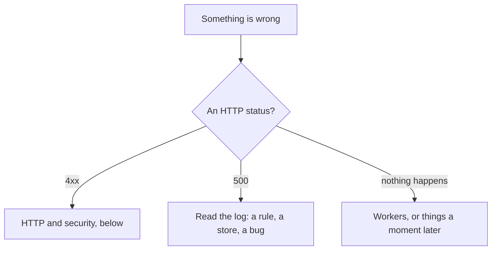

# E. Common problems

What you see, what it usually means, and what to do. Start from the
symptom; each entry names its cause, the fix, and the chapter that explains why.

Messages are quoted as newt and cooper write them. cooper replaces some of newt's at startup with
`setMessages` (`cooper/backend/shared/messages.ts`); where they differ, both are given, cooper's
first. cooper's is what a person using the app sees; newt's is what a test or a script sees,
since they do not go through `cooper/backend/index.ts`. The `code` is the same in both, and it is
what a client acts on. For the full list of errors, see [appendix A](./a-rules#when-newt-throws).

## HTTP and security

### A test gets 429

**Symptom.** A test that passed alone fails in the suite with `429` and
`{ "code": "too_many_requests" }`, or a use case rejects with `TooManyRequests` (its `limit`
names which, `session.signIn`).

**Cause.** Rate limits count across the tests that share a store. Every test request comes from
`127.0.0.1`, so a limit `by: 'ip'` (cooper's `SIGN_IN_LIMIT`, 30 in 15 minutes) counts the whole
suite as one person; a use case's limit keyed by email (`session.signIn`, 10 in 15 minutes)
counts every test that signs in as the same person.

**Fix.**
- Open a fresh store per test, or give the base its own store of counts:
  `new CooperBase({ name: 'client', store, rateLimits: new MemoryRateLimitStore() })`
  (`cooper/backend/shared/web-session/web-session.test.ts`). cooper's base keeps its counts in a
  `TableRateLimitStore` on the context's store, so a new store starts with none.
- Use a different email per test.
- To test the limit itself, move the clock past its window: the router counts by the base's
  clock when it is handed one (`new HttpRouter({ rateLimits, clock })`, as `CooperBase` does).

::: danger Never
`rateLimit: false` on a production route to make tests pass. Test the limit instead: cooper's
`cooper/backend/contexts/auth/auth.test.ts` checks that the eleventh sign-up from one address is
a 429 with `Retry-After`.
:::

See [Rate limits](./28-rate-limits), [Testing](./12-testing).

### Everyone gets 429 at once in production

**Symptom.** Behind a load balancer, sign-in starts answering "Too many requests: try again in …
s" to everyone after a burst of traffic, though no one person tried that often.

**Cause.** `serve` was not told about the proxy, so `clientIp` is the proxy's address for every
request. Every limit `by: 'ip'`, and every `by: 'actor'` limit for people not signed in, counts
all visitors as one.

**Fix.** Tell `serve` how many proxies add to `X-Forwarded-For`: `trustProxy: 1` behind one
load balancer. cooper reads it from `COOPER_TRUST_PROXY` (`cooper/backend/config.ts`), set to 1
behind Coolify's proxy.

::: warning Watch out
Do not set `trustProxy` higher than the proxies you really have. A client may write
`X-Forwarded-For` itself; only the last `trustProxy` entries are believed, so one too many lets
anyone pick their own address and dodge every limit.
:::

See [Rate limits](./28-rate-limits), [Production](./13-production).

### 403 `cross_origin_refused` from a script, a test or a dev server

**Symptom.** "This cannot be done from a page of another site" (`cross_origin_refused`, 403) on
a POST, PUT, PATCH or DELETE, though the same request works from the app.

**Cause.** newt refuses a write that a browser says comes from a page of another origin, unless
the route's `cors` names it. It reads `Sec-Fetch-Site` (anything but `same-origin` or `none` is
refused), or, from an older browser, `Origin` against `Host`. Usual culprits:
- a test or script that copies a browser's headers and sends an `Origin` (Bun's `fetch` and
  `@newt-kit/newt/testing`'s `browser` send none, and pass);
- a frontend served by a dev server on another port, calling the API on its own: another port is
  another origin, and the browser says `same-site`, not `same-origin`;
- a page in a sandboxed frame, whose origin is `null`.

**Fix.** Serve the frontend from the same origin as its API, as `serve({ frontend })` does; drop
the `Origin` header from a script. A route meant for other origins says so with `cors`, and then
proves who calls with a bearer token, never a cookie. A form another site posts back on purpose
(a payment's, a sign-in's) takes `crossOrigin: true`.

See [Security](./27-security).

### 413 `upload_too_large`

**Symptom.** "The file is longer than the 1048576 bytes it may be" (413), from an `uploadStart`.

**Cause.** A file may be 1 MB unless told. Give `maxBytes` to `uploadUrl` and to `verifyUpload`
([Files](./34-files)).

### 413 `payload_too_large`

**Symptom.** "The body of the request is longer than the 1048576 bytes it may be" (413).

**Cause.** A route reads at most a megabyte unless told (`MAX_BODY_BYTES`). A route may take
less: cooper's OAuth client registration takes 16 KB (`REGISTRATION_MAX_BYTES` in
`cooper/backend/shared/rate-limits.ts`). A body sent without a length is cut as it is read.

**Fix.** Send less, or raise it on the one route that needs it: `{ maxBodyBytes: 10 * 1024 * 1024 }`.
For routes beside the router's (`serve`'s `routes`), `serve({ maxBodyBytes })` sets it.

See [Security](./27-security).

### 415 `unsupported_media_type`

**Symptom.** "The body of the request must be sent as application/json" (415).

**Cause.** The client sent JSON without `Content-Type: application/json` (a `fetch` with
`body: JSON.stringify(…)` and no headers). newt refuses it on purpose: a form posted from another
site cannot send that type without asking first.

**Fix.** Send the header. `@newt-kit/newt/testing`'s `browser` does it for you with `json:`.

See [HTTP](./08-http).

### A page works in development and breaks once built

**Symptom.** After `bun run cooper:build` (or in production), the browser's console says
"Refused to execute inline script because it violates the following Content Security Policy
directive: script-src 'self' 'sha256-…'", or refuses to load a script, a font or a request to
another origin.

**Cause.** A built frontend is served with newt's Content-Security-Policy
(`CONTENT_SECURITY_POLICY`): scripts, styles, fonts, images and requests from its own origin
only. The page's own inline `<script>` elements run, by their hashes, which `serveFrontend`
computes from the file. What it cannot hash is refused: a script added at runtime, an inline
event handler (`onclick="…"`), a script from a CDN, a `fetch` to another origin. A frontend
served from its sources, in development, has no policy (Bun's reloading runs scripts of its own),
which is why it worked there.

**Fix.** Move the code into the bundled module, or into a `<script>` that is in `index.html`. For
a third-party origin, replace the directive, keeping `'self'`:
`serve({ …, csp: { 'script-src': ["'self'", 'https://cdn.example'] } })`. Each directive you give
replaces newt's; `null` leaves one out.

See [Security](./27-security), [Frontends](./30-frontends).

### A server answers `https` only, after HSTS was turned on

**Symptom.** A staging server reached by `http://` stops loading in a browser that visited it
before.

**Cause.** `hsts` tells browsers to come back only over HTTPS, for a year unless told.

**Fix.** Turn it on only where the public address is HTTPS. cooper sets it from its public URL
(`cooper/backend/shared/served-context.ts`): `hsts` is on when `publicUrl` starts with `https:`.

### "You are not signed in, or your session has ended: sign in to go on" / "Sign in to continue" (`not_signed_in`, 401)

**Cause.** A route that is not `public` was called without a session; or a use case that reads
`currentActor()` ran with no actor (`NoActor`): a script, a handler or a test calling it outside
`runAsActor`.

**Fix.** Sign in; in a script or test, `runAsActor({ userId, via: 'web' }, fn)`. A public route
that wants to know who is there asks `findCurrentActor()`, which returns `undefined` instead.
A route that is not public answers 401 before its rate limit counts anything.

See [Use cases](./06-use-cases), [Auth](./29-auth).

### A member gets 404 for a workspace that exists

**Cause.** They do not belong to it. boards answers 404 so a stranger cannot tell it exists.

**Fix.** Check their access in auth. See [Tenants](./22-tenants).

### A cross-origin call fails, or sends no cookie

**Cause.** The route has no `cors`, or relies on cookies across origins.

**Fix.** A route other pages call says so with `cors`, and proves who calls with a bearer token.
See [Security](./27-security), [MCP](./31-mcp).

## Saving

### `Property 'scope' is missing in type …` from `bun check`

**Cause.** A `TableRepository` that does not say what its rows belong to.

**Fix.** `{ scope: { field: 'workspaceId', current: currentWorkspaceId } }` for a tenant's rows,
or `{ scope: 'none' }` with the reason in a comment. It is required so a scope is never dropped
by leaving it out. See [Repositories](./07-repositories), [Tenants](./22-tenants).

### "Someone else changed this a moment ago. Reload it and try again." / "Someone changed it in the meantime. Try again." (`concurrency_conflict`, 409)

**Cause.** Two saves of one row at once, and the use case already ran four times (newt runs it
again from the start up to three more times, only the first of a chain); or it says
`retryOnConflict: false`.

**Fix.** Under heavy contention on one value (a counter), take it in the save's `before` under a
`guard`, so saves take turns instead of colliding. A use case that must not run twice keeps
`retryOnConflict: false` and lets the person try again. See [Concurrency](./20-concurrency).

### "That is already taken: pick another one" / "There is already one with this name" (`duplicate_value`, 409)

**Cause.** A unique index refused the row: someone took the value between your check and your
save. If you see `duplicate_value` itself, the use case has no check of its own before saving.

**Fix.** Check first in the use case and throw the module's error (`board.name_taken`); keep the
index as the last word. Where "given twice" means "given once" (an access granted again), catch
`DuplicateValue` and answer what is there. `NULL` never equals `NULL` in an index: say it as a
value when it is one. See [Concurrency](./20-concurrency).

### "[guard rule] column.add reads column in a save that guards nothing: …"

**Cause.** A save read rows in its transaction (in `before`, `after`, or a `find`) and named no
`guard`. On SQLite it seems to work, since transactions take turns; on Postgres they do not.

**Fix.** Give the save the keys its rule protects, ``guard: [`columns:${boardId}`]``, or
`guard: []` when nothing it reads needs one. `guardRule: 'warn'` on the base turns the error into
a warning while an application adds its guards. See [Concurrency](./20-concurrency).

### Two saves break a rule over several rows

**Symptom.** Two columns at position 3; eleven columns where ten is the limit.

**Cause.** The rule is checked in `after`, but under a key too wide, too narrow, or folded
differently from how the rule compares (`Roadmap` and `roadmap`).

**Fix.** Fold the key exactly as the rule compares. See [Concurrency](./20-concurrency).

### A row created meanwhile slips past the check

**Symptom.** A card moved into a column while the column is reordered.

**Cause.** A version protects a row that exists; a new one has none.

**Fix.** Check the whole order in the save's `after` and call `this.conflict()` when someone
slipped in. See [Concurrency](./20-concurrency).

### ``A write runs inside `store.transaction` ``

**Cause.** Something wrote with a `SqliteStore`'s connection (or Kysely) outside a save.

**Fix.** In a repository, write inside `save` or `saveRows`. Outside one (a script, an adapter),
inside `store.transaction(…)`. Postgres and MySQL do not check it: there a write outside a
transaction runs on its own. Wrap it the same, so the code works on every store.
See [Queries](./25-queries).

### "This call belongs to a transaction that has ended: …"

**Cause.** A call inside a transaction was left without `await`, or a branch of a `Promise.all`
kept running after another threw.

**Fix.** Await every call; the lint's `no-floating-promises` catches most ([B](./b-lint)).

### "Waited 30000 ms for the store: a transaction holds it. …"

**Cause.** Code inside a transaction asks for the store from outside it, so it waits for itself:
a save from a callback that is not in the save's chain of `await` (an `EventEmitter`, a timer).

**Fix.** Move that work to a worker. See [Workers](./10-workers).

### `database is locked`

**Cause.** Another process held SQLite's write lock for more than 5 seconds (its busy timeout):
a script with a long transaction while the backend runs.

**Fix.** Keep the script's transactions short; with several processes writing at once, move to
Postgres. See [Stores](./26-stores), [Production](./13-production).

## The write rule

### "[write rule] workspace.prepare writes to boards.board outside a worker: …"

**Cause.** A use case of one module saved in another without going through a worker. If it
failed halfway, nothing would finish it.

**Fix.** Make the second module react to an event of the first with a `'handler'` subscription.
Work over several modules is a saga, run from a worker. If the person needs both writes in the
answer, say the exception where it is seen, `@UseCase({ writesTo: ['access'] })`, with the
reason, and make sure a failure between the two leaves nothing half made. A use case called from
another context is the root of what it does in its own. See [Workers](./10-workers),
[Between contexts](./11-between-contexts).

### "[write rule] card.create saves boards.board in the transaction that saved boards.card: one module per transaction; …"

**Cause.** Two modules saved in one transaction, in a worker too: a save hook that called another
module's saving use case, or two saves inside one `store.transaction`.

**Fix.** Save the second after the first commits, from a worker reacting to its event.
See [Aggregates](./21-aggregates).

## Asking twice

### "A request with this Idempotency-Key is still in progress: …" (`idempotency_key_in_use`, 409)

**Cause.** The client sent the same submit again while the first still ran.

**Fix.** Retry once the first ends; a key held by a request that died is free again after a
minute. See [Idempotency](./24-idempotency).

### "This Idempotency-Key was sent before with another body: …" (`idempotency_key_reused`, 422)

**Cause.** The client reused a key for a different request.

**Fix.** A new `crypto.randomUUID()` per submit; the same one only to send the same submit again.
The body is compared byte by byte. See [Idempotency](./24-idempotency).

### The same POST sent twice made two cards

**Cause.** The route has no `idempotency` option, the client sent no `Idempotency-Key`, or the two
were more than a day apart (`ttlMs`).

**Fix.** See [Idempotency](./24-idempotency).

### A refused request, sent again with the same key, runs again

That is on purpose: what fails (an error thrown, a 5xx) is not kept, so the same key may try
again.

## Workers

### A job never runs

Check, in order:

| Check | Why |
|---|---|
| Does the subscription say `strategy: 'handler'`? | `'fire-and-forget'` writes no job, and is lost if it throws. |
| Did `when` take the event? | An event it refuses leaves no job at all. |
| Did the context start its worker? | `runContexts` starts every one; a script that only opens a context runs none. |
| In a test, do you wait with `base.jobs.idle()`, on the right context? | A job lives in the outbox of the context that **publishes** the event: boards' reaction to `tenant.created` runs on auth's worker. Wait for auth's jobs first, then boards'. |
| Did the save commit? | A job is written in the save's transaction: a rollback takes it with it. |
| Is it due? | A job that failed waits its backoff: 10 s, doubling, up to 15 minutes. |

See [Workers](./10-workers), [Between contexts](./11-between-contexts).

### `A handler of 'card.assigned' is named '<handler's module>.<use case it calls>.on.card.assigned', not '…'`

**Cause.** At startup: the queue does not end with its event, or lacks the shape
`<module>.<use case>.on.<module>.<event>`.

**Fix.** Name it so. `newt/queue-name` catches it, and more, in the editor ([B](./b-lint#newt-queue-name)).

### "[JobQueue] N job(s) of '…' wait, and no worker serves that queue: was its handler renamed or removed?"

**Cause.** Jobs wait in a queue no worker registers. The queue names the module, the use case and
the event, so renaming any of the three leaves the old jobs under the old name.

**Fix.** Put the name back until they are done, or write a script that does their work. The
monitor's queues page shows such a queue as served by nobody ([Queues](./45-queues)).

### A job runs twice, and its effect shows twice

**Cause.** A job runs at least once, so maybe more: a worker that stopped halfway, a lease that
ran out.

**Fix.** Make the second run find nothing to do, and key what leaves the process on the event's
`id` (the handler's second argument, `EventMeta`): an email gets it as its `key`, and is sent
once. See [Idempotency](./24-idempotency).

### A job is `dead`

**Cause.** It ran out of attempts (5 by default). Its `lastError` says why.

**Fix.** Fix the cause, then retry it: cooper's backoffice lists each context's dead jobs and
retries them; newt-monitor shows them too ([Queues](./45-queues)). A dead job of a saga is work
stuck halfway: give such jobs more `attempts`.

### "Job … is done, not dead: only a dead job is retried" (`outbox.job_not_dead`, 409)

**Cause.** Someone retried it already, or it was never dead.

**Fix.** Reload the list. (This one is cooper's, `cooper/backend/shared/outbox/errors/job-not-dead.ts`.)

### A worker acts on what is no longer there

**Cause.** A job may run late: the card was deleted since its event.

**Fix.** Read again what it is about, and do nothing if it is gone. See [Workers](./10-workers).

### A schedule never ticks in a test

**Cause.** Schedules tick on the base's clock.

**Fix.** Move the clock (`{ now: () => new Date(time) }`), then call `base.schedules.tick()`. A
new schedule waits for its next tick: the first call tells nothing of before. See [Time](./23-time).

## Things that appear a moment later

### A new workspace has no boards yet; a removed member is still an assignee; a card is missing from the search

**Cause.** Each is done by a worker after an event (`tenant.created`, `access.revoked`,
`card.created`), a moment later.

**Fix.** Design the screen for that moment, and in tests wait for the jobs. If it lasts, look for
a dead job of that queue among the publishing context's. See [Between contexts](./11-between-contexts).

### The card search finds stale cards, or misses some, with two processes

**Cause.** cooper's search is in memory, one per process: rebuilt as boards opens, and wrong as
soon as there are two.

**Fix.** A search server is another adapter of the same port. See [Stores](./26-stores).

## Who and where

### "No workspace here: a route under /workspaces/:workspaceId, inWorkspace or runInWorkspace enters one"

**Cause.** A boards repository ran outside a workspace. (A scope defined without `missing` says
`Nothing is in the <name> scope here: enter it with its run`.)

**Fix.** A route enters it through the workspace group; an MCP tool with `inWorkspace`; a worker
or a script with `runInWorkspace`. To read across workspaces on purpose, a repository method uses
`findInEveryScope`. See [Tenants](./22-tenants).

### `Property 'via' is missing` where an actor is given

**Cause.** cooper adds `via` (`'web'` or `'mcp'`) to newt's `Actor`, and it is required.

**Fix.** Every `runAsActor` and authenticator says how the person came:
`runAsActor({ userId, via: 'web' }, fn)`. See [Auth](./29-auth).

### A test signs in, but the routes see another person

**Cause.** A router has one authenticator, and the last one set wins.

**Fix.** A test that wants its own sets it after the context opens. See [Auth](./29-auth).

### An entity's secret shows in an answer or an event

**Cause.** The entity has no public schema.

**Fix.** `Entity<typeof Kept, typeof Public>` makes `toDTO()` give only the public fields.
See [Entities](./05-entities).

### `auth.tenant.list is not in boards' own tests: cooper.test.ts runs it on the real auth`

**Cause.** A test of boards alone reached a use case of auth that its fake
(`cooper/backend/contexts/boards/testing/fake-auth.ts`) does not have.

**Fix.** Test that path in `cooper.test.ts`, on the real auth; or, if boards' own rules need it,
give the fake that use case. See [Testing](./12-testing).

### `describeApplication` or the monitor shows a module depending on nothing

**Cause.** The module passed no deps to `super`, or was given another context's use cases wrapped
in a port of functions.

**Fix.** `super('card', base.invocations, deps)` with every dep, and the other context's modules
themselves, under its name (`auth: { access }`). See [Structure](./42-structure).

## Migrations

### "Migration 00001_board was changed after it was applied: put its up file back as it was, and make the change a new migration"

**Cause.** The store keeps a checksum of each applied migration and refuses to open when one
changed.

**Fix.** `git checkout` the file; write the change as the next migration. `bun run
cooper:migrations status` names every such migration without failing. Line ends do not count.
See [Stores](./26-stores).

### "Migrations … and … share the version …: renumber one"

**Cause.** Two branches each added a migration with the same number.

**Fix.** Renumber yours, the one not applied anywhere yet.

### "Last applied migration … is not in the migrations folder"

**Cause.** The database is ahead of the code: a branch without a migration it already applied.

**Fix.** Go forward again, or `down` that migration from the branch that has it.

### "The migrations folder '…' cannot be read"

**Cause.** The path is wrong, or points at the other dialect's folder. newt refuses to treat it as
"no migrations".

### A table works on SQLite and not on Postgres

**Cause.** Each dialect has its own folder, `migrations/sqlite/` and `migrations/postgres/`.

**Fix.** A new migration goes in both. See [Production](./13-production).

## The browser

### The browser warns about node:async_hooks

**Symptom.** `Module "node:async_hooks" has been externalized for browser compatibility, imported
by ".../packages/newt/core/scope/define-scope.ts"`.

**Cause.** A frontend pulled `@newt-kit/newt/core` in, through a schema or a value object that imports it.

**Fix.** A `*.schema.ts` and its value objects import `@newt-kit/newt/contract`, never `@newt-kit/newt/core`. The
lint's `newt/schema-imports` catches it in the schema itself; in a value object the schema
imports, only this warning does ([B](./b-lint#newt-schema-imports)).

### A client shows a message that changed, or breaks when it does

**Cause.** It acts on the message.

**Fix.** Act on `code`, which never changes; read every failure as an `ErrorBody`.
See [Frontends](./30-frontends).

## Running cooper

### "…: port 3002 is already in use" and "Nothing was started."

**Cause.** `bun run cooper` checks every port first, and another process listens on one.

**Fix.** Stop it, or move cooper with the `COOPER_*_PORT` and `COOPER_*_PUBLIC_URL` variables.

### "The frontend is not built: its folder has no index.html" (503)

**Cause.** The backend serves the built frontends, and they are not built.

**Fix.** In development, `bun run cooper` serves them from their sources. In production, run
`bun run cooper:build` first. See [Frontends](./30-frontends).

### The lint stops before linting: "@newt-kit/eslint: contexts never use each other in a cycle, …"

**Cause.** `contexts.uses` in `eslint.config.js` names a context it does not list, or makes a
cycle. See [B](./b-lint#newt-context-boundaries).

### Nothing is traced

**Cause.** No tracer was set, or each context got its own.

**Fix.** One tracer to `runContexts`, for every context of the process.
See [Observability](./32-observability).

## Recap

- 429 in tests: counts shared across tests; a fresh store, other emails, or move the clock.
- 429 for everyone in production: `trustProxy` missing.
- 403 `cross_origin_refused`: a write from another origin; same origin, `cors`, or `crossOrigin`.
- Works in development, breaks built: the CSP, which development does not send.
- A job that never runs: strategy, `when`, worker started, the publishing context's outbox.

## Going further

- [A. The rules](./a-rules): every error newt throws, and every HTTP code.
- [B. The lint](./b-lint): what the editor tells you before any of this happens.
- [Security](./27-security) and [Rate limits](./28-rate-limits): the defaults behind the newest
  entries here.
